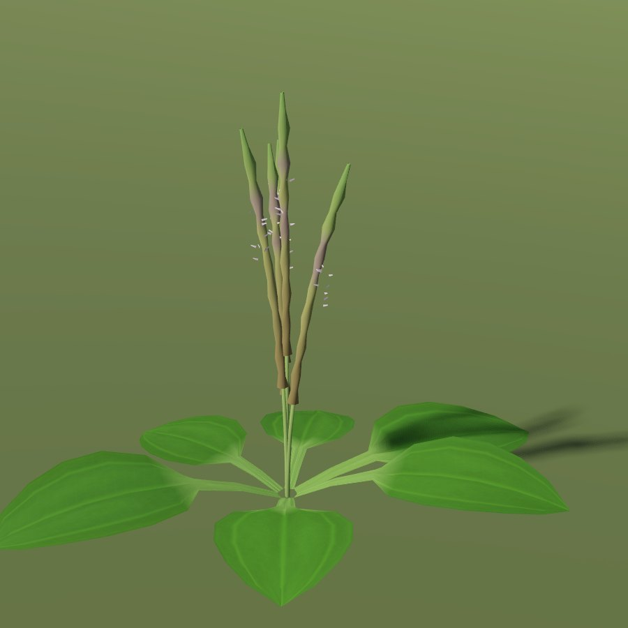
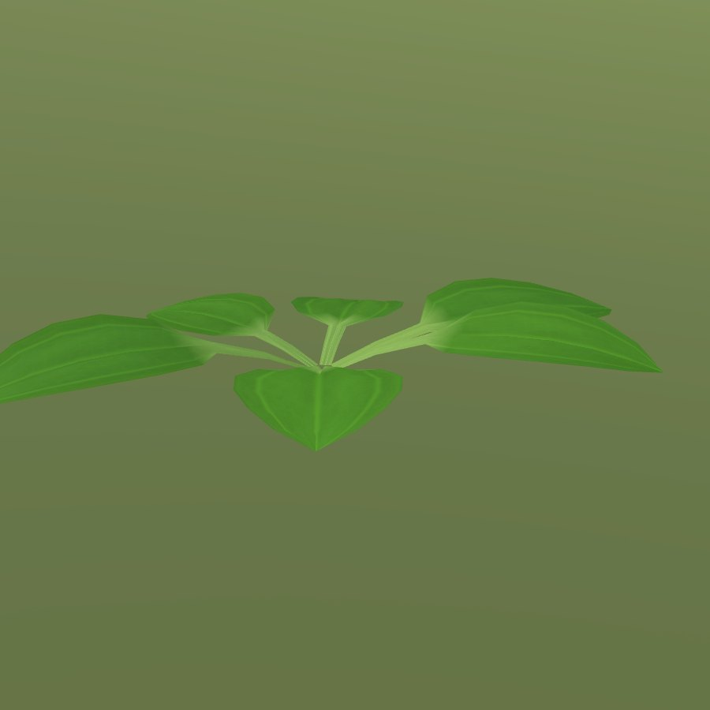

# Broadleaf plantain

| plantain | plantain leaves |
|---|---|
|  |  |

| Field | Value |
|---|---|
| Latin | *Plantago major* |
| Estonian | suur teeleht |
| Runtime ID | city `plantain`, `plantain_leaves`; district `plant.plantain` |
| Habitat group | verges, yards and wall feet |
| Period (1343) | high |
| Model | Detailed city wild-plant model (`CityForbMeshes`), near and far variants; blueprint maps reuse it ([wild plants](../../SYSTEMS/LIVING_VEGETATION.md#wild-plants-forbs)) |

## Where it grows in game

The trampling plant: worn verges and yards, pressed flat.

## Seasons

Spikes June-September.

## Folk use and herbalism (planned)

Leaf laid on cuts and stings - the first herb every child knows. No gathering system exists yet; see [herbalism readiness](../README.md#herbalism-readiness).

## Notes

- Seasons switch the model through `VegetationPhenology.forb_phase`; placement is `CityForbs.suitability`.
