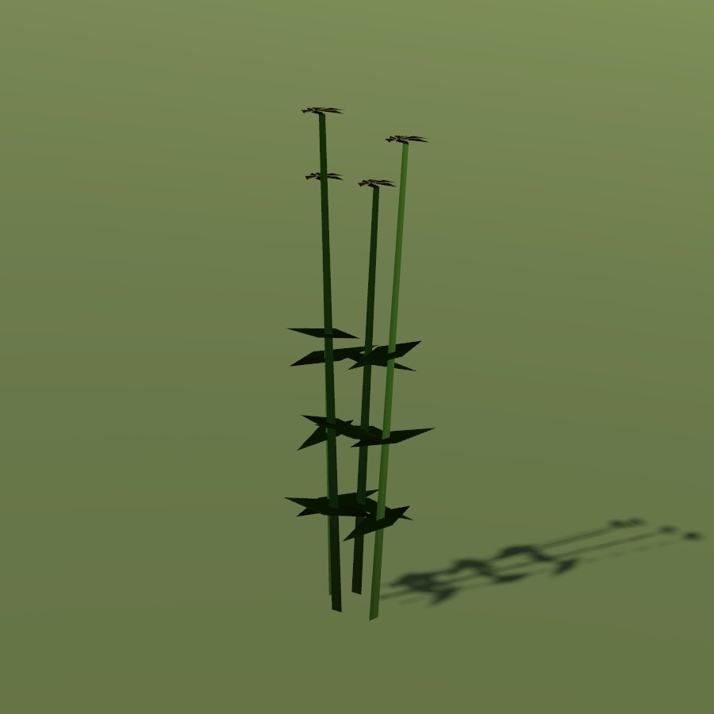

# Creeping thistle

| Field | Value |
|---|---|
| Latin | *Cirsium arvense* |
| Estonian | põldohakas |
| Runtime ID | district `plant.thistle` |
| Habitat group | verges, yards and wall feet |
| Period (1343) | high |
| Model | Primitive district model (`MapViewPlantMeshes`, one of the generic growth archetypes); not in the seamless city |

## Where it grows in game

Fields, pastures, road edges.

## Seasons

Flowers July-August.

## Folk use and herbalism (planned)

Weed; down for tinder. No gathering system exists yet; see [herbalism readiness](../README.md#herbalism-readiness).

## Notes

- **Needs a detailed model.** The district archetype reads as a generic green bunch up close. A detailed `CityForbMeshes` model would also bring it into the seamless city.
