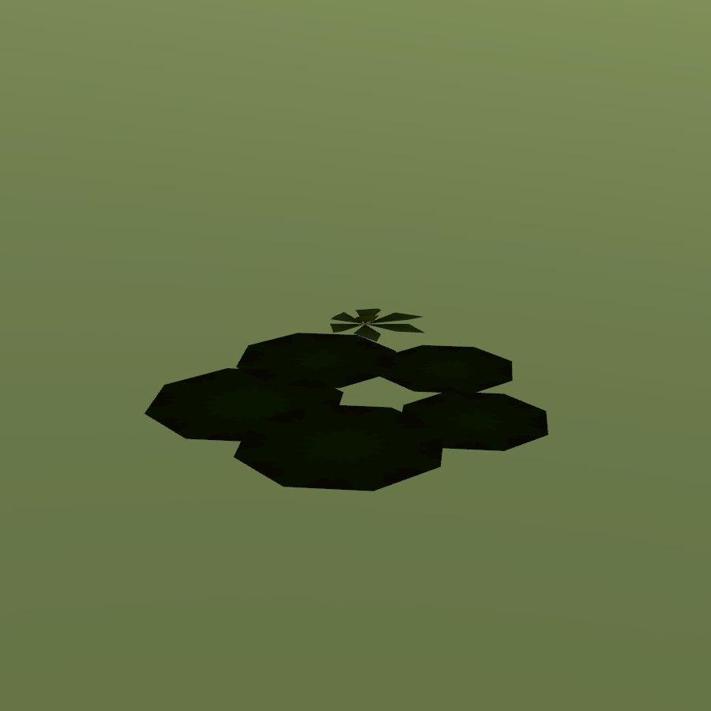

# White water lily

| Field | Value |
|---|---|
| Latin | *Nymphaea alba / N. candida* |
| Estonian | valge vesiroos |
| Runtime ID | district `plant.water_lily` |
| Habitat group | water and wet ground |
| Period (1343) | high |
| Model | Primitive district model (`MapViewPlantMeshes`, one of the generic growth archetypes); not in the seamless city |

## Where it grows in game

Still ponds and slow streams.

## Seasons

Flowers June-August.

## Folk use and herbalism (planned)

Roots in folk medicine; water-spirit folklore. No gathering system exists yet; see [herbalism readiness](../README.md#herbalism-readiness).

## Notes

- **Needs a detailed model.** The district archetype reads as a generic green bunch up close. A detailed `CityForbMeshes` model would also bring it into the seamless city.
