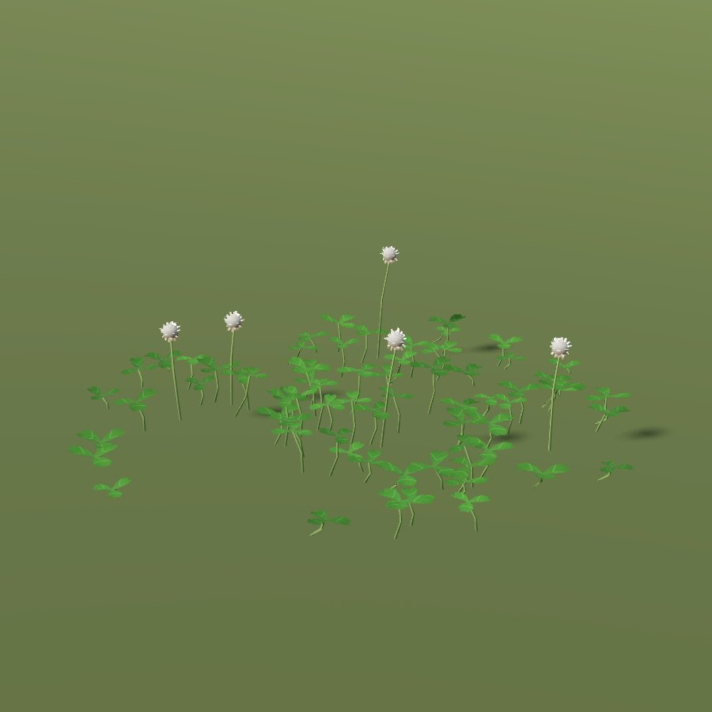
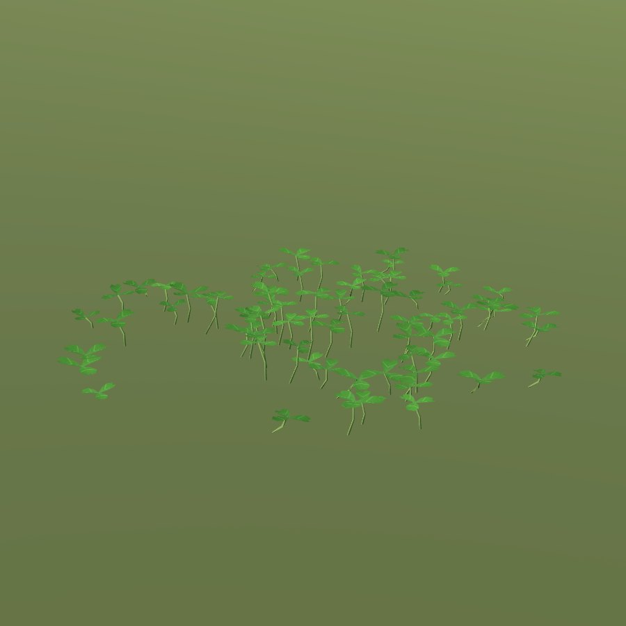

# White clover

| white clover | white clover leaves |
|---|---|
|  |  |

| Field | Value |
|---|---|
| Latin | *Trifolium repens* |
| Estonian | valge ristik |
| Runtime ID | city `white_clover`, `white_clover_leaves`; district `plant.clover` |
| Habitat group | meadow and pasture |
| Period (1343) | high |
| Model | Detailed city wild-plant model (`CityForbMeshes`), near and far variants; blueprint maps reuse it ([wild plants](../../SYSTEMS/LIVING_VEGETATION.md#wild-plants-forbs)) |

## Where it grows in game

Creeping patches in short, grazed or scythed turf.

## Seasons

Flowers June-August.

## Folk use and herbalism (planned)

Fodder; flowers for tea. No gathering system exists yet; see [herbalism readiness](../README.md#herbalism-readiness).

## Notes

- Seasons switch the model through `VegetationPhenology.forb_phase`; placement is `CityForbs.suitability`.
