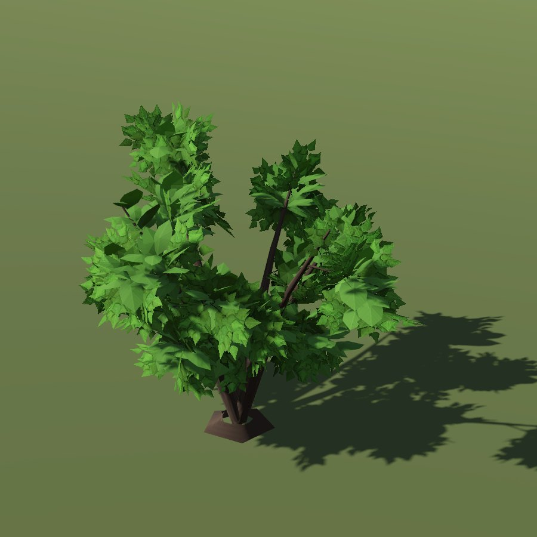

# Hazel shrub

*No shrub model of its own: the city draws it with the hazel tree mesh; the portrait is that tree.*

| Field | Value |
|---|---|
| Latin | *Corylus avellana* |
| Estonian | harilik sarapuu |
| Runtime ID | `bush.hazel_shrub`, city `hazel_shrub` |
| Period (1343) | high |
| Model | City: hazel tree mesh (`CityVegetationBuilder.SHRUB_AS_TREE`) |

## Where it grows in game

See [hazel](../trees/hazel.md).

## Seasons

Nuts in September.

## Folk use and herbalism (planned)

Nuts, rods. No gathering system exists yet; see [herbalism readiness](../README.md#herbalism-readiness).
