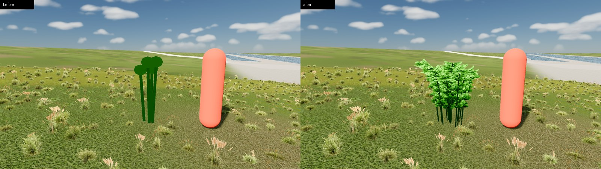

# Raspberry

*City shrub close-up.*

| Field | Value |
|---|---|
| Latin | *Rubus idaeus* |
| Estonian | harilik vaarikas |
| Runtime ID | `bush.raspberry`, city `raspberry` |
| Period (1343) | high |
| Model | City cane model (`MapViewBushMeshes.city_mesh_for`), dated flowers and fruit |

## Where it grows in game

Upright canes with hazel leaves; clearings and yards.

## Seasons

Berries July-August (drawn by date).

## Folk use and herbalism (planned)

Berries; leaves for tea. No gathering system exists yet; see [herbalism readiness](../README.md#herbalism-readiness).
