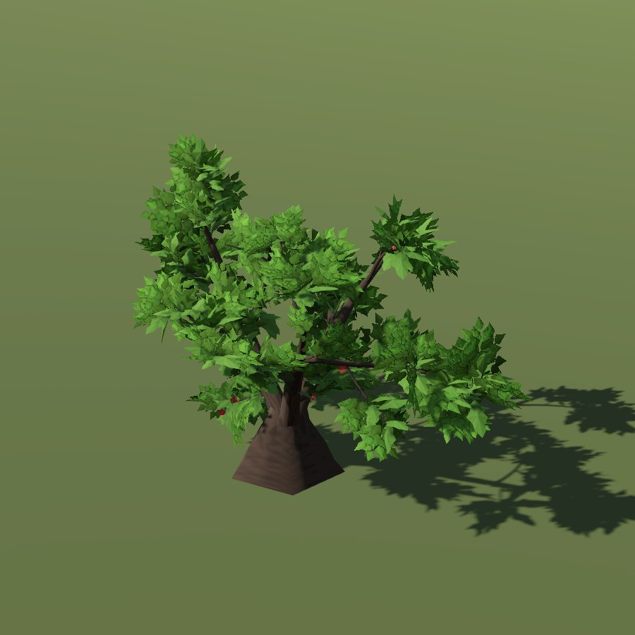

# Spindle

*No shrub model of its own: the city draws it with the hawthorn tree mesh; the portrait is that tree.*

| Field | Value |
|---|---|
| Latin | *Euonymus europaeus* |
| Estonian | harilik kikkapuu |
| Runtime ID | `bush.spindle`, city `spindle` |
| Period (1343) | high |
| Model | City: hawthorn tree mesh (`CityVegetationBuilder.SHRUB_AS_TREE`) |

## Where it grows in game

Hedges and wood edges.

## Seasons

Pink fruit September-October (not drawn).

## Folk use and herbalism (planned)

Poisonous; wood for spindles and skewers. No gathering system exists yet; see [herbalism readiness](../README.md#herbalism-readiness).
