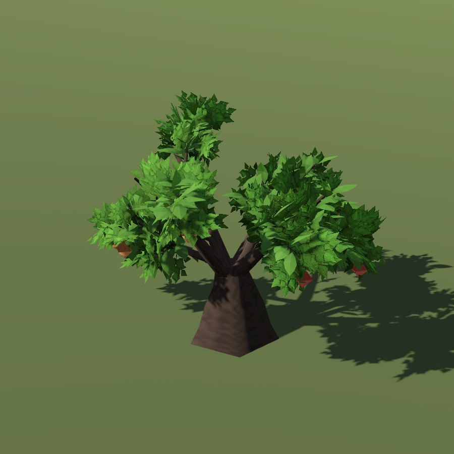

# Apple

| Field | Value |
|---|---|
| Latin | *Malus domestica / M. sylvestris* |
| Estonian | aed-õunapuu / metsõunapuu |
| Runtime ID | `tree.apple` |
| Period (1343) | medium (orchards attested in Livonian towns; varieties unknown) |
| Model | Procedural Weber-Penn skeleton with leaf-cluster cards, built at runtime ([trees](../../SYSTEMS/LIVING_VEGETATION.md#trees)) |

## Look

Low orchard head with a fork at a third of the height.

## Where it grows in game

Monastery and burgher gardens, farmsteads.

## Seasons

Fruit August-October. Phenology: `VegetationPhenology` ([seasons](../../SYSTEMS/LIVING_VEGETATION.md#seasons-and-fruit)).

## Folk use and herbalism (planned)

Fruit, cider, vinegar. No gathering system exists yet; see [herbalism readiness](../README.md#herbalism-readiness).

## Notes

- The portrait is the district (blueprint) model from `tools/capture_flora_cards.gd`. The seamless city draws the same skeleton with metre-scale bark, near and macro crown tiers and whole-tree wind ([detail by distance](../../SYSTEMS/LIVING_VEGETATION.md#detail-by-distance)).
- All 20 species side by side: [tree reference sheet](../../reports/images/fauna/p0_103_tree_reference_sheet.png).
