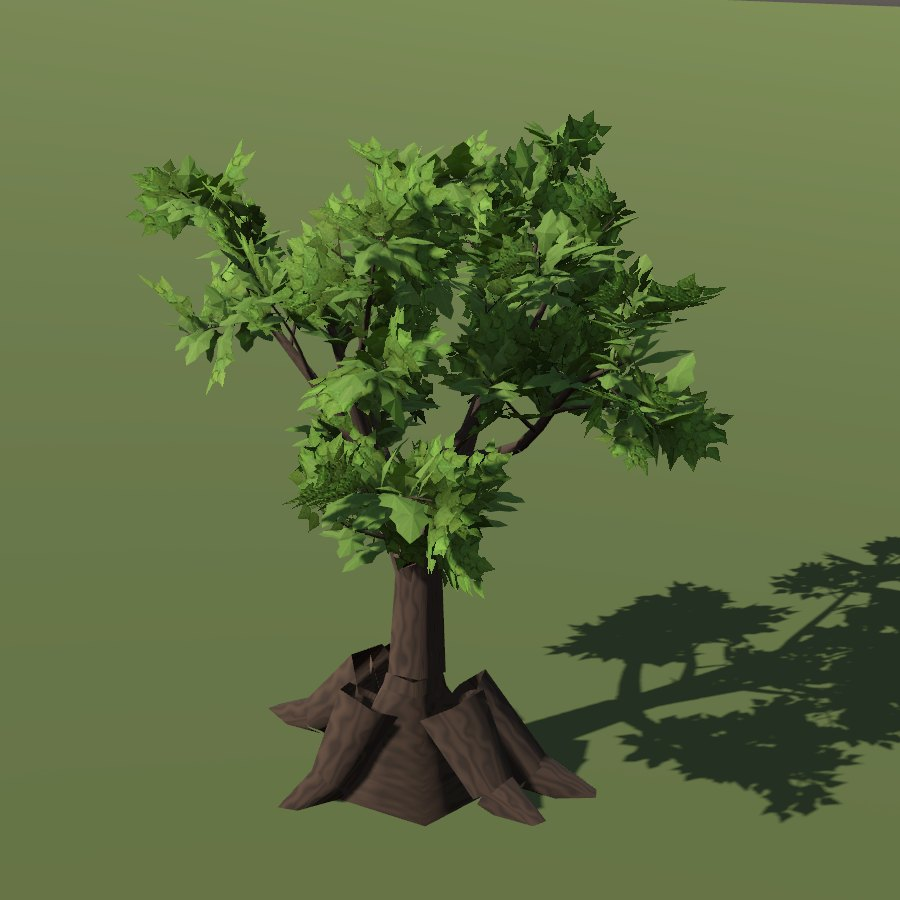

# Oak

| Field | Value |
|---|---|
| Latin | *Quercus robur* |
| Estonian | harilik tamm |
| Runtime ID | `tree.oak` |
| Period (1343) | high |
| Model | Procedural Weber-Penn skeleton with leaf-cluster cards, built at runtime ([trees](../../SYSTEMS/LIVING_VEGETATION.md#trees)) |

## Look

Low crooked fork, broad dome, brown autumn.

## Where it grows in game

Inland loam, sacred groves, pasture woods.

## Seasons

Late leaf, brown autumn, acorns. Phenology: `VegetationPhenology` ([seasons](../../SYSTEMS/LIVING_VEGETATION.md#seasons-and-fruit)).

## Folk use and herbalism (planned)

Bark for tanning and astringent wash; sacred tree (hiis). No gathering system exists yet; see [herbalism readiness](../README.md#herbalism-readiness).

## Notes

- The portrait is the district (blueprint) model from `tools/capture_flora_cards.gd`. The seamless city draws the same skeleton with metre-scale bark, near and macro crown tiers and whole-tree wind ([detail by distance](../../SYSTEMS/LIVING_VEGETATION.md#detail-by-distance)).
- All 20 species side by side: [tree reference sheet](../../reports/images/fauna/p0_103_tree_reference_sheet.png).
