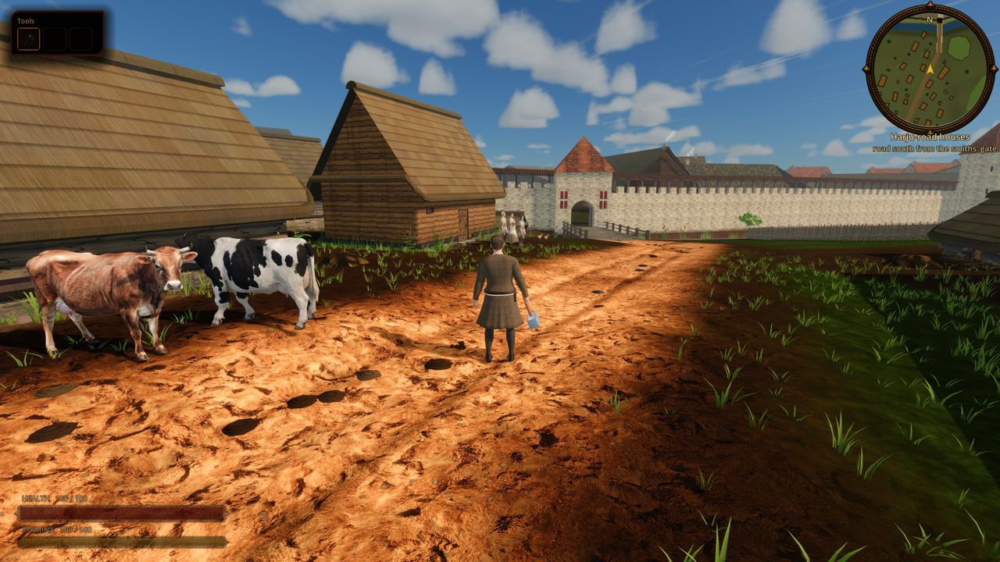
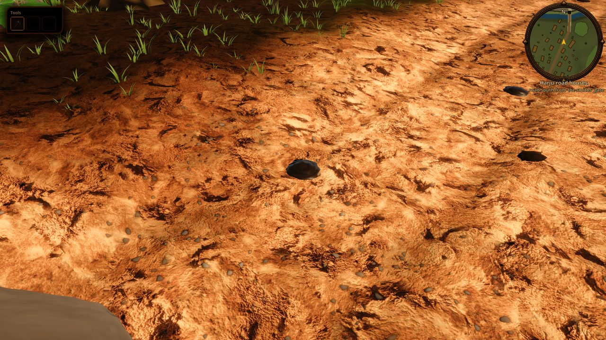
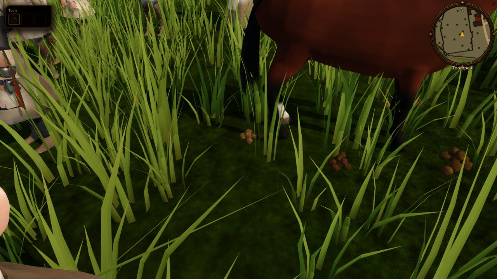
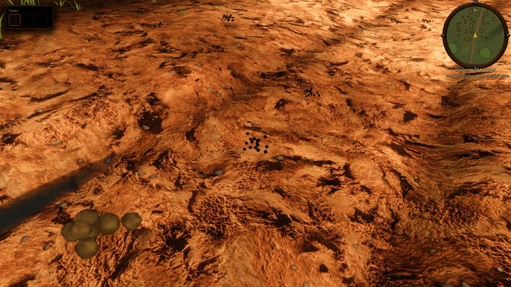

# Animal dung: pats, droppings and manure heaps

Status: implemented (task **R-2077**)

Scope: what the city's stock leaves on the ground in the seamless city and its hinterland. Cow pats, horse dung, sheep and goat pellets, pig piles, hare pellets and fowl droppings lie where those animals live and walk, and a manure heap stands by every byre, sheep shed and sty. This is a visual layer only, with no collision, no smell, no `GameState` and no save data. Out of scope (follow-ups): live drops from animals walking near Kalev, boot smears and squashed pats, flies, citizens cleaning the streets, dung carts.



## What the player sees

- **Drove roads.** Each byre and sheep shed drives its stock daily to the nearest pasture or fallow field. The walk follows the nearest street (extramural road, lane, spine or alley). The town herd goes out the same way from the Karja (cattle) gate. Roads shared by several yards collect the most pats.
- **Pastures, fallow herds and pens.** Dung is spread round each fauna group's home (`CityFauna.groups_for`), denser towards the middle. Grazing herds leave twice as much as penned stock.
- **Horse dung.** Cart horses foul the extramural roads (about one heap per 18 m), the spines inside the walls (one per 45 m) and the square edges. Tethered horses at the forum, smithy, brewery, castle and gates leave heaps round the tether.
- **Ageing.** Each drop has a fixed age. A fresh cow pat is dark olive-brown and glossy (wet material for the first day). By about 18 days it has dried to a pale, flat, slumped crust, and it is gone after about 40 days. Dung on a road lasts about 6 days before hooves and wheels break it up.
- **Seasons.** Grazing stock is housed from about 13 November to 18 April (`CityFauna.stock_housed`). While it is housed, no grazing dung shows. After turn-out, only dung younger than the days out lies on the ground. On the 21 April opening there are only a few fresh pats, and by July pats of every age are out. Horses, town yard goats and fowl stay out all year. Settled snow deeper than 2 cm buries every drop older than 1.5 days, and fresh ones lie on top of the snow.
- **Manure heaps.** Byre dung piles up all winter and is carted to the fallow in June, so the heap is largest in spring, small by early July and growing again through autumn (`CityDung.HEAP_FILL`).
- **No rabbits.** Rabbits were not kept or wild in 1343 Estonia, so the small round pellets belong to hares on the field margins.

| Cow pats on the road, close | Horse dung by a tether | Sheep pellets on a drove road |
|---|---|---|
|  |  |  |

## How it is built

- `CityDung` (`scripts/city/city_dung.gd`) is mounted by `scenes/world/reval_city/reval_city.gd` next to `CityFauna` (feature `fauna`) at `world/CityDung`. It needs the fauna groups, and `CityFauna` depends on the game autoloads, so world-only `SceneTree` tools that build `CityWorld3D` do not get dung.
- `CityDung.drops_for(plan)` is pure and deterministic. Every drop is `{kind, at, u, life, yaw, size, grazing, tint}`, seeded by the group, yard, street or gate id. Sources are `_home_drops` (fauna groups), `_heaps`, `_droves` (`drove_route`: yard to the nearest street within 45 m, along its polyline to the point nearest the grazing, then straight out), and `_horse_roads`. Spots must pass `CityFauna._is_dry`: dry ground, off foundations, out of the moat and off landmark sites.
- `set_calendar_date(date)` is called from `CityMapView.set_calendar_date`. It filters drops by housing, days out (`CityDung.days_out`) and snow (`CitySnow.depth_at`), then rebuilds the MultiMesh batches. Batches are keyed by kind, wet or dry, and a 96 m chunk, and each has a visibility range (heap 140 m, pats 75 m, pellets 30-35 m). Only heaps cast shadows.
- Meshes are procedural (`SurfaceTool`): a coiled lathe pat, heaped straw balls, pellet scatters, lumpy pig piles, white-capped fowl droppings and a straw-flecked heap mound. They use no asset files, so the asset freeze does not apply. Vertex colours hold the dried palette, and the instance colour darkens fresh drops (geese tint green). Albedos are kept low on purpose because the outdoor exposure gain (R-1748) brightens them.
- Kinds, species map, lifetimes, densities and spacings are the constants at the top of the script (`SPEC`, `DROVE_STOCK`, `DROVE_SPACING`, `HORSE_SPACING`).

## Historical basis

- The Karja gate's name (Estonian *karja*, of the herd) comes from the town herd being driven out to common pasture. Daily driving of village and suburban stock between byre and common pasture or fallow is the general pattern in the [Harju village dossier](../../history/dossiers/hinterland/harju-village-and-manor.md). The exact routes are generated, so they are a `plausible composite`.
- The June carting of byre manure to the fallow follows the Estonian peasant year (manure hauling before the fallow is ploughed for winter rye). The heap curve is a stylised calendar, not a recorded date.
- Rabbits came to the eastern Baltic much later. The brown hare is native.

## Verify

```
godot --headless --path . --script tools/run_godot_tests.gd -- --filter=test_city_dung
tools/godot_render.sh --resolution 1600x900 res://tools/capture_city_dung.tscn [-- --date=7-15]
```

`tests/godot/test_city_dung.gd` checks determinism, every kind placed, nothing in buildings or the moat, the drove route following road vertices, housing and turn-out (no cow pats in January, a few fresh ones on 21 April, many by July), pats drying flat and the wet stage, the heap calendar, and `days_out`. The capture places Kalev at the densest pats on a drove street, a heap, horse dung and sheep pellets, and writes the game-camera and close shots to `build/season/dung_<m>_<d>_<stop>[_near].png`.

## Limits

- Dung is static per date: an animal walking past does not drop anything new, and a pat stays where it is when stepped on.
- A drove follows one street. It does not route across the street graph, so some yards walk straight across open ground to their grazing.
- Heaps can land in a kitchen-garden corner or under a bush, because they avoid buildings and the moat but not garden beds.
- Rain does not darken or soften dried dung.
