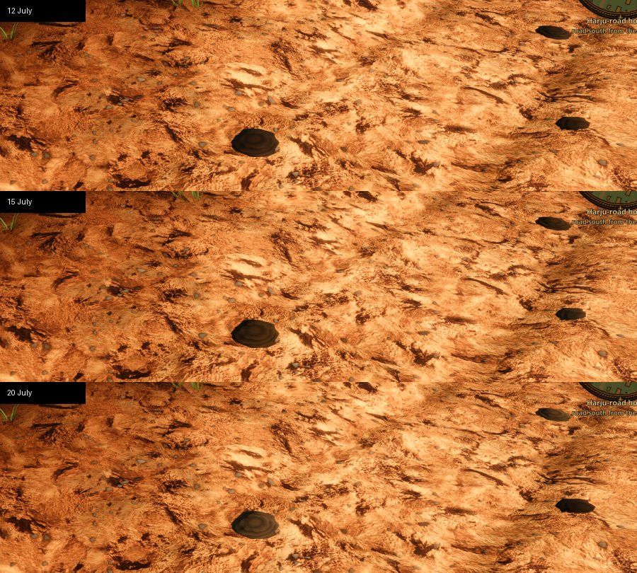
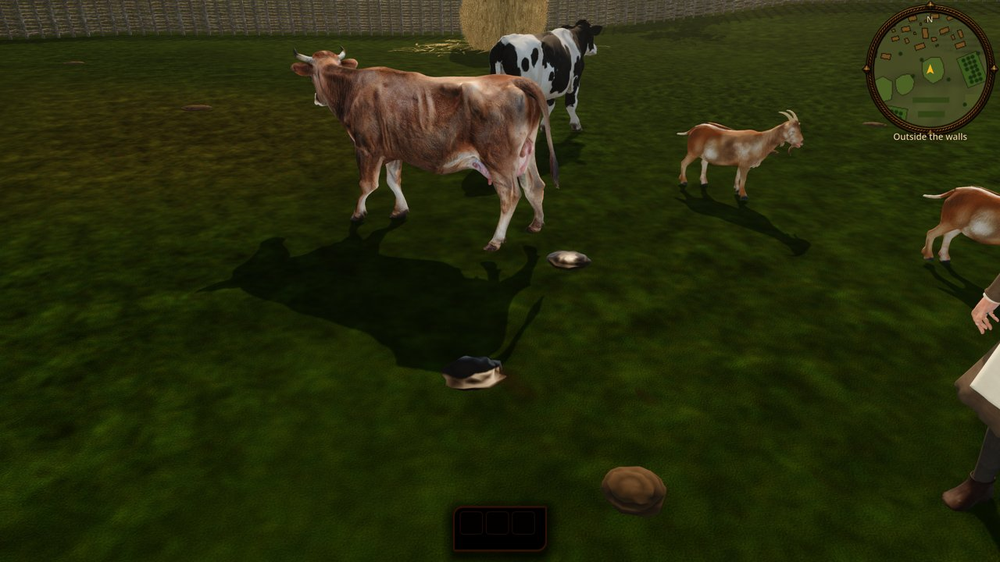

# Animal dung: pats, droppings and manure heaps

Status: implemented (task **R-2077**, drove graph, heap clearance and rain follow-up; live drops and squashed pats **R-2175**)

Scope: what the city's stock leaves on the ground in the seamless city and its hinterland. Cow pats, horse dung, sheep and goat pellets, pig piles, hare pellets and fowl droppings lie where those animals live and walk, and a manure heap stands by every byre, sheep shed and sty. This is a visual layer only, with no collision, no smell, no `GameState` and no save data. Out of scope (follow-ups): flies, citizens cleaning the streets, dung carts.


## What the player sees

- **Drove roads.** Each byre and sheep shed drives its stock daily to a pasture or fallow field. The herd steps onto the nearest street (extramural road, lane, spine or alley) and follows the street network, turning at junctions, to the street point nearest its grazing. A herd walks straight across open ground only when its grazing lies beside the yard, never through a sown field or a house if the streets offer a way round. The town herd goes out the same way from the Karja (cattle) gate. Roads shared by several yards collect the most pats.
- **Pastures, fallow herds and pens.** Dung is spread round each fauna group's home (`CityFauna.groups_for`), denser towards the middle. Grazing herds leave twice as much as penned stock.
- **Horse dung.** Cart horses foul the extramural roads (about one heap per 18 m), the spines inside the walls (one per 45 m) and the square edges. Tethered horses at the forum, smithy, brewery, castle and gates leave heaps round the tether.
- **Ageing.** Each drop has a fixed birth phase, and its age runs with the calendar (`CityDung.age_on`, `day_number`): the same pat on the same spot gets older every game day, and when its life runs out a fresh one falls there. A fresh cow pat is dark olive-brown and glossy (wet material for the first day), keeps a damp sheen until about a third of its drying time, then dulls to a crust (`stage_for`). In summer it has dried to a pale, flat, slumped crust in about 12 days, and it is gone after about 40 days. Drying is slower in cool months (`DRY_SLOWDOWN`: x1.3 in May and September, x1.8 in April and October, x2.5-3 in winter). Dung on a road lasts about 12 days before hooves and wheels break it up.


- **Seasons.** Grazing stock is housed from about 13 November to 18 April (`CityFauna.stock_housed`). While it is housed, no grazing dung shows. After turn-out, only dung younger than the days out lies on the ground. On the 21 April opening there are only a few fresh pats, and by July pats of every age are out. Horses, town yard goats and fowl stay out all year. Settled snow deeper than 2 cm buries every drop older than 1.5 days, and fresh ones lie on top of the snow.
- **Manure heaps.** Byre dung piles up all winter and is carted to the fallow in June, so the heap is largest in spring, small by early July and growing again through autumn (`CityDung.HEAP_FILL`). A heap stands on open yard ground, never in a kitchen-garden bed or under a tree or bush.
- **Rain.** Rain and puddles darken dried dung and give it back a soft sheen; fresh wet dung looks the same in any weather. It dries back as the ground does.
- **No rabbits.** Rabbits were not kept or wild in 1343 Estonia, so the small round pellets belong to hares on the field margins.

| Cow pats on the road, close | Horse dung by a tether | Sheep pellets on a drove road |
|---|---|---|
|  |  |  |

- **Live drops (R-2175).** Animals walking within 30 m of Kalev drop a fresh dropping of their kind (`CityDung.SPECIES_KIND`) about every 60 m a cow walks (horse 45 m, sheep and goats 30 m, pigs 45 m, hares 80 m, fowl 25 m), a body length behind them. The newest 64 stay on the ground in a ring buffer; they are always fresh and wet and are not saved.
- **Stepping in it (R-2175).** When Kalev's foot or a walking citizen's foot lands on a dropping (static or live, not a heap), it is trodden flat to about a third of its height and spread out along the step, and the boot drags a brown smear forward off it: dark and wet from a fresh or damp pat, paler from a dry crust. The boot then leaves two fainter brown prints on its next steps. Paved ground squashes too; only soft ground takes the footprint itself.

| A fresh pat behind the cow, a trodden pat with its smear (grass hidden for this close-up) |
|---|
|  |

## How it is built

- `CityDung` (`scripts/city/city_dung.gd`) is mounted by `scenes/world/reval_city/reval_city.gd` next to `CityFauna` (feature `fauna`) at `world/CityDung`. It needs the fauna groups, and `CityFauna` depends on the game autoloads, so world-only `SceneTree` tools that build `CityWorld3D` do not get dung.
- `CityDung.drops_for(plan)` is pure and deterministic. Every drop is `{kind, at, u, life, yaw, size, grazing, tint}`, seeded by the group, yard, street or gate id. Sources are `_home_drops` (fauna groups), `_heaps`, `_droves` and `_horse_roads`. `_droves` uses `drove_plan`: the drove streets form a graph (`_street_graph`, cached per plan; vertices within `DROVE_SNAP` 3 m merge into junctions and a street end that butts against another street's segment splits it). From the street point nearest the yard (within 45 m) a Dijkstra search gives road distances. Each pasture or fallow field within 520 m is then scored by the cheapest exit point: road metres cost 1, open ground to the grazing's edge `DROVE_OFFROAD` (3), metres through a sown field `+DROVE_CROP` (12) and through a building `+DROVE_BUILDING` (40). The straight walk is scored the same way, and the cheapest plan wins. `drove_route`/`drove_path` route to one given target. `_heaps` tries two rings round the shed and rejects spots within 1.3 m of a kitchen-garden bed (`CityFarmland.features_for`, kind `kitchen_garden`) or 1.5 m of a plan tree or bush (`heap_clear`). Spots must pass `CityFauna._is_dry`: dry ground, off foundations, out of the moat and off landmark sites.
- `set_calendar_date(date)` is called from `CityMapView.set_calendar_date`. It filters drops by housing, days out (`CityDung.days_out`) and snow (`CitySnow.depth_at`), then rebuilds the MultiMesh batches. Batches are keyed by kind, drying stage (wet, damp, crust) and a 96 m chunk, and each has a visibility range (heap 140 m, pats 75 m, pellets 30-35 m). Only heaps cast shadows.
- `CityDung.set_wetness(value)` is static: `CityWorld3D` passes the ground-trail wetness (rain and puddles) every weather update. It lerps the damp and crust materials' albedo towards `RAIN_DARKEN` and their roughness towards `RAIN_ROUGHNESS`, so all batches change at once with no rebuild.
- Meshes are procedural (`SurfaceTool`): a coiled lathe pat, heaped straw balls, pellet scatters, lumpy pig piles, white-capped fowl droppings and a straw-flecked heap mound. They use no asset files, so the asset freeze does not apply. Vertex colours hold the dried palette, and the instance colour darkens fresh drops (geese tint green). Albedos are kept low on purpose because the outdoor exposure gain (R-1748) brightens them.
- `CityDungLive` (`scripts/city/city_dung_live.gd`, R-2175) is mounted by `reval_city.gd` next to `CityDung` at `world/CityDungLive` and holds everything trodden or freshly dropped. `CityTrailFeed.feed(..., dung_live, kalev_xz)` calls `track_animal` for each live animal from `CityFauna.live_animals()`: walked distance per animal key, a seeded interval per animal (`LIVE_SPACING` x 0.6-1.4), then `drop()`; animals unfed for a frame are forgotten (`end_frame`). `CityGroundTrail` emits `footfall(key, foot_xz, facing)` for every footfall of Kalev (`KALEV_KEY`) and of each citizen fed through `track_walker`, before its soft-ground check; `step_on` is connected to it. A trodden static pat is found through a one-metre cell index over `CityDung.placements()` (placements follow the batch nodes in child order, so no hook in `CityDung` is needed); its static instance is collapsed and a squashed copy joins the live ring. Squashed drops use `squashed_mesh(kind)`, a flattened copy of the dung mesh with rebuilt normals. Smears are one transparent MultiMesh ring of 32 (`smear_mesh`, vertex alpha fading to the edges). The static per-date layer is unchanged and stays deterministic; its squashes reset when `set_calendar_date` rebuilds it.
- Kinds, species map, lifetimes, densities and spacings are the constants at the top of the script (`SPEC`, `DROVE_STOCK`, `DROVE_SPACING`, `HORSE_SPACING`).

## Historical basis

- The Karja gate's name (Estonian *karja*, of the herd) comes from the town herd being driven out to common pasture. Daily driving of village and suburban stock between byre and common pasture or fallow is the general pattern in the [Harju village dossier](../../history/dossiers/hinterland/harju-village-and-manor.md). The exact routes are generated, so they are a `plausible composite`.
- The June carting of byre manure to the fallow follows the Estonian peasant year (manure hauling before the fallow is ploughed for winter rye). The heap curve is a stylised calendar, not a recorded date.
- Rabbits came to the eastern Baltic much later. The brown hare is native.

## Verify

```
godot --headless --path . --script tools/run_godot_tests.gd -- --filter=test_city_dung
tools/godot_render.sh --resolution 1600x900 res://tools/capture_city_dung.tscn [-- --date=7-15]
```

`tests/godot/test_city_dung.gd` checks determinism, every kind placed, nothing in buildings or the moat, the drove route staying on drove streets, droves through the street graph (several yards on streets, some over 2+ streets, every drove ending at its grazing, straight walks keeping off sown fields and houses, the town herd on the road), heaps clear of gardens, trees and bushes, rain darkening and softening crusts, housing and turn-out (no cow pats in January, a few fresh ones on 21 April, many by July), pats drying flat and the wet stage, the same pat ageing, slumping and losing its gloss from day to day (also across New Year), the heap calendar, and `days_out`. For R-2175 it checks that a cow walking 600 m drops a handful of cow pats on its walk, nothing falls far from Kalev, the ring keeps the newest 64; that a foot on a pat squashes it (static instance hidden, a flattened copy under 40% of the height in the ring, where it lay), leaves a smear and two fading prints, squashes a live drop too, and that the next date rebuild lays the pat whole again; and that the trail announces Kalev's and a citizen's footfalls. The capture places Kalev at the densest pats on a drove street, a heap, horse dung and sheep pellets, and writes the game-camera and close shots to `build/season/dung_<m>_<d>_<stop>[_near].png`. The last stop, `live`, pins a penned cow, lays a fresh pat behind it through `CityDungLive.drop` and walks Kalev over a second pat beside it until his footfall squashes it; its close-up hides the grass so the drops can be judged.

## Limits

- Static dung is fixed per date. Live drops and squashes are cosmetic and not saved: they are gone after a reload, a trodden static pat stands whole again after the next date change, and a trodden pat leaves the ground once 64 newer live drops or squashes have recycled its ring slot.
- Live drops do not age or dry: they stay fresh and wet until recycled, and they follow walking only (an animal grazing in place drops nothing live).
- Only feet tracked by the ground trail squash dung (Kalev and walking citizens within its range); hooves, wheels and the citizens' own routes ignore it, and nobody steps round a pat.
- The smear is a flat card 1.5 cm above the ground: over a deep footprint dent it can float a little. In July pasture grass both drops and smears are mostly hidden by the grass.
- Many hinterland yards have no drove street within reach of their grazing, so they still walk straight to a pasture beside the yard. The walk from the yard to its first street is a straight line and can clip a house corner.
- Rain changes only the look of dung: wet pats do not wash away faster or dry slower after rain.
- Drying speed follows the month of the shown date, not the weather of each day since the drop fell; a pat that crumbles falls fresh again on the same spot.
