# Citizen wardrobe: dress that shows rank, age, trade and arms

Status: implemented (tasks **R-1663**, **R-1667**, epic **R-1662**; prestige and wear variants **R-2004**; surcoats and the Order mantle **R-2022**; bags **R-2034**). Scope: the census residents of the seamless city ([`CITIZENS.md`](./CITIZENS.md)) wear layers over their baked base outfit, chosen from what the census knows about them: head coverings, aprons, the armour kits of the watch, crown men, knights and Order brothers (coat of plates, aventail, great helm, chausses, gauntlets, white mantle with the black cross, shields), keys, prayer beads, scrips and sacks, each dyed by wealth and office; every piece of cloth is drawn in a grade that matches the wearer's wealth (homespun to scarlet) and dirtied by their trade (see [Cloth grades and wear](#cloth-grades-and-wear)). Out of scope (planned, see [Roadmap](#roadmap)): civilian mantles and cloaks, new gowns, footwear, more child bodies, hand-carried props, hair and tonsure, and a crowd variety gate. Named NPCs keep their own models ([`NAMED_NPCS.md`](./NAMED_NPCS.md)).

## Historical basis

Rules follow the research dossier [`clothing-and-status-markers.md`](../../history/dossiers/dailylife/clothing-and-status-markers.md) (confidence `plausible composite`: no Reval wardrobe inventory survives for 1343; cuts come from Herjolfsnes and Bocksten finds and German manuscripts) and [`watch-duty-and-town-defence.md`](../../history/dossiers/military/watch-duty-and-town-defence.md):

| Who | What the city shows | Dossier line |
|---|---|---|
| Patricians, merchants | long tunic or gown in strong dyes; hood in madder, woad or walnut; wives veiled in white linen with keys at the belt; some prayer beads (amber or coral) | burgher / councillor, burgher wife |
| Masters, journeymen | knee tunic; hood, linen coif or wool cap; trade apron | middling master |
| Labourers, servants, Estonian townsfolk | short tunic in undyed or cheap dyes; coif or wool cap (more caps among Estonians); porters with a sack | labourer, Estonian townsman |
| Smiths, armourers, cutlers, tanners, cobblers, masons, coopers | leather apron (*Schurz*) | master craftsman (Kalev) |
| Bakers, butchers, brewers, cooks, alewives, fishmongers, dyers, washerwomen | linen waist apron (bakers and cooks white, dyers stained blue) | alewife, servant girl |
| Clerks, scribes, scholars, pilgrims, pedlars, healers, midwives | scrip on a shoulder strap: tooled leather for burghers, rawhide or linen for the poor, a pilgrim's plain leather with a pewter scallop ([Bags](#bags-r-2034)) | - |
| Married women | headscarf always; burgher wives add a linen veil, rich wives wear a barbette under it; Estonian wives the long head cloth; widows and elders of means a wimple; maidens bare with braids | burgher wife, market woman |
| Nuns, lay sisters | black veil over the white wimple, beads | Cistercian nun |
| Monks, lay brothers | white wool habit (the base body's cloth, `DOMINICAN_WHITE` for friars) under the black hood with its shoulder cape (the cappa's capuce), beads. The Order of Preachers wears white tunic, scapular and capuce under a black cappa; census friars do not yet have the scapular or the black cappa (follow-up: fit `scapular` and `cappa` as citizen layers; built for the named infirmarian, see [`CHARACTER_GENERATION.md`](../CHARACTER_GENERATION.md)) | Dominican friar |
| Town watch on duty | quilted aketon over the street tunic, kettle hat, spear | watch overlay ("does not replace the undertunic") |
| Crown men-at-arms on duty | aketon, mail haubergeon, red surcoat (Danish crown colours, no invented heraldry), kettle hat | vassal knight / Danish retainer |
| Sergeants | aketon, mail, mail coif, kettle hat, sword | - |
| Vassal knights (noble knights off the roster) | two thirds armed: aketon, mail, then a coat of plates under a cloth cover in crown red or a rich dye (55%) or a surcoat; head: bascinet with aventail (60%), mail coif under a flat-topped great helm (20%, ceremony and the lists) or bare mail coif; mail chausses (70%), gauntlets (60%); a heater shield | vassal knight |
| Order brothers (`livonian_order` knights) | aketon, mail, chausses, gauntlets, white surcoat, the white mantle with a black cross (left breast, large on the back), bascinet with aventail or mail coif; white shield with the black cross | Order knight: "mail hauberk, surcoat with black cross, heater shield" ([arms and armour](../../history/dossiers/military/arms-and-armour-livonia-1340s.md)) |
| Squires | half armed: aketon, half with mail, some with a kettle hat; no plate | - |
| Men-at-arms off duty | 40% armed: aketon; crown and Order men add mail under their lord's colour (surcoat) and sometimes chausses; some a kettle hat; half carry a shield (crown red or plain wood) | Danish retainer |

Never mixed (the dossier's table, enforced by tests): no armour on burghers, masters or labourers; the knightly harness (`KNIGHT_ONLY`: coat of plates, great helm, aventail, bascinet, gauntlets, Order mantle) only on a knight of noble status, never on squires or men-at-arms; no veil on servants and poor women; no keys on poor women; one shoulder strap at a time; one head covering, except the armour stack (mail coif under a bascinet or kettle hat).

## How the reference games do it, and what we take

- **Kingdom Come: Deliverance 1 and 2:** a body wears up to 16 armour slots in four torso layers (gambeson, mail, plate, surcoat) plus coif, mail coif and helmet on the head; NPCs are dressed from the same item pool by social class, and items carry dirt and blood. We take the slot-and-layer model, the order of the armour stack (aketon -> mail -> surcoat, coif -> mail coif -> helmet), and dirt that tells the trade: mud splashed up from the hem, soot, flour and blood where the work is held (**R-1667**).
- **The Witcher 3:** crowd NPCs are composed from per-community appearance templates (body, torso, legs, shoes, head, hair, accessory) with colour variants; a small template set shows its limits when one dress colour repeats across a square. We take composition by community (here: status, trade, faction) and colour variants per item, and avoid the repetition trap by hashing every pick from the resident id and measuring repetition (**R-1672**).
- **Both:** close-up quality comes from per-item PBR cloth with a tiling detail normal, and from silhouettes that differ by class (hem length, headwear, carried things). R-1663 delivers silhouettes; R-1667 the cloth grades and wear.

## How it works

1. **Layers fitted per body (build time).** `tools/assets/realistic_humans/citizen_bodies.py` lists `LAYERS` per sex and life stage. `build_human.py` builds them on the same MPFB body as the baked base outfit, so a hood fits a thin elder and a heavy merchant alike, then exports each one apart as a skinned, decimated GLB: `assets/characters/realistic/<body>/layers/<layer>.glb` (budgets in `LAYER_TRIANGLES`, 400 to 2,600 triangles). Torso layers get `layer_ease` (0.022 m) so they clear the baked tunic, its blousing and the belt.
2. **New garment builders** in `garments.py`: `coif`, `wool_cap`, `veil_over` (veil over the baked headscarf), `mail_coif`, `bascinet` (pointed, open-faced), `coat_of_plates` (sleeveless cloth cover with rivet heads, registered so the surcoat and mantle clear it), `aventail` (mail tippet hung from the bascinet), `great_helm` (flat-topped with eye slit and sight bar), `mail_chausses`, `gauntlets` (hand shells with flared cuffs over the sleeve ends), `order_mantle` (white wool cloak open at the front; the black cross is a separate undyed patch of fine quads projected onto the cloth, so only the white takes `wear_dye`), `keys`, `paternoster`, `satchel`, `back_sack`; existing `hood`, `smith_apron`, `waist_apron`, `gambeson`, `mail_haubergeon`, `surcoat` and `kettle_hat` are reused. Accessories hang from the outside of the belt (`belt_anchor`); straps are laid over the worn body (`_strap_path`).
3. **Rules (data build).** `tools/city/citizen_wardrobe.py` `dress(person, available)` returns `(wear, wear_dye)`; `tools/city/build_citizen_runtime.py` stores them on every resident in `content/world/reval_city/citizens.json` after the duty roster ([`GATE_GARRISONS.md`](./GATE_GARRISONS.md)) is assigned. Every roll is `crc32(id + tag)`, so a resident always wears the same things.
4. **Runtime.** `CitizenGear.arm` (`scripts/city/citizen_gear.gd`) calls `CitizenWardrobe.dress` (`scripts/city/citizen_wardrobe.gd`) when a resident's rig is styled: each layer is mounted with `SharedCharacterRig.equip_garment(&"wear_<layer>")` and its own cloth (material `<body>_<layer>`) dyed with `wear_dye`. Duty kits wear the fitted kettle hat; the watchman's shared hat is only a fallback for a body without one.

5. **Cloth grade and wear (R-1667).** At the end of `dress`, `CitizenWardrobe.weave` replaces every cloth surface (base body and layers; wool, linen, leather and quilted, read off the material's `textiles/<family>_albedo*.png`) with a shared `ShaderMaterial` of `scripts/city/citizen_cloth.gdshader`, one per (garment material, grade). The resident's dyes and wear go into instance uniforms on the mesh, so residents share materials and textures (see below).

6. **Variants (R-2004).** After `dress`, `citizen_wardrobe.variants` tags every worn layer with a prestige and wear cell, `"<layer>@p<1-3>_w<0-2>"`, and gives armed residents a `gear_variant` cell for the spear, sword or shield; duty-kit layers share one cell per post. Rules, fallback and the stand-in finish: [`EQUIPMENT_VARIANTS.md`](./EQUIPMENT_VARIANTS.md#runtime-variant-choice-r-2004). At runtime `CitizenWardrobe.dress` mounts the cell's own fitted layer when a body has one, else the base layer, and `weave` scales the layer's cloth wear by the cell (`CELL_WEAR`) and wears its iron.

Today 3,941 residents wear about 3,440 layers; body plus layers gives about 330 distinct silhouettes (22 before), before dyes.

## Cloth grades and wear

Grades follow the dossier's cloth ladder (undyed homespun for the poor, fulled broadcloth for masters and burghers, scarlet, the costliest sheared cloth, for patricians and nobles; tow linen against bleached linen). Each grade is a tileable 512 px set (`albedo`, `normal`, `orm`) built by `tools/assets/realistic_humans/textiles.py --grades` into `assets/characters/realistic/textiles/<grade>_*_512.png`:

| Grade | Cloth | Tile | Who (status -> wealth in `CitizenWardrobe.WEALTH`) |
|---|---|---|---|
| `homespun` | hand-spun tabby, lumpy yarn, pills, fleece flecks, blotchy fulling | 12 cm | wool of the poor: labourers, servants, free commoners, apprentices, dependents, soldiers |
| `broadcloth` | fulled and napped twill, weave hidden | 8 cm | wool of journeymen, masters, clerks, clerics; under-wool of the rich |
| `scarlet` | sheared nap, soft sheen | 6 cm | outer wool (tunic, gown, dyed layer) of patricians, nobles, merchants |
| `linen_coarse` / `linen_fine` | tow linen with shives / bleached fine tabby | 9 / 5 cm | shirts, braies, coifs, veils, aprons: poor / everyone else |
| `linen_coarse_w1` / `linen_coarse_w2` | the tow yellowed / sweat-stained (albedo only, weave of `linen_coarse`, R-2024) | 9 cm | the linen of the poor ([Linen that shows](#linen-that-shows-r-2024)) |
| `leather`, `quilted` | the existing family sets | 22 / 20 cm | as made |
| `leather_tooled` / `rawhide` | vegetable-tanned leather with a blind-tooled lattice and ring stamps / scraped, dried untanned hide, waxy and mottled (`tools/assets/realistic_humans/bag_textiles.py`, R-2034) | 11 / 20 cm | scrips: burghers' pouches / the poor's pouches and straps ([Bags](#bags-r-2034)) |
| `fur` | pelt strands in clumps | 12 cm | built for fur trim and linings; no crowd garment uses fur yet (**R-1665**) |

Wear is drawn by the same shader from one shared RGBA mask (`wear_mask_512.png`: R mud spatter, G soot smudge, B flour dust, A stain blotches, 60 cm tile) and the skinned model-space position (height above the feet, front of the body):

| Mark | Where | Who (`CitizenWardrobe.TRADE_WEAR`, `WEALTH_WEAR`) |
|---|---|---|
| Mud | splashed up from the hem, thickest at the ground | everyone a little (poor 0.45, middling 0.22, rich 0.06); labourers, porters, carters, drovers, farmers, stable hands, brickmakers 0.7-0.9 |
| Soot | greys the upper body, blackest in front | smiths and nailsmiths 0.9, armourers, cutlers; brewers, tallow chandlers a little |
| Flour (and lime, stone, saw dust) | front and sleeves, waist to chest | bakers 0.9, limeburners, masons, cooks, carpenters |
| Stains | front of the belly | butchers 0.9, tanners, fishmongers, barbers, midwives, healers, cooks |
| Patches | 16 cm pieces of other cloth with a dark seam | poor 0.7, middling 0.15, rich none |
| Fading | dye greyed and paled | poor 0.5, middling 0.18, rich none |

The larger of the wealth and trade value wins, scaled by a roll of `hash(id)` (0.75-1.15) so two smiths differ; the same hash shifts the mask, so no two residents carry the same splashes. All values are a pure function of the record.

Instance uniforms (per mesh, `GeometryInstance3D.set_instance_shader_parameter`): `dye_outer` (base `cloth`, or the layer's `wear_dye`), `dye_under` (base `under`), `wear_soil` (mud, soot, flour, stain), `wear_age` (patches, fade, seed). Material uniform `dye_slot` says which dye a surface takes, by the same name rules as `CityCitizens.dye` (`BODY_DYE_SLOT`) and the layer's `CLOTH_KEY`.

**Memory.** Materials are cached per source material and grade (about 10 garments per body, 22 bodies plus layers); no resident owns a material or a texture. The grade sets add **3.78 MiB** of texture memory once (measured, see [`PERFORMANCE_REPORT.md`](../PERFORMANCE_REPORT.md#citizen-cloth-grades-r-1667)); the family sets the GLBs reference stay loaded.

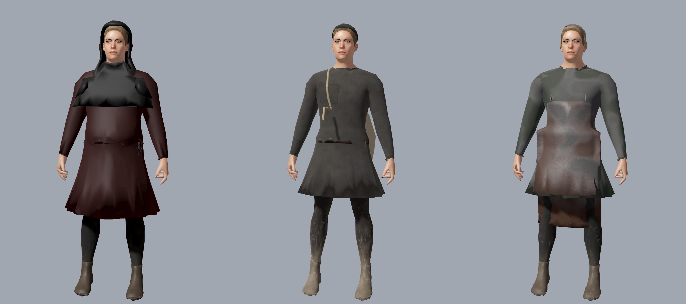

## Men's headwear (R-2028)

Task **R-2028** (EQ-26 of epic **R-2002**): the hood gains its liripipe and, for the rich, dagged hem; the coif and the wool cap take their variants from the existing cell rules. Builder: [`headwear.py`](../../tools/assets/realistic_humans/headwear.py), wrapped round the `hood` entry of `garments.WARDROBE`.

- **Liripipe.** Every crowd hood carries the long tail of its crown: a tapering strap (6.2 cm to 1.8 cm wide, 62 cm long) that hangs down the back over the cape and falls to one side per body. Friars' capuces (spec `hood_over`) keep the plain cape.
- **Dags.** A ring of 32 cut leaf tongues (6-10 cm) below the cape's hem, the mid-14th-c. fashion of the rich, is its own surface `<body>_hood_dags`. `weave` hides it with `hidden_material` below prestige p3 (`CitizenWardrobe.HOOD_DAGS`), as the sleeve buttons are hidden on p1. Crowd layers only (spec `tier` 2); the layer budget is 3,600 triangles.
- **Variants.** Hood: p1 w1 and w2 homespun (worn: faded, patched), p2 w0 broadcloth, p3 dagged and scarlet by the wealth grade. Coif: coarse linen w1 (yellowed) or w2 (sweat-stained), fine bleached linen for the better off (`linen_grade`). Wool cap: homespun, broadcloth, scarlet by wealth, with the cell's wear. No new garment files: the cell picks the cloth and the dags.
- **Not built.** Felt, straw and fur hats are new hat kinds that need an approved P0-040 task naming the files; the approval question timed out unanswered, so they stay open (follow-up on the board).

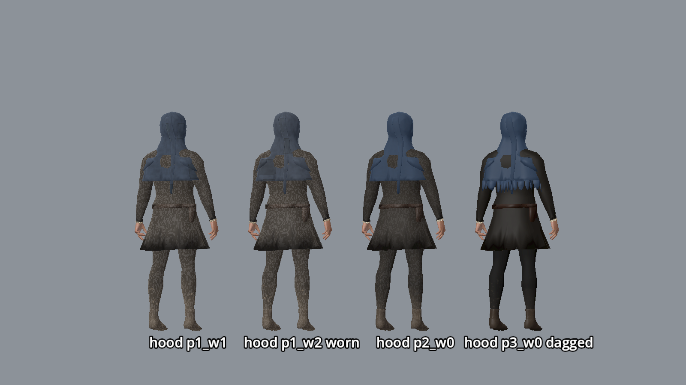
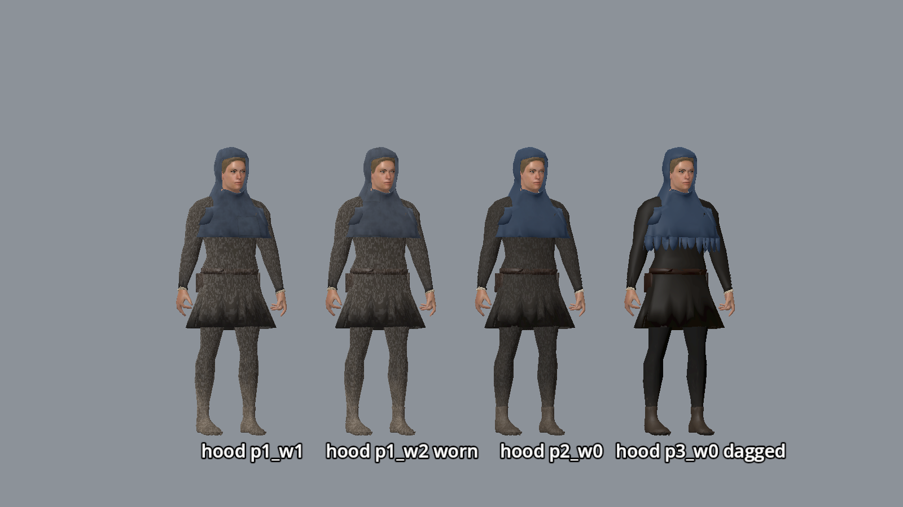
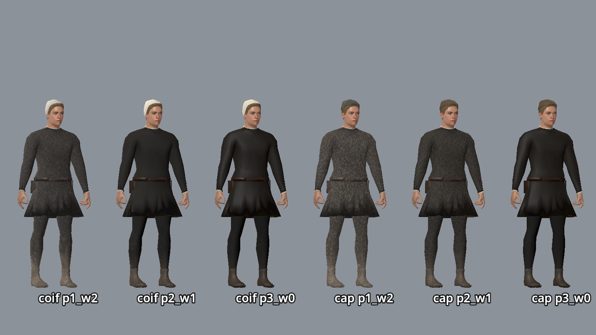
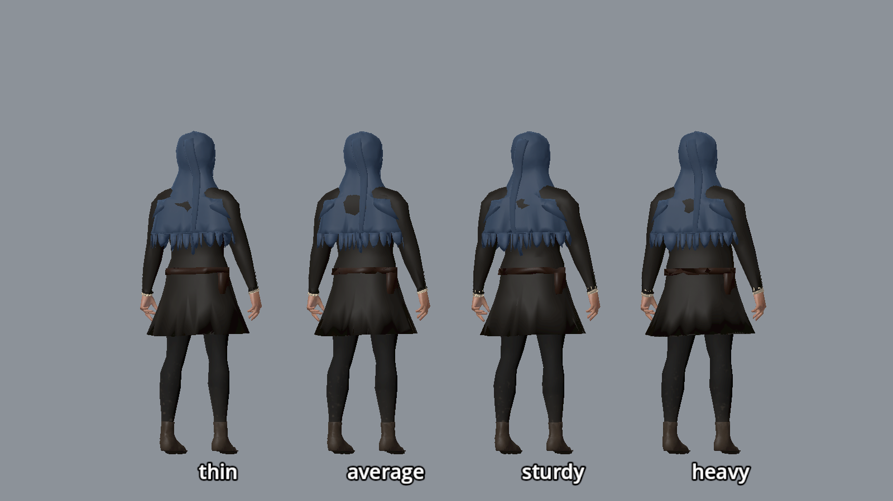

Verify: refit with `Blender --background --python tools/assets/realistic_humans/build_human.py -- --character=citizen_m_adult_<build> --layers-only --only hood`; test `test_hood_dags_show_on_prestige_three`; capture `tools/godot_render.sh --script tools/capture_headwear.gd`.

## Women's headwear (R-2029)

Task **R-2029** (EQ-27 of epic **R-2002**): a woman's head follows marriage, people and purse. Builders: [`women_headwear.py`](../../tools/assets/realistic_humans/women_headwear.py) (new `wimple` and `barbette` layers), the existing `headscarf`, `head_cloth`, `veil_over` and `braids` in `garments.py`; rules in `tools/city/citizen_wardrobe.py` (`WOMAN_HEAD`, `UNDER_VEIL`).

| Wearer | Head |
|--------|------|
| Maiden, girl | braids (bare); a kerchief for kitchen and washing trades (`KERCHIEF_TRADES`) |
| Estonian wife (wrap-skirt body d) | long linen head cloth (75 %), else headscarf; never veil, wimple or barbette |
| German or other wife, poor and middling | headscarf, a veil over it for 55 % of the middling |
| Rich burgher wife, noblewoman | barbette (70 %) under a white veil, else headscarf and veil |
| Widow or elder of means | wimple (rich 80 %, middling 55 %), veil over it for the rich; the poor an unveiled headscarf |
| Nun | white wimple under a black veil |

- **Wimple.** A linen oval covering chin, throat and the hair's edge, ending at the collar; the face is open from brow to lip. Layer budget 1,400 triangles.
- **Barbette.** A 2.4 cm band hugging the skin in a loop before the ears, over the crown and under the chin (c. 1300-1350), seen across the chin and cheeks below the veil. 500 triangles. No fillet: it would sit under the veil, unseen.
- **Drape.** Veils fall over the gown's shoulders (`cape_layers` = the baked gown or surcoat) and their front edge slopes down the chest instead of standing out at the shoulder (`head_wrap(max_flare=...)`); the wimple stops at the throat (`cape=False`).
- **Variants.** The cell picks the grade, as for every linen layer ([`EQUIPMENT_VARIANTS.md`](./EQUIPMENT_VARIANTS.md#linen-r-2024)): `linen_coarse_w1` (yellowed) or `linen_coarse_w2` (sweat-stained) for the poor, bleached `linen_fine` (w0) for everyone better off; a worn cell takes soil from the wear shader. Test `test_womens_headwear_mounts_with_linen_grades`.
- **Not built.** The goffered (frilled) veil edge: crimped Krause veils are attested from the 1350s on the Rhine and in the Low Countries, not for the Baltic by 1343, so by the period rule it is left out until a research note dates it.

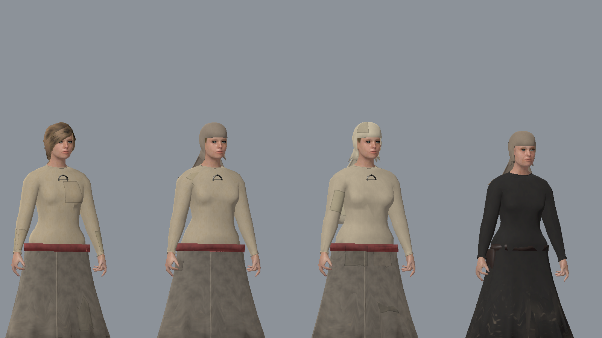
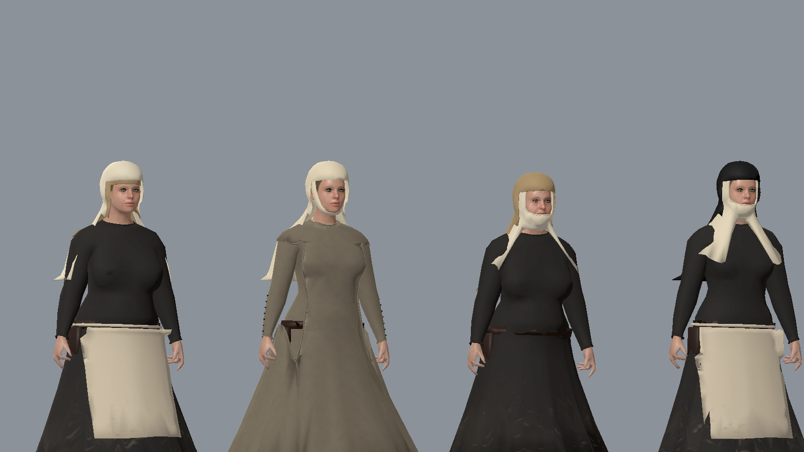
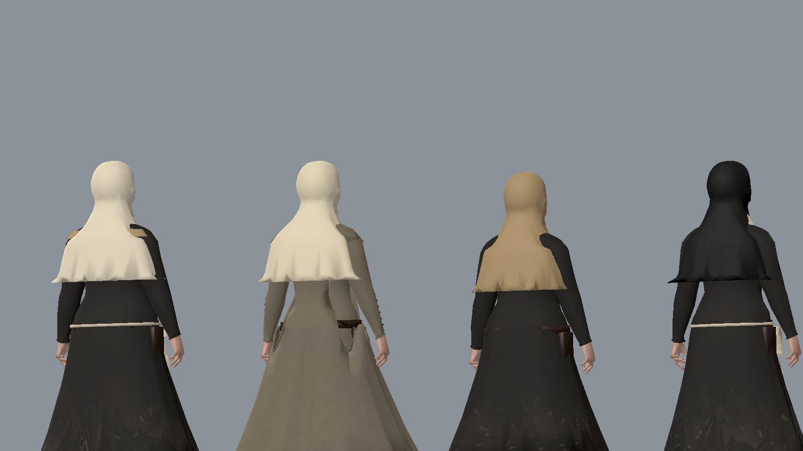
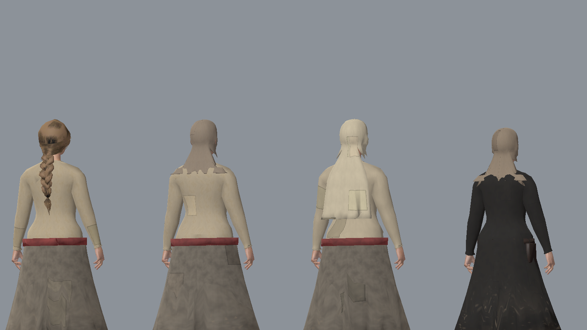

Verify: refit with `Blender --background --python tools/assets/realistic_humans/build_human.py -- --character=citizen_f_<stage>_<build>[_b|_c] --layers-only --only wimple,barbette,veil_over`; Python test `test_wimple_and_barbette_follow_age_and_purse`; capture `tools/godot_render.sh --script tools/capture_womens_headwear.gd`.

## Linen that shows (R-2024)

Every man wore a linen shirt and braies under the wool, every woman a chemise (smock, *sark*) under the gown ([clothing dossier](../../history/dossiers/dailylife/clothing-and-status-markers.md)). On a crowd body only its edges are seen, so only the edges are built, by `tools/assets/realistic_humans/underlinen.py` (imported at the end of `garments.py`, it wraps the base outfit entries of `WARDROBE`):

| Base outfit | Linen that shows |
|---|---|
| `short_tunic`, `long_tunic` (men, elders, boys) | shirt band 1.1 cm above the tunic's neckline; cuffs 1.4 cm past the wool sleeve, rolled hem |
| `cotehardie` | shirt band only (the sleeve runs over the hand) |
| `work_gown`, `gown` (women, elders, girls) | chemise edge 0.8 cm above the round neckline; cuffs |
| `kirtle` | chemise edge only (the buttoned sleeve covers the wrist) |
| `linen_shift` (outfit `d`) | the shift itself is the linen |
| every body | `Clothing_Braies` (baked under the hose) |

`under_shirt` (the healer's boy's `shirt_tunic`) uses the same collar and cuffs; its shell stops inside the wool sleeve. The pieces are textile family `linen` and keep their undyed colour (dye slot 0).

The grade follows the variant rule of [`EQUIPMENT_VARIANTS.md`](./EQUIPMENT_VARIANTS.md#linen-r-2024): the poor wear coarse tow, `linen_coarse_w1` (yellowed) or `linen_coarse_w2` (sweat-stained: labourers, servants and one in three of the rest, `CitizenWardrobe.linen_grade`, rolled on the id); everyone better off wears bleached `linen_fine` (w0). The worn grades are albedo maps only (`textiles.linen_coarse_worn`, `write_linen_wear`); their normal and ORM are the `linen_coarse` set (`CitizenWardrobe.GRADE_BASE`). The braies, coifs, veils and aprons of a resident take the same grade as the shirt.

Capture (`tools/capture_underlinen.gd`): [neck and wrist, three ranks of men and women](../reports/images/characters/citizen_underlinen.jpg).

## Bags (R-2034)

Scrips (`satchel`) and back sacks (`back_sack`) stay fitted layers, one GLB per body, but every part has its own material key so the resident's variant cell decides what it is made of at runtime (`scripts/city/citizen_bags.gd`, preloaded by `CitizenWardrobe.weave`). Geometry is built by `satchel` and `back_sack` in `tools/assets/realistic_humans/garments.py`; the strap and rope keep their `_strap_path` routing.

| Part (material key) | Shape | p1 (the poor) | p2, p3 (burghers, merchants, patricians) | Pilgrims (any cell) |
|---|---|---|---|---|
| `satchel` (pouch and flap, dyed) | pressed pouch on the left hip under a rounded flap | coarse linen or rawhide, half each (a roll of `"scrip:" + id`), undyed | `leather_tooled`, dyed tan or dark | plain soft `leather`, dyed |
| `satchel_strap` (strap and toggle tab) | strap over the right shoulder, tab sewn under the flap point | `rawhide` | `leather` | `leather` |
| `satchel_toggle` | turned wood or horn peg through the tab | baked dark wood | same | same |
| `satchel_badge` | pewter scallop, 4.4 cm, on the flap | hidden | hidden | shown, pewter (no rust finish) |
| `back_sack`, `back_sack_rope` | sack with gathers under a tied neck and a ruffled mouth; the tie cord runs on over the right shoulder | `linen_coarse` sacking | same | - |

Wear stays the layer cloth wear: `w0` clean, `w2` dirtier with patch pieces (`CELL_WEAR`, `BATTERED_FLOOR`), so a battered sack or scrip shows mended squares. Prestige comes from `citizen_wardrobe.variants` (the poor `p1`; clerks, masters and merchants `p2`; patricians `p3`), so no census field changed.

History: leather scrips with a flap and toggle, linen sacks tied at the neck. Pilgrim signs, pewter scallops of Santiago de Compostela among them, are found in Tallinn (about forty badges and scallops from a 15th-century landfill at Jahu and Väike-Patarei streets, 2018; Mänd and Selart, "The Relics of the Holy Blood in Riga and Schwerin and the Pilgrim Badges Found in Tallinn", *Forschungen zur baltischen Geschichte* 20, 2026; A. Vunk, "Eesti arheoloogilised palverändurimärgid"). The finds postdate 1343; the scallop sign itself is older (12th c. on), so the badge is a `plausible composite` for 1343. Tooled lattice and ring stamps follow 13th-14th c. North German and Baltic leather finds (sheaths, cases, purses).

Hand-carried trade props (baskets, buckets, carried sacks; **R-1670**) are not layers: they mount on the hand slots. A sack carried in the hand should reuse the `linen_coarse` sacking and the `back_sack` palette colour so it matches the sack on the back.

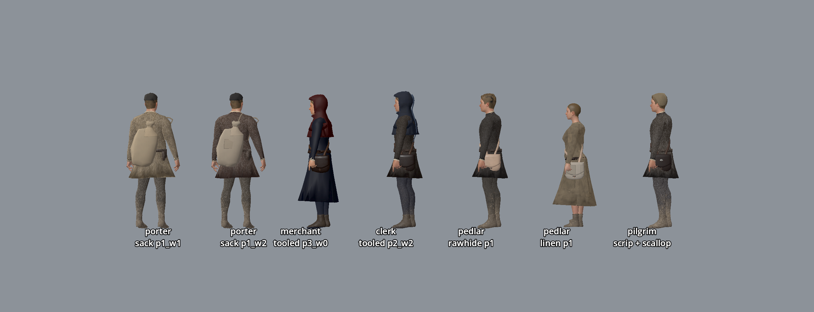
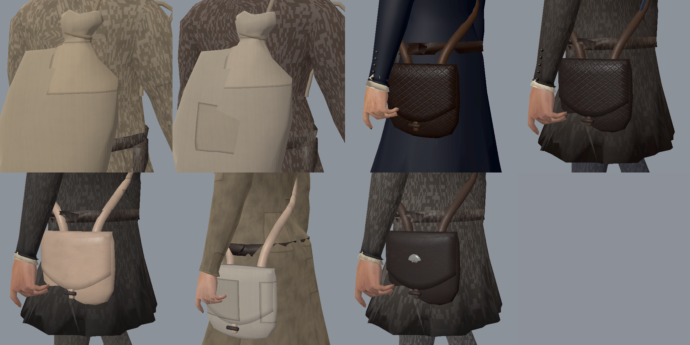

Capture: `tools/godot_render.sh --script tools/capture_bag_variants.gd`. Refit: `build_human.py -- --character=<body> --layers-only --only satchel,back_sack` for each body that has them.

## Belt gear (R-2033)

Keys and prayer beads no longer use their fitted layers on a body with a baked belt: they hang as rigid parts with the buckle, strap-end, mounts and purse of the resident's prestige (`scripts/city/belt_gear.gd`, called at the end of `dress`). The census rules and layer ids are unchanged. Details and captures: [`EQUIPMENT_VARIANTS.md`](./EQUIPMENT_VARIANTS.md#belt-gear-r-2033).

## Surcoats and the Order mantle (R-2022)

Task **R-2022** (EQ-20 of epic **R-2002**) recut the crown red surcoat, the knight's field surcoat, the Order's white surcoat and the white mantle with the black cross, and fixed **R-1994** (crown men-at-arms looked blood-spattered).

- **Cut (arms dossier: surcoats sleeveless, slit front and back for riding, to the knee or calf in the 1340s).** `garments.surcoat` (citizen layer) cuts the skirt open at centre front and back from the hem to 12 cm below the hip joint (`_riding_slits`, `SLIT_DEG`, `SLIT_BELOW_HIPS`), lays soft pleats over the loft folds (`SURCOAT_PLEAT`: 7 deep folds, flare 1.9 instead of a stiff 2.2 bell) and binds the cut edges with the hem roll. Weights (`_surcoat_skirt_weights`): down to the hem of the mail (or aketon) under it the surcoat copies that layer's weights, so the two move as one in the walk; below it each panel follows its own thigh, more so toward the hem, and parts at the slits. Budget 2,800 triangles (`build_human.LAYER_TRIANGLES`).
- **Order mantle.** Fulled wool hangs in fewer, deeper folds (`_cloak(fold=2.0)`), clears the wide surcoat skirt (`max_push` 0.2 below the armpits) and falls as one bell over it (`hang`: a row never steps back in once a layer pushed the row above out). Below the waist it takes the surcoat's weights, so the slit panels never pierce it. It ties at the neck with a leather thong (`_mantle_ties`, material `<body>_order_mantle_tie`, keeps its colour); the black cross stays a separate projected patch (left breast, large on the back).
- **Cloth grade by prestige, not purse** (`CitizenWardrobe.FINE_WOOL_LAYERS`, `fine_grade`). The surcoat and mantle are the lord's issue or a knight's own cloth: p2 (crown men-at-arms) `broadcloth`, p3 (a knight's own surcoat, crown red or field colours) `scarlet`; the Order's surcoat and mantle stay `broadcloth` (plain cloth under the Rule). The existing fulled-wool grade sets are used, no new textures.
- **Wear by cell** (`FINE_WOOL_WEAR`, `fine_wool_wear`): the wearer's poverty and trade do not reach issue cloth (a poor soldier's surcoat is not his own mended wool, and no butcher stains on a garrison). w0 fresh (clean hem), w1 travel-worn (mud at the hem, sun-faded), w2 torn and patched. The resident's seed still varies mud and patch pattern.
- **Torn hem (w2).** The layer GLBs carry a second UV map `HemRise` (glTF `TEXCOORD_1`, Godot `UV2`) = metres above the hem in the rest pose, with a flag in V (written 0 in Blender; glTF flips V, so it reads 1). `CitizenWardrobe._shader(double_sided, torn)` compiles a variant of `citizen_cloth.gdshader` with `#define TORN_HEM` for w2 surcoats and mantles only (so no other cloth pays for `discard`); it cuts ragged notches up from the hem (wear mask: blotch channel for deep rents, spatter channel for a frayed edge, instance uniform `wear_tear`) and darkens the torn edge.
- **R-1994 root cause: the global instance-uniform buffer overflowed.** The city holds more per-instance shader uniforms (cloth dyes and wear on every resident mesh, plants, water, murals) than Godot's default `rendering/limits/global_shader_variables/buffer_size` (65,536); Godot logged `Too many instances using shader instance variables` and residents past the limit drew with another instance's dyes and stains, so crown men showed white cloth with red stain blotches. `project.godot` raises it to 262,144 (4 MiB of GPU buffer). Regression test: `test_instance_uniform_buffer_fits_the_city`.

Variants on the sturdy build (`tools/godot_render.sh --script tools/capture_surcoat_variants.gd [-- --idle]`; crown p2 w0/w1/w2, crown knight p3 w0, vassal knight p3 w1, Order p3 w0/w1/w2): walking [front](../reports/images/equipment/surcoat_variants_front.jpg), [side](../reports/images/equipment/surcoat_variants_side.jpg), [back](../reports/images/equipment/surcoat_variants_back.jpg); standing [front](../reports/images/equipment/surcoat_variants_front_idle.jpg), [side](../reports/images/equipment/surcoat_variants_side_idle.jpg), [back](../reports/images/equipment/surcoat_variants_back_idle.jpg). In the city, Toompea castle bailey at 10:00 (`tools/godot_render.sh --resolution 1600x900 res://tools/capture_city_surcoats.tscn -- --city-spawn=poi.well.castle --city-hour=10`):

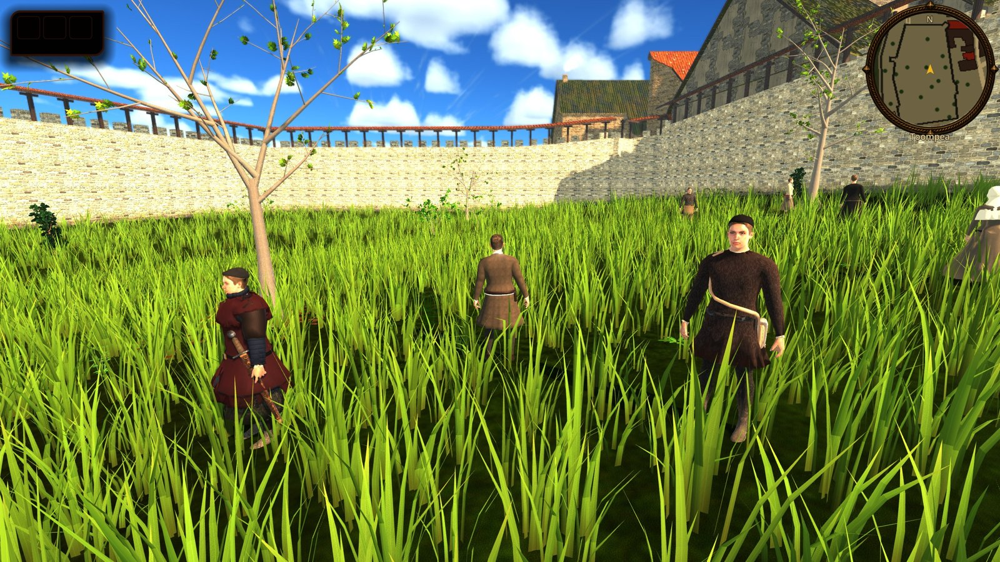

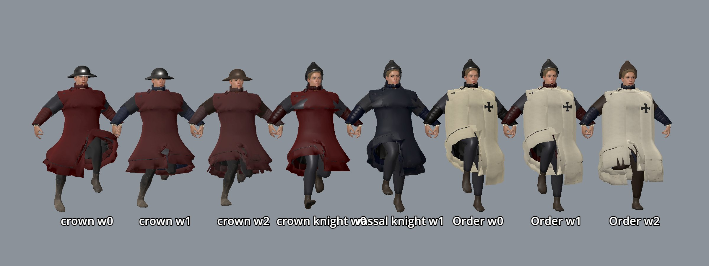

## Data and stable IDs

| Field (resident record) | Meaning |
|---|---|
| `wear` | ordered layer ids with their variant cell (R-2004), e.g. `["gambeson@p2_w1", "mail_haubergeon@p2_w1", "surcoat@p2_w1", "kettle_hat@p2_w1"]`; `citizen_wardrobe.layer_of` and `EquipmentVariant.split` strip the cell. A plain `"<layer>"` entry still works (cell `w1`) |
| `gear_variant` | prestige and wear cell (`p1_w2`) of the duty weapon or shield; only on residents who carry one |
| `wear_dye` | `{layer: [r, g, b]}` multiplier of the layer's undyed cloth |
| `status`, `trade`, `id` | read by `CitizenWardrobe.weave`: grade by wealth, wear by trade, per-resident roll |

Layer ids are stable: `hood`, `coif`, `wool_cap`, `braids`, `headscarf`, `head_cloth`, `wimple`, `barbette`, `veil_over`, `kettle_hat`, `mail_coif`, `aventail`, `bascinet`, `great_helm`, `gambeson`, `mail_haubergeon`, `coat_of_plates`, `surcoat`, `order_mantle`, `mail_chausses`, `gauntlets`, `smith_apron`, `waist_apron`, `keys`, `paternoster`, `satchel`, `back_sack`. Mounted garment ids are `wear_<layer>`. The armour layers exist on the eight adult men's bodies only. The stack is built in this order, each layer clearing the trees the layers under it registered (`ctx.layers`): aketon, mail, coat of plates, mail coif or aventail, surcoat, mantle.

Shields are not layers: the optional resident field `shield` (`order`, `crown`, `field`, `plain`; `citizen_wardrobe.shield_of`) is a modelled GLB chosen by `CitizenShield` (`scripts/city/citizen_shield.gd`, R-2013): `heater_order` (white, black cross, p3), `heater_crown` (plain crown red, p2), `heater_field` (pale board, runtime-tinted, p3), `heater_plain` (scuffed wood with an iron boss, p1), plus `buckler` and `pavise` families (models and `CitizenShield.scene` kinds `buckler`/`pavise` ship; the census does not hand them out yet). The bearer's `gear_variant` cell picks the file, else the nearest shipped cell of that kind. They are mounted on the left hand slot by `CitizenGear` (`_shield_held` turns the board face outward; the enarmes show from behind). Files: [shield variants](../../assets/props/weapons/heater_shield/variants), built by `tools/assets/equipment/build_shields.py`; see [EQUIPMENT_VARIANTS.md](EQUIPMENT_VARIANTS.md#shields-r-2013). `field` shields take the colour of the knight's coat of plates or surcoat. The town watch carries none. Grade ids are stable: `homespun`, `broadcloth`, `scarlet`, `linen_coarse`, `linen_coarse_w1`, `linen_coarse_w2`, `linen_fine`, `leather`, `quilted`, `fur`.

## Commands

```bash
# Refit layers for bodies (keeps the shipped body GLB and textures):
/Applications/Blender.app/Contents/MacOS/Blender --background --python-exit-code 1 \
  --python tools/assets/realistic_humans/build_human.py -- --character=citizen_m_adult_average --layers-only
godot --headless --path . --import
python3 tools/city/build_citizen_runtime.py            # rules -> citizens.json
python3 tools/assets/realistic_humans/textiles.py --grades   # cloth grades + wear mask
python3 tools/assets/realistic_humans/bag_textiles.py        # bag leathers: leather_tooled, rawhide
tools/godot_render.sh --script tools/capture_bag_variants.gd # porters, merchant, clerk, pedlars, pilgrim
tools/godot_render.sh --script tools/capture_citizen_textiles.gd   # 3 m close-ups + texture memory delta
tools/godot_render.sh --script tools/capture_citizen_wardrobe.gd   # review plates
tools/godot_render.sh --script tools/capture_surcoat_variants.gd  # surcoat and mantle cells (R-2022)
```

## Save and load

None: the wardrobe and its variant cells are a pure function of the static census and duty roster. Player items keep their own variant in the save ([`EQUIPMENT_VARIANTS.md`](./EQUIPMENT_VARIANTS.md#runtime-variant-choice-r-2004)).

## Verify

```bash
python3 -m unittest tests.python.test_citizen_wardrobe tests.python.test_equipment_variants -v
python3 tools/city/build_citizen_runtime.py --check
godot --headless --path . --script tools/run_godot_tests.gd -- --filter=test_citizen_wardrobe,test_equipment_variants
tools/godot_render.sh --script tools/capture_watch_variants.gd   # six watchmen, mixed variants
```

Armour plates (four builds, five kits each: man-at-arms, coat of plates, vassal knight, great helm, Order brother), idle and walk (`--walk`), by build: thin [front](../reports/images/characters/citizen_armour_thin_front.jpg), [back](../reports/images/characters/citizen_armour_thin_back.jpg), [walk front](../reports/images/characters/citizen_armour_thin_front_walk.jpg), [walk back](../reports/images/characters/citizen_armour_thin_back_walk.jpg), average [front](../reports/images/characters/citizen_armour_average_front.jpg), [back](../reports/images/characters/citizen_armour_average_back.jpg), [walk front](../reports/images/characters/citizen_armour_average_front_walk.jpg), [walk back](../reports/images/characters/citizen_armour_average_back_walk.jpg), sturdy [front](../reports/images/characters/citizen_armour_sturdy_front.jpg), [back](../reports/images/characters/citizen_armour_sturdy_back.jpg), [walk front](../reports/images/characters/citizen_armour_sturdy_front_walk.jpg), [walk back](../reports/images/characters/citizen_armour_sturdy_back_walk.jpg), heavy [front](../reports/images/characters/citizen_armour_heavy_front.jpg), [back](../reports/images/characters/citizen_armour_heavy_back.jpg), [walk front](../reports/images/characters/citizen_armour_heavy_front_walk.jpg), [walk back](../reports/images/characters/citizen_armour_heavy_back_walk.jpg).

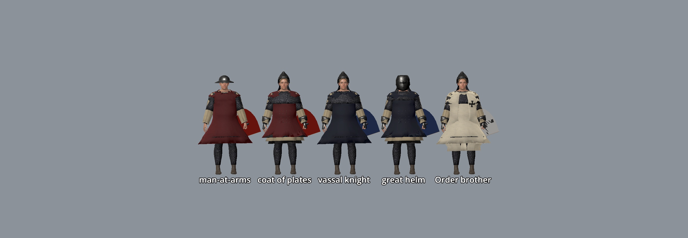

Review plates (`tools/capture_citizen_wardrobe.gd`): men's kits [front](../reports/images/characters/citizen_wardrobe_1_front.jpg) and [back](../reports/images/characters/citizen_wardrobe_1_back.jpg); women, elders and children [front](../reports/images/characters/citizen_wardrobe_2_front.jpg) and [back](../reports/images/characters/citizen_wardrobe_2_back.jpg). In the city, forum at 10:00 (`tools/capture_city_citizens.tscn -- --city-spawn=poi.forum --city-hour=10 --tag=wardrobe_forum`): [citizens_wardrobe_forum.jpg](../reports/images/city/citizens_wardrobe_forum.jpg).

Cloth grades and wear (`tools/capture_citizen_textiles.gd`, 3 m): [rich](../reports/images/characters/citizen_textiles_rich.jpg), [poor](../reports/images/characters/citizen_textiles_poor.jpg), [smith](../reports/images/characters/citizen_textiles_smith.jpg). Asset checks: `python3 tools/verify_asset_lint.py`, `python3 tools/validate_asset_sources.py`.

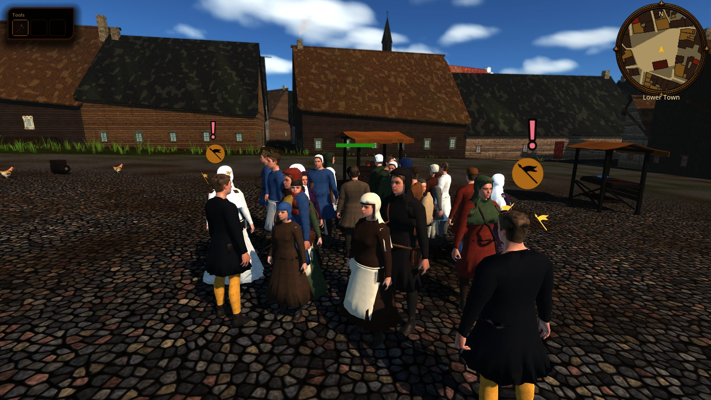

## Limits

- Layers are worn indoors and in bed too (no hood down, no undressing at home); weather does not change dress yet (**R-1664**).
- Women's headscarf and the men's belt with purse and knife are baked into every base body, so maidens cannot go bareheaded and poor men cannot lose the knife until **R-1665** and **R-1668** move them to layers.
- One base cut per wealth bracket (short or long); no sideless surcoat, fitted kirtle, fur trim or Estonian wrap skirt yet (**R-1665**). Novgorod merchants dress like Germans (no kaftan or fur hat).
- Layers clear the baked base by ease and a final push, not by cloth simulation. Skirts are skinned to the hips and thighs, so in the walk cycle the forward knee shows through the hem of the baked tunic and of the aketon or surcoat alike (also true of bodies without layers).
- Armour exists on adult men's bodies only: an elder knight (the census's one Order brother is 67) wears none. Plates are cloth-covered, so no bare plate cuirass, and a gauntlet is a smooth shell, not articulated. The shield is a flat board hung at the hip, not strapped to the forearm in the walk cycle. The Order mantle follows the surcoat's skirt in the walk (R-2022), so on a long stride it swings out as one stiff panel; the census has no Order brother young enough to wear it in the city.
- Wear is a tint and roughness change, not geometry: no frayed hems, torn holes or wet cloth; mud does not change with weather or season, and nothing washes off (clothes stay as dirty at Sunday mass).
- Elbows and knees are not worn through: the shader knows height and front, not limbs.
- Named NPCs ([`NAMED_NPCS.md`](./NAMED_NPCS.md)) and heroes keep their own StandardMaterials; only census residents dressed through `CitizenGear.arm` are woven. `CityCitizens.dye` still duplicates the tunic and hose material per resident before `weave` replaces it (a transient copy; folding the dye into `weave` would touch `city_citizens.gd`).
- The fur grade has no garment yet (**R-1665** trims, **R-1664** mantles).
- No layer ships a variant file yet, so prestige cells look alike; wear cells differ by the stand-in cloth wear and iron finish only (**R-2004**, item tasks of epic **R-2002**).

## Roadmap

| Task | What |
|---|---|
| **R-1664** WD-2 | Mantles and cloaks by wealth and weather |
| **R-1665** WD-3 | Women's gowns: sideless surcoat, fitted kirtle, Estonian wrap skirt, maidens with braids |
| ~~R-1666~~ WD-4 | Done: armour range (coat of plates, aventail, great helm, chausses, gauntlets, Order mantle with cross, shields) |
| **R-1667** WD-5 | Textile grades and wear masks (homespun to scarlet, soot, flour, mud) |
| **R-1668** WD-6 | Footwear: turnshoes, wooden shoes, pattens, bare feet |
| **R-1669** WD-7 | Children and youths: more child bodies and their dress |
| **R-1670** WD-8 | Hand-carried trade props by timetable |
| **R-1671** WD-9 | Hair, beards and tonsure |
| **R-1672** WD-10 | Crowd variety metric and district review |
