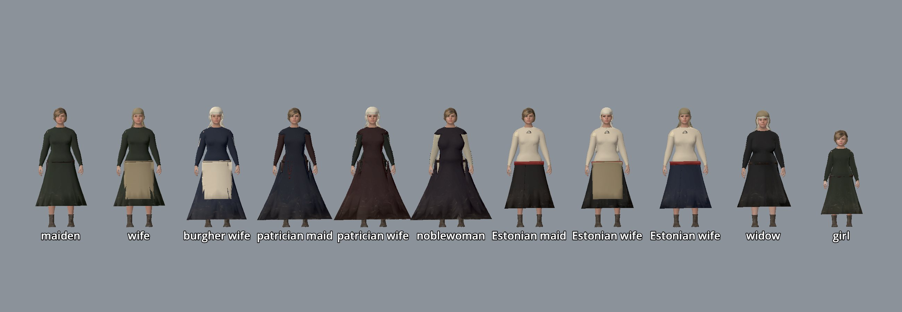

# Citizen wardrobe: dress that shows rank, age, trade and arms

Status: implemented (tasks **R-1663**, **R-1665**, **R-1666**, **R-1667**, epic **R-1662**). Scope: the census residents of the seamless city ([`CITIZENS.md`](./CITIZENS.md)) wear layers over their baked base outfit, chosen from what the census knows about them: head coverings, aprons, the armour kits of the watch, crown men, knights and Order brothers (coat of plates, aventail, great helm, chausses, gauntlets, white mantle with the black cross, shields), keys, prayer beads, scrips and sacks, each dyed by wealth and office; women's rank, ethnicity and marriage read from the gown and the head (see [Women's dress range](#womens-dress-range)); every piece of cloth is drawn in a grade that matches the wearer's wealth (homespun to scarlet) and dirtied by their trade (see [Cloth grades and wear](#cloth-grades-and-wear)). Out of scope (planned, see [Roadmap](#roadmap)): civilian mantles and cloaks, fur trim, footwear, more child bodies, hand-carried props, hair and tonsure, and a crowd variety gate. Named NPCs keep their own models ([`NAMED_NPCS.md`](./NAMED_NPCS.md)).

## Historical basis

Rules follow the research dossier [`clothing-and-status-markers.md`](../../history/dossiers/dailylife/clothing-and-status-markers.md) (confidence `plausible composite`: no Reval wardrobe inventory survives for 1343; cuts come from Herjolfsnes and Bocksten finds and German manuscripts) and [`watch-duty-and-town-defence.md`](../../history/dossiers/military/watch-duty-and-town-defence.md):

| Who | What the city shows | Dossier line |
|---|---|---|
| Patricians, merchants | long tunic or gown in strong dyes; hood in madder, woad or walnut; wives veiled in white linen with keys at the belt; some prayer beads (amber or coral) | burgher / councillor, burgher wife |
| Masters, journeymen | knee tunic; hood, linen coif or wool cap; trade apron | middling master |
| Labourers, servants, Estonian townsfolk | short tunic in undyed or cheap dyes; coif or wool cap (more caps among Estonians); porters with a sack | labourer, Estonian townsman |
| Smiths, armourers, cutlers, tanners, cobblers, masons, coopers | leather apron (*Schurz*) | master craftsman (Kalev) |
| Bakers, butchers, brewers, cooks, alewives, fishmongers, dyers, washerwomen | linen waist apron (bakers and cooks white, dyers stained blue) | alewife, servant girl |
| Clerks, scribes, scholars, pilgrims, pedlars, healers, midwives | leather scrip on a shoulder strap | - |
| Married women | headscarf always, or the Estonian wife's long white head cloth; burgher wives add a linen veil; widows and elders often veiled | burgher wife, market woman |
| Maidens and girls | bareheaded with a braid; working maids, cooks and alewives often tie a kerchief over it | "maidens bare or filleted", servant girl |
| Patrician and noble women | fitted, buttoned kirtle under a sideless surcoat, in two rich dyes | burgher wife / noblewoman, "long wool gown, fitted bodice" |
| Estonian and Finnish women below the rich | linen shift, wool wrap skirt with a woven sash, solg brooch at the breast | Estonian market woman, "tunic-skirt" |
| Nuns, lay sisters | black veil over the white headscarf (wimple), beads | Cistercian nun |
| Monks, lay brothers | black hood (cowl) over the black habit, beads | Dominican friar |
| Town watch on duty | quilted aketon over the street tunic, kettle hat, spear | watch overlay ("does not replace the undertunic") |
| Crown men-at-arms on duty | aketon, mail haubergeon, red surcoat (Danish crown colours, no invented heraldry), kettle hat | vassal knight / Danish retainer |
| Sergeants | aketon, mail, mail coif, kettle hat, sword | - |
| Vassal knights (noble knights off the roster) | two thirds armed: aketon, mail, then a coat of plates under a cloth cover in crown red or a rich dye (55%) or a surcoat; head: bascinet with aventail (60%), mail coif under a flat-topped great helm (20%, ceremony and the lists) or bare mail coif; mail chausses (70%), gauntlets (60%); a heater shield | vassal knight |
| Order brothers (`livonian_order` knights) | aketon, mail, chausses, gauntlets, white surcoat, the white mantle with a black cross (left breast, large on the back), bascinet with aventail or mail coif; white shield with the black cross | Order knight: "mail hauberk, surcoat with black cross, heater shield" ([arms and armour](../../history/dossiers/military/arms-and-armour-livonia-1340s.md)) |
| Squires | half armed: aketon, half with mail, some with a kettle hat; no plate | - |
| Men-at-arms off duty | 40% armed: aketon; crown and Order men add mail under their lord's colour (surcoat) and sometimes chausses; some a kettle hat; half carry a shield (crown red or plain wood) | Danish retainer |

Never mixed (the dossier's table, enforced by tests): no armour on burghers, masters or labourers; the knightly harness (`KNIGHT_ONLY`: coat of plates, great helm, aventail, bascinet, gauntlets, Order mantle) only on a knight of noble status, never on squires or men-at-arms; no veil on servants and poor women; no veil over the Estonian head cloth; a wife is never bareheaded; no keys on poor women; one shoulder strap at a time; one head covering, except the armour stack (mail coif under a bascinet or kettle hat).

## How the reference games do it, and what we take

- **Kingdom Come: Deliverance 1 and 2:** a body wears up to 16 armour slots in four torso layers (gambeson, mail, plate, surcoat) plus coif, mail coif and helmet on the head; NPCs are dressed from the same item pool by social class, and items carry dirt and blood. We take the slot-and-layer model, the order of the armour stack (aketon -> mail -> surcoat, coif -> mail coif -> helmet), and dirt that tells the trade: mud splashed up from the hem, soot, flour and blood where the work is held (**R-1667**).
- **The Witcher 3:** crowd NPCs are composed from per-community appearance templates (body, torso, legs, shoes, head, hair, accessory) with colour variants; a small template set shows its limits when one dress colour repeats across a square. We take composition by community (here: status, trade, faction) and colour variants per item, and avoid the repetition trap by hashing every pick from the resident id and measuring repetition (**R-1672**).
- **Both:** close-up quality comes from per-item PBR cloth with a tiling detail normal, and from silhouettes that differ by class (hem length, headwear, carried things). R-1663 delivers silhouettes; R-1667 the cloth grades and wear.

## How it works

1. **Layers fitted per body (build time).** `tools/assets/realistic_humans/citizen_bodies.py` lists `LAYERS` per sex and life stage. `build_human.py` builds them on the same MPFB body as the baked base outfit, so a hood fits a thin elder and a heavy merchant alike, then exports each one apart as a skinned, decimated GLB: `assets/characters/realistic/<body>/layers/<layer>.glb` (budgets in `LAYER_TRIANGLES`, 400 to 2,600 triangles). Torso layers get `layer_ease` (0.022 m) so they clear the baked tunic, its blousing and the belt.
2. **New garment builders** in `garments.py`: `coif`, `wool_cap`, `headscarf` (now a layer), `head_cloth`, `braids` (the hair proxy exported as a layer: `bake_crowd_body` leaves out any body part a layer claims), `veil_over` (veil over the headscarf), `mail_coif`, `bascinet` (pointed, open-faced), `coat_of_plates` (sleeveless cloth cover with rivet heads, registered so the surcoat and mantle clear it), `aventail` (mail tippet hung from the bascinet), `great_helm` (flat-topped with eye slit and sight bar), `mail_chausses`, `gauntlets` (hand shells with flared cuffs over the sleeve ends), `order_mantle` (white wool cloak open at the front; the black cross is a separate undyed patch of fine quads projected onto the cloth, so only the white takes `wear_dye`), `keys`, `paternoster`, `satchel`, `back_sack`; existing `hood`, `smith_apron`, `waist_apron`, `gambeson`, `mail_haubergeon`, `surcoat` and `kettle_hat` are reused. Accessories hang from the outside of the belt (`belt_anchor`); straps are laid over the worn body (`_strap_path`).
3. **Rules (data build).** `tools/city/citizen_wardrobe.py` `dress(person, available)` returns `(wear, wear_dye)`; `tools/city/build_citizen_runtime.py` stores them on every resident in `content/world/reval_city/citizens.json` after the duty roster ([`GATE_GARRISONS.md`](./GATE_GARRISONS.md)) is assigned. Every roll is `crc32(id + tag)`, so a resident always wears the same things.
4. **Runtime.** `CitizenGear.arm` (`scripts/city/citizen_gear.gd`) calls `CitizenWardrobe.dress` (`scripts/city/citizen_wardrobe.gd`) when a resident's rig is styled: each layer is mounted with `SharedCharacterRig.equip_garment(&"wear_<layer>")` and its own cloth (material `<body>_<layer>`) dyed with `wear_dye`. Duty kits wear the fitted kettle hat; the watchman's shared hat is only a fallback for a body without one.

5. **Cloth grade and wear (R-1667).** At the end of `dress`, `CitizenWardrobe.weave` replaces every cloth surface (base body and layers; wool, linen, leather and quilted, read off the material's `textiles/<family>_albedo*.png`) with a shared `ShaderMaterial` of `scripts/city/citizen_cloth.gdshader`, one per (garment material, grade). The resident's dyes and wear go into instance uniforms on the mesh, so residents share materials and textures (see below).

Today 3,941 residents wear about 4,930 layers; body plus layers gives about 400 distinct silhouettes (22 before R-1663), before dyes.

## Women's dress range

Task **R-1665** (WD-3). A woman's gown now tells rank and ethnicity, and her head tells marriage.

**Base outfits** (baked into the body, `citizen_bodies.FEMALE_OUTFITS`; adults only, elders and girls wear `a`):

| Outfit | Body id | Garments (`garments.py`) | Who (`build_citizen_runtime.clothing`) |
|---|---|---|---|
| `a` | `citizen_f_adult_<build>` | calf-length work gown | everyone else |
| `b` | `..._b` | ankle gown with a linen apron | the better-off (`LONG_SHARE`), nuns and lay sisters |
| `c` | `..._c` | `kirtle`: fitted wool kirtle to the ankle, low girdle, seven pewter buttons on each forearm; `sideless_surcoat`: floor-length, open at the sides from armhole to hip (the plackard about a foot wide), so the kirtle, girdle, keys and beads show through | nobles 85%, patricians 75%, merchants' women 40% (`SURCOAT_SHARE`) |
| `d` | `..._d` | `linen_shift` (cut at the hip, the skirt covers the rest), `wrap_skirt`: wool, waist to calf, the wrapped panel's edge right of centre front, a red woven sash; `solg`: silver penannular brooch at the neck slit | Estonian and Finnish women: poor 60%, middling 35% (`WRAP_SHARE`) |

The kirtle takes the resident's `under` dye (for `c` a second rich dye that differs from the surcoat's), the surcoat and the wrap skirt the `cloth` dye; the shift stays undyed linen (`BODY_DYE_SLOT`, `CityCitizens.dye`). Rich wool weaves as scarlet outside and broadcloth beneath, so the surcoat reads finer than the kirtle.

In the census today: 528 adult women in `a`, 311 in `b`, 114 in `c`, 372 in `d`; of grown women 854 wear the headscarf, 42 the head cloth and 588 the braid.

**Heads** (`citizen_wardrobe.dress`): the headscarf is no longer baked. Grown women carry their hair, MakeHuman's CC0 `braid01` cards, as the `braids` layer, so it can come off. Every grown woman wears exactly one of `braids`, `headscarf`, `head_cloth` (`WOMAN_HEAD`):

- wives, household heads, widows and every elder: covered; the Estonian wife in outfit `d` wears the `head_cloth` (75%) or the headscarf; the burgher veil (`veil_over`) only goes over the headscarf (rich wives always, middling 55%, other elders 35%);
- nuns: white headscarf (wimple) under the black veil;
- unmarried women: bareheaded with the braid, except a share of working maids, servants, cooks, alewives, washerwomen and dairy maids who tie a kerchief (`KERCHIEF_TRADES`);
- girls keep the braid baked into the child body; elder bodies have no hair at all (always covered).

**Historical basis and confidence.** All `plausible composite`:

- *Sideless surcoat and fitted kirtle:* the sideless surcoat with armholes opened to the hip is a 14th-century noblewomen's fashion, criticised by moralists; the fitted, buttoned kirtle (*cotte*) under it belongs to the 1330s-40s ([Wikipedia: Surcoat](https://en.wikipedia.org/wiki/Surcoat); Larsdatter, [Sideless surcoats](http://www.larsdatter.com/surcoats.htm); the dossier's "long wool gown, fitted bodice" for burgher wives and noblewomen, Codex Manesse plate `.05`). No Reval depiction survives; German elite comparanda. No laced bodices, no farthingale.
- *Estonian dress:* linen shift, woollen wrap skirt and a penannular brooch (*sõlg*) follow the dossier's "Estonian market woman: tunic-skirt, apron, scarf" and Estonian archaeological costume (13th-century women's burial dress, R. Rammo, *One costume - complex meanings*, Tartu); the married women's linen head cloth and the bareheaded maiden follow Estonian folk-costume tradition, which is later evidence carried back. The sash colour is a choice.
- *Marriage and the head:* "married women covered; maidens bare or filleted" (dossier); "bareheaded noblewoman in church procession" is a forbidden mix, so a rich wife is always veiled.

## Cloth grades and wear

Grades follow the dossier's cloth ladder (undyed homespun for the poor, fulled broadcloth for masters and burghers, scarlet, the costliest sheared cloth, for patricians and nobles; tow linen against bleached linen). Each grade is a tileable 512 px set (`albedo`, `normal`, `orm`) built by `tools/assets/realistic_humans/textiles.py --grades` into `assets/characters/realistic/textiles/<grade>_*_512.png`:

| Grade | Cloth | Tile | Who (status -> wealth in `CitizenWardrobe.WEALTH`) |
|---|---|---|---|
| `homespun` | hand-spun tabby, lumpy yarn, pills, fleece flecks, blotchy fulling | 12 cm | wool of the poor: labourers, servants, free commoners, apprentices, dependents, soldiers |
| `broadcloth` | fulled and napped twill, weave hidden | 8 cm | wool of journeymen, masters, clerks, clerics; under-wool of the rich |
| `scarlet` | sheared nap, soft sheen | 6 cm | outer wool (tunic, gown, dyed layer) of patricians, nobles, merchants |
| `linen_coarse` / `linen_fine` | tow linen with shives / bleached fine tabby | 9 / 5 cm | shirts, braies, coifs, veils, aprons: poor / everyone else |
| `leather`, `quilted` | the existing family sets | 22 / 20 cm | as made |
| `fur` | pelt strands in clumps | 12 cm | built for fur trim and linings; no crowd garment uses fur yet (**R-1664**) |

Wear is drawn by the same shader from one shared RGBA mask (`wear_mask_512.png`: R mud spatter, G soot smudge, B flour dust, A stain blotches, 60 cm tile) and the skinned model-space position (height above the feet, front of the body):

| Mark | Where | Who (`CitizenWardrobe.TRADE_WEAR`, `WEALTH_WEAR`) |
|---|---|---|
| Mud | splashed up from the hem, thickest at the ground | everyone a little (poor 0.45, middling 0.22, rich 0.06); labourers, porters, carters, drovers, farmers, stable hands, brickmakers 0.7-0.9 |
| Soot | greys the upper body, blackest in front | smiths and nailsmiths 0.9, armourers, cutlers; brewers, tallow chandlers a little |
| Flour (and lime, stone, saw dust) | front and sleeves, waist to chest | bakers 0.9, limeburners, masons, cooks, carpenters |
| Stains | front of the belly | butchers 0.9, tanners, fishmongers, barbers, midwives, healers, cooks |
| Patches | 16 cm pieces of other cloth with a dark seam | poor 0.7, middling 0.15, rich none |
| Fading | dye greyed and paled | poor 0.5, middling 0.18, rich none |

The larger of the wealth and trade value wins, scaled by a roll of `hash(id)` (0.75-1.15) so two smiths differ; the same hash shifts the mask, so no two residents carry the same splashes. All values are a pure function of the record.

Instance uniforms (per mesh, `GeometryInstance3D.set_instance_shader_parameter`): `dye_outer` (base `cloth`, or the layer's `wear_dye`), `dye_under` (base `under`), `wear_soil` (mud, soot, flour, stain), `wear_age` (patches, fade, seed). Material uniform `dye_slot` says which dye a surface takes, by the same name rules as `CityCitizens.dye` (`BODY_DYE_SLOT`) and the layer's `CLOTH_KEY`.

**Memory.** Materials are cached per source material and grade (about 10 garments per body, 22 bodies plus layers); no resident owns a material or a texture. The grade sets add **3.78 MiB** of texture memory once (measured, see [`PERFORMANCE_REPORT.md`](../PERFORMANCE_REPORT.md#citizen-cloth-grades-r-1667)); the family sets the GLBs reference stay loaded.


## Data and stable IDs

| Field (resident record) | Meaning |
|---|---|
| `wear` | ordered layer ids, e.g. `["gambeson", "mail_haubergeon", "surcoat", "kettle_hat"]` |
| `wear_dye` | `{layer: [r, g, b]}` multiplier of the layer's undyed cloth |
| `status`, `trade`, `id` | read by `CitizenWardrobe.weave`: grade by wealth, wear by trade, per-resident roll |

Layer ids are stable: `hood`, `coif`, `wool_cap`, `braids`, `headscarf`, `head_cloth`, `veil_over`, `kettle_hat`, `mail_coif`, `aventail`, `bascinet`, `great_helm`, `gambeson`, `mail_haubergeon`, `coat_of_plates`, `surcoat`, `order_mantle`, `mail_chausses`, `gauntlets`, `smith_apron`, `waist_apron`, `keys`, `paternoster`, `satchel`, `back_sack`. Mounted garment ids are `wear_<layer>`. The armour layers exist on the eight adult men's bodies only; `braids` on adult women's bodies, `head_cloth` on outfit `d` only. Base garment ids (material suffixes) `kirtle`, `sideless_surcoat`, `linen_shift`, `wrap_skirt`, `solg` are stable too. The stack is built in this order, each layer clearing the trees the layers under it registered (`ctx.layers`): aketon, mail, coat of plates, mail coif or aventail, surcoat, mantle.

Shields are not layers: the optional resident field `shield` (`order`, `crown`, `field`, `plain`; `citizen_wardrobe.shield_of`) is built in code by `CitizenShield` (`scripts/city/citizen_shield.gd`, a heater board with painted face, black cross for the Order, iron boss otherwise) and mounted on the left hand slot by `CitizenGear`. `field` shields take the colour of the knight's coat of plates or surcoat. The town watch carries none. Grade ids are stable: `homespun`, `broadcloth`, `scarlet`, `linen_coarse`, `linen_fine`, `leather`, `quilted`, `fur`.

## Commands

```bash
# Refit layers for bodies (keeps the shipped body GLB and textures):
/Applications/Blender.app/Contents/MacOS/Blender --background --python-exit-code 1 \
  --python tools/assets/realistic_humans/build_human.py -- --character=citizen_m_adult_average --layers-only
godot --headless --path . --import
python3 tools/city/build_citizen_runtime.py            # rules -> citizens.json
python3 tools/assets/realistic_humans/textiles.py --grades   # cloth grades + wear mask
tools/godot_render.sh --script tools/capture_citizen_textiles.gd   # 3 m close-ups + texture memory delta
tools/godot_render.sh --script tools/capture_citizen_wardrobe.gd   # review plates
```

## Save and load

None: the wardrobe is a pure function of the static census and duty roster.

## Verify

```bash
python3 -m unittest tests.python.test_citizen_wardrobe -v
python3 tools/city/build_citizen_runtime.py --check
godot --headless --path . --script tools/run_godot_tests.gd -- --filter=test_citizen_wardrobe
```

Armour plates (four builds, five kits each: man-at-arms, coat of plates, vassal knight, great helm, Order brother), idle and walk (`--walk`), by build: thin [front](../reports/images/characters/citizen_armour_thin_front.jpg), [back](../reports/images/characters/citizen_armour_thin_back.jpg), [walk front](../reports/images/characters/citizen_armour_thin_front_walk.jpg), [walk back](../reports/images/characters/citizen_armour_thin_back_walk.jpg), average [front](../reports/images/characters/citizen_armour_average_front.jpg), [back](../reports/images/characters/citizen_armour_average_back.jpg), [walk front](../reports/images/characters/citizen_armour_average_front_walk.jpg), [walk back](../reports/images/characters/citizen_armour_average_back_walk.jpg), sturdy [front](../reports/images/characters/citizen_armour_sturdy_front.jpg), [back](../reports/images/characters/citizen_armour_sturdy_back.jpg), [walk front](../reports/images/characters/citizen_armour_sturdy_front_walk.jpg), [walk back](../reports/images/characters/citizen_armour_sturdy_back_walk.jpg), heavy [front](../reports/images/characters/citizen_armour_heavy_front.jpg), [back](../reports/images/characters/citizen_armour_heavy_back.jpg), [walk front](../reports/images/characters/citizen_armour_heavy_front_walk.jpg), [walk back](../reports/images/characters/citizen_armour_heavy_back_walk.jpg).


Review plates (`tools/capture_citizen_wardrobe.gd`): men's kits [front](../reports/images/characters/citizen_wardrobe_1_front.jpg) and [back](../reports/images/characters/citizen_wardrobe_1_back.jpg); women, elders and children [front](../reports/images/characters/citizen_wardrobe_2_front.jpg) and [back](../reports/images/characters/citizen_wardrobe_2_back.jpg). Women's dress range (WD-3): gowns and heads [front](../reports/images/characters/citizen_wardrobe_7_front.jpg) and [back](../reports/images/characters/citizen_wardrobe_7_back.jpg); every female body, thin and average [front](../reports/images/characters/citizen_wardrobe_8_front.jpg) and [back](../reports/images/characters/citizen_wardrobe_8_back.jpg), sturdy, heavy, elders and girl [front](../reports/images/characters/citizen_wardrobe_9_front.jpg) and [back](../reports/images/characters/citizen_wardrobe_9_back.jpg).

 In the city, forum at 10:00 (`tools/capture_city_citizens.tscn -- --city-spawn=poi.forum --city-hour=10 --tag=wardrobe_forum`): [citizens_wardrobe_forum.jpg](../reports/images/city/citizens_wardrobe_forum.jpg).

Cloth grades and wear (`tools/capture_citizen_textiles.gd`, 3 m): [rich](../reports/images/characters/citizen_textiles_rich.jpg), [poor](../reports/images/characters/citizen_textiles_poor.jpg), [smith](../reports/images/characters/citizen_textiles_smith.jpg). Asset checks: `python3 tools/verify_asset_lint.py`, `python3 tools/validate_asset_sources.py`.


## Limits

- Layers are worn indoors and in bed too (no hood down, no undressing at home); weather does not change dress yet (**R-1664**).
- The men's belt with purse and knife is baked into every base body, so poor men cannot lose the knife until **R-1668** moves it to a layer.
- Women: no fur trim or lining yet (**R-1664**), no fillet or wreath on maidens, one braid style and one hair colour for every woman (**R-1671**). Elders and girls have one outfit (`a`): no Estonian or patrician elders, no girls in the surcoat. Over the wrap skirt the apron's lower corner can still dip behind the skirt's overlap edge. The braid's tail lies on the back of a surcoat or gown and can clip it in the walk. Novgorod merchants and their women dress like Germans (no kaftan or fur hat).
- Layers clear the baked base by ease and a final push, not by cloth simulation. Skirts are skinned to the hips and thighs, so in the walk cycle the forward knee shows through the hem of the baked tunic and of the aketon or surcoat alike (also true of bodies without layers).
- Armour exists on adult men's bodies only: an elder knight (the census's one Order brother is 67) wears none. Plates are cloth-covered, so no bare plate cuirass, and a gauntlet is a smooth shell, not articulated. The shield is a flat board hung at the hip, not strapped to the forearm in the walk cycle. Capture review: the mantle's hem is stiff in the walk.
- Wear is a tint and roughness change, not geometry: no frayed hems, torn holes or wet cloth; mud does not change with weather or season, and nothing washes off (clothes stay as dirty at Sunday mass).
- Elbows and knees are not worn through: the shader knows height and front, not limbs.
- Named NPCs ([`NAMED_NPCS.md`](./NAMED_NPCS.md)) and heroes keep their own StandardMaterials; only census residents dressed through `CitizenGear.arm` are woven. `CityCitizens.dye` still duplicates the tunic and hose material per resident before `weave` replaces it (a transient copy; folding the dye into `weave` would touch `city_citizens.gd`).
- The fur grade has no garment yet (**R-1664** mantles and trims).

## Roadmap

| Task | What |
|---|---|
| **R-1664** WD-2 | Mantles and cloaks by wealth and weather |
| ~~R-1665~~ WD-3 | Done: women's gowns (sideless surcoat over buttoned kirtle, Estonian shift, wrap skirt and solg), headscarf and braids as layers |
| ~~R-1666~~ WD-4 | Done: armour range (coat of plates, aventail, great helm, chausses, gauntlets, Order mantle with cross, shields) |
| **R-1667** WD-5 | Textile grades and wear masks (homespun to scarlet, soot, flour, mud) |
| **R-1668** WD-6 | Footwear: turnshoes, wooden shoes, pattens, bare feet |
| **R-1669** WD-7 | Children and youths: more child bodies and their dress |
| **R-1670** WD-8 | Hand-carried trade props by timetable |
| **R-1671** WD-9 | Hair, beards and tonsure |
| **R-1672** WD-10 | Crowd variety metric and district review |
