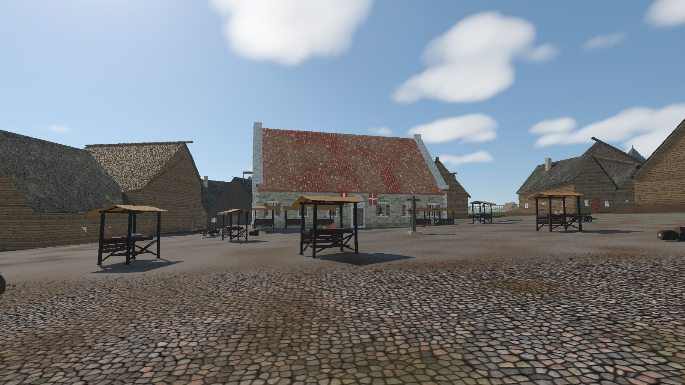
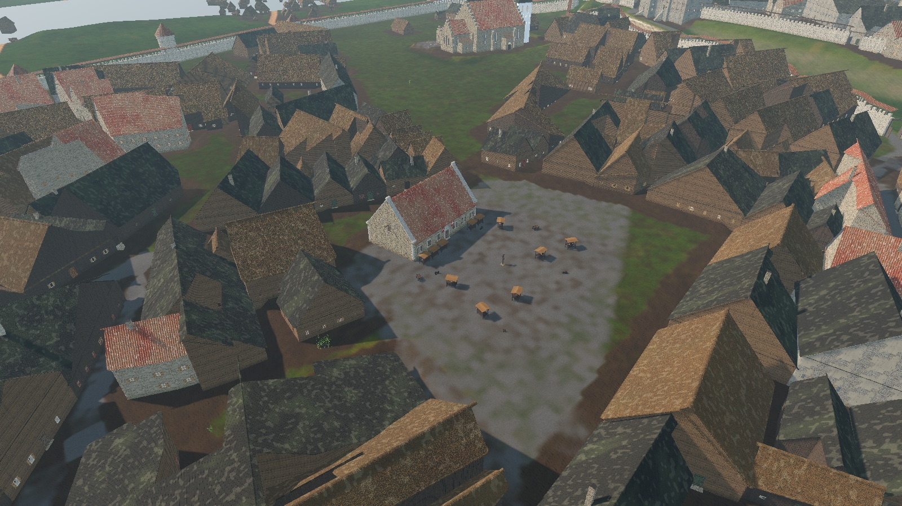
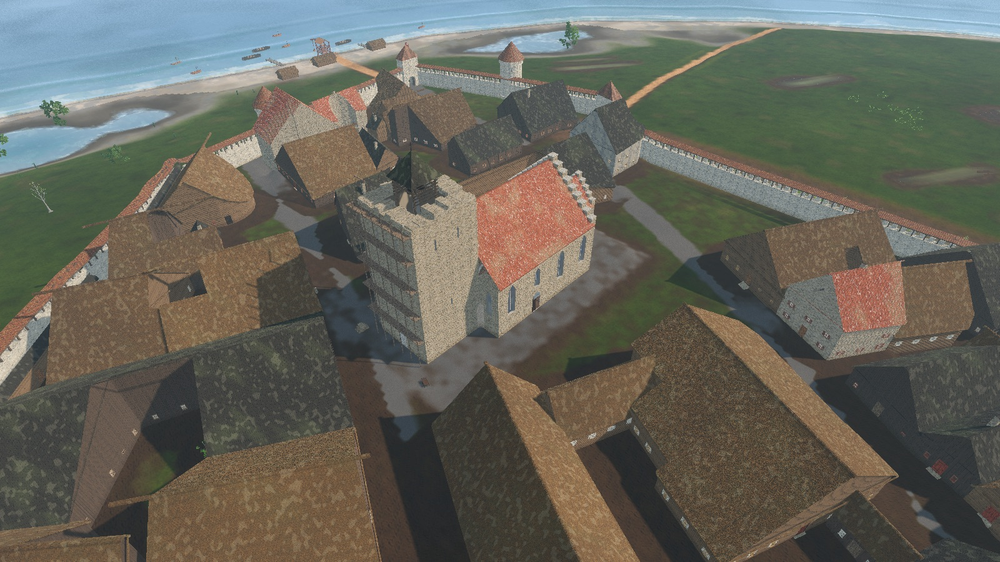
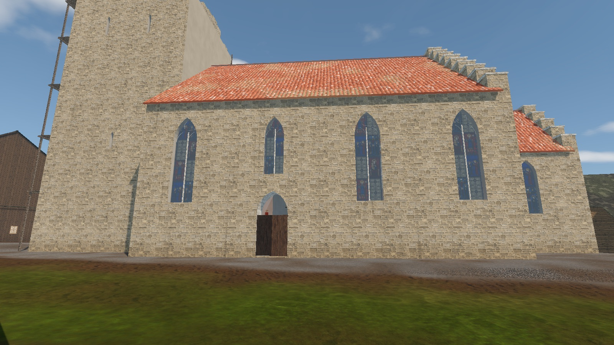
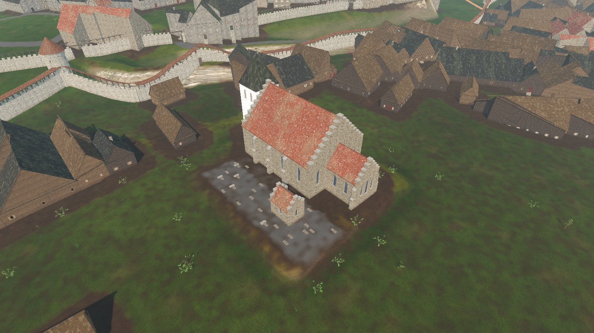
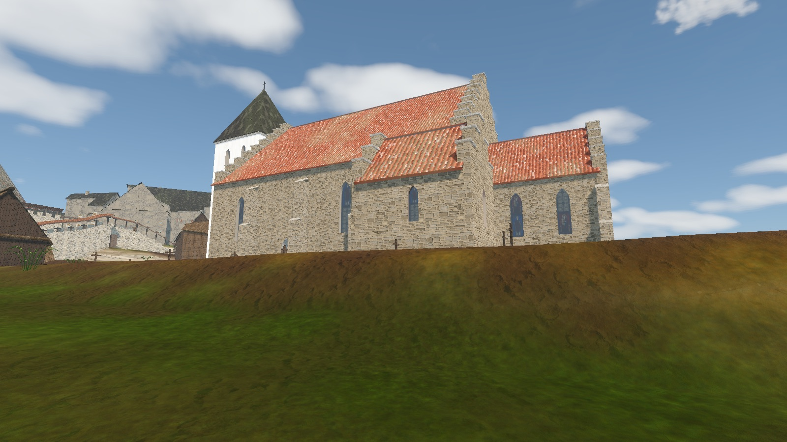
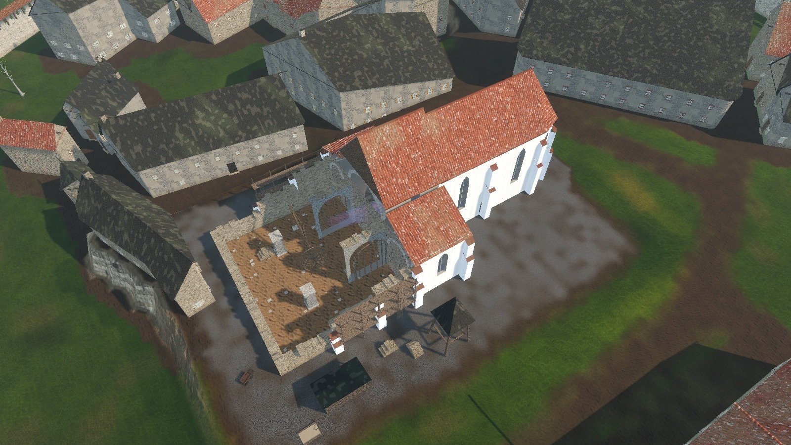
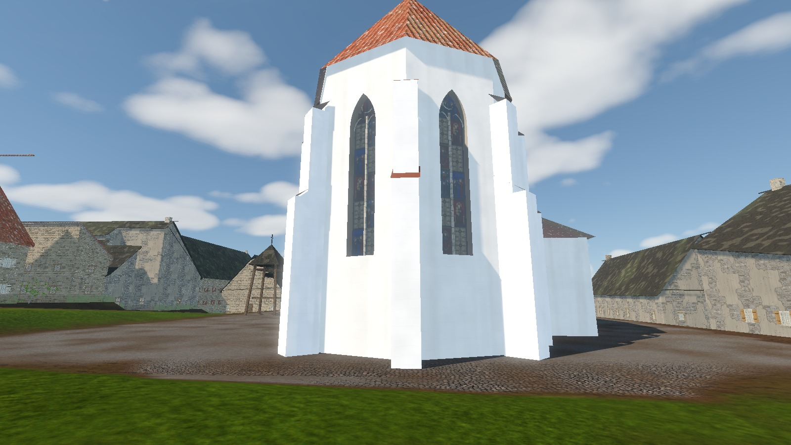

# Landmark sites in the seamless city

Status: implemented for `site.raekoja_plats`, `site.holy_spirit`, `site.st_olaf`, `site.st_nicholas`, `site.st_mary` and `site.kalev_smithy` ([ADR 0032](../adr/0032-bespoke-landmark-sites-in-the-city.md); smithy implementation reference **R-1643**; visual catalogue **R-1695**). Scope: a contract and runtime for bespoke, navigable models of famous Reval buildings and places in the [seamless city](./SEAMLESS_CITY.md), shown as they stood in spring 1343, and one catalogue entry per building (built or not) with its 1343 function, room plan, decoration and research. Out of scope: final Blender-generated landmark shells, multi-storey interiors, site-specific NPC behaviour, and building the pending or proposed sites listed below (each needs its own task).

## How to read this page

Each building has one section: status and links, captured views (built sites only), **function in 1343**, **plan** (rooms and what happens in them), **decoration**, **left out** (later fabric), **historical research** (project dossiers first, then external studies) and related board work. Shared runtime behaviour, the authoring contract, verification and limits for all sites follow after the buildings.

- **Implemented** means a registered, navigable model in the seamless city, not final art approval. All six sites use **interim GDScript builders**; the final Blender-generated shells required by [ADR 0032](../adr/0032-bespoke-landmark-sites-in-the-city.md) are pending. Images are captured model evidence (review snapshots, not concept art or photos of modern Tallinn); ongoing fixes may postdate them.
- **Pending** means ADR 0032 already names the site but no manifest exists. **Proposed** means the building stood in 1343 and is worth a site, but no ADR or task names it yet; adding one is a scope decision (see [AGENTS.md, Scope](../../AGENTS.md#scope)).
- Confidence words follow the dossiers: **attested** (a dated source), **plausible composite** (reconstructed from the type and later fabric), **unknown**. Plans of rooms are composites unless marked attested; no measured 1343 interior plan survives for any Reval building.
- **Period rule** (maintainer, 2026-10-07): an element dated after 1343 is left out. Where the 1343 state is unrecorded, use a slightly simplified form of the later, documented building. A later feature needs a maintainer-recorded entry in the manifest's `presentation` list.
- Board references (`R-…`) are task IDs, not delivery dates; states are a snapshot of **2026-10-11**. Legacy district-map tasks are labelled and must be re-scoped before they can deliver a seamless-city site.

## Building index

| Building | Kind | 1343 state | Game status |
|---|---|---|---|
| [Council hall and market square](#council-hall-and-market-square-raekoja-plats) | political, market | standing (consistorium 1322) | implemented `site.raekoja_plats` |
| [Holy Spirit church and almshouse](#holy-spirit-church-and-almshouse-pühavaimu) | parish, council church, hospice | standing | implemented `site.holy_spirit` |
| [St Olaf's church](#st-olafs-church-oleviste) | parish | standing, tower unfinished | implemented `site.st_olaf` |
| [St Nicholas' church](#st-nicholas-church-niguliste) | merchant parish | standing | implemented `site.st_nicholas` |
| [St Mary's cathedral](#st-marys-cathedral-toomkirik-dome-church) | cathedral, bishop | building site | implemented `site.st_mary` |
| [Kalev's smithy](#kalevs-smithy-task-r-1643) | craft house, game hub | plausible composite | implemented `site.kalev_smithy` |
| [Danish royal castle (Small Castle)](#danish-royal-castle-on-toompea-castrum-minus) | political, military | standing | pending (partial non-site enclosure) |
| [Bishop's court and chapter on the Great Castle](#bishops-court-chapter-and-vassal-houses-castrum-maius) | political, religious | standing | proposed |
| [St Catherine's Dominican friary](#st-catherines-dominican-friary) | friary, preaching, school | standing, smaller than its peak | pending |
| [St Michael's Cistercian nunnery](#st-michaels-cistercian-nunnery) | convent | standing, wall tie-in under way | pending |
| [St Canute's guild house](#st-canutes-guild-house-kanutigilde) | guild, political | house held from 1326 | proposed |
| [St Olaf's guild house](#st-olafs-guild-house-olaigilde) | guild, political | house held from 1341 | proposed |
| [St John's leper hospital](#st-johns-leper-hospital-jaani-seek) | hospital, outside the walls | standing (first mention 1237) | proposed |
| [Coastal Gate](#coastal-gate-strantporte) | gate | gate tower, low form | non-site model |
| [Viru Gate](#viru-gate-lehmporte) | gate | present, possibly unfinished | non-site model |
| [Karja Gate](#karja-cattle-gate) | gate | present | non-site model |
| [Harju Gate](#harju-gate-smedeporte) | gate | present | non-site model |
| [Nuns' Gate and Nuns' Tower](#nuns-gate-and-nuns-tower) | gate, tower | under construction | proposed |
| [Sand Gate](#sand-gate) | minor gate | present | proposed |
| [Long Leg and Short Leg hill gates](#long-leg-and-short-leg-hill-gates) | hill gates | wooden | proposed |
| [Golden Leg tower](#golden-leg-tower-kuldjala) | wall tower | standing (c. 1310 core) | proposed |
| [Rent, Stolting and Hinko towers](#rent-stolting-and-hinko-towers) | wall towers | standing | proposed |
| [Not in 1343](#buildings-that-did-not-exist-in-1343) | - | later | do not build |

## Implemented sites

### Council hall and market square (Raekoja plats)

**Status:** implemented, interim builder. Stable ID: `site.raekoja_plats`. [Manifest](../../content/world/reval_city/sites/raekoja_plats.json) · [Model builder](../../scripts/city/sites/raekoja_plats_builder.gd).

| Council hall from the forum | Square and market layout |
|---|---|
|  |  |

**Function in 1343:** seat of the town council under Lübeck law; the Vogt's lower court; the treasury and town books; a meeting place for burghers and a store for merchants' goods. The building is recorded in 1322 as a *consistorium* (meeting room) over a *cellarium civitatis* (town cellar) (attested). The market square (*forum*) is the town's trading floor and place of punishment.

**Plan** (manifest `program_1343`, after the merchant-house pattern the dossier records: "cellar and diele–dornse expansion precede 1343"):

- **Diele** (great hall, entered from the portal): the Vogt's lower court.
  - The Vogt on a raised dais under the town arms (white cross on red), with two assessors.
  - A court barrier with a gap for the parties; before it a litigant pleading and an oath-helper; an oath lectern with a book and relic box.
  - A petitioner on the bench along the market wall; the hall servant (Ratsdiener) by the door.
  - The Kämmerer at his counting table (reckoning cloth, coin, balance), with an iron-bound strongbox.
  - The trapdoor to the cellar store; two oak posts on stone pads, clear of every walking line; pricket candle stands.
- **Dornse** (council chamber) behind a limestone partition with its own door:
  - Two burgomasters (not four; that bench is later) on the high-backed seat under a striped woollen hanging and the arms; four councillors on benches.
  - The council table with green cloth, the town seal, red wax and parchment.
  - The town scribe at a slanted desk under the window; the book cupboard (town books lie flat), the three-lock town chest, hypocaust vents in the floor.
- **Cellar** (*cellarium civitatis*): reached by the trapdoor; not walkable yet.
- **Forum:** three merchants' booths (*Kramerbuden*, recorded 1339) and two shoemakers' stalls (AWB 1341) against the hall front; market stalls with cloth, fish, grain and pottery; two carts and trade goods; the pillory at the forum centre (`anchor.forum_pillory_1337`, plausible composite). Packed earth with patches of paving. **No well** (the dossier resolves it as absent, R-1207).

**Exterior:** one tall storey of grey limestone rubble, 26 × 14.8 m, walls 0.95 m thick; a steep (50°) monk-and-nun tile roof between stone parapet gables (coping, kneelers, apex stone, three stepped blind lancet niches, two rows of putlog holes, a loft door with hoist beam in the east gable). Market front: a pointed-arch portal (dressed jambs, tympanum, worn threshold flush with the floor); six rectangular windows with dressed frames, iron grilles and plank shutters (closed, ajar or folded back, varied per window); two red-and-white banners on iron rods. Smaller lights at the rear, a footing plinth and alternating dressed quoins.

**Decoration:** lime wash painted with red-ochre false-ashlar joints, an earthy dado and a frieze (chevron in the diele, green-and-red vine scroll in the dornse). This is a plausible composite after 14th-century Hanseatic halls; no Reval hall painting of 1343 survives. Limestone flag floors; oak joists under a boarded ceiling.

**Left out (later):** the arcade, the upper storey and the octagonal tower (1371–74 extension, 1402–04 rebuild by master Ghercke); the Burghers' Hall and vaulted Councillors' Hall of today; *Vana Toomas* (1530).

**Historical research:**

- Project: [Raekoja plats extents and council hall](../../history/dossiers/topography/raekoja-plats-extents-1343.md); [Town council and officers](../../history/dossiers/people/town-council-and-officers.md); [Law courts and punishment](../../history/dossiers/power/law-courts-and-punishment.md); [Writing and records](../../history/dossiers/culture/writing-and-records-reval-1343.md); [Burgher house plan](../../history/dossiers/architecture/burgher-house-plan.md); [Council prosopography 1340–45](../../history/dossiers/people/reval-council-prosopography-1340-1345.md); [Forum pillory placement](../../history/dossiers/topography/forum-pillory-placement-1337.md); [Market weekday](../../history/dossiers/economy/reval-market-weekday-1340s.md); [Town Hall remodel report](../reports/town_hall_1343_remodel.md) (earlier district model).
- External: Tallinn Town Hall, ["The building"](https://raekoda.tallinn.ee/en/the-building) (1322 consistorium and cellarium; three walls and seven windows of the oldest building survive); Medieval Heritage, ["Tallinn - town hall"](https://medievalheritage.eu/en/main-page/heritage/estonia/tallinn-town-hall/) (building phases, Neumann & Nottbeck plans and section); W. Neumann, E. Nottbeck, *Geschichte und Kunstdenkmäler der Stadt Reval*, vol. 2, Reval 1904; K. Alttoa et al., *Mittelalterliche Baukunst in Livland*, Berlin 2017.

**Related work:** R-1610 (`idea`, forum paving), R-1612 (`idea`, market crowd and goods). Capture context: [historical walk ledger](../reports/historical_walk_coverage.md), walk 5 (2026-10-10).

### Holy Spirit church and almshouse (Pühavaimu)

**Status:** implemented, interim builder. Stable ID: `site.holy_spirit`. [Manifest](../../content/world/reval_city/sites/holy_spirit.json) · [Model builder](../../scripts/city/sites/holy_spirit_builder.gd). Built on the footprint of the surviving church (OSM) and compared view by view with photos of the real building (Wikimedia Commons; the manifest's `review_shots` reproduce their viewpoints).

| Church exterior and precinct | Almshouse range |
|---|---|
|  |  |

**Function in 1343:** parish church by the market (priest attested 1316, church 1319) and the chapel of the Holy Spirit almshouse (*hospice*) for the sick and poor; the council's church by later tradition (council mass before sittings is **not** attested for 1343, so it is not shown as routine).

**Plan:**

- **Two-aisle hall** with a flat timber ceiling (attested); square piers carrying pointed arches between the aisles.
- **Choir:** narrower and lower, rectangular, on the north aisle's axis, three steps up; the high altar.
- **Nave:** plain oak benches with rounded end boards and a cross aisle at the courtyard door, set out so Kalev can walk them (1.8 m middle aisle between the two north blocks, 1.5 m between rows, a free strip along the arcade piers; the site is turned about 26° so Kalev's square footprint needs about 1.06 m across a gap; `test_holy_spirit_nave_benches_leave_walkable_aisles` checks every slot).
- **Doors:** a pointed north portal near the west end and the small pointed door beside it, as today; the south door from the almshouse yard (dual-entrance tradition, attested / composite).
- **Almshouse** (1334): beside the choir, opening into the south aisle, with the inmates' beds.
- **Bells:** an octagonal timber turret with a shingled spire on the west gable.

**Decoration:** white lime render outside, crow-stepped gables; two-light lancets with mullions, roundels and leaded stained glass (smaller than the 1360 windows); a wide-plank nave floor, stone flags and tomb slabs in the choir; iron candle crowns from the beams; a plain painted pulpit on a pier; saint figures on pier consoles; the rood beam with the crucifix, Mary and John; a winged retable as a smaller, plainer form of the later carved altar (predella, gilded shrine of five saints under pointed canopies, painted wings, cresting). Shared glazing, murals and sunlight are in [Church interiors](./CHURCH_INTERIORS.md).

**Left out (later):** rib vaults, the large Gothic windows and the stone tower (all 1360s), the north portal (1597), the clock (1684), the painted galleries (17th c.), Notke's altarpiece (1483), the baroque spire.

**Historical research:**

- Project: [Churches and religious houses](../../history/dossiers/religion/churches-and-religious-houses.md) (Holy Spirit section); [Liturgical calendar, spring 1343](../../history/dossiers/religion/liturgical-calendar-spring-1343.md).
- External: Wikipedia, ["Church of the Holy Spirit, Tallinn"](https://en.wikipedia.org/wiki/Church_of_the_Holy_Spirit,_Tallinn) (1316/1319 records, 1360 vaults); HistoryFiles, ["Holy Spirit Church"](https://www.historyfiles.co.uk/ChurchesEurope/Estonia/Harju_Tallinn07.htm) (almshouse church, twin-nave tradition).

**Related work:** R-1613 (`idea`, terrain bank), R-1614 (`idea`, lime-render weathering), R-1615 (`idea`, precinct research). R-1126 / LM-03 (`todo`) targets the legacy district model, not a missing city church. Capture context: walk 5 (2026-10-10).

### St Olaf's church (Oleviste)

**Status:** implemented, interim builder. Stable ID: `site.st_olaf`. [Manifest](../../content/world/reval_city/sites/st_olaf.json) · [Model builder](../../scripts/city/sites/st_olaf_builder.gd). Set into the surviving church's site, west tower on the tower's position; strict 1343 by maintainer decision, compared with photos of today's interior.

| Whole church and unfinished tower | South elevation |
|---|---|
|  |  |

**Function in 1343:** the second parish of Lower Town, north by the harbour approach; Scandinavian-settler tradition, dedicated to St Olaf of Norway (seafarers); patronage held by the St Michael nuns since 1267 (attested); the St Olaf craft umbrella keeps altars here.

**Plan:**

- **West tower:** walls 3.2 m thick, standing unfinished at about 30 m (attested); the tower hall at its foot with the font by the west door.
- **Nave:** a three-aisle hall of four bays on square piers with moulded imposts, under quadripartite rib vaults with red-ochre brick ribs (vaults completed c. 1330, attested; aisle layout composite); plank floor and benches.
- **Chancel:** small, east; the high altar with a winged retable and the rood.
- **Side altars:** guild altars at the aisle ends; a pulpit on a pier.
- **Tower works yard:** racked-back top courses, a provisional timber bell frame with two bells under a shingled cap, a putlog scaffold with board decks on the north and west faces, a hoist jib with a rope, a masons' yard with stone stacks and a cart.

**Decoration:** grey limestone rubble outside, stepped east gables, dressed pointed portals in the tower and on the south side; lime-washed walls inside; two-light lancets with stained glass.

**Left out (later):** the upper tower (1364+); the record spire (c. 1450); the basilica nave with clerestory and star vaults and the long choir (after the 1433 fire); the Mary chapel (16th c.); 19th-century fittings.

**Historical research:**

- Project: [Churches and religious houses](../../history/dossiers/religion/churches-and-religious-houses.md) (St Olaf section); [Guild structure](../../history/dossiers/crafts/guild-structure.md) (St Olaf umbrella altars); [St Olaf's 1343 remodel](../reports/st_olaf_1343_remodel.md) (earlier district model).
- External: Medieval Heritage, ["Tallinn - St Olaf's Church"](https://medievalheritage.eu/en/main-page/heritage/estonia/tallinn-st-olafs-church-oleviste-kirik/) (1330 vault boss, chronological stratification plan after Lumiste / Neumann); Oleviste congregation, ["History of the Church"](https://oleviste.ee/church/history-of-the-church/); HistoryFiles, ["St Olaf's Church"](https://www.historyfiles.co.uk/ChurchesEurope/Estonia/Harju_Tallinn09.htm).

**Related work:** R-1650 (`in_progress`, churchyard), R-1653 (`idea`, nave buttresses), R-1656 (`idea`, tower worksite). Capture context: walk 6 (2026-10-11); the plates precede the ongoing churchyard pass.

### St Nicholas' church (Niguliste)

**Status:** implemented, interim builder. Stable ID: `site.st_nicholas`. [Manifest](../../content/world/reval_city/sites/st_nicholas.json) · [Model builder](../../scripts/city/sites/st_nicholas_builder.gd). Strict 1343, compared with photos of today's church.

| Church and cemetery | South side and St Barbara chapel |
|---|---|
|  |  |

**Function in 1343:** the wealthiest parish, founded by Westphalian merchants from Gotland; patron of merchants and seafarers; family and guild altars; built with barred doors and loopholes as a refuge before the town wall enclosed it (attested).

**Plan:**

- **Nave and two aisles** (hall church, 1230s to c. 1290, attested) with a square chancel and a sacristy.
- **Low west tower** with defensive loopholes; the nave west wall (`nave.west.mid`) runs across the tower front with the tower arch, which has its own floor (`floor.tower_arch`).
- **North porch** (first half of the 14th c., attested); a beggar's place.
- **Walkable nave:** benches (1.6 m) leave a 1.6 m middle aisle and stop 0.4 m short of the pier faces, so a row is entered from the aisle or the side aisle and never through a slot that only just fits Kalev's footprint (0.875 × 0.625 m); `test_st_nicholas_nave_is_walkable_and_west_wall_closed` checks every gap.
- **St Barbara chapel** (first recorded 1342): a charnel house at the cemetery edge with bones and skulls on low benches and an altar of St Barbara.
- **Cemetery:** wooden grave crosses, slabs and mounds, levelled with the church.

**Decoration:** bare grey limestone piers and grey vault ribs against whitewashed walls and webs, as inside today; a stone-flag floor with many tomb slabs; single lancets with stained glass; candle crowns; a pulpit; a winged retable; side altars of merchant families and guilds. Outside: grey limestone rubble with stepped buttresses; a whitewashed tower with pointed blind arcading under a steep shingled helm.

**Left out (later):** the basilica nave and ambulatory choir (1405–20 and later); the high tower and baroque spire; the later side chapels (1470s+); Rode's altar (1478–81); the organ and brass chandeliers.

**Historical research:**

- Project: [Churches and religious houses](../../history/dossiers/religion/churches-and-religious-houses.md) (St Nicholas section); [Niguliste placement contract](../tasks/urban_form/UF-10_niguliste_exterior.md) (legacy district target).
- External: Medieval Heritage, ["Tallinn - St Nicholas' Church"](https://medievalheritage.eu/en/main-page/heritage/estonia/tallinn-st-nicholas-church-niguliste-kirik/) (build phases, 1342 St Barbara chapel); Niguliste Museum, ["St. Nicholas' Church"](https://nigulistemuuseum.ekm.ee/en/introduction/st-nicholas-church/).

**Related work:** R-1651 (`in_progress`, churchyard enclosure and paths), R-1654 (`idea`, north porch). R-1134 / LM-08 (`todo`) is legacy-targeted model work. Capture context: walk 6 (2026-10-11); the plates precede the ongoing churchyard pass.

### St Mary's cathedral (Toomkirik, Dome church)

**Status:** implemented, interim builder. Stable ID: `site.st_mary`. The **1343 construction site is intentional**, not a missing model: the choir is usable while the Gothic nave is being built. [Manifest](../../content/world/reval_city/sites/st_mary.json) · [Model builder](../../scripts/city/sites/st_mary_builder.gd).

| Cathedral and building yard | Finished eastern end |
|---|---|
|  |  |

**Function in 1343:** the cathedral of the Bishopric of Reval (consecrated 1240 as *matrix ecclesiae*), seat of Bishop Olaf of Roskilde (pro-Danish), the chapter of canons and the cathedral school (by 1319). Burghers are baptised and married in their Lower Town parishes, not here.

**Plan:**

- **Finished and in use** (plausible composite): the chancel with a polygonal apse and tracery windows holding the chapter's choir stalls, the high altar with a winged retable and the rood; the vestry; the easternmost nave bay (arcade, clerestory, rib vaults and roof) closed westwards by a plank screen with a door and a boarded temporary gable.
- **Rising westwards** (the building site): bare rubble walls at 7, 4.5 and 2 m with ragged courses; half-built piers; the second bay's arcade arches turned on timber centering; a low west wall with a plank site gate; packed earth with stone chips; a treadwheel crane with jib, rope and a stone in a lewis; putlog scaffolds and ladders.
- **Yards:** a masons' lodge with banker benches and templates, stone stacks, a lime pit, a cart, and a detached timber belfry with two bells.

**Decoration:** white render and buttresses outside as today; inside the finished bay, lime wash and stained glass after [Church interiors](./CHURCH_INTERIORS.md).

**Left out (later):** the west tower and baroque helm (1779), the later chapels, funeral hatchments and monuments, box pews, brass chandeliers, the pulpit (1686).

**Historical research:**

- Project: [Toompea castle and upper town](../../history/dossiers/architecture/toompea-castle-and-upper-town.md); [Churches and religious houses](../../history/dossiers/religion/churches-and-religious-houses.md); [Small Castle and Great Castle interiors](../../history/dossiers/architecture/toompea-small-castle-interior.md) (`GC-cathedral`, `GC-chapter`); [St Mary's historical art review](../reports/r671_st_marys_historical_art_review.md) (earlier district model).
- External: Toomkirik, ["Ajalugu"](https://toomkirik.ee/toomkirik/ajalugu/) (1240 consecration, Gothic enlargement from the 1330s).

**Related work:** R-1678 (`idea`, cathedral chapter destination binding). R-1122 / UF-12 (`todo`) is a legacy district placement contract. Capture context: walk 7 (2026-10-11), **visual acceptance pending** in the [walk ledger](../reports/historical_walk_coverage.md).

### Kalev's smithy (task R-1643)

Status: implemented (task **R-1643**, maintainer request 2026-10-10), interim shell with reused GLB furnishings. Stable ID: `site.kalev_smithy`. [Manifest](../../content/world/reval_city/sites/kalev_smithy.json) · [Model builder](../../scripts/city/sites/kalev_smithy_builder.gd). Scope: the smithy as one building of the seamless city, modelled from scratch as a landmark site, and the new-game start inside it. Out of scope: the forge gameplay (Mart, the anvil pickup, commissions, saves), the loft as a walkable floor, Blender GLB of the shell.

| Street exterior | Interior cutaway |
|---|---|
|  |  |

**Function in 1343:** a master smith's workshop and home, the game's hub. No Reval smithy plan of 1343 survives, so it is a plausible composite: a stone-footed street-front craft house, hot work in limestone (Hanseatic fire practice), forge bay about 55% of the floor behind the street door, living bay behind a stone partition, smoke out through a rubble stack in the gable.

**Plan:**

- **Outside (14 × 9.4 m):** limestone rubble walls 0.62 m thick under a 48° shingle roof, plain gables, the chimney stack in the east gable with a lit plume, plank shutters folded back, the street window as a shop front (fold-down counter on brackets with horseshoes, nails and a knife; awning leaf on props), a loft door in the west gable, and an open lean-to on oak posts with the charcoal crib, cordwood, a crank grindstone (Luttrell Psalter, c. 1330) and bar iron. The yard behind the yard door is the site's `reserve`.
- **Forge bay (`room.forge`):** beaten-earth floor, sooted rubble walls, tie beams under open rafters. The old forge's GLB kit in its old relative layout, turned so the hearth backs onto the east gable: raised hearth under the clay hood with live embers, flames, sparks and the flickering forge light (`MapViewSmithyPropBuilder.add_smithy_furnace`), great bellows on the smith's left, anvil about 2.4 m down-fire, slack tub beside it, stock rack, scrap crate, finishing bench, charcoal bin.
- **Living bay (`room.living`):** lime-washed walls, board floor, the boarded loft on joists with a ladder, bed, chest, table with a candle and jug, chair, bench, shelf.

**Decoration and art reuse:** the walls use the old smithy's photoreal plates (`MapViewKalevSmithyInterior.material_for`: limestone rubble, lime wash, beaten earth, boards), re-scaled from the old 0.87 m district unit to metres and tinted warm; kit GLBs are mounted at 0.87 scale; their contact-shadow cards (`ksi_loft_shadow`) are drawn clear.

**Left out:** trip-hammers, water power, brick chimney pots, glazing, a screw vice (per the dossier).

**Start:** the almshouse prologue and every `forge` redirect arrive at spawn `kalev_smithy` (manifest `spawns`, site-local (10.5, 5.6), facing 52°): in the forge bay by the hearth, the 6 m third-person camera inside the room by the street door. The HUD reads "Inside: Kalev's smithy (forge)"; the `forge` music zone (`zone.smithy`) is centred on the site.

**Historical research:** [Smithy workshop layout](../../history/dossiers/architecture/smithy-workshop-layout.md); [Blacksmith materials and techniques](../../history/dossiers/crafts/blacksmith-materials-and-techniques.md); [Schmiede-Amt ordinances before 1363](../../history/dossiers/crafts/schmiede-amt-ordinances-pre-1363.md); [Earlier smithy interior redesign](../reports/kalev_smithy_interior_redesign.md) (source of the reused kit, not proof of gameplay integration).

**Review plates:** `docs/reports/images/city/kalev_smithy_street.jpg`, `kalev_smithy_street_east.jpg`, `kalev_smithy_aerial.jpg`, `kalev_smithy_cutaway.jpg`, [forge bay](../reports/images/city/kalev_smithy_forge_bay.jpg), [living bay](../reports/images/city/kalev_smithy_living.jpg), [new-game arrival](../reports/images/city/kalev_smithy_new_game_start.jpg).

**Verify:** `godot --headless --path . --script tools/validate_city_sites.gd`; `godot --headless --path . --script tools/run_godot_tests.gd -- --filter=test_city_sites` (`test_kalev_smithy_*`); `tools/godot_render.sh --script tools/capture_reval_city.gd -- --only=kalev_smithy_street,kalev_smithy_street_east,kalev_smithy_aerial,kalev_smithy_cutaway,kalev_smithy_forge_bay,kalev_smithy_living`.

**Limits:** the census bathkeeper household `hh.lt.osm_r7239857` still lives on the replaced plot (needs rehoming); the forge's gameplay controllers are not mounted here (see [Seamless city limits](./SEAMLESS_CITY.md#limits)); the loft is not walkable. R-1643 is the implementation reference retained from this document; the 2026-10-11 board lookup did not return that row.

## Pending and proposed sites (not built yet)

None of these has a manifest in the [site registry](../../content/world/reval_city/sites/registry.json). **No site model** does not mean nothing is visible: generic shells and fortification-builder geometry are separate from the bespoke site contract. Plans below are design briefs for a future task, not built behaviour.

### Danish royal castle on Toompea (castrum minus)

**Status:** pending ([ADR 0032 delivery order](../adr/0032-bespoke-landmark-sites-in-the-city.md#7-first-sites-in-order)). **Partial non-site fortification model:** the enclosure is visible, the bespoke hall, keep, chapel and service ranges are not. [Existing enclosure screenshot](../reports/images/historical_walk/toompea_castle_aerial.jpg) (not the finished castle). Board: **R-1462 / HW-T1** (`in_progress`, seamless-city castle buildings); R-1128 / LM-04 (`todo`) is the legacy district predecessor.

**Function in 1343:** *Castrum Danorum*, the Danish crown's administrative and military seat in Estonia: the viceroy (*capitaneus*) Konrad Preen holds court and audience here in April; the garrison musters here. Danish banner, not the Order cross, until the handover on 16 May 1343 (attested).

**Plan** (production zones from the interior dossier; no measured Danish plan survives):

| Zone | Function | Confidence |
|---|---|---|
| Southern forecourt (`SC-forecourt`) | muster yard, carts, storage | plausible composite |
| Cross-wall gate and tower (`SC-gate-tower`) | controlled passage to the residence | attested |
| Viceroy's audience hall (`SC-viceroy-audience`), upper storey | judgment, petitions, council of vassals | plausible composite |
| Viceroy's private chambers (`SC-viceroy-private`) | sleeping, treasury, household | plausible composite |
| Castle chapel (`SC-castle-chapel`) | castle worship, not the cathedral | plausible composite |
| Service cellar (`SC-service-cellar`) | stores, arms racks, possibly kitchen | plausible composite, gap |
| West gate and dansker (`SC-west-gate`, `SC-west-dansker`) | drawbridge exit at second-storey level; latrine projection | plausible composite |
| Outer bailey (`OB-courtyard`, `OB-east-gate`) | stables, smithy, guard barracks; upper end of the Short Leg | plausible composite |

**Decoration:** limestone walls; bricked-up large window openings in the western outer wall are the only fabric confidently tied to the Danish build (attested). Audience hall: Danish royal arms (three lions), benches along the walls, a raised seat, wall hangings, plank shutters; plausible composite.

**Left out (later):** the four-wing Order convent house (34 × 39 m, 1350–60+), Pikk Hermann (first masonry 1360–71), Stür den Kerl and Landskrone at current height, the stone Long Leg gate tower (1380), the baroque Riigikogu front (1767–73).

**Historical research:**

- Project: [Toompea castle and upper town](../../history/dossiers/architecture/toompea-castle-and-upper-town.md); [Small Castle and Great Castle interiors](../../history/dossiers/architecture/toompea-small-castle-interior.md); [Jurisdictions of Reval](../../history/dossiers/power/jurisdictions-of-reval.md); [Order and comptoir transition 1343–46](../../history/dossiers/power/order-comptoir-transition-1343-1346.md).
- External: Wikipedia (et), ["Toompea Väike linnus"](https://et.wikipedia.org/wiki/Toompea_V%C3%A4ike_linnus) (Danish cross-wall, forecourt, viceroy's residence); Medieval Heritage, ["Tallinn - Toompea Teutonic Castle"](https://medievalheritage.eu/en/main-page/heritage/estonia/tallinn-toompea-teutonic-castle/) (post-1346 plan, comparandum only); R. Zobel, "Toompea loss keskajal (ca 1030–1525)", in *Toompea loss*, Tallinn 2008, pp. 11–30 (primary, not yet mined: see the dossier's access notes); M. Reppo, ["The Bishop's House and new additions to the study of the limestone quarry on Toompea Hill"](https://arheoloogia.ee/ave2018/AVE2018_12_Reppo_Toompea.pdf), *AVE* 2018; R. Nurk, *Linnakindlustuste kaardistus* (local `history/Linnakindlustuste kaardistus.pdf`, A2 inventory).

### Bishop's court, chapter and vassal houses (castrum maius)

**Status:** proposed; no ADR or task. The Great Castle plateau around the cathedral.

**Function in 1343:** the bishop's residence (Bishop Olaf, pro-Danish political actor and co-signatory of crisis letters), the canons' houses and chapter meetings, and the fortified town houses (*curiae*) of the Harju-Viru vassals: the nobility's political ground, distinct from the merchant Lower Town.

**Plan:** `GC-bishop-palace` next to the cathedral (hall, chamber, chapel, yard; attested function, composite rooms); `GC-chapter` canons' houses; `GC-vassal-plot-*` stone town houses with yards and small chapels around the square (attested density); `GC-cross-wall` dividing the enclosure (attested 1238–1346); the Toom Gate on the south (position composite, ring wall may be incomplete in 1343).

**Decoration:** composite after Livonian noble houses: lime-washed hall, painted beams, heraldic shields of vassal families, a hearth, benches and chests. No primary source describes these interiors.

**Left out (later):** the 2018 Bishop's House excavation footprint (late medieval), the Knighthood House, baroque palaces.

**Historical research:** [Small Castle and Great Castle interiors](../../history/dossiers/architecture/toompea-small-castle-interior.md) (Great Castle zones); [Toompea castle and upper town](../../history/dossiers/architecture/toompea-castle-and-upper-town.md); Wikipedia (et), ["Toompea Suur linnus"](https://et.wikipedia.org/wiki/Toompea_Suur_linnus) (castrum maius, vassal density, cross-wall); Reppo 2018 (above).

### St Catherine's Dominican friary

**Status:** pending (ADR 0032 delivery order). No registered-site preview; do not substitute a legacy district render. Board: **R-1124 / LM-02** (`todo`), an exterior on the retired Lower Town map; needs re-scoping to a city site.

**Function in 1343:** a friary of the Order of Preachers (re-founded 1246 by Prior Daniel of Visby with eleven friars): preaching to townsfolk, confession, a school, a brewery and fish trade through the port. Not a parish. The precinct is a church-law seam where the town Vogt treads carefully (sanctuary, composite).

**Plan** (Kühnert's plan of the late-medieval friary, reduced to the phases standing by c. 1300):

- **Church** in the south of the precinct: a large limestone hall, shorter and simpler than its eight-bay peak (67.7 × 18.5 m); author about 45–55 × 16–18 m. Public **nave** for the laity; **friars' choir** east of a rood screen or grille; a vaulted **crypt** under the choir.
- **Cloister garth** north of the church with a **well** and a small garden; cloister walks linking all rooms.
- **East wing** (attested as the first range, finished c. 1300): sacristy next to the church; **chapter house** on a square plan with a vault on a central pillar; a narrow room (later the library); the **old refectory** in the corner; upstairs the **dormitory** of cells with light partitions, the prior's larger room, and a passage to the church for night offices.
- **West range and yards:** lay brothers' rooms, kitchen, granary at the church corner, stables, the **brewery** and stores; the school on the precinct; the gate on Vene street.

**Decoration:** a stepped pointed west portal with a moulded archivolt and capital friezes (vine leaves left, oak leaves with acorns right), surviving; painted architectural details; stained glass; altars funded by townspeople (about fifteen at the peak, fewer in 1343). Friars in white habit and black cloak.

**Left out (later):** the new refectory in the north wing (c. 1500), the rebuilt two-storey cloister, Black Heads patronage (15th–16th c.), the 1520s works.

**Historical research:**

- Project: [Churches and religious houses](../../history/dossiers/religion/churches-and-religious-houses.md); [Ecclesiastical precinct boundaries](../../history/dossiers/religion/ecclesiastical-precinct-boundaries-1343.md) (Dominican polygon); [Dominican brewery and fish yard](../../history/dossiers/religion/dominican-brewery-fish-yard-1343.md); [Back lanes east of Pikk](../../history/dossiers/topography/back-lanes-east-of-pikk.md).
- External: Medieval Heritage, ["Tallinn - Dominican Friary"](https://medievalheritage.eu/en/main-page/heritage/estonia/tallinn-monastery-of-st-catherine-puha-katariina-klooster/) (Kühnert plans, sections and room functions); E. Kühnert, *Das Dominikanerkloster zu Reval*, Reval 1926; MNLL, ["De ordine predicatorum de Tolosa in Dacia"](https://medieval.wiki.uib.no/De_ordine_predicatorum_de_Tolosa_in_Dacia) (1229 and 1246 foundations); Mauritanum, [St Catherine's Convent](https://1246.eu) (surviving east-wing rooms).

### St Michael's Cistercian nunnery

**Status:** pending (ADR 0032 delivery order). No registered-site preview. Board: **R-1130 / LM-05** (`todo`), district primitives, not a city-site task.

**Function in 1343:** an enclosed convent of Cistercian nuns from vassal and upper-town families (founded 1249); patron of St Olaf's church since 1267; landlord of manors and urban mills. In April 1343 its walls are being tied into the new town curtain (Johannes Kanne's 1340s programme, attested).

**Plan** (composite; the close area in 1343 is **unknown**, built core about 1.2–1.8 ha):

- **Convent church** (St Michael) with a nuns' gallery or choir separated from any lay access.
- **Enclosure** (*clausura*) ranges around a cloister: chapter room, refectory, dormitory, kitchen; access only through the gate house (*porta*) with a turn and a speaking grille.
- **Service court** with lay sisters, granary, brewhouse, stables; the **walled garden and orchard** taking most of the close.
- **Wall seam:** lime scaffold, stone carts and a gap at the future Nuns' Gate.

**Decoration:** Cistercian austerity: lime-washed walls, plain glass or grisaille, few images; nuns in white habit with black veil. Composite.

**Left out (later):** the "Nuns' Gate" name (1355), 1433 fire repairs, the post-Reformation girls' school and Swedish-era fabric.

**Historical research:** [Churches and religious houses](../../history/dossiers/religion/churches-and-religious-houses.md); [Ecclesiastical precinct boundaries](../../history/dossiers/religion/ecclesiastical-precinct-boundaries-1343.md) (St Michael segments); [Monastery building-set contract](../tasks/architecture/AR-07_monastery_district_set.md) (legacy); Wikipedia (et), ["Tallinna Püha Miikaeli klooster"](https://et.wikipedia.org/wiki/Tallinna_P%C3%BCha_Miikaeli_klooster); I. Graužiniene, [lecture on the convent](https://gag.ee/wp-content/uploads/2018/12/Klooster_ettekanne-Gustav-Adolfi-p%C3%A4eval_06.11.2015_Inna.pdf), Gustav Adolf Gymnasium 2015 (founding legend vs the 1249 date).

### St Canute's guild house (Kanutigilde)

**Status:** proposed; no ADR or task. Pikk 20 (medieval core under the 1863 front).

**Function in 1343:** seat of the St Canute umbrella guild of the "finer", mostly German crafts (house held from 1326, attested): feasts, elections, mutual aid, burials, and from the mid-14th century political voice against the council. Smiths belong to this umbrella, so this is Kalev's guild ground.

**Plan** (composite after Hanseatic guild houses): a street-front hall (*gildestube*) for feasts and meetings with the alderman's table, a cellar for beer and stores, a kitchen, and a chest room for the guild box, statutes and silver; the guild altar is in a parish church, not in the house.

**Decoration:** long trestle tables and benches, the patron's banner and image (St Canute Lavard), candle crowns, painted beams; composite.

**Left out (later):** the 1863–64 Tudor-Gothic front and its statues.

**Historical research:** [Guild structure](../../history/dossiers/crafts/guild-structure.md); [Schmiede-Amt ordinances before 1363](../../history/dossiers/crafts/schmiede-amt-ordinances-pre-1363.md); A. Mänd, ["Suurgildi liikmeskonnast…"](https://doi.org/10.3176/hist.2005.1.07), *Acta Historica Tallinnensia* 9, 2005.

### St Olaf's guild house (Olaigilde)

**Status:** proposed; no ADR or task. Pikk 24 (14th-century core).

**Function in 1343:** seat of the St Olaf umbrella guild of the simpler trades (house held from 1341, attested); later tradition gives it more Estonian members, so it is the natural ground for the Estonian-German tension of the uprising (social colour, not proof of Estonian masters in April).

**Plan and decoration:** as St Canute's, plainer; composite.

**Left out (later):** the 15th-century guild hall rebuild.

**Historical research:** [Guild structure](../../history/dossiers/crafts/guild-structure.md); [Estonian and German populations](../../history/dossiers/people/estonian-and-german-populations.md); Mänd 2005 (above).

### St John's leper hospital (Jaani seek)

**Status:** proposed; no ADR or task. Outside the walls, about 0.5 km south-east of the Viru Gate where the Tartu road crosses the Härjapea river, in the hinterland streaming group ([ADR 0027](../adr/0027-reval-hinterland-streaming-group.md)).

**Function in 1343:** the town's leper house and hospital (*domus fratrum leprosorum sancti Johannis*), first mentioned in 1237, run by the council (earlier by the cathedral chapter), with lands and the Patika mill (1279 gift). Care and separation: the sick live beyond the walls.

**Plan:** a late-14th-century account (closest to 1343) lists a **church**, a **dwelling house with a storeroom**, a **latrine** with a long stone seat, a **lock-up** for disobedient inmates, an **anteroom and a stone-vaulted sauna**, a **stable** and a **mill**; plus the cemetery (attested list, layout composite).

**Decoration:** plain timber and limestone; beds, chests, a common hearth, the chapel altar. The 15th-century house rules (fines for quarrelling, drinking, missing mass, staying in town) give scene colour.

**Left out (later):** the 1571 siege destruction and rebuild, the 20th-century buildings at Tartu mnt 16.

**Historical research:** Wikipedia (et), ["Jaani seek"](https://et.wikipedia.org/wiki/Jaani_seek) (1237, 1279, late-14th-c. building list, house rules); T. Kala, "Mis oli ja millega tegeles Jaani seek?", *Horisont* 4, 2004; Tallinn City Museum, ["Seegi ajalugu"](https://linnamuuseum.ee/jaani-seek/lugemiseks/seegi-ajalugu/); Tallinn City Archives blog, ["Seek"](https://linnaarhiiv.wordpress.com/2017/10/25/seek/). No project dossier yet.

## Gates and wall towers

The mid-14th-century circuit has **eight gates** in rectangular towers with ground-floor passages, and a short list of towers; the ring closes only around 1355. Gates in the current city are **fortification-builder models without landmark-site manifests**. Board: **R-1131 / LM-06** (`todo`, Karja Gate on the retired south-quarter map, needs re-scoping); no city-site task for the others. Shared research for every gate and tower: [Walls, gates and towers](../../history/dossiers/topography/walls-gates-towers.md); [Watch duty and town defence](../../history/dossiers/military/watch-duty-and-town-defence.md); [Gate garrisons](./GATE_GARRISONS.md); Medieval Heritage, ["Tallinn city defensive walls"](https://medievalheritage.eu/en/main-page/heritage/estonia/tallinn-city-defensive-walls/) (Zobel reconstruction and mid-14th-century plan); R. Nurk, *Linnakindlustuste kaardistus* (local `history/Linnakindlustuste kaardistus.pdf`, B1 inventory).

**Shared gate-tower plan** (plausible composite from the type): a vaulted or beamed **passage** on the ground floor with two plank leaves and a draw bar; a **guard room** beside or above it for the toll-taker and watch; upper storeys on timber floors reached by ladders, with loopholes; a **wooden fighting deck** with hoardings at the top in wartime; a door to the wall-walk. No portcullis complexes or drawbridges of the later forms; no gunports.

### Coastal Gate (Strantporte)

Non-site model: [from the harbour](../reports/images/city/gate_coastal_from_harbour.png), [aerial](../reports/images/city/coastal_gate_aerial.png). **1343:** low wall and gate, probable gate tower 1311–1340, on a sandstone cliff 5–8 m above the harbour ground; name *Suur Rannavärav* first written 1359. **Function:** the harbour gate, where goods come up from the strand and customs are taken. **Left out:** Fat Margaret (c. 1529), the 1430 barbican. **Research:** M. Reppo, V. Kadakas, *AVE* 2019 (local `history/AVE2019_15_Reppo-Kadakas.pdf`); [Harbour and shoreline](../../history/dossiers/topography/harbour-and-shoreline.md); [Harbour customs](../../history/dossiers/economy/reval-harbour-customs-1340s.md).

### Viru Gate (Lehmporte)

Non-site model: [from outside](../reports/images/city/gate_viru_from_outside.png), [aerial](../reports/images/city/viru_gate_aerial.png). **1343:** present but possibly unfinished; archaeology places the main gate in the mid-14th century; written name *Lehmporte* (clay gate) only from 1362. **Function:** the eastern main road to Tartu and Narva; toll and cart traffic to the market. **Left out:** the round flanking towers (1370s+ foregate), the 1450s barbican. **Research:** Kraut & Nurk, *AVE* 2016/17 (local `history/AVE2016_17_KRAUT-NURK_Tln-Viru-tn.pdf`); Wikipedia, ["Gatehouse of the Viru Gate"](https://en.wikipedia.org/wiki/Gatehouse_of_the_Viru_Gate); [Viru and Vanaturg paving archaeology](../../history/dossiers/topography/viru-vanaturg-paving-archaeology.md).

### Karja (Cattle) Gate

Non-site model: [gate and mill](../reports/images/historical_walk/hw3_karja_gate_mill.jpg). **1343:** early-14th-century wall and gate rebuild plausible; name *Kariestrate* 1365; the watermill over the moat is **uncertain** in 1343. **Function:** the south gate to the pastures; cattle driven out and in. **Left out:** the barbican (1453–56). **Research:** Nurk et al., *AVE* 2010 Karja Gate (cited in the walls dossier); [Karja gate leaf state](../../history/dossiers/topography/karja-gate-leaf-state-1343.md).

### Harju Gate (Smedeporte)

Non-site model: [looking out](../reports/images/historical_walk/hw4_harju_gate_out.jpg). **1343:** present (plausible composite); gate mentioned 1361, smiths' street 1362. **Function:** the "smiths' gate" to the Harju settlement and the south-west road; the smith trade clusters inside it, which ties it to Kalev. **Left out:** the foregate (1448–53). **Research:** walls dossier [11]; [Lower Town street plan](../../history/dossiers/topography/lower-town-street-plan.md); [Trades of the Lower Town](../../history/dossiers/crafts/trades-of-the-lower-town.md).

### Nuns' Gate and Nuns' Tower

**Proposed.** **1343:** the nunnery wall is being tied to the new curtain; an opening may exist, but the name *Porta Monialium* is recorded only at the 1355 closure, so do not label it in the UI. The Nuns' Tower is a rectangular bartizan type of the first half of the 14th century (about 8.4 m high, projecting 0.4 m). **Function:** the west gate by the convent; a watch post on the curtain. **Research:** walls dossier; [Ecclesiastical precinct boundaries](../../history/dossiers/religion/ecclesiastical-precinct-boundaries-1343.md).

### Sand Gate

**Proposed.** **1343:** a minor north-east beach gate on the mid-14th-century plan (plausible composite). **Function:** boats, fish and the path to the Kalamaja fishing shore; a smugglers' way in quest terms. **Research:** walls dossier; [Kalamaja fishing shore](../../history/dossiers/topography/kalamaja-fishing-shore-1343.md).

### Long Leg and Short Leg hill gates

**Proposed.** **1343:** both are **wooden** gates on the two ascents from Lower Town to Toompea; the town may close them at night; stone Long Leg tower only after 1380, Short Leg mid-15th century; the curtain between hill and town is a timber or earthen barrier until 1454–55. **Function:** the political border between the self-governing town and the crown's hill. **Research:** walls dossier; [Toompea castle and upper town](../../history/dossiers/architecture/toompea-castle-and-upper-town.md).

### Golden Leg tower (Kuldjala)

**Proposed.** **1343:** present, c. 1310 core, horseshoe plan about 9 m wide and 7 m high (attested). **Function and plan:** the north-west corner tower; open or timber-floored storeys with loopholes and a wooden fighting deck (composite). **Research:** walls dossier.

### Rent, Stolting and Hinko towers

**Proposed.** **1343:** Rent Tower (north-west, before mid-14th c., attested); Stolting Tower (north-east corner) and Hinko Tower (south-east corner), both on the mid-14th-century plan. **Function and plan:** corner and curtain towers of the burgher watch; as Golden Leg (composite). **Research:** walls dossier.

## Buildings that did not exist in 1343

Do not add these as 1343 buildings; each is dated later in the dossiers.

| Building | Earliest date | Source |
|---|---|---|
| Great Guild hall (*Suurgild*) | 1407–10 | [Guild structure](../../history/dossiers/crafts/guild-structure.md) |
| House of the Black Heads | charter 1400, house 1517 | Guild structure |
| Town hall tower, upper storey, arcade | 1371–1404 | [Town hall (Medieval Heritage)](https://medievalheritage.eu/en/main-page/heritage/estonia/tallinn-town-hall/) |
| Pikk Hermann | 1360–71 | [Toompea dossier](../../history/dossiers/architecture/toompea-castle-and-upper-town.md) |
| Order convent house on Toompea | 1350–60+ | [Small Castle interiors](../../history/dossiers/architecture/toompea-small-castle-interior.md) |
| Maiden, Goat, Stable towers | 1370s (Maiden 1373) | [Walls, gates and towers](../../history/dossiers/topography/walls-gates-towers.md) |
| At the Monks, Bremen, Helleman, Loewenschede, Epping, Plate towers | late 14th-15th c. | Walls, gates and towers |
| Kiek in de Kök | 1475+ | Walls, gates and towers |
| Fat Margaret | c. 1529 | Walls, gates and towers |
| Foregates and barbicans (Viru, Karja, Harju, Coastal) | 1370s-1461 | Walls, gates and towers |
| St Olaf's spire, St Nicholas' basilica | c. 1450, 1405+ | [Churches](../../history/dossiers/religion/churches-and-religious-houses.md) |
| Pirita Brigittine convent | 1407 | Churches |

**Uncertain, needs research before a site is proposed:** a Rus merchants' Orthodox church in the Vene street quarter (not covered by any dossier); public bath houses (see [Public bath locations](../../history/dossiers/topography/public-bath-locations-1343.md)).

## Shared behaviour of all sites

- **Walking in:** Kalev enters through the portal and the door swings open.
- **People:** none. Landmark sites no longer post nameless people (they could not be clicked and had no census record); only census citizens populate the city. The `people` manifest key and `CitySiteActor` remain supported but unused.
- **Cutaway:** in the top-down and third-person cameras, while he is inside, everything above head height lifts away: upper walls, gables, banners, roof and ceiling. The wall stubs get a stone section cap, so the cameras see into the room. First person keeps the whole room, ceiling included. The lifted nodes stay in the sun's shadow pass (`CityWorld3D.set_cutaway` makes their geometry shadows-only and hides lights), so the room below stays shaded. Ordinary houses use the same cutaway ([Seamless city](./SEAMLESS_CITY.md#how-buildings-are-built)).
- **Minimap:** shows the room, e.g. "Inside: Council hall".
- **Collision:** walls, posts, tables, chests, lecterns, partitions, stores, booths, stalls and carts block Kalev. The pillory does not (dossier: no permanent collision).

## How a site is authored

1. Write `content/world/reval_city/sites/<name>.json` (fields in ADR 0032 decision 1) and add `<name>` to `content/world/reval_city/sites/registry.json`. Sites are never found by scanning a folder.
2. Coordinates are **site-local metres**. `anchor.at` is the plan position of the local origin; `anchor.rotation_deg` turns local +x. Local +z is to its right, which is south at rotation 0. Heights are relative to the terrace level.
3. `replaces` lists the generic plan buildings the site removes (stable IDs). `tools/validate_city_sites.gd` fails while any generic building still overlaps a site building by more than 1 m².
4. `terrace.level.door` names the door whose outside ground (`outside_m` out) sets the level. `terrace.polygon` is levelled to it and blended over `blend_m`.
5. `walk` is the logic plane:
   - `walls` are outer-face segments with a thickness that goes into the building. Leave the door gap out.
   - `floors` are polygons with a height above the terrace.
   - `solid` holds extra blocking polygons.
   - A dressing item with `"solid": [w, d]` also blocks.
6. `rooms` say which floor they are on and which visual nodes (`hide` paths relative to the site's root) disappear while Kalev is inside.
7. `doors` hang leaves through `CityDoors` (gap ends `a`/`b`, `inward`, `height`, `style`, `paint`). Inner doors between rooms work the same way.
   `people` lists who is at work there: `id`, `role`, `rig` (a variant under `assets/characters/variants/`), `at`, `facing_deg`, `pose` (`sit`, `stand`, `talk`). `CityNpcs` spawns them as `CitySiteActor`s near the site. Seated people have no collision.
   `walk.floors` may hold raised floors (a dais) reached by `walk.ramps` (`to_floor`). A floor with `rise` ([x0, h0, x1, h1], site-local x) is a flight of steps. Floors that touch a reachable floor count as reachable.
   Fabric `openings` also take `lights` (multi-light tracery and glass), `reveal` (the material of the reveal) and `kind: "recess"` (a blind recess in the inner face). An opening's `s` runs from the wall's `a` end towards `b`.
   `review_shots` hold reviewer camera views in site-local metres (`eye`, `look`, `fov`, `cutaway`) for `capture_reval_city.gd`. `review_views` are first-person spots for the walk test.
8. `dressing` uses the prop catalogue `CitySiteProps`:
   - `market_stall` with `goods` (`fish`, `cloth`, `grain`, `pottery`, joined with `+`);
   - `cart`;
   - `trade_goods` with `variant` (`eastern_furs_wax`, `western_cloth_salt`, `livonian_grain_flax`, `barrelled_herring_metal`);
   - `pillory`;
   - `stone_stack` (dressed blocks on skids, for a masons' yard).
   A builder may define its own kinds; `kalev_smithy_builder.gd` reads `kit` (an old-forge GLB by `model`), `catalog` (an object-catalog id, `y` lift) and its yard pieces. Solid furniture footprints then go in `walk.solid`.
   `spawns` (optional) lists spawn ids the site owns, with site-local `at` and `facing_deg`; `CityTravel.spawn_position` and the arrival camera use them before any other spawn kind.
   `terrace.over_houses: true` levels the terrace again after the neighbouring house plots are cut (a small site between houses).
9. `fabric` (optional) describes the walls once for both the model and the walk data. Each entry has an outer face line `a`→`b`, `inside`, `thick`, `y0`/`y1`, `floor`, the face keys `outer`/`inner` and `openings`. An opening has `kind` (`window`, `door`, `arch`, `niche`, `louvre`), `s`, `w`, `sill`, `spring`, an optional `apex` for a pointed head, `splay` and `glass`. `CitySiteKit` builds the walls from it, and `CitySite` derives the logic-plane walls from it, with door and arch openings at floor level left open.
10. `visual` is either `{"kind": "builder", "script": ...}`, a script with `static func build(site: CitySite, plan: CityPlan) -> Node3D`, or `{"kind": "scene", "path": ...}`.
11. Rebuild the plan (`python3 tools/city/build_reval_city_plan.py`), then run the validator.

**Maintaining the catalogue:** when a model changes, update its building section (status, plan, board reference and captured views) together. Keep stable site IDs, link an existing building dossier or report before creating a duplicate, and label historical photos, concepts and retired-model images explicitly if adding them. A pending or proposed building moves to **Implemented sites** only with a registry entry. Documentation checks: `python3 tools/docs_index.py --check` and `python3 tools/generate_active_docs_report.py --check`.

## Runtime entry points

| Script | Role |
|---|---|
| `tools/city/build_reval_city_plan.py` (`load_sites`, `terrace_site`, `flatten_ground`) | Drops `replaces`, levels the terrace, keeps trees and shrubs off the site, paints splat and minimap, writes `plan.json` → `sites[]` (`id`, `at`, `rotation_deg`, `level`, world `footprints`, `reserve`) |
| `scripts/city/city_site.gd` (`CitySite`) | Manifest plus placement; local↔world transforms; floors, rooms, walls, solids, doors in world XZ |
| `scripts/city/city_site_registry.gd` (`CitySiteRegistry`) | Loads the registry and pairs manifests with their plan placement |
| `scripts/city/city_plan.gd` | `sites`, `site_at`, `site_room_at`; `walk_height` uses site floors first; `location_at` names site rooms |
| `scripts/city/city_world_3d.gd` | Builds each site visual at its anchor; `set_site_room_hidden`, `site_occluder_index` |
| `scripts/city/city_collision_builder.gd` (`_sites`) | Site walls, solids and dressing footprints on the logic plane |
| `scripts/city/city_doors.gd` | Site doors keyed `"site:<door id>"` |
| `scripts/city/city_site_props.gd` (`CitySiteProps`) | Prop catalogue for dressing |
| `scripts/city/city_site_actor.gd` (`CitySiteActor`) | A person on a site: rig, facing, pose |
| `scripts/city/sites/site_kit.gd` (`CitySiteKit`) | Shared kit for site models. Walls from `fabric` with flat or pointed openings, splays, glass, niches and louvres; crow-stepped gables; gable and pyramid roofs; quadripartite rib vaults (`rib_vault`); square piers (`square_pier`, plastered or bare `greystone`); octagonal pillars; flag floors with ledger slabs; cut caps; materials (`bind_site_washes` binds the lime wash and painted wash of a site's meshes to its floor height and frieze frame and sets their indoor brightness) |
| `scripts/city/sites/kalev_smithy_builder.gd` | Kalev's smithy: rubble walls with the old forge's plates, plain gables, shingle roof, gable stack, loft, shutters, shop counter, lean-to, and the old forge GLB kit with the live hearth fire. Root meta `chimneys` (site-local stack tops, always-lit smoke); fire controllers join group `city_cycle_lights` (`CityWorld3D.apply_time`) |
| `scripts/city/sites/holy_spirit_builder.gd` | Holy Spirit church, choir, almshouse and bell turret on the kit |
| `scripts/city/sites/st_mary_builder.gd` | St Mary's chancel, apse, vestry, finished bay, rising nave, crane, centering, scaffolds, lodge, belfry |
| `scripts/city/sites/st_nicholas_builder.gd` | St Nicholas' hall church, chancel, sacristy, porch, low tower, buttresses, St Barbara charnel chapel, cemetery |
| `scripts/city/sites/st_olaf_builder.gd` | St Olaf's hall church, chancel, unfinished tower, scaffold, belfry, vaults |
| `scripts/city/sites/church_furnishings.gd` (`CityChurchFurnishings`) | Shared church furnishings: plank floors, benches, font, altars with a winged retable and saint figures, the rood, pulpit, statues, candle crowns, candle lights |
| `scripts/city/city_stained_glass.gdshader` | Leaded stained glass |
| `scripts/city/sites/raekoja_plats_parts.gd`, `raekoja_plats_interior.gd` | Shared dimensions and helpers; the diele, dornse, partition and furniture |
| `scripts/city/sites/raekoja_plats_builder.gd` | Council-hall model in metres. Walls with real openings are built as grid cells between the opening edges (`_facade`, `_holed_face`). It adds the gables, portal, window dressing, interior and roof, then splits everything at the cut height into `CouncilHall/Lower`, `CouncilHall/Upper` (with the banners) and `CouncilHall/Roof` |
| `scripts/city/city_tile_roof.gdshader` | Procedural monk-and-nun clay tiles from the roof UVs (metres): courses, per-tile colour, lip shadows, moss in the channels, lichen, wetness. Used by every tile roof in the city |
| `scripts/city/city_limewash.gdshader`, `city_flagstone.gdshader` | Interior lime wash and limestone flags. Both are darkened and warmed for indoors and have no distance fog, because the GL Compatibility renderer has no ambient occlusion |
| `scenes/world/reval_city/reval_city.gd` | Lifts site room roofs while Kalev is inside; camera occluder index |

## Save and load

Sites hold no state. Door positions are not saved; the plan and manifests rebuild the same site every time.

## Verification

- `godot --headless --path . --script tools/validate_city_sites.gd`: the registry loads; replaced buildings are gone; no overlap with generic buildings; every door has clear ground outside and a floor behind it (its own floor, or a passage through a thick wall touching it); no wall crosses a door; every door and arch is at least 1.4 m wide (Kalev's capsule is 1.0 m); every floor is reachable; every room is reachable from the street through doors and floor-level openings (room graph); people stand on a floor and not inside furniture; every `hide` path resolves; visual walls and authored walls agree within 0.25 m (AABB of the `Walls` mesh against the wall segments).
- `godot --headless --path . --script tools/run_godot_tests.gd -- --filter=test_city_sites`: placement, replaced building, floor height, room and HUD name, door gap.
- `tools/godot_render.sh --resolution 1600x900 res://tools/capture_reval_city_walk.tscn [-- --only-sites]` (NPC collision is ignored during the site checks, so people standing at a door do not fail them; each inner door must be reachable from at least one entrance): walks in through every site door (door opens, roof lifts, top-down shot inside), then from inside through every other door of the site (the hall into the council chamber) and back out.
- `tools/godot_render.sh --resolution 1600x900 res://tools/capture_reval_city_walk.tscn -- --only-holy-spirit-benches`: walks Kalev with real input along the Holy Spirit middle aisle, through a bench-row slot on each side and along the south aisle; fails if he stops short, and saves `walk_holy_spirit_<leg>.png`.
- `tools/godot_render.sh --script tools/capture_reval_city.gd -- --only=raekoja_plats_aerial,raekoja_plats_topdown,raekoja_plats_street,raekoja_plats_cutaway,raekoja_plats_interior` (the cutaway plate lifts the rooms as if Kalev were inside).

## Limits

- All six registered site shells are interim GDScript models. Their Blender GLB replacements (ADR 0025 tier B budgets) are follow-up work; no per-site delivery task or date was confirmed in the 2026-10-11 catalogue review.
- The cut is one flat plane at head height: window openings above it are cut through, and the section cap spans the window holes.
- Neighbouring generic roofs are clipped where they would overhang a site building (`keep_out`), so they no longer poke through its walls.
- The retable, figures and pulpit are box-modelled; carved detail and painted faces need the planned Blender models.
- Council, court and clergy are not shown until they can be census citizens with civic costume (asset task under the asset freeze).
- Interior light is approximate: one candle light per room, with the indoor darkening baked into the materials. There is no light falling through the windows.
- The validator's mesh check compares plan extents (AABB), not a full top-down raster.
- The plan's `forum` polygon (about 90 × 80 m) is still larger than the dossier's 1343 market reserve (about 44 × 36 m). The site's `reserve` follows the dossier, but the extra open ground around it is not yet filled with burgess plots.
- Stalls and carts are the district-map GLBs at their old scale; there are no awnings in varied cloth colours and no horses yet.
- Six sites are registered. The castle, St Catherine, St Michael and the gates are pending; the guild houses, the bishop's court, St John's hospital and the remaining towers are proposals without an ADR or task. See [Pending and proposed sites](#pending-and-proposed-sites-not-built-yet).
- The council-hall cellar (*cellarium civitatis*) is not walkable.
