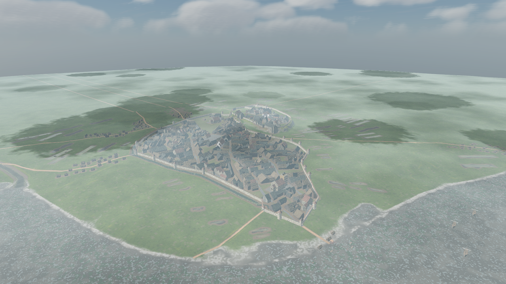
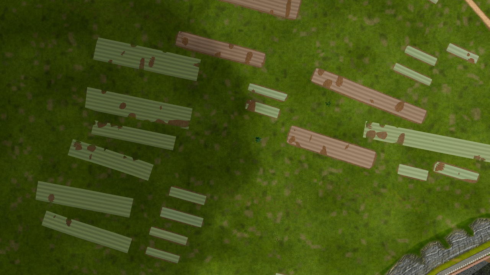
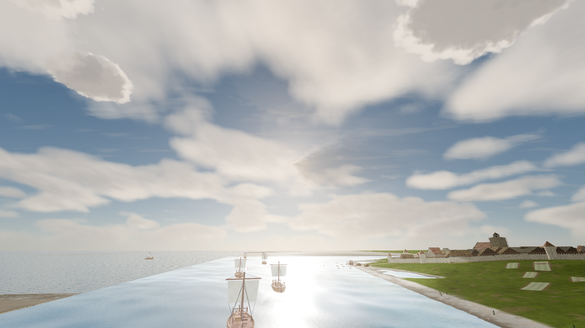
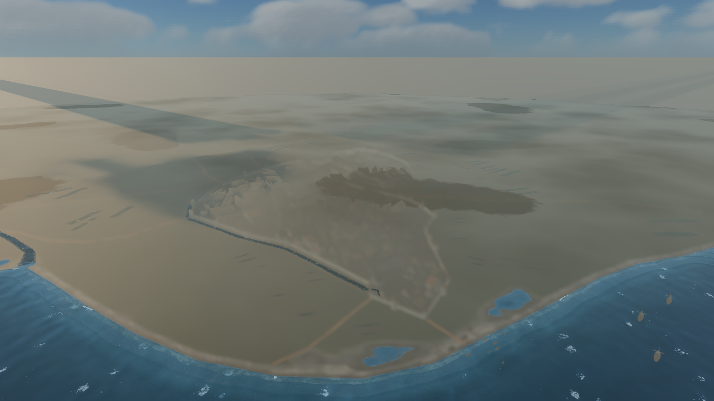
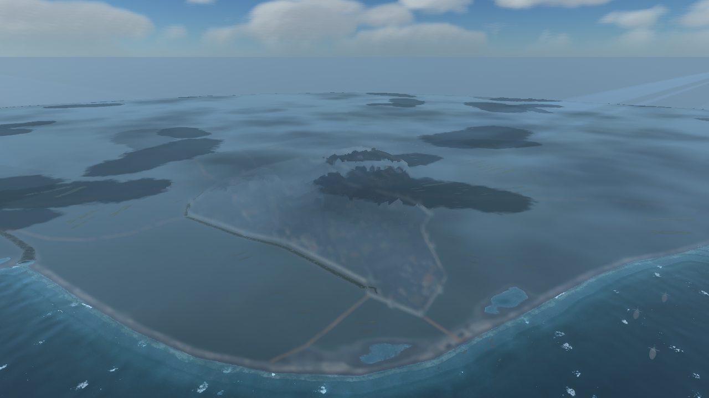

# Cloud cells, shadows and storm-cell lightning

Status: implemented (R-1400 through R-1533; see [`SKY_ATMOSPHERE.md`](./SKY_ATMOSPHERE.md) for the wider weather presentation).

Scope: discrete world-space cumulus and cumulonimbus in the 3D maps and seamless city, including cloud-volume rendering, movement, growth, merging, local shadows, storm rain, lightning and sunbeams. Cloud-cell counts now also follow the shared Tallinn seasonal climate curve: fair-weather cumulus convection is strongest in summer and reduced, but not eliminated, in winter.

Out of scope: seasonal weather probabilities, terrain-reactive clouds, thunder audio distance, storm-following puddles and mud, and replacing the continuous distant cloud deck (R-1768 kept the deck and gave it lobes and self-shadow instead, see [lit cloud deck](./SKY_ATMOSPHERE.md#lit-cloud-deck); the cells stay for parallax near the player and for storms). Winter storm cells remain governed by storm weather; the seasonal adjustment targets fair-weather cumulus, not storm probability.

## Visual field guide

The plates below are generated from the live seamless-city renderer by `tools/capture_cloud_cells.gd`. They are existing visual evidence, not painted concept art. Compare the same type of cloud from the street, above the city and from a shadow-focused overhead view.

| State / phenomenon | Appearance and viewing angle | Plate |
|---|---|---|
| Fair-weather cumulus | Separate bright, lobed puffs with flatter grey bases; viewed over the town |  [`street view`](../reports/images/weather/cells_street_cumulus.png) |
| More numerous cumulus | Denser field under a cloudier sky, from above |  |
| Cloud life and shape | Growth, ageing, breakup and wind-stretched lobes |  [`field view`](../reports/images/weather/cells_field_cumulus.png) |
| Overhead shadow | Soft cloud shadow on roofs, streets and ground |  [`harbour`](../reports/images/weather/cells_harbour_shadow.png) |
| Isolated thunderstorm | Tall, wide cumulonimbus tower, rain curtain, visible from the horizon |  [`merging from cumulus`](../reports/images/weather/cells_tower_merge.png) |
| Rain and lightning | Local rain only beneath the cell; ground strike or flash within the cloud |  [`away from cell`](../reports/images/weather/cells_storm_rain_away.png) · [`ground strike`](../reports/images/weather/cells_storm_ground_stroke.png) · [`in-cloud flash`](../reports/images/weather/cells_storm_in_cloud.png) |
| Broken cloud at low sun | Sunbeams and a sun-shower rainbow against a storm curtain |  [`rainbow`](../reports/images/weather/cells_shower_bow.png) |
| Skyward view | Cloudless sky compared with fair cumulus and broader weather context |  [`cloudless`](../reports/images/weather/cells_sky_cloudless.png) · [`weather context`](../reports/images/weather/cells_sky_context.png) |

**Day/night note:** cells, their shadows and sunbeams are daylight phenomena; shadows fade at night. The current capture suite includes sky/cell views, sunrise-angle beams and lightning, but does not provide a matched all-weather night plate set. Night cloud appearance should be reviewed separately from the daytime atlas.

### Seasonal comparison

The shared climate weights smoothly reduce fair-weather cumulus convection in the cold season. The intended read is fewer and weaker fair-weather puffs in winter, with occasional winter cumulus still possible; summer gets the full fair-weather count. This does not ban winter clouds or erase storm cells. Weather cover still drives the cloud deck and storm intensity still drives cumulonimbus.

The January/July pair below was captured by the live-city renderer with identical requested weather, camera and framing. The capture run also emitted unrelated city-builder script errors (`site_kit.gd` and dependent landmark builders) from the already-dirty worktree; treat these plates as a provisional comparison and rerun after those project errors are resolved.

| Winter | Summer |
|---|---|
|  |  |

The count scale is blended from `SeasonState.season_weights`: winter 0.35, spring 0.75, summer 1.0 and autumn 0.65. Those are presentation tuning weights, not a claim that real winter cumuliform clouds are impossible. Storm-cell counts remain unchanged by this fair-weather scale.

## What changes with season and weather

| Driver | What it changes | What it does not change |
|---|---|---|
| Campaign date / climate season | Fair-weather cumulus count and convection strength | Weather-cycle probabilities and storm-cell count |
| Weather cloud cover | Number of fair-weather cells and distant deck; closed deck suppresses discrete cumulus | Seasonal climate weights |
| Storm intensity | Number and growth of cumulonimbus cells | Fair-weather seasonal scale |
| Wind | Cloud drift, shape stretch, shadow travel and rain slant | Seasonal calendar |
| Sun elevation | Cloud lighting, projected shadow, rays and day/night visibility | Cloud population |

## Runtime and data

| Piece | Entry point |
|---|---|
| Deterministic cloud field, seasonal count scaling | `scripts/map/view3d/cloud_cells.gd` (`CloudCells.counts_for`, `update`) |
| Seasonal climate weights | `scripts/global/season_state.gd` (`SeasonState.season_weights`) |
| Weather date and cell update | `scripts/map/view3d/sky_weather_3d.gd` (`set_calendar_date`, `_update_cells`) |
| Volume, beams and lightning | `scripts/map/view3d/sky_weather_3d.gdshader` |
| Ground shadows | `scripts/map/view3d/cloud_shadow_pass.gd` and shader |
| Review plate capture | `tools/capture_cloud_cells.gd` |
| Regression coverage | `tests/godot/test_cloud_cells.gd` |

The field is deterministic from the cloud clock, drift, weather counts and campaign date. Date-derived cell counts are rebuilt from the shared calendar; they are not additional saved state. Cloud cell positions and life stages remain functions of the existing cell clock and drift.

## Verification and known limits

Run the cloud regression suite with:

```sh
godot --headless --path . --script tools/run_godot_tests.gd
```

Capture the full plate set (requires the project renderer wrapper) with:

```sh
tools/godot_render.sh --script tools/capture_cloud_cells.gd
```

Capture just the seasonal pair with:

```sh
tools/godot_render.sh --script tools/capture_cloud_cells.gd -- --only=cells_season_winter,cells_season_summer
```

The seasonal atlas pair is a new capture target and must be rendered after the code change; existing seasonal image placeholders are not evidence. Current seasonal logic changes fair-weather cloud counts, not weather probabilities, cloud base altitude, droplet phase, snow/cloud interaction, or storm frequency. Matched night captures and winter-specific cloud morphology remain candidates for later tuning.

## Implementation notes

Cells are packed into fixed slots and computed as pure functions. Cumulus drift faster than the distant dome deck, grow and dissolve, and can merge in a convective hotspot. Mature cumulonimbus cells own local rain and lightning. Every cell can project a soft shadow along the sun direction; the dome deck remains the far continuous layer. Since R-1768 the deck is lit as heaped lobes on the recommended tier, and its ground shadow takes the same lobed edges, so deck and cells read as one cumulus field. The season factor scales only the cumulus count after the weather-cover/deck calculation so seasonal transitions do not abruptly replace the weather state.

Screenshots and code are presentation-only; they do not change gameplay or weather save schema.

## Related documentation

- [Sky and atmosphere overview](./SKY_ATMOSPHERE.md)
- [Sky/weather saved-state contract](../SKY_WEATHER_STATE_CONTRACT.md)
- [World presentation and weather cycle](./WORLD_PRESENTATION.md)
