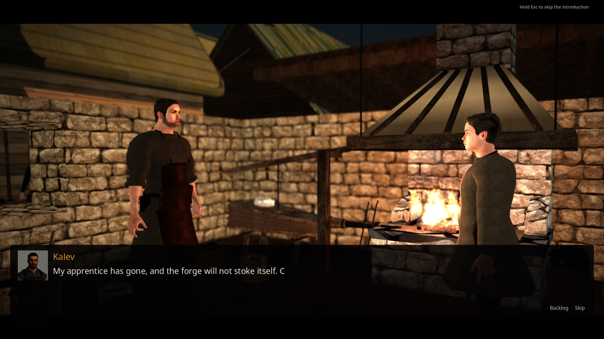
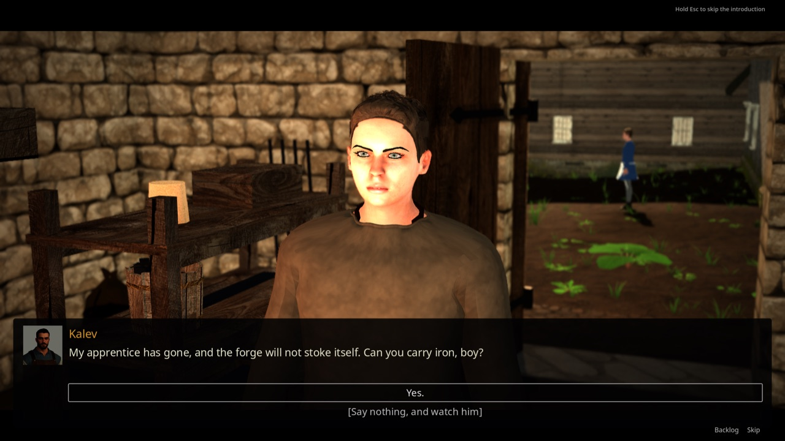

# Cutscenes

**Status:** implemented (tasks **R-1316**, **R-1317**, **R-1318**, **R-1331**; opening vision removed by **R-1763**; [ADR 0034](../adr/0034-cutscene-mode-and-cinematic-prologue.md))

Authored cinematic sequences played as a dedicated mode: a letterboxed frame with a slow
camera move, a place-and-date caption, a speaker plate, and a chain to whatever runs next.
The shipped tier is **stills**; every shot already carries the slot and the prompt for the
later **AI-video tier** with voice-over and lip-sync.

**In scope:** the sequence record format, the player, skip and chaining behaviour, and the
three prologue sequences. **Out of scope here:** in-engine scripted-camera cinematics
(removed by ADR 0034), ambience (field reserved, nothing wired), localization of shot text,
and menu replay of a seen cutscene.

## Prologue flow

New Game starts in the seamless city inside Kalev's smithy, where the porter's spirit duel is fought in place, followed by the Kalev dialogue (R-1872, see [`SPIRIT_DIALOGUE.md`](./SPIRIT_DIALOGUE.md#new-game-duel-in-the-smithy-r-1872)). The year card and closing still-image cutscene do not play; their authored records are retained but unused by this flow.

**Kalev's arrival is framed, not staged (R-1877).** When the duel closes, the porter is gone at
the cut ("went out of my door"), Kalev stands in the forge bay and the boy turns to him. No scene
loads: `ConversationShot` puts a second `Camera3D` into the same city world at eye level and
frames the two speakers from the side the gameplay camera was on, kept inside the arena disc so
it stays in the room (the lens widens up to 60 degrees rather than cropping a speaker when the
room is tight). The shot fades up from black, pushes in slowly, and adds a snapshot of the live
grade with higher contrast and lower saturation, a far depth blur behind the speakers, a
vignette and thin letterbox bars. Gameplay HUD layers and overhead health bars are hidden for
the shot; the dialogue box stays. When the dialogue ends (or Esc is held) the gameplay camera,
HUD and bars come back exactly as they were, and play continues in the smithy. This is
dialogue framing over normal play, not a cutscene record, so the ADR 0034 rule against
per-scene camera rigs is unaffected: nothing is authored per shot.



**Universal conversation camera (R-1888, [ADR 0047](../adr/0047-interaction-stances-and-conversation-camera.md)).** The same `ConversationShot` now frames every conversation, Kalev's and talk with anyone ([`DIALOGUE.md`](./DIALOGUE.md#talk-to-anyone-r-1887)):

- **Opening two-shot** for the first line, then a **close shot over the listener's shoulder** on whoever speaks (`cue_line`), and the reverse shot on the hero while he picks a reply (`focus`). The lens stays on the opening shot's side of the line between the two (180-degree rule); its eye is at the listener's eye height and it aims at the speaker's chest so the face sits in the upper third, above the dialogue box.
- **Line of sight.** The city has no 3D colliders, so `ShotOcclusion` (`scripts/prologue/shot_occlusion.gd`) gathers the meshes near the conversation (from the common parent of the world and the speakers: people are mirrored under `MapViewRuntime`, beside `CityWorld3D`) and tests each camera-to-face segment against bounds, then real triangles. Several angles and distances are tried; one that sees the faces past the scenery wins. A passer-by in the way (a mesh under a `Skeleton3D`) does not reject an angle: they are hidden for that shot and shown again at the next cut. The last close-shot fallback is a point of view from just in front of the listener's face.
- **Hand-back.** `release()` cuts back; `release(blend_sec)` cranes the camera along a smooth path to the live gameplay camera (lens, blur and letterbox ease out) and emits `released`. A conversation that turns into a spirit duel uses it (`CRANE_SEC` 1.2 s).



| Input | Effect |
|---|---|
| `interact`, `ui_accept`, left click | advance one line; at the last line of a shot, advance one shot |
| `ui_cancel` tapped | skip the rest of the current shot |
| `ui_cancel` held 0.6 s | skip the whole sequence and jump to its chain target |
| nothing | lines auto-advance after their authored `seconds` |

Keyboard, mouse and gamepad all work, because the player only reads the existing input
actions and never binds a key directly. Skipping is not a loss of information: ADR 0034
requires the facts a player needs to be in the shot **captions**, which are the first thing
written for each shot.

## Runtime entry points

| File | Role |
|---|---|
| `scripts/cutscene/cutscene_sequence.gd` (`CutsceneSequence`) | typed parse of a `cutscene` record into shots and lines; refuses a malformed record by returning `null` |
| `scripts/cutscene/cutscene_player.gd` (`CutscenePlayer`) | `CanvasLayer` that presents the sequence, handles input and timing, and follows the `next` chain |
| `scripts/cutscene/cutscene_scene_host.gd` (`CutsceneSceneHost`) | makes a sequence a `change_scene_to_file` target via an exported `sequence_id` |
| `scenes/intro/start_label.gd` | main-menu **Start** calls `SmithyOpening.start_new_game` (city, spawn `kalev_smithy`) |
| `scripts/prologue/smithy_opening.gd` | New Game prologue in the city smithy: porter duel in place, then Kalev |
| `scripts/prologue/conversation_shot.gd` | eye-level conversation camera in the live world: grade, depth blur, vignette, letterbox, HUD hidden; two-shot, over-the-shoulder cuts (`frame_subjects`, `cue_line`, `focus`), `release(blend)` cuts or cranes back to play (R-1877, R-1888) |
| `scripts/prologue/shot_occlusion.gd` | line of sight for shots against drawn meshes; tells scenery from passers-by (R-1888) |
| `scripts/prologue/almshouse_opening.gd` | the old staged almshouse hall; now only a duel fixture for tests and capture tools, unreachable from New Game |

`CutscenePlayer` runs with `PROCESS_MODE_ALWAYS` and does not pause the tree, so it works
whether or not a world is running. `auto_continue = false` stops it before any scene change;
tests use that.

## Data and stable IDs

Records live in `content/cutscenes/`, are typed `cutscene` with the `cutscene.` ID prefix,
and are loaded by `ContentDB` through `SessionState.DEMO_CONTENT_DIRS`. Schema:
[`schemas/cutscene.schema.json`](../../schemas/cutscene.schema.json).

| ID | Shots | Chain target |
|---|---|---|
| `cutscene.prologue.almshouse_dawn` | 3 | `return` (the host scene continues) |
| `cutscene.prologue.taken_in` | 3 | `door` → scene `reval_city`, spawn `kalev_smithy` |

Per shot: a stable `id`, a `still` under `res://assets/cutscenes/`, a reserved `video`,
`transition_in` (`cut`/`fade`/`dissolve`), a `motion` block (`push_in`, `pull_out`,
`pan_left`, `pan_right`, `tilt_up`, `tilt_down`, `hold` with `zoom_from`/`zoom_to`), a
`caption`, `lines` with optional `speaker`/`speaker_id`/`seconds`/`delivery`/`conditions`, reserved
`sound`, and a required **`authoring`** block holding `direction`, `image_prompt` and
`video_prompt`. The runtime ignores `authoring`; it exists so the prompt that produced a
frame is inseparable from the frame, and so the video tier is written while the scene is
being authored rather than reconstructed later. Grammar for those prompts:
[`cinematics/PROMPT_GRAMMAR.md`](../../cinematics/PROMPT_GRAMMAR.md).

**Conditional lines (R-1335):** a line may carry `conditions` (the dialogue condition ops
from `common.schema.json`, for example `flag_is`). `CutsceneSequence.from_record(record,
state)` keeps such a line only when every condition holds for `state`; without a state
(`CutscenePlayer.play_id`, `CutsceneSceneHost`) conditional lines are dropped, so a
context-free player never echoes a choice the player did not make. `AlmshouseOpening` parses
`cutscene.prologue.taken_in` with the session state, so its first shot adds one line for the
duel's ending (`l1_spared`, `l1_broke`, `l1_struck`, `l1_punished`). Those lines have no voice
take yet and play as timed narration.

Shot and line IDs are stable API: renaming one breaks the generated-art mapping and the
future voice-line mapping. Do not renumber shots when inserting one; append a new ID.

## Where the frames live

`assets/cutscenes/<sequence>/<shot_id>.jpg`, one folder per sequence, with the Godot
`*.import` sidecar committed beside each file. Every frame has a provenance row in
`assets/SOURCES.csv` carrying the generator, the model and the full prompt. 1536x1024,
JPEG; at roughly 0.5 MB each the set stays well under the 10 MiB Git LFS threshold in
[`ASSET_STORAGE_POLICY.md`](../ASSET_STORAGE_POLICY.md).

## Narration voice (R-1331)

No shipped sequence is narrated today: the only narrated one, the conquest vision, was removed with its takes (**R-1763**), and from spring 1343 on the story is "now" and plays without a voice-over (maintainer decision), so chapters II and III carry text or captions only. The voice path below stays for the video remake; `tests/godot/test_cutscene_player.gd` exercises it on a patched copy of `cutscene.prologue.taken_in`. A line may carry an optional `voice` (`res://assets/audio/cutscene_voice/<sequence>/<shot>_<line>.mp3`).
`CutscenePlayer` plays it on the `Voice` bus when the line starts, stops it when the line
is advanced or skipped, and holds auto-advance until the take ends plus a 0.9 s tail (1.8 s when the line closes a shot) and never advances while audio is still playing (the
authored `seconds` is the floor). A missing file degrades to the silent timed line.

The takes are generated by `python3 tools/generate_cutscene_voice.py` with **ElevenLabs Eleven
v4** (`elevenlabs/eleven-v4`) through OpenRouter (`/api/v1/audio/speech`). Eleven v4 is steered
by inline audio tags in the input text, so every take is sent as `CINEMATIC` (`[dramatic]`)
plus a per-line emotion tag (`[sorrowful]`, `[bitter]`, `[softly]`, `[hopeful]`) plus the line.
Keep tags to one short standard word: long descriptive tags made v4 speak the tag words and
stutter the first phrase. After regenerating, transcribe a few takes (`stt` tool) and compare
with the line text; seconds-per-word far above ~0.5 flags a suspect take. The tags go to
the model only; the on-screen text stays untouched in the cutscene JSON. One voice (`brian`);
the emotion runs from sorrowful with a vengeful edge for the conquest history, through
bitter controlled anger on two defiant lines, to hushed and then hopeful once the narration
reaches the boy. Per-line exceptions live in `LINE_OVERRIDES`. The key comes from `OPENROUTER_API_KEY` or the Brute OpenRouter provider config. Re-runs
skip existing files; `--force` regenerates all, `--only <id fragment>` limits to one
cutscene. To retune: edit the tag constants, delete the mp3s to replace, re-run, then
`godot --headless --path . --import`. The tool also writes the `voice` field and the
`assets/SOURCES.csv` rows (approval `draft` until a maintainer listens through).

## Music

A shot's `sound.music` (res:// mp3/ogg) starts an underscore on the `Music` bus, with a 2 s
fade-in, at `sound.music_volume_db` (default -16 dB, kept well under the narrator on the `Voice`
bus; tune it per shot). It keeps playing across the following shots (an empty `music` leaves
it alone; a different path replaces it) and fades out over 3 s when the sequence ends or is
skipped. The fade runs on the tree root so a scene change cannot cut it. The main-menu theme is
crossfaded out by `MusicDirector` as soon as the cutscene scene loads. *The Weight of
Centuries* (`music/intro/`, prompt in `music/README.md`) scored the removed conquest vision at
-11 dB and is kept for the video remake; no shipped sequence sets `sound.music` now. Narration
is trimmed by -4 dB (`VOICE_DB` in `CutscenePlayer`). Player Music-bus volume from settings still applies on top.

## Saved state

Cutscenes write no flags. They read state only through conditional lines (above); the almshouse scene around them owns
`flag.prologue.apprenticed` exactly as before. A cutscene is therefore safe to replay and
safe to skip.

## Verification

```bash
python3 tools/validate_content.py content/cutscenes      # schema and ID rules
python3 tools/verify_cutscenes.py                        # frames, sidecars, provenance, chains
godot --headless --path . --script tools/run_godot_tests.gd   # tests/godot/test_cutscene_player.gd
```

Kalev's framed arrival: `tests/godot/test_smithy_opening.gd` (shot mounted in the city world,
porter gone, camera handed back; `compute_shot` keeps both speakers in frame and widens the lens
in a tight room). Review plate: `tools/godot_render.sh --resolution 1600x900 --script
tools/capture_smithy_opening.gd` writes `build/smithy_opening/kalev_shot.png`.

`tools/verify_cutscenes.py` fails when a still is missing, has no `*.import` sidecar, has no
`assets/SOURCES.csv` row, when a shot or line ID repeats, when an authoring field is empty,
or when a `next` target names a cutscene, a transition-manifest scene and spawn, or a scene
file that does not exist.

## Adding a cutscene

1. Write the record in `content/cutscenes/`, captions first, then lines, then the authoring
   block for every shot (follow `cinematics/PROMPT_GRAMMAR.md`).
2. Generate the stills into `assets/cutscenes/<sequence>/`, import them headless
   (`godot --headless --path . --import`), and add `assets/SOURCES.csv` rows.
3. Point something at it: a `CutsceneSceneHost` scene, or `CutscenePlayer.play_id()` from an
   existing scene.
4. Run the three commands above and extend this page.

## Limits

- **Nothing is scored or narrated.** `sound.ambience` is in the schema and unused; the conquest
  vision, the only sequence with music and narration, was removed (**R-1763**) pending its video
  remake.
- **Not localized.** Captions and lines are authored English strings in the record. The
  dialogue-localization route does not cover them yet.
- **No menu replay.** ADR 0034 calls for replaying a seen prologue from the main menu; not
  built.
- **Chapters II and III art is provisional.** The OpenAI image credit ran out during
  **R-1318**, so those six frames are Leonardo.ai fallbacks and are marked `provisional` in
  `assets/SOURCES.csv`. They are visibly softer than the removed `gpt-image-1` frames of
  chapter I and contain minor anachronisms (an overhead wire in `prologue_taken_in/s02_street.jpg`,
  modern-looking footwear in `s01_door.jpg`, window glazing bars in the almshouse frames).
  Regeneration is tracked as **R-1330**; the prompts to re-run are already in the records.
- **Kalev's framed arrival is one fixed shot.** It does not cut per speaker, the boy turns but
  Kalev does not walk in (he is placed at the cut), and the interior roof stays cut away as in
  play, so neighbouring roofs and sky can show above the smithy walls.
- **No video tier.** `video` is parsed and preferred over `still` when set, but no shot sets
  it and no video decoding path has been exercised.
