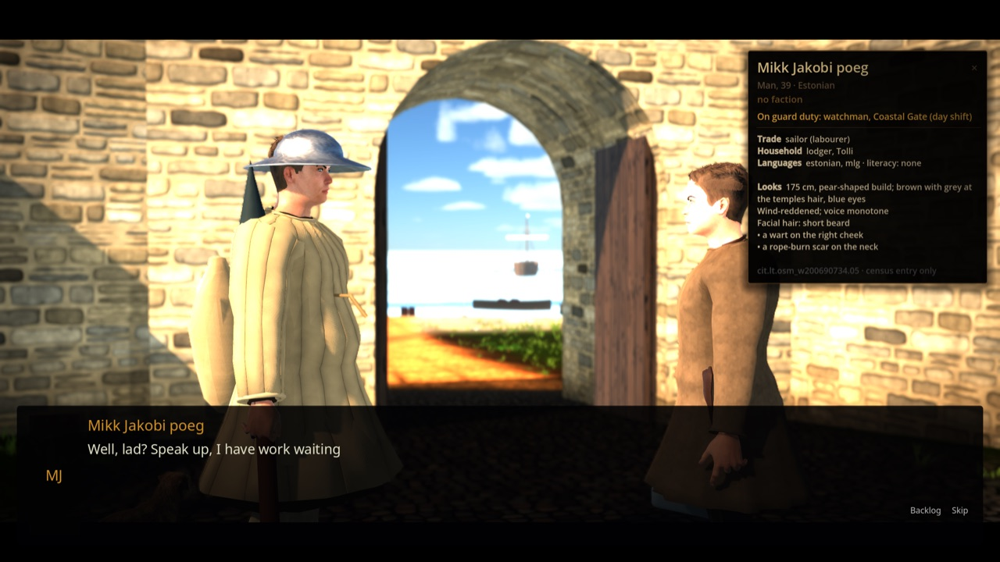
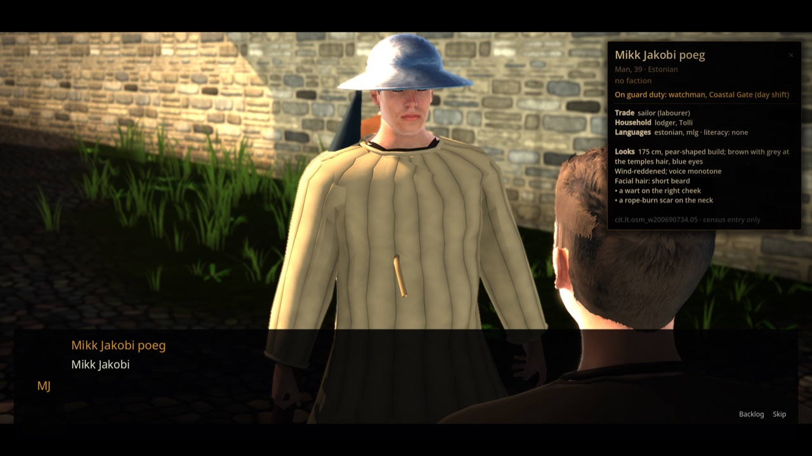
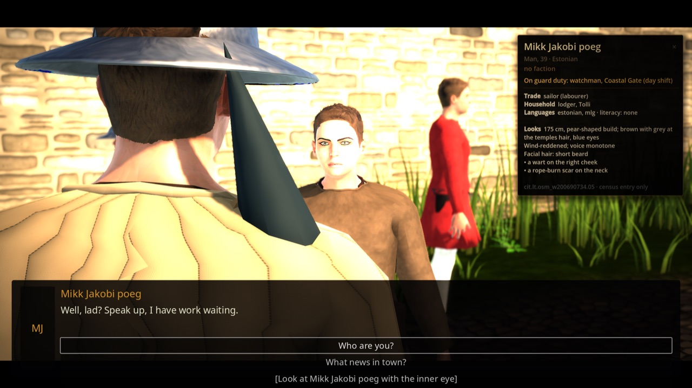
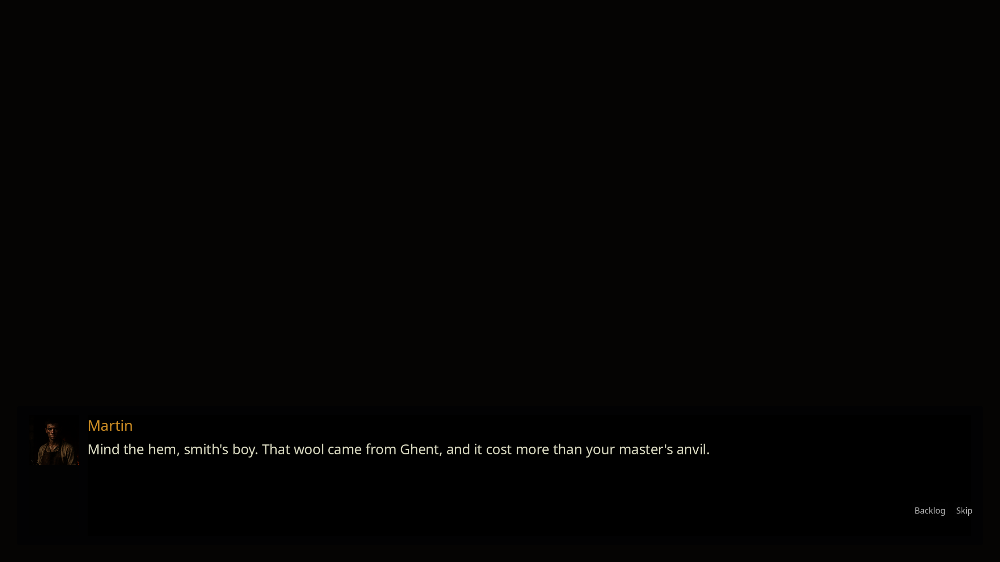

# Dialogue, barks, and localization

Status: implemented (tasks **P1-011** runner, **P1-012** UI, **P1-013** settings, **P1-014** overflow and pseudo-localization). Scope: authored branching conversations, ambient barks, the dialogue panel, localization catalogs, and the offline voice handoff. Policy: all dialogue is authored offline, with no runtime LLM or free-text chat ([ADR 0003](../adr/0003-authored-offline-dialogue-and-prohibit-runtime-llm.md)).

## Player-facing behavior

- **Anyone in the city** can be talked to: see [Talk to anyone](#talk-to-anyone-r-1887).
- **Conversations** open a bottom panel with speaker name, optional 144 px portrait, and typewriter text. Continue with interact / `ui_accept` / click. `ui_cancel` first completes the line, then skips. Choices are listed with keyboard/gamepad focus (`ui_up` / `ui_down`). Disabled choices stay visible and show their authored reason.
- **Barks** are non-blocking speech bubbles over the speaker's 3D head. They expire after about 3.2 s and never capture input, so movement and camera stay live.
- Speakers in the `dialogue_speakers` group get `on_dialogue_speaker(speaker_id, text_length)` for talking animation.
- Settings (Settings → Dialogue): text scale `small / normal / large / extra_large` (0.85–1.5×), text speed `slow / normal / fast / instant` (18 / 36 / 72 chars/s / instant), high contrast, subtitle background, reduced motion, subtitles and bark subtitles on/off, voice on/off, locale, and pseudo-localization. See [`SETTINGS_AND_ACCESSIBILITY.md`](./SETTINGS_AND_ACCESSIBILITY.md).

## Runtime pieces

| Piece | File | Role |
|---|---|---|
| `DialogueRunner` | `scripts/dialogue/dialogue_runner.gd` | Plays a `dialogue.*` record: entry variants, node conditions, effects, `once` nodes (tracked in `GameState`), choices, and `next_node_id` chains. `start(id)`, `advance()`, `select_choice(id)`; signals `started` / `finished`. Barks: `resolve_bark(pool, phase, location)` / `play_bark(...)`. |
| `DialogueEntryResolver` | `scripts/dialogue/dialogue_entry_resolver.gd` | Picks the highest-priority `entry_variants[]` node whose conditions pass, else `start_node_id`. |
| `DialoguePresenter` / `DialogueUiPresenter` | `scripts/dialogue/` | Presenter contract between runner and UI (tests use `tests/godot/dialogue_test_presenter.gd`). |
| `DialogueUI` | `scripts/dialogue/dialogue_ui.gd` | The panel, with helpers `DialogueUiBuilder` (node tree), `DialogueUiChoices`, `DialogueUiInput`, `DialogueUiReveal` (typewriter), `DialogueUiTheme` (colors), `DialogueTextScale`, `DialogueTextLayout` (overflow geometry). |
| `DialogueBarkPresenter` | `scripts/dialogue/dialogue_bark_presenter.gd` | World-anchored bark bubble. |
| `DialoguePortraitResolver` | `scripts/dialogue/dialogue_portrait_resolver.gd` | Portraits for Mart, Kalev, Henning, and Aita from `assets/characters/portraits/` (`KNOWN_PORTRAITS`); then the `portrait` field of the speaker's `NamedNpcRegistry` row; any other `char.<slug>` falls back to `assets/characters/portraits/npc/<slug>.png` (task **R-1566**). No file means no portrait. |
| `DialogueTextFormatter` | `scripts/dialogue/dialogue_text_formatter.gd` | Expands runtime tokens (below). |
| `DialogueLocalization`, `DialoguePseudoLocalization` | `scripts/dialogue/` | Catalog lookup and the layout stress mode. |

Barks are also played by `MapPatrolBarkPresenter`, `SocialReputationController`, `MarketDayController`, `WorldItemPickupFeedback`, and the forge prologue.

## Content

- `type: dialogue` ([`schemas/dialogue.schema.json`](../../schemas/dialogue.schema.json)): `participants`, `start_node_id`, optional `entry_variants[]`, and `nodes[]` with `speaker_id`, `text` or `text_key`, `conditions`, `effects`, `once`, `next_node_id`, and `choices[]` (`target_node_id`, `conditions`, `effects`, `disabled_reason`). Conditions and effects: [`STATE_AND_SAVES.md`](./STATE_AND_SAVES.md#conditions-and-effects).
- Optional foreign-language markup on nodes (`language`, `gist`, `imagery`) and choices (`comprehension`), ADR 0033: see [`SPIRIT_DIALOGUE.md`](./SPIRIT_DIALOGUE.md#language-comprehension-implemented-sd-08).
- Optional spirit-duel markup (`duel`, per-node and per-choice `move`, ADR 0033): see [`SPIRIT_DIALOGUE.md`](./SPIRIT_DIALOGUE.md#dialogue-move-tags-implemented-sd-02).
- `type: bark` ([`schemas/bark.schema.json`](../../schemas/bark.schema.json)): `selection: first_valid_in_order`, optional `phase_ids` / `location_ids` scope, and `entries[]` with `priority` and `conditions`. Selection is deterministic: highest priority first, first passing entry wins.
- Records live in `content/examples/valid/`, `content/demo/`, and quest packages. Every record carries `deterministic_offline: true`.

### Text tokens

`{trade_price:<good_id>}` becomes the current district price for that good (for example `{trade_price:trade.iron}`); see [`FACTIONS_AND_ECONOMY.md`](./FACTIONS_AND_ECONOMY.md#trade-prices).

## Localization and voice

Catalogs live in `localization/<locale>.json` (`en`, `et`). Lookup order is requested locale → language base → default → inline `text`. Details and the offline ElevenLabs voice-manifest handoff are in [`localization/README.md`](../../localization/README.md). The voice manifest is `docs/data/dialogue_voice_manifest.json`.

## Verify

```bash
godot --headless --path . --script tools/run_godot_tests.gd -- --filter=test_dialogue
python3 tools/dialogue_voice_manifest.py --content content/examples/valid --content content/demo --locale en --output docs/data/dialogue_voice_manifest.json --check
```

## Limits

- The demo Mart street conversation (`DemoMartEncounter`) and the forge Henning/cat conversations (`scenes/reval_east/forge/forge_dialogue_encounter.gd`) still use the linear `DemoDialogueRunner` + `DemoDialogueBox` from D-002, which the script header marks superseded by `DialogueRunner`. Migrating them is open work ([`docs/reports/code_health_audit_2026-10-07.md`](../reports/code_health_audit_2026-10-07.md)).
- Portraits: four core speakers plus 98 named NPCs imported from `characters/**/img/<slug>.jpg` and `docs/CHARACTERS/img/sheets/<slug>.jpg`.

## Talk to anyone (R-1887)

Status: implemented (tasks **R-1885** card, **R-1886** stance, **R-1887** talk, **R-1888** camera, **R-1889** duel; epic **R-1884**, [ADR 0047](../adr/0047-interaction-stances-and-conversation-camera.md)). Scope: every census resident and named NPC in the seamless city. Out of scope: per-person authored dialogue, cats and other creatures (no city cats exist yet; the contract below fits them), state or reputation from small talk, guilt for duels with strangers.

**What the player does.**

- Walk up to anyone (within 4 m). The name over their head adds what a click does: `E  Talk`, `LMB  Strike` with the weapon drawn, `E  Spirit duel` in spirit sight. Further away it shows only the name.
- **Talk:** left click (press and release on the person, no drag) or `interact` (`E`, gamepad A). The person stops and turns to the hero, their card docks top-right, and the conversation camera frames both. Replies: *Who are you?* (name, trade or title, and whom they stand with), *What news in town?*, *[Look at them with the inner eye]*, *God keep you.*
- **Inner eye:** the reply ends the talk, the camera cranes up to the play view, and a spirit duel against that person opens in place ([`SPIRIT_DIALOGUE.md`](./SPIRIT_DIALOGUE.md#spirit-duel-with-anyone-r-1889)).
- **Armed:** with the weapon drawn (`G`) the click is a blow ([`COMBAT.md`](./COMBAT.md#peaceful-and-armed-stance-r-1886)); `interact` still talks and sheathes the weapon, which is how a gamepad puts it away.
- A click is decided at release: a press that moves more than 8 px is a drag, never a talk, so drag gestures on bodies keep working.





**Runtime.**

| Piece | File | Role |
|---|---|---|
| `CharacterConversation` | `scripts/dialogue/character_conversation.gd` | `open_with(parent, player, body, rig, who, keep)` starts the talk (or the duel in sight); holds the person, sheathes the weapon, frames the shot, runs `DialogueRunner` + `DialogueUI`, escalates `inner_eye` to the duel; `ended(outcome)`. Static helpers: `active`, `in_reach`, `action_hint`, `make_tag`, `tag_text`, `side_line` |
| `CityCitizens.activate`, `CityNamedNpcs.activate` | `scripts/city/` | click (at release) or `interact` → card + conversation; `person_at_screen` lets `MapClickInputController` leave a peaceful click on a person to them |
| `CitizenActor` / `NamedNpcActor` | `scripts/city/` | `hold_for_talk(hero)` / `release_talk()`: stand still, face the hero; the clock resumes on release |
| `DialogueRunner.speaker_names`, `.text_tokens` | `scripts/dialogue/dialogue_runner.gd` | display name per speaker id; `{key}` replacements in lines and choices |
| `DialogueUI.portrait_overrides`, `line_shown`, `choices_shown` | `scripts/dialogue/dialogue_ui.gd` | portrait per speaker id; signals the camera cuts on |
| `CitizenInfoPanel` | `scripts/city/citizen_info_panel.gd` | the card (R-1885): opaque bronze-rimmed panel, portrait beside name, title and faction row, `dock_right()` during a conversation |

**Data.** [`content/dialogue/`](../../content/dialogue/README.md): `dialogue.city.small_talk`, `dialogue.city.spirit_duel`, placeholder speaker `char.interlocutor`. Tokens: `{interlocutor_name}`, `{interlocutor_title}`, `{interlocutor_side}`. Nothing is saved; the dialogue sets no flags.

**Verify.** `godot --headless --path . --script tools/run_godot_tests.gd -- --filter=test_character_conversation,test_conversation_shot,test_map_click_input_controller`; plates: `tools/godot_render.sh --resolution 1600x900 res://tools/capture_character_talk.tscn -- --city-spawn=gate.coastal --city-hour=15 --out=res://build/character_talk_gate`.

**Limits.** One generic conversation for everyone; the news line is the same for all. Census residents have no portrait (initials show). A person released after a duel snaps back to where the clock puts them. In a dense crowd the camera hides passers-by who stand in the shot; they reappear at the next cut.

## Named NPC portraits (R-1566)

`python3 tools/assets/import_npc_portraits.py` crops each `characters/**/img/<slug>.jpg` and `docs/CHARACTERS/img/sheets/<slug>.jpg` to a top-aligned square (head and shoulders, 256 px max, sRGB PNG) into `assets/characters/portraits/npc/`. It is idempotent and fails on duplicate slugs. Provenance rows live in `assets/SOURCES.csv` (candidate, art approval pending per ADR 0044). It then lists registry NPCs whose `portrait` is null or missing on disk (currently `char.old_toomas`, `char.ironhand`); those need new art in a follow-up task. `DialoguePortraitResolver.portrait_path()` checks, in order: `KNOWN_PORTRAITS` (core cast), the `portrait` field of the [`NamedNpcRegistry`](./NAMED_NPCS.md) row (registry ids such as `char.martin_cloaks` need not match the jpg stem `martin`), then `char.<slug>` → `npc/<slug>.png` by naming convention for speakers outside the registry. Limits: portraits are 256 px squares cropped from the top of full-body sheets, so a few heads sit off-centre. Tests: `tests/godot/test_dialogue_portrait_resolver.gd`, `tests/python/test_import_npc_portraits.py`. Capture: `tools/godot_render.sh --resolution 1280x720 --script tools/capture_named_npc_dialogue.gd -- --out=res://docs/reports/images/dialogue`.


