# Equipment variants: pipeline, art bible and the watch spear pilot

Status: implemented (tasks **R-2003** EQ-1 and **R-2004** EQ-2 of epic **R-2002**). The pipeline and art bible are in place and proven on one item: the town-watch spear variant `spear_p1_w1`. Every census resident's worn layers and hand gear now carry a prestige and wear cell chosen from the census, with a fallback to the base item while a cell has no file ([Runtime variant choice](#runtime-variant-choice-r-2004)); player items carry a save-safe variant id.

Scope: how a period-accurate item brief becomes a game-ready Godot asset in several prestige and wear variants; the rules every equipment variant follows; how the city picks a variant per resident; the pilot.
Out of scope: every other item family and its variant files (R-2005..R-2034, one task each), stats or prices per variant, retiring the legacy primitives (R-2035), the walk-cycle arm pose (R-2036).

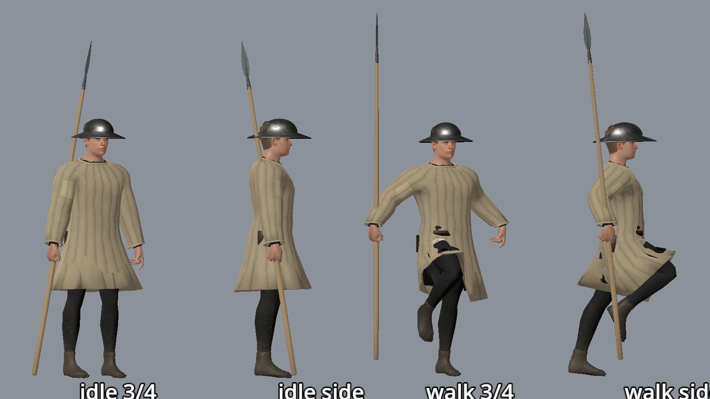

## Two routes, one rule

| Item kind | Route | Why |
|---|---|---|
| Rigid: weapons, helmets, shields, shoes, belt gear, buckles | Leonardo reference -> Meshy image-to-3D -> Blender cleanup (`tools/assets/equipment/cleanup_equipment.py`) -> GLB | Meshy copies a good reference with real riveting, forging marks and wear |
| Fitted garments: aketon, tunics, hose, mail, surcoats, hoods | stay `garments.py` meshes skinned to the shared 71-bone rig; only their surface changes, from tileable PBR plates (`tools/assets/equipment/derive_tileable_pbr.py`) | a Meshy scan is a rigid shell; a garment must keep the body topology to deform |
| Long poles (spear, glaive, bill shafts) | only the iron is scanned; the shaft is built procedurally by the cleanup script | Meshy cannot resolve a 2 m pole 3 cm thick |

## Variant axes and naming

- **Prestige** `p1` munition / peasant (plain, issued, homemade), `p2` burgher (good materials, maker's care), `p3` noble (fine work plus a faction finish: crown red, Order white, the town's colours). The finish is colour and material only, never invented heraldry.
- **Wear** `w0` new, `w1` used (the default), `w2` battered: rust, dents, patches. Wear is modelled into the scan or plate, not only a runtime tint.
- **File name** `<family>_
_<w>.glb` under the family's folder: `assets/props/weapons/<family>/variants/`, `assets/props/armour/<family>/variants/`, `assets/props/clothing/<family>/variants/`. Textile plates under `assets/materials/equipment/<plate>/`.
- **Stable ids:** the variant id is the file stem (`spear_p1_w1`); the item it belongs to is its object-catalog id (`obj.spear_watch`, [`OBJECT_CATALOG.md`](./OBJECT_CATALOG.md)), which links on to combat `item.*` records. Variant ids never change once shipped; a remodel gets a new wear or prestige slot, not a reused name.
- Not every cell of the 3x3 grid exists; each item task lists the cells it ships.

## Runtime variant choice (R-2004)

**Census rules** (`tools/city/citizen_wardrobe.py`, run by `tools/city/build_citizen_runtime.py` after the duty roster and the wardrobe): every resident gets a cell `p<prestige>_w<wear>`, a pure function of the record, so the same census gives the same variants.

| Axis | Rule (`prestige_of`, `wear_of`) |
|---|---|
| Prestige by office | town watch `p1` (town munition), crown men on duty `p2` (crown issue), watch sergeant `p1` (`p2` for the crown's), gatekeeper `p1`; noble knights `p3`; men-at-arms and squires `p2` under the crown or Order, else `p1` |
| Prestige by rank | patricians and nobles `p3`; merchants, masters, journeymen, clerks, clergy `p2`; the poor `p1`. A rich burgher's own gear outranks the town sergeant's issue |
| Wear | rebels (`harju_kings`, `black_cloaks`, `vitalienbruder`) always `w2`, old and looted; Livonian Order `w0` or `w1` (kept by the house); everyone else from a roll of the id, older (50+) and hard trades (porters, carters, smiths, masons, sailors...) toward `w2`, the young (under 25) and the rich toward `w0` |
| Issue kits | the duty kit's layers (aketon, kettle hat, mail, surcoat) and the hand weapon share one cell per unit, `crc32("issue:<kit>:<post>")`: men of one post carry the same store's gear, men of different posts differ. Wear odds per lord `ISSUE_WEAR` (the crown keeps its stores better) |

**Data** (`content/world/reval_city/citizens.json`): `wear` entries are `"<layer>@<cell>"` (`"kettle_hat@p1_w2"`); own clothes take the resident's cell, duty-kit layers the unit's. `gear_variant` (only on residents with a duty weapon or a shield) is the cell of the spear, sword or shield. Layer ids, garment ids (`wear_<layer>`) and the item ids are unchanged; the cell is extra data.

**Runtime** (helper `scripts/city/equipment_variant.gd`, preloaded): `CitizenGear` mounts `<dir>/<family>_<cell>.glb` (`assets/props/weapons/spear/variants/spear_p2_w0.glb`, `.../sword/variants/sword_<cell>.glb`) when shipped, else the base item (`spear_p1_w1`, the legacy sword); the mounted node carries meta `variant` = `spear_<cell>`. `CitizenWardrobe.dress` mounts `<body>/layers/<layer>_<cell>.glb` when shipped, else the base layer; `CitizenShield.scene(kind, field, cell)` uses `assets/props/armour/heater_shield/variants/heater_shield_<cell>.glb` when shipped, else its built board. Until the item tasks ship the cells, a fallback is told apart by a stand-in finish: `w0` slightly brighter and smoother, `w2` darker, rougher and, on iron, rust-browned with less bare metal; layer cloth scales its patches, fade and dirt by `CitizenWardrobe.CELL_WEAR`; shield paint fades toward the wood. `w1` is the base look. Finished materials are shared per source material and wear, or the rig's own per-garment duplicate, so no resident adds a material of its own.

**Player items:** an item instance may carry a `variant` id (`spear_p2_w0`): `InventoryPlacement.variant`, `GameState.equipped_variant(slot)`, and the world item record's `variant`. Pickup (`WorldItemController`), drop, equip and unequip carry it through; bag stacks merge only with the same variant. Saves write it only when set (bag rows `variant`, top-level `equipped_variants`, world item records), so old saves load as the base item ([`STATE_AND_SAVES.md`](./STATE_AND_SAVES.md)). The item id (`item.forge_spear`, `obj.spear_watch`) never changes. No seeded item sets a variant yet, and the player's held weapon is drawn from the item's base scene.

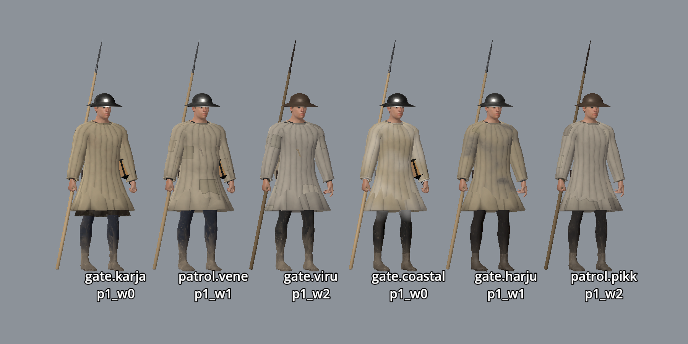
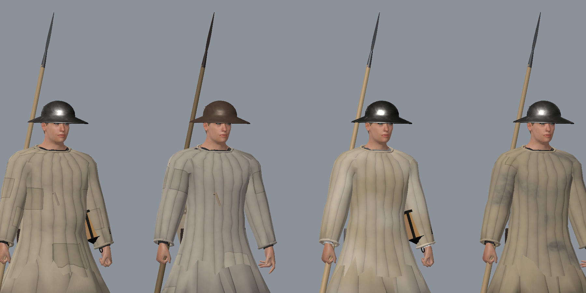

## Budgets

| Kind | LOD0 tris | LOD1 tris | Textures |
|---|---|---|---|
| Hand weapon (spear, sword, axe) | <= 4k | <= 1k | 1024 px base colour, normal, ORM |
| Helmet | 3-6k | <= 1.5k | 1024 px |
| Shield | <= 3k | <= 1k | 1024 px |
| Fitted garment | keeps the body topology | Godot import LODs | tileable plates, 512-1024 px |

ORM: occlusion in R, roughness in G, metal in B, as one image (glTF reads R as occlusion and G/B as roughness/metal from the same texture). Godot generates mesh LODs at import; the cleanup script also writes a LOD1 GLB to `build/equipment/` to check that the item survives the LOD1 budget.

## Attach sockets

Every rigid variant's origin is where it attaches, so code mounts it with a turn and no offset. Socket empties export as child nodes:

| Socket | Used by | Slot on `SharedCharacterRig` |
|---|---|---|
| `socket_grip` (origin) | hand weapons: where the right hand closes | `right_hand` |
| `socket_butt`, `socket_tip` | hafted weapons: ground contact, thrust point | - |
| `socket_forearm` (origin) | shields, strapped to the left forearm | `left_hand` |
| `socket_hip`, `socket_back` | sheathed sword, slung shield or bow (R-2004) | planned |
| `socket_head` (origin) | helmets and hats: the top of the head cavity | head bone |

Axes: the item's long axis is Godot +Y (point up), its flat face toward Godot +Z. The hand slot's X axis points down the forearm, so `Basis(Vector3.BACK, PI * 0.5)` turns the item's +Y up along the hand (`scripts/city/citizen_gear.gd`).

## Art bible

- **Iron and steel:** wrought iron is grey-black, matte, hammer-marked; bright metal only on a freshly filed edge. No chrome, no mirror plate, no blued or gilded fittings below `p3`. The cleanup script floors roughness (`rough_floor`, 0.45 on the pilot) and caps metal.
- **Wood:** ash for spear and polearm shafts, birch or ash for tool hafts; pale grey-cream to honey, greyer and grimier with wear. No dark walnut, no varnish.
- **Textiles:** undyed grey-brown wool for labourers and the watch, woad blue and madder red for burghers, scarlet (fine fulled wool) only for the rich, linen for shirts, coifs and aketon covers. Quilting runs vertically.
- **Leather:** vegetable-tanned brown, darkening with wear; no black patent, no studs as decoration.
- **Forbidden:** fantasy ornament, spikes, engraving and etched blades, invented heraldry or faction badges, Renaissance or later forms (plate armour harness, ruffs, rapiers), modern straps and buckles.
- **Look target** for the watch, generated in the R-2002 feasibility check:

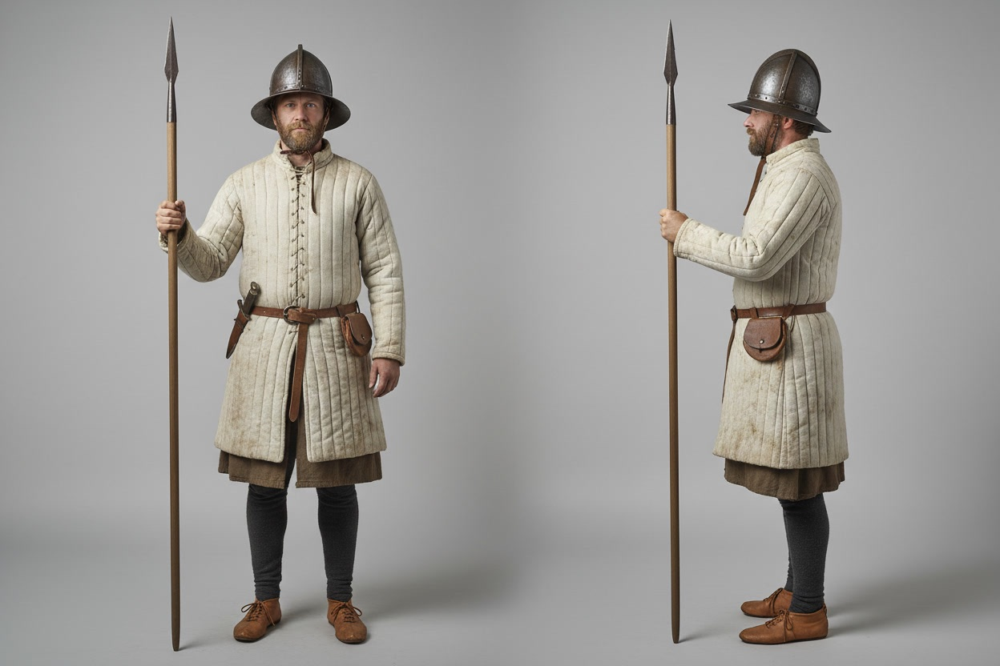

## Historical checklist per item

Every item task fills this in its manifest or task body before generating, and cites the dossiers [`arms-and-armour-livonia-1340s.md`](../../history/dossiers/military/arms-and-armour-livonia-1340s.md) and [`clothing-and-status-markers.md`](../../history/dossiers/dailylife/clothing-and-status-markers.md):

1. Who carries it in Reval 1343 (watch, crown men-at-arms, Order, burgher, Estonian levy) and in which prestige cells.
2. Who made it (town smith, imported, carpenter, home) and so how fine `p2`/`p3` can be.
3. Shape and size from the dossier ledger, with the shapes it must not have (later or fantasy forms).
4. Materials and colours from the art bible above.
5. Evidence level (plausible composite or source-backed) copied from the dossier.

Pilot answers (spear): carried by the burgher watch and crown men-at-arms ("padded jack, iron cap, sword, crossbow or spear", arms dossier); head by the town smith, ash shaft by a carpenter (item ledger row 1); socketed leaf blade, no barbs, no wings, no langets; wrought iron and ash; plausible composite.

## Pipeline

All tools live in [`tools/assets/equipment/`](../../tools/assets/equipment/); prompt templates in [`prompts.md`](../../tools/assets/equipment/prompts.md). Blender runs headless with `--factory-startup`; Godot only with `--headless` or `tools/godot_render.sh`.

1. **Reference** (Leonardo): one isolated object on white, from the template. Inspect it: Meshy copies its mistakes.
2. **Scan** (Meshy image-to-3D, PBR on, `target_polycount` 3000-6000). Move the raw GLB to gitignored `build/<set>/` and put its SHA-256 in the item manifest `tools/assets/equipment/items/<variant>.json`.
3. **Clean up and export:** `python3 tools/assets/equipment/build_equipment.py tools/assets/equipment/items/<variant>.json` checks the raw hash, runs `cleanup_equipment.py` in Blender (align and real-size scale, wearable cavity cut with a liner, procedural shaft, roughness floor, AO bake and ORM repack, pivot and sockets, decimate, LOD1 to `build/equipment/`; the GLB goes to the manifest's `out` under `assets/`, never `generated/`), then renders the turntables with `render_turntable.py`.
4. **Textile and wood plates:** generate a flat texture photo (Leonardo Nano Banana or the ComfyUI graph `comfyui_tileable_textile.json`), then `python3 tools/assets/equipment/derive_tileable_pbr.py --src ... --out-dir assets/materials/equipment/<plate> --stem <plate> --tint r,g,b --preview docs/reports/images/equipment/<plate>_plate.png` makes it seamless (terrain-plate helpers, as in `tools/assets/derive_plate_normals.py`) and derives normal and roughness. Garments use the same plates for their surface.
5. **Import:** `/Applications/Godot.app/Contents/MacOS/Godot --headless --path . --import` writes the `.import` sidecars and the extracted `<variant>_*.jpg` textures; commit them all.
6. **Provenance:** one `assets/SOURCES.csv` row for the GLB (full prompt, Leonardo generation, Meshy task, raw and output SHA-256, cleanup parameters) and one per extracted texture and plate; `python3 tools/validate_asset_sources.py`.
7. **Mount** in code by the variant's socket, and capture it on a character.

## The pilot: watch spear `spear_p1_w1`

- Asset: [`assets/props/weapons/spear/variants/spear_p1_w1.glb`](../../assets/props/weapons/spear/variants/spear_p1_w1.glb), manifest [`items/spear_p1_w1.json`](../../tools/assets/equipment/items/spear_p1_w1.json). 2.33 m overall: a 0.34 m Meshy leaf-blade head (2.4k tris, Leonardo gpt-image-1.5 reference) on a 2.0 m ash shaft, 1.7 cm butt radius, thickest a third of the way up, top matched to the scanned socket. 2,580 tris LOD0, 1,000 LOD1, 512 KiB.
- Shaft plate: [`assets/materials/equipment/ash_shaft_used/`](../../assets/materials/equipment/ash_shaft_used/) from a Leonardo Nano Banana photo, tinted warm (the generator gave white laminate). The forge set's `spear_WeaponAshWood_albedo.png` is dark walnut-brown and was not used.
- Runtime: `CitizenGear.SPEAR` (`scripts/city/citizen_gear.gd`) mounts it on `right_hand` for the `watch` and `crown` kits ([`GATE_GARRISONS.md`](./GATE_GARRISONS.md)); origin at the grip, 0.83 m above the butt, so the idle watchman's butt rests on the ground. Brawling watchmen keep their spear profile ([`COMBAT.md`](./COMBAT.md)). The legacy primitive `assets/characters/shared/spear.tscn` stays in the repo until R-2035.

Turntables (yaw 0-315 deg in 45 deg steps, then from below):

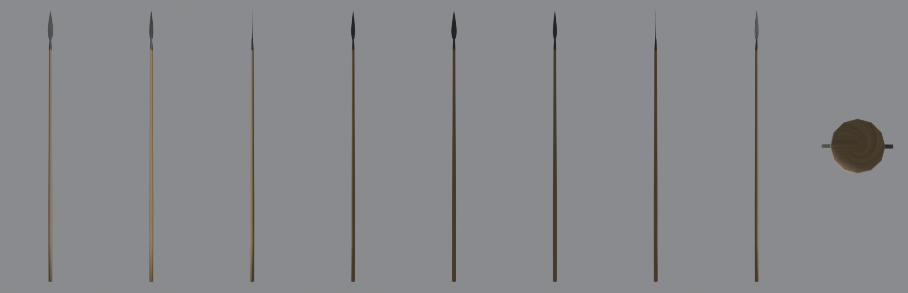
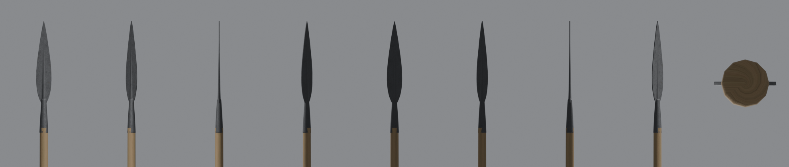
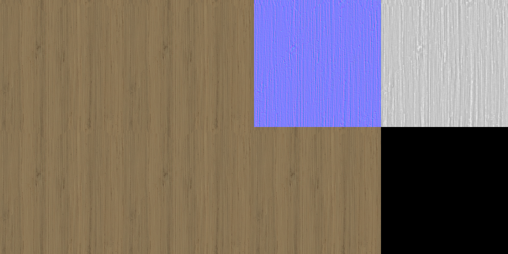
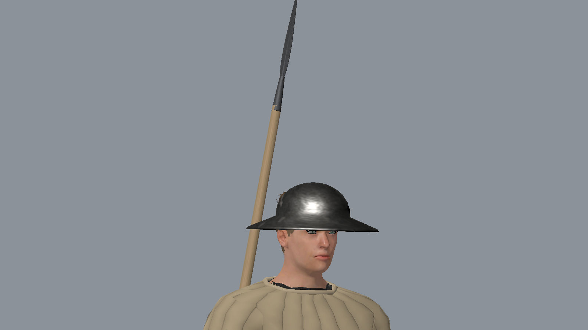

Feasibility input for EQ-13 (kettle hat), from the R-2002 check: reference and Meshy views (underside capped solid, chin strap fused across the brim; `cleanup_equipment.py`'s `cavity` step cuts the head volume and lines it):

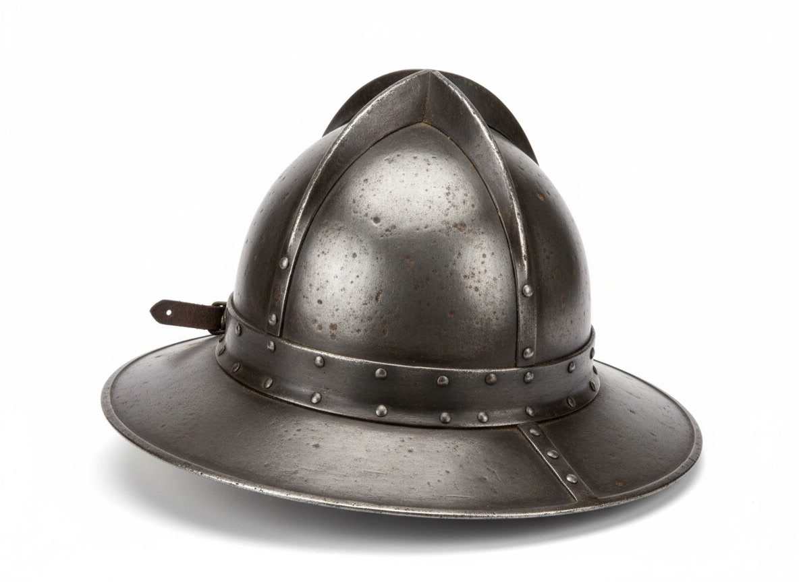
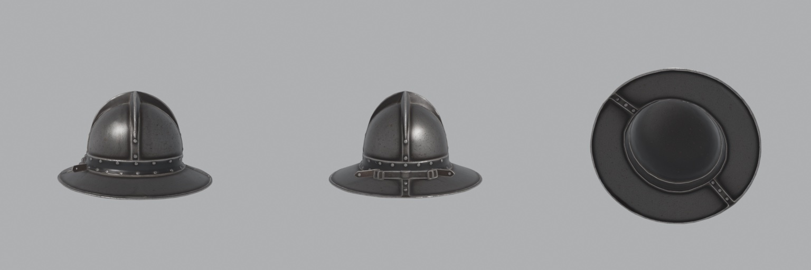

## Verify

- Rebuild and turntables: `python3 tools/assets/equipment/build_equipment.py tools/assets/equipment/items/spear_p1_w1.json` (needs the raw scan in `build/equipment_pilot/`; re-download it from Meshy by the manifest's task id if missing, the hash check confirms it).
- In game: `tools/godot_render.sh --script tools/capture_watch_spear.gd` writes `docs/reports/images/equipment/watch_spear_capture.png` (idle and walk, three-quarter and side) and `watch_spear_closeup.png`.
- Tests: `test_watch_carries_the_spear_variant` in `tests/godot/test_citizen_wardrobe.gd` (variant mounted, sockets exported, 2.1-2.4 m, origin at the grip); `godot --headless --path . --script tools/run_godot_tests.gd -- --filter=test_citizen_brawl,test_citizen_roster,test_citizen_wardrobe` and `python3 -m pytest tests/python/test_citizen_wardrobe*.py`.
- Variant choice (R-2004): `python3 -m unittest tests.python.test_equipment_variants -v` (same census same cells, prestige per office, rebel and Order wear, one cell per unit, runtime data distribution); `godot --headless --path . --script tools/run_godot_tests.gd -- --filter=test_equipment_variants` (shipped cell mounted as is, missing cell falls back with a finish, variant layer entries, shield wear, bag/equip/world-item variants survive a JSON save round trip, old saves load the base item); `python3 tools/city/build_citizen_runtime.py --check`.
- Capture: `tools/godot_render.sh --script tools/capture_watch_variants.gd` writes `watch_variants_row.png` and `watch_variants_closeup.png` (six census watchmen of different posts, labelled with post and cell).

## Shields (R-2013)

Shields are modelled, not scanned: a flat painted board needs exact heraldry (the Order's black cross on white, the crown's plain red, no invented arms) and Meshy cannot promise that, so `tools/assets/equipment/build_shields.py` (Blender, headless) builds the geometry (curved planked board, leather rim binding, enarmes and guige on the back, iron boss, rivets) and draws the face paint in numpy with wear (edge dirt, scratches, paint loss). Origin mid-board, face +Z, `socket_forearm` and `socket_back` empties. Under 2.5k tris, 1024 px JPEG.

| Family (dir) | Files `<family>_<cell>.glb` | Look |
|--------------|-----------------------------|------|
| `heater_order` (`heater_shield/variants`) | `p3_w0`, `p3_w1` | white field, black cross pattee, 0.46 x 0.62 m |
| `heater_crown` | `p2_w1` | plain crown red |
| `heater_field` | `p3_w1` | pale board, `shield_face` material tinted by `CitizenShield.scene(kind, field)` |
| `heater_plain` | `p1_w0` (forge item), `p1_w2` | bare wood, iron boss, paint loss |
| `buckler` (`buckler/variants`) | `p1_w1`, `p2_w1` | 0.31 m round, iron boss, rim, grip bar |
| `pavise` (`pavise/variants`) | `p1_w1` | 0.46 x 0.90 m ridged board, town red, prop stick |

`CitizenShield.scene(kind, field, cell)` keeps its API (`order`, `crown`, `field`, `plain`, plus `buckler`, `pavise`); a cell that is not shipped resolves to the nearest of that kind (wear gap first, then prestige). The forge `item.forge_heater_shield` scenes now instance `heater_plain_p1_w0`; the old code-built board and the old `heater_shield.glb` are gone. `CitizenGear._shield_held` carries a half turn about the shield's up axis so the face points away from the body.

Verify: Build: `/Applications/Blender.app/Contents/MacOS/Blender -b --factory-startup --python tools/assets/equipment/build_shields.py` then `render_turntable.py --glb <file> --out docs/reports/images/equipment/<name>_turntable.png` (front and back tiles); `godot --headless --path . --script tools/run_godot_tests.gd -- --filter=test_equipment_variants,test_citizen_wardrobe,test_forge_weapons` (includes the `ShieldGuard` tests); `tools/godot_render.sh --script tools/capture_shields.gd` writes `shields_front.png` and `shields_back.png` (Order brother, crown man, field knight, plain man-at-arms).

Limits: the census does not give out `buckler` (burgher sidearm) or `pavise` (wall crossbowmen) yet; the buckler and pavise have no carry pose; the pavise prop stick is fixed (no hinge).

## Axes (R-2009)

The Viking-age bearded axe of the first forge set is gone (`assets/props/weapons/bearded_axe/` deleted, its builder removed from `tools/assets/build_forge_weapons.py`). Forms and sources: the axes section of [`history/dossiers/military/arms-and-armour-livonia-1340s.md`](../../history/dossiers/military/arms-and-armour-livonia-1340s.md).

| Variant | Used for | Notes |
|---|---|---|
| `axe_peasant_p1_w1` | the player's `item.forge_bearded_axe` (id kept, now "Peasant axe"), villagers, woodcutters | small one-piece head, 15 cm poll to edge, steel-welded edge, 72 cm ash haft |
| `axe_peasant_p1_w2` | rebels (always wear `w2`) | same head, nicked edge, broken corner, rust; darker worn-ash haft plate `assets/materials/equipment/ash_haft_worn` |
| `axe_broad_p2_w1` | carpenters and joiners (a tool, never a weapon kit) | 18 cm deep head, 15 cm straight edge, 60 cm haft; no combat item |
| war axe (`axe_war_p2_w0`) | - | **not shipped**: the research note found no Baltic evidence for a long-hafted war axe c.1343 |

**Pipeline difference from the spear.** `tools/assets/equipment/cleanup_axe.py` (manifest key `"cleanup": "cleanup_axe.py"`, run by `build_equipment.py`) replaces `cleanup_equipment.py` because an axe head sits on the haft through its eye, side-on. The Leonardo/OpenAI reference must be a **cheek view with no eye drawn**: image generators draw the hole and the fan outline on the same face, and a Meshy scan of that gives an adze (edge across the haft), which the first build did. The script stands the edge along the haft, turns the cheeks sideways and the blade forward (Godot +Z, `socket_edge`), widens the blade (`edge_stretch`), thins the cheeks toward the edge (`edge_thin`) and builds an oval haft through the poll with a short stub above it. Origin is the grip (0.2 m above the butt, 0.18 for the broad axe); sockets `socket_grip/butt/tip/edge`. Budget 3,500 tris LOD0 / 1,000 LOD1.

**Mounting.** Scenes live in `assets/props/weapons/axe_peasant/scenes/` and `axe_broad/scenes/` (`<variant>_held.tscn`, `<variant>_ground.tscn`, meta `variant`). The held scenes keep the legacy hand turn (`rotation.z = PI / 2`, haft up along the forearm) that the `axe_attack` animation was authored for. The census gives no resident an axe kit, so no citizen carries one in the city yet; rebel and carpenter hands are shown by the capture only. The item keeps its combat numbers.

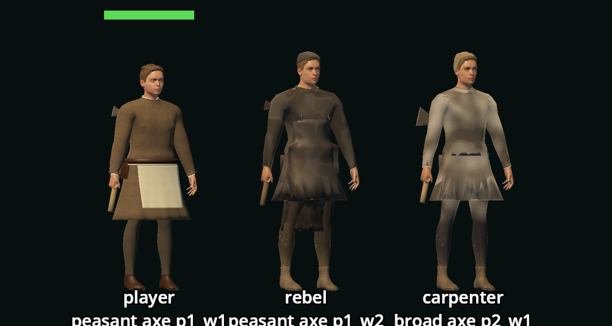
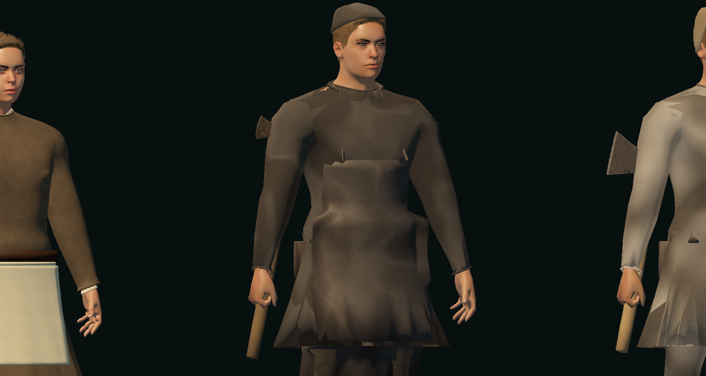
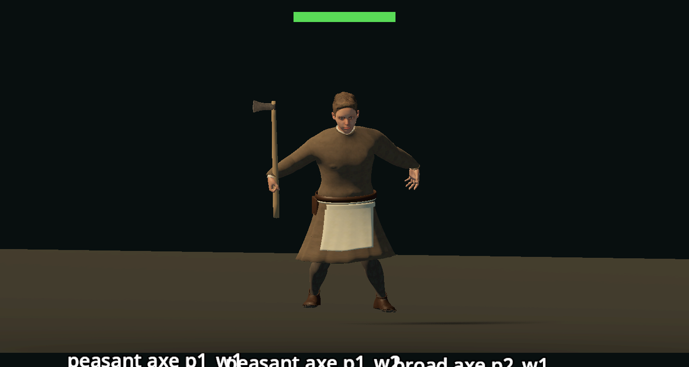
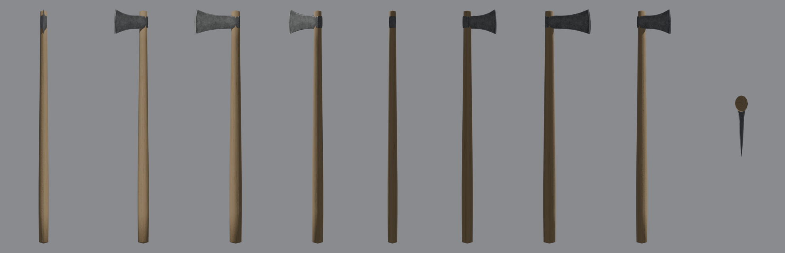
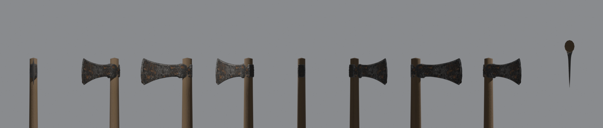
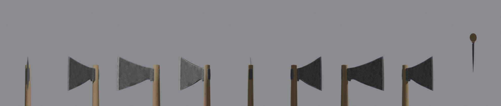

Verify: `tools/godot_render.sh --script tools/capture_axe_equipment.gd`; `python3 tools/assets/equipment/build_equipment.py tools/assets/equipment/items/axe_*.json`; `test_forge_weapons`.

## Limits

- The spear is held with the same hand turn as the old primitive, so in the idle pose it leans about 10 degrees across the body; the walk cycle holds it upright. The walk arms are the separate T-pose bug R-2036.
- One variant file only; `p2`/`p3` and `w0`/`w2` spears are the spear family task. Until then other cells show the base spear with the stand-in finish, so prestige is not visible yet (a `p3` knight's gear looks like `p1` of the same wear), and the finish is a material change, not modelled wear.
- Variants change looks only: no stats or prices per variant (follow-up idea).
- Meshy bakes soft studio light into the base colour, so a scan reads slightly flat under hard sun.
- The cavity cut is implemented but not yet used on a shipped wearable (first use: EQ-13 kettle hat). The ComfyUI textile graph was not run in R-2003 (server offline); the Leonardo route was.
- The wearable `socket_head`, `socket_hip` and `socket_back` conventions are defined here, not yet mounted.
