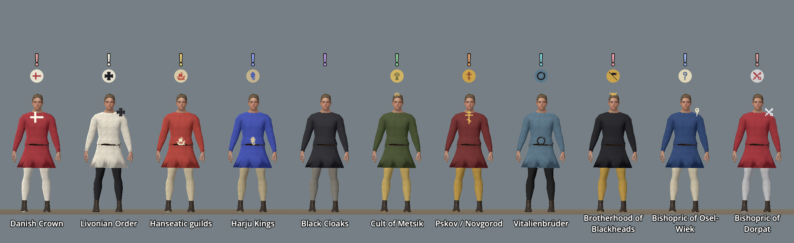

# Factions, relationships, district pressure, and prices

Status: implemented (faction ledger, district pressure, trade prices, social reputation, relationship memory). Scope: how the world remembers Kalev's choices without a morality score. Design contracts: README [factions](../../README.md) and [ADR 0008](../adr/0008-three-act-campaign-and-faction-scope.md). Hope/Fear city meters are in [`LIVING_CITY.md`](./LIVING_CITY.md).

## Principle

Every number here derives from **explicit recorded events and flags**. There is no aggregate good/evil value. Content writes events, and models read them.

## Faction ledger

- Eight active factions (`FactionLedger.ACTIVE_FACTIONS`): `danish_crown`, `livonian_order`, `hanseatic`, `harju_kings`, `black_cloaks`, `cult_metsik`, `pskov_novgorod`, `vitalienbruder`.
- Standing per faction is `-3..3` and is derived only from `record_faction_event` effects (`GameState.get_faction_standing`).
- `FactionCandidateSeats` (`scripts/state/faction_candidate_seats.gd`) allows events-only candidate seats (currently `faction.blackheads`, see `docs/data/faction_blackheads_candidate.json`) without promoting a ninth faction. The Lizard Union is an intrigue cell and is never a ledger seat.
- Player view: Journal → faction ledger rows (`FactionLedgerModel.build_snapshot`), with labels from `FactionLedger.standing_label`.
- Conditions: `faction_standing_at_least`.

## Relationships and memories

- `rel.*` trust per character, `-3..3`, through `adjust_relationship`; read with `relationship_at_least`.
- `memory.*` keys (`RelationshipMemory`) are append-only booleans for discrete acts a character can bring up later (`record_memory` / `memory_recorded`).

## District pressure

`DistrictPressureModel` (`scripts/faction/district_pressure_model.gd`) resolves a tier per district from district flags (`…unrest`, `…martial_law`) plus faction standing:

| Tier | Patrol speed | Price multiplier | Bark pool |
|---|---|---|---|
| relaxed | 0.75× | 0.9× | `bark.district.<district>.relaxed` |
| normal | 1.0× | 1.0× | `…normal` |
| tense | 1.25× | 1.15× | `…tense` |
| crackdown | 1.5× | 1.3× | `…crackdown` |

Districts: `district.lower_town` (Lower Town, smithy) and `district.north_merchant` (north quarter). Conditions: `district_pressure_at_least`.

## Trade prices

`TradePriceModel` (`scripts/economy/trade_price_model.gd`) quotes essential goods (`trade.iron`, `trade.bread`) per district from pressure tier, faction standing, supply flags, and material grade, with tiers `low / normal / high / scarce`. Dialogue shows live quotes with the `{trade_price:trade.iron}` token ([`DIALOGUE.md`](./DIALOGUE.md#text-tokens)). Conditions: `district_price_tier_at_least`. There is no wallet or currency simulation.

## Social reputation

`SocialReputationModel` lists authored public moments keyed to standing thresholds (example: `reputation.harju_kings_trusted` at Harju Kings ≥ 2 in Lower Town, reaction `cheer`). `SocialReputationController` fires each one once, sets its `flag.reputation.*`, and plays its bark pool.

## Faction visual identity (task R-1565)

Status: implemented for named NPCs ([ADR 0044](../adr/0044-named-npc-presentation-tier.md) section 4, still proposed; built on the maintainer's go-ahead for R-1565). Scope: how a named NPC's faction reads at a glance. Census residents keep plain clothes. Out of scope: faction-dressed crowd variants, banners, hand-drawn period heraldry.

Data: `content/factions/faction_identity.json`, one row per `faction.*` id: the eight launch factions, Blackheads (candidate seat) and the ADR candidates `faction.osel_wiek`, `faction.dorpat`. Fields: `primary`, `secondary` (period dyes), `emblem` (`res://assets/UI/factions/<slug>.png`, a 128 px white-alpha glyph), `accent` (`kind`, `placement` chest/shoulder/belt/head/none, `emblem_on_body`), `public_emblem`, `marker_tint`, `canon`. Heraldic claims and their confidence labels live in [`CANON.md`](../CANON.md#faction-heraldry-and-livery-r-1565). Clergy and NPCs without a seat have no row, no chip.

What the player sees (`FactionIdentity`, `scripts/npc/faction_identity.gd`):

- **Livery:** the primary dye goes on the tunic and the secondary on hose and headwear (`CityNamedNpcs.style_record` over the registry body, so it also works on census-blank fallback bodies); an emblem in the secondary dye sits on the chest, shoulder, belt or head, front and back.
- **Marker:** `NamedNpcMarker` takes its glyph tint from `marker_tint` and hangs the faction chip under the "!". The chip is the emblem glyph on a round plate; the plate is the lighter dye and the glyph the darker one, so contrast holds for every faction. Shape is the main channel, tint is decoration.
- **Info panel:** `CitizenInfoPanel.faction_badge` shows the same chip beside the faction name.
- **Black Cloaks** hide their emblem (`public_emblem: false`): hooded charcoal dye only, no body emblem, no chip. A "revealed" state does not exist yet.
- Hero crimson `#D9364D` is never used by a faction. Primary and secondary keep a contrast ratio of at least 3 (validated).

Emblem art: image-model renders (white on black, luminance to alpha) cleaned by `tools/assets/import_faction_emblems.py`; the Livonian and Nordic crosses are drawn as geometry. Provenance rows `assets.ui.factions.*` in `assets/SOURCES.csv`, status `candidate` until ADR 0044 is accepted.

Verify:

```bash
python3 tools/validate_faction_identity.py
python3 -m unittest tests.python.test_faction_identity -v
godot --headless --path . --script tools/run_godot_tests.gd -- --filter=test_faction_identity,test_named_npc_marker,test_city_named_npcs
tools/godot_render.sh --script tools/capture_faction_identity.gd   # plate
```



Limits: no "revealed" state for the Black Cloaks; the accent is an emblem decal, not a modelled tabard or sash (custom models are NPC-7, R-1567); the 3-contrast rule is checked on the dye pair, not under the ADR 0018 grade.

## Verify

```bash
godot --headless --path . --script tools/run_godot_tests.gd -- --filter=test_faction
godot --headless --path . --script tools/run_godot_tests.gd -- --filter=test_district_pressure
godot --headless --path . --script tools/run_godot_tests.gd -- --filter=test_trade_price
```

## Self-talk reactions

Witnesses of the apprentice talking to himself change faction standing and city suspicion by a fixed table; see [`SPIRIT_DIALOGUE.md`](./SPIRIT_DIALOGUE.md#talking-to-yourself-implemented-sd-09).
