# Farmland, pastures and woods round Reval

Status: implemented (country presentation, ADR 0031; kitchen gardens **R-1645**; documentation and realism review **R-1700**; rural dwelling plan **R-1929**). **The realism roadmap below is proposed, not implemented.**

Scope: the open country outside the 1343 walls of the seamless city: strip fields with seasonal crops, kitchen gardens, crofts and common pasture, hay ricks, orchards, farmsteads, livestock, ambient workers and woods. This is a presentation layer and deterministic plan data, not a farming simulation. Crops, gardens and rural fences are visual only; hay ricks have city-scene collision, and outbuildings use building collision. There is no farmland-specific `GameState`, ownership, harvest inventory or save record. Distant regions retain explicit journeys (ADR 0027).

**Reading guide:** [visual atlas](#visual-atlas) · [implemented behaviour](#what-the-player-sees) · [historical evidence](#historical-basis-and-evidence-boundaries) · [realism roadmap](#realism-roadmap) · [reproduce and verify](#verify).

## Visual atlas

These are **existing engine captures, not historical reference photographs or new captures of the current checkout**. The historical-walk plates were committed on 10 October 2026 (`71b296fd` for HW4); the garden plates came later that day with R-1645 (`aff19df7`). They illustrate the implementation and its recorded problems, not a claim that every defect still exists. The source revision, camera, date and renderer must be recorded when replacing them. Review the full-size image by opening it directly.

### Landscape scale: fields and routes

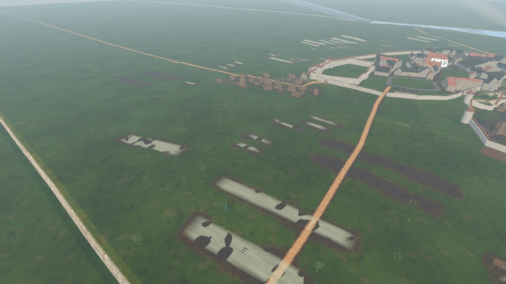

**Read:** the relationship between strips, roads, farmyards and open ground. **Recorded concern:** the R-1593 walk described islands of cultivation in lawn-like grass, rather than a connected working landscape. R-1592 separately records road/field intersections. This is a review baseline, not an approved 1343 land-use plan.

### April grain: intended green growth versus the recorded render defect

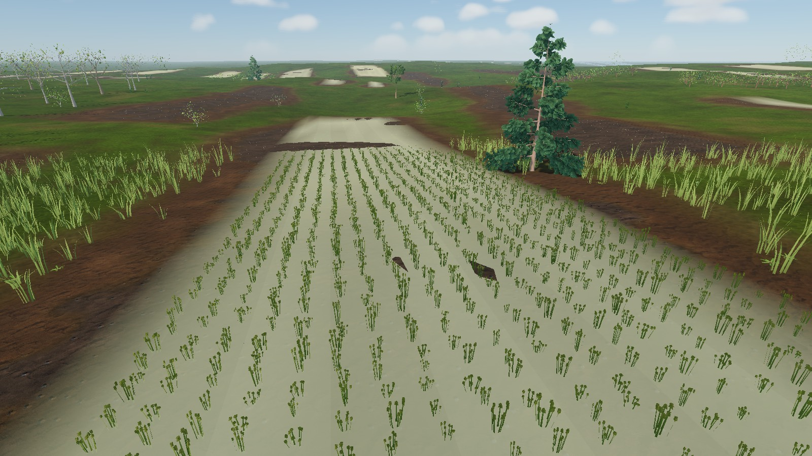

**Read:** crop scale, soil and near/far colour. **Recorded concern:** R-1591 identifies pale winter-grain surfaces that read as snow or slabs. The intended April treatment is emerging green over visible earth, not ripe grain. Re-capture before deciding whether the issue remains; the present `SEASONS` table is an art schedule, not evidence of plant height on 21 April 1343.

### Croft enclosure and fodder

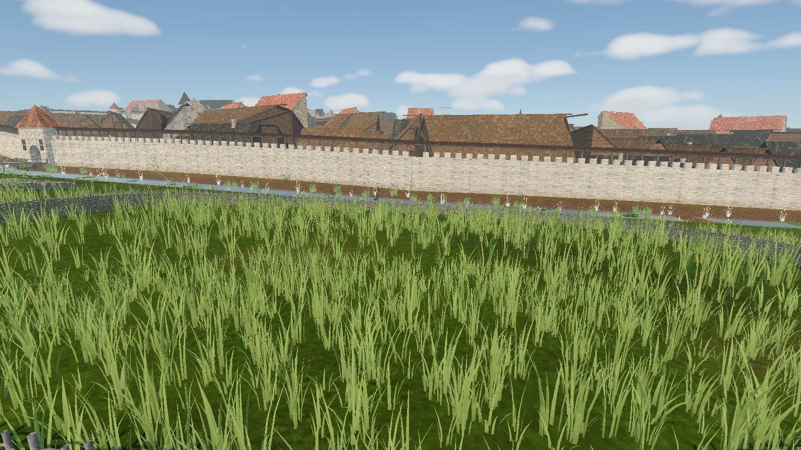

**Read:** enclosure silhouette and its relationship to grazing ground. This world-builder plate does **not** prove runtime animal behaviour or that the fence blocks movement. Fauna needs a live-scene check. Any April hay should represent stored fodder from the previous season, not a new hay harvest.

### Farmstead buildings: an implementation example, not a reconstruction authority

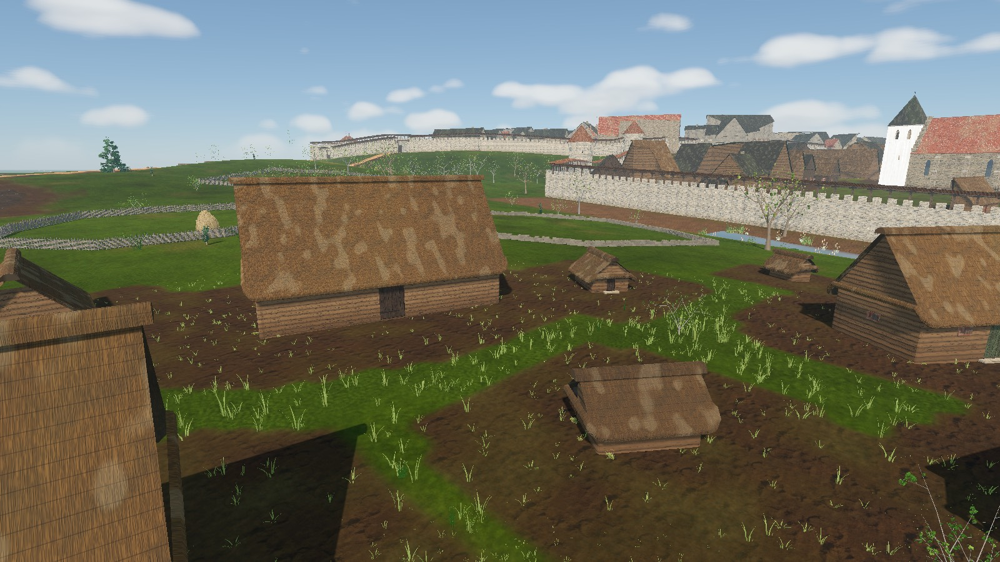

**Read:** dwelling/outbuilding scale, roof mass and yard emptiness. **Open historical issue:** the generated high thatch must not be accepted merely because this screenshot exists. R-1632 asks for reconciliation with the lower board-and-bark dwelling treatment in current canon. No roof change is made by this documentation task.

### Kitchen garden: model improvement and placement

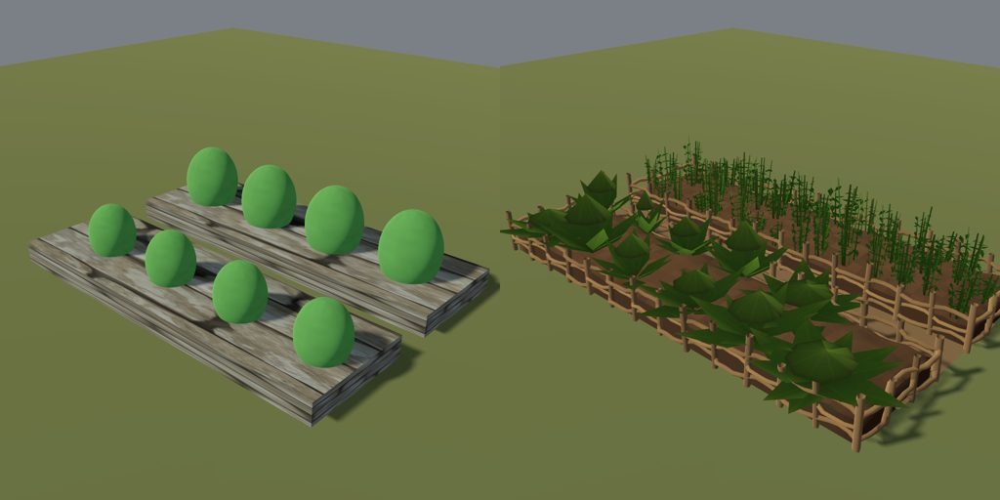

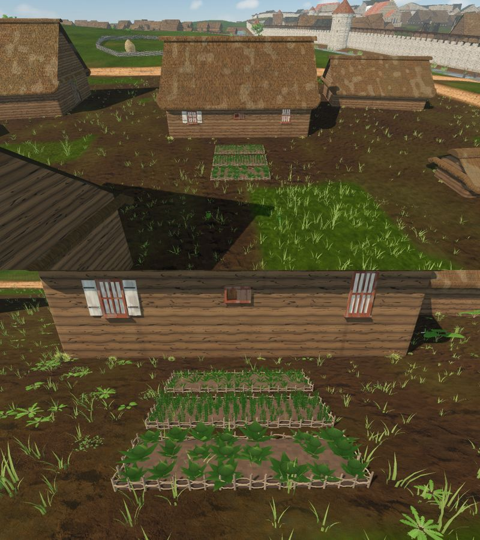

**Read:** bed edging, planting scale, soil and clearance beside a dwelling. The farmhouse plate documents the **July 15 review setup**, not the April opening; do not use its developed vegetables as spring evidence. R-1645 added clearance-tested garden placement after the historical walk, so older reports that there are no kitchen gardens require rechecking.

### Wood edge: vegetation is not only tree count

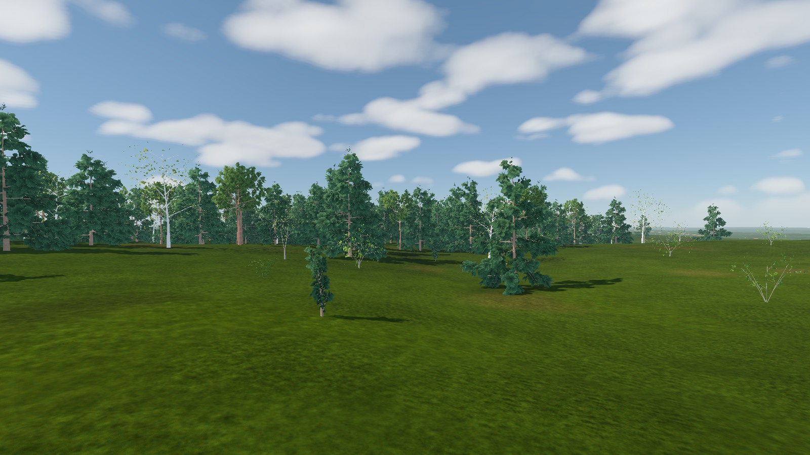

**Read:** canopy spacing and the transition from open ground to woodland. R-1595 recorded a park-like floor with little understorey or deadwood. Current vegetation work may supersede this plate; a new April shot should test leaf stage, litter, browsing and paths rather than just adding more trees.

### Adjacent scope: harbour and the fishing shore

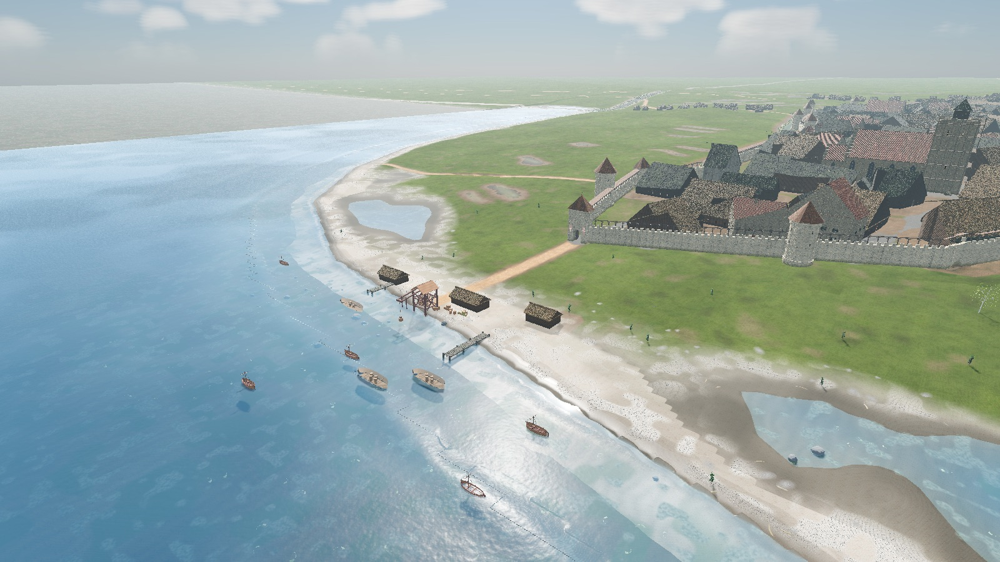

This is orientation for the [Harbour and Kalamaja](#harbour-and-kalamaja) section, not proof of the later R-1640 net and fish-rack changes. Detailed shore behaviour belongs to [City sea](./CITY_SEA.md).

**Coverage still missing here:** a verified orchard close-up, the three fence types side by side, hay-stack scale/reaction, spring workers and livestock in the live scene, and matched April/July views. Capture recipes are in [Verify](#verify). Do not fill these gaps with generated concept art labelled as gameplay screenshots.

## What the player sees

- **Fields.** Strip parcels (14-24 m wide, 80-150 m long) in blocks on dry, gentle ground 40-620 m from the walls. Crops follow the campaign date (the slice opens on 21 April 1343): winter rye and wheat use a partially grown green presentation, spring barley, oats, peas and flax have just been sown and the soil is bare, gardens hold seedlings (cabbage, turnip, onion, peas, flax), fallow strips are rough grass. Grain ripens to gold in July and August and is stubble from harvest. Rye and barley dominate; winter wheat is a minor crop in this plan (the [canon diet note](../CANON.md) gives broader rye/barley context, not field percentages). Crop heights and seasons: `CityFarmland.growth` / `tint` (pure functions of the day of year).
- **Pastures.** Fenced crofts placed near some farmsteads (hay rick; fence type by enclosure id: about 62% woven wattle, 24% rough pole fence on stakes, 14% low field-stone wall, all in grey weathered wood or stone; these percentages and the exclusion of sawn-board fences are art/generator choices, not measured 1343 prevalence, `CityFences`, `scripts/city/city_fences.gd`; review plate `tools/capture_country_fences.gd`, test `tests/godot/test_city_fences.gd`; the same builder also dresses Kalamaja net yards and the `timber_fence` map prop through `CityFences.build_run`, wattle or pole by prop id, no sawn box posts and rails) and unfenced common grazing along the Karja cattle road, with cows, sheep, goats, horses and geese. A few damp meadows hold sheep and geese.
- **Orchards.** About 30 fenced fruit gardens (plan key `orchards`): the generator attempts a 24-34 m x 30-44 m enclosure beside a farmstead where space permits, with additional candidates on dry ground 45-260 m from the walls. Trees stand in loose planted rows 5-6 m apart with the odd gap, apple dominant with cherry, plum and pear (the existing `apple`/`cherry`/`plum`/`pear` tree species, so no new model was needed). The enclosure is a wattle/pole/stone fence like a croft (`CityFences`). They are claimed before the fields, so strips go round them. Review plate: `tools/capture_city_farmland.gd --only=orchard`; test `test_orchards_hold_fruit_trees_and_stay_clear_of_fields`. Limits: no blossom or ripe-fruit seasonal state, no ladders or baskets, and the fruit trees are ordinary plan `trees` (not separate streamed objects).
- **Farmsteads.** Each farm-suburb house (`bldg.karja.*`, `bldg.harju.*`, `bldg.toompea_foot.*`) is a smoke cottage with a yard of outbuildings by wealth tier (`FARM_TIERS` in the generator). Types, sizes and roofs differ so the silhouettes read apart: `barn_dwelling` (the two-bay *elurehi*, see [Rural dwelling plan](#rural-dwelling-plan)), `barn` (threshing and storage), `byre`, `sheep_shed`, `pigsty`, `hen_house`, `store`. They are plan `buildings` of `kind: outbuilding` (ignored by the census) with the animals kept at their own sheds (`CityFauna.YARD_STOCK`). All are solid and closed except the `barn_dwelling`, which is walk-in without a household of its own.
- **Kitchen gardens.** Eligible farmhouses receive two or three raised beds when the clearance search finds room (see Kitchen gardens below).
- **Farm hands.** A man or woman walks a furrow in a hash-selected subset (roughly half) of spring-sown and garden-sown `field` features while Kalev is within 75 m (at most six at once). These are not the separate yard `kitchen_garden` features.
- **Woods.** Clustered spruce-pine, pine on the sandy ridges, alder-birch in the damp, oak-linden mixed stands, thinning toward the walls and open at the glacis. Trees are kept out of the field and pasture polygons. The reviewed plan has 6,816 tree entries overall, not all woodland trees; counts are generated output, not a historical census.

## How it is built

`tools/city/build_reval_city_plan.py` (`countryside`) writes five lists into `content/world/reval_city/plan.json`:

| Key | Record | Notes |
|---|---|---|
| `fields` | `{id, crop, sowing, ploughed, angle, polygon}` | `sowing` is `winter`, `spring`, `garden` or `fallow`; ids `field.<block>.<strip>` |
| `pastures` | `{id, kind, fence, stock, polygon}` | `kind` is `croft`, `common` or `meadow`; `stock` lists species and counts |
| `woods` | `{id, kind, at, area_m2, cells}` | the trees themselves are in `trees` |
| `farmsteads` | `{id, building, at}` | `farmstead.<suburb>.<n>` |
| `orchards` | `{id, fence, trees, polygon}` | `orchard.<n>`; the fruit trees themselves are entries in `trees` |

Generation is deterministic (seeded value noise, no filesystem walk). Woods claim damp, steep and far ground first, then pastures and orchards, then fields; nothing is placed inside the plan's 24 m edge margin. The ground splat marks cultivated soil; near plants and the far crop wash are intended to give winter grain a green-over-soil appearance (the historical walk recorded a colour defect, R-1591). The review plate and minimap colour fields by `sowing`.

Runtime entry points:

- `CityFarmland` (`scripts/city/city_farmland.gd`, mounted by `CityWorld3D`, updated from `reval_city.gd`): streams up to one near feature (field, pasture, orchard fence or kitchen garden) per update within 95 m of Kalev (freed beyond 135 m). Crops are `MapViewPlantMeshes` MultiMeshes in rows; fences are `CityFences` meshes (one rod mesh per enclosure, MultiMesh stones for walls); ricks are `MapViewHayMeshes` (see Hay stacks). `set_calendar_date` rebuilds crops when the date changes.
- `CityFauna.groups_for`: pasture and farmstead animal groups.
- `CityNpcs._stream_field_workers`: the farm hands (the shared `Walker`).
- `CityVegetationBuilder`: `juniper_shrub` and `sea_buckthorn` now draw with the real-size leaf-card tree meshes (the shared block-shaped shrub meshes read as giant flat stalks beside a 1.83 m figure).

<a id="historical-basis-for-the-yard"></a>

## Historical basis and evidence boundaries

Use [CANON](../CANON.md) for approved claims. The research dossiers below are supporting syntheses, **not a newly completed primary-source audit**. `attested` means the cited evidence supports that particular claim, not every dimension or placement in the game; `plausible composite` is a bounded reconstruction; `invented` covers authored particulars. A missing local date, measurement or species frequency remains **unknown**.

| Subject | What the evidence supports | What must not be presented as fact |
|---|---|---|
| Settlement and fields | [Harju village dossier](../../history/dossiers/hinterland/harju-village-and-manor.md): clustered northern villages, strips, pasture and hay meadow provide the regional framework. Applying that pattern to these specific suburban plots is `plausible composite`. | Exact Reval 1343 field boundaries, the plan's strip dimensions, coverage percentages, crop ratios and ownership are unknown. A regional village is not automatically a town suburb. |
| Spring | [Spring climate dossier](../../history/dossiers/nature/spring-climate-and-living-world.md): emerging growth, sowing/harrowing, wet traffic surfaces and last year's hay are the production baseline (`plausible composite`). | Fixed sprout/harvest days, knee-high grain on a named day, full vegetable heads, full fruit blossom or measured 1343 weather are not established. The dossier's modern climate analogies are not medieval observations. |
| Dwelling and roof | [Rural dwelling dossier](../../history/dossiers/architecture/rural-smoke-dwelling-and-farmstead-1343.md): chimneyless oven-heated log dwelling is the archaeological baseline; a barn-dwelling type has a 14th-century mention. Current [canon, Harju reconstruction](../CANON.md) chooses low board-and-bark smoke-room dwellings as `plausible composite`. The walk-in plan (heated bay, log partition, heap oven, threshing gate) is `plausible composite`; its evidence table is under [Rural dwelling plan](#rural-dwelling-plan). | A mention of the type does not date the familiar high-thatched museum silhouette to 1343. The older dossier allows broader roofing analogies, while R-1632 explicitly calls for reconciliation before changing Reval's suburban roofs. The generator still assigns `barn_dwelling` 54-degree thatch. |
| Farmyard | The dwelling dossier supports a functional yard vocabulary: storage, animals, fuel, water and work surfaces. The exact inventory and standalone shelter chronology remain `plausible composite`. | A complete 18th/19th-century museum farm copied building for building; chambers (*kambrid*) treated as 1343 evidence. |
| Fences and orchards | Wattle/poles/stone and fruit gardens are reconstruction choices that should follow function and local evidence. | The 62/24/14 fence mix, 30 orchards, regular spacing, every orchard species and a garden for every household are not attested Reval statistics. No universal historical ban on boards is established here. |
| Hay and livestock | The spring dossier supports stored fodder, domestic stock and plausible young animals. | A fresh April hay harvest, the model's exact stack dimensions as archaeological measurements, modern breed proportions, or hay and cereal straw treated as interchangeable. |

The dossier excludes domestic rabbit hutches for lack of reviewed 1343 Estonian evidence. This is a conservative production exclusion, not proof that no rabbit could have existed in the region. Later museum buildings and modern climate/landscape photographs remain **labelled analogies**, not reference photographs of the medieval site.

### What the old description underexplained

- **Work connections:** access from house to water, byre, fuel and field; cart turning space; gates or breaks in enclosures. More props alone cannot fix a disconnected farmyard.
- **Land-use differences:** hay meadow, grazed common, fallow and cultivated soil need distinct use and wear, not one lawn material. Field margins and turning headlands matter as much as crop meshes.
- **Seasonal scarcity:** old fodder, worn stacks and modest green-up tell April better than lush crops. Hay (grass fodder), straw (cereal stems) and grain stores should be distinguishable.
- **Managed woodland:** fuel gathering, cut stumps, browsed edges and paths are candidates for research-led dressing, not a demand for a uniformly dense wild forest. Exact local management remains unknown.
- **Social context without a new mechanic:** unequal yard provision and shared access can suggest labour and resources. Do not assign historical owners, dues or an automatic three-field rotation without evidence and a separate approved task.

## Realism roadmap

**Status: proposed.** This is a reading order for existing task-board work, not a second queue or approval to implement it. Board states below were read on **11 October 2026**; recheck the implementation and captures before claiming a task. Preserve stable IDs, navigation and the vegetation budget. Any new production art needs a task naming the exact files under the asset freeze.

| Order | Player-facing improvement | Existing task / dependency | Acceptance evidence before calling it done |
|---|---|---|---|
| 1. Spring read | Resolve pale winter-grain surfaces and check near/far continuity; separate April growth from July ripening. | **R-1591** (`idea`); coordinate with **R-1534** wheat work (`in_progress`). Reproduce first; do not assume old screenshots are current. | Matched `field_rye_game` / `field_rye_top` captures on 4-21 and a July comparison; green-over-earth rather than white sheets; focused colour/season tests. |
| 2. Working landscape | Join strips, fallow and hay meadow into a plausible layout; keep routes clear; reconnect Karja farms to their land. | **R-1592**, **R-1593**, **R-1544** (`idea`). Audit R-1645's later garden coverage before reimplementing gardens. Research/canon must approve any target area share. | Road-width-buffer overlap test, before/after stable-ID inventory, Harju aerial and Karja street views. Do not choose a land-use percentage just because it looks medieval. |
| 3. Period building form | Resolve the suburban roof/house evidence conflict before adding more farm buildings. | **R-1632** (`todo`), canon-keeper decision required. | Written evidence/confidence decision; same-camera before/after roof plate; no lost building IDs, doors or routes. Museum resemblance alone is not acceptance. |
| 4. Used yards | Place water/fuel/manure/cart/tool and fodder cues where work happens, with wear and usable access rather than random clutter. | **R-1594** (`idea`, needs approval); depends on settled yard layout and existing prop availability. | One representative yard at walking height and overhead; paths/doors clear, scale and April fodder reviewed; no unsupported household ownership claim. |
| 5. Living margins | Replace park-like woodland floors and uniform grass transitions with locally appropriate litter, patchy understorey and seasonal edges. | **R-1595** (`idea`); coordinate with [Vegetation realism](./VEGETATION_REALISM.md), not a parallel vegetation rewrite. | Fixed April wood-edge shot and perf measurement; preserve sightlines and paths, avoid summer foliage as a universal fix. |
| 6. Labour, last | Only after the landscape reads correctly, consider one researched ploughing/harrowing scene instead of generic walkers. | **R-1596** (`idea`, needs approval); draught animal, implement and action must be reviewed together. | Live-scene capture of the complete routine, scale/tack and route review, population/performance limits. A still image cannot verify an animation. |

**Research/capture gaps, not new promises:** orchard prevalence and spring stage; meadow versus grazing appearance; hay versus straw storage and seasonal depletion; animals/young stock at realistic scale; field-worker actions. Address these in the relevant task contracts before adding models or mechanics. Harvest economy, property simulation, weather-driven agronomy and new quests remain out of scope.

## Rural dwelling plan

Status: implemented (task **R-1929**). Scope: the walk-in plan of 1343 smoke dwellings in the open city and the regional sites: the 43 farm-suburb houses (`bldg.harju.*`, `bldg.karja.*`, `bldg.toompea_foot.*`, `kind: house`) as **smoke cottages**, and the suburban `barn_dwelling` outbuildings plus the Harju and Saaremaa `smoke_room` dwellings as two-bay **barn-dwellings** (*elurehi*). Out of scope: roof pitch and cover (R-1632), footprints, wall heights, the drying poles and sheaves (`DryingLoft`, `HouseholdLayout._furnish_loft`), yard dressing (R-1594), smoke plumes from vents.

What the player sees and does:

- **Smoke cottage** (`smoke_cottage`): one heated log room with smoke-blackened walls (no limewash), a beaten-earth floor, a stone heap oven in a back corner with its mouth to the front wall and a flat hearth stone before it, no chimney, no glazed windows (two small dark smoke vents with board shutters high in the walls), one low door (1.2 x 1.75 m). Its household lives round the oven; no plank partitions. No cold entry: the 1343 evidence does not attest one.
- **Barn-dwelling** (`barn_dwelling`): one roof over two bays. A log partition across the ridge axis splits the **heated bay** (*rehetuba*: heap oven in its back corner, dark earth floor, beds and benches along its walls) from the **threshing bay** (*rehealune*: paler beaten clay, a broad boarded double gate on the yard side). The outer door opens on the threshing floor, which serves as the entry; a low inner door (1.2 x 1.65 m, with a sill log) in the partition leads to the warm room. Outside, the partition's log ends and two seam boards mark the bay line on both long walls. Kalev walks in through either door; the gate is closed boards.
- The Harju dwellings keep their households in the heated bay; the field tools stand by the outer door on the threshing floor, where the drying-loft feature lays the straw and flails. The suburban barn-dwelling has no household (the census only counts houses).

Runtime and data:

- Plan data: `rural_plan` on each building, written by `rural_plan()` in `tools/city/build_reval_city_plan.py` (called after `fix_blocked_doors` for the city, and by `tools/city/build_site_plan.py` for every `smoke_room`). Fields: `form`; `oven` `{id, at, size, mouth}`; for a barn-dwelling also `share` (heated share of the length), `heated_end` (+1/-1 along the ridge), `seam` (two plan points), `inner_door` `{id, at, w, h}` and `gate` `{id, at [x, y, outward angle], w, h}`. New stable ids: `<building id>.oven`, `<building id>.inner_door`, `<building id>.gate`. Building ids, footprints, doors, wall heights and roofs are unchanged.
- Plan rule: the heated bay is the end of the ridge axis away from the outer door; the seam sits at `MapViewRuralDwellingModels.ROOM_SHARE` (0.38) of the length from that end, the same seam as the map-view facade, stepped down to no less than 0.3 only to keep a door on a long wall 0.9 m clear of the partition. The gate is centred on the threshing bay's front (door-side) wall in the longer stretch the door leaves free, width clamp(0.32 x length, 1.75, 2.7) m, height min(2.32, wall - 0.35) m. The oven (1.5 m cottage, 1.8 m barn-dwelling) stands in the back corner, slid inward until it is clear of every wall.
- `scripts/city/rural_dwelling_plan.gd` reads the plan and builds the structure: `CityBuildingBuilder.build_building` skips windows, plinth and chimney, lays the clay floors, the partition (cut and capped at `CUT_HEIGHT` like the outer walls), the oven, gate, vents and log ends; `CityCollisionBuilder` adds the partition pieces and the oven as walls with the inner doorway open; `HouseholdLayout` takes its rooms (threshing floor = room 0, heated room = room 1, one partition entry without `walls`) and the oven as the household's `hearth` item (`oven`, `depth`, no catalog model). `CityInteriors` gives that hearth only its fire (`MapViewDomesticHearthModels.add_oven_fire`), no hood and no flue.
- Save/load: nothing is saved; the plan is generated data and every part is a deterministic function of it.

Evidence (source summary awaiting human approval before it is copied into the dossier and [CANON](../CANON.md)):

| Claim | Source | Label |
|---|---|---|
| North-type heated room narrower and higher than the threshing floor; heated room 25-40 m2, threshing floor about twice as big | Estonian Open Air Museum (EVM), "Rehemaja" | 18th-19th c. buildings; `plausible composite` for 1343 |
| Heap oven in the back corner, mouth usually to the front wall, open hearth before it, no chimney until the late 19th c. | EVM "Rehemaja"; et.wikipedia "Rehielamu" (Etnograafia sõnaraamat 1995) | ethnographic; `plausible composite` for 1343. Viking-age stoves at Rõuge stood in a corner, by a wall or mid-room (EXARC 2013) |
| Broad gates in both long walls of the threshing floor (drive-through) | et.wikipedia "Rehielamu" (Viires 2007) | ethnographic; the game uses one yard-side gate (`plausible composite`) |
| Threshing-floor buildings visible archaeologically only from the 15th-16th c. (Varbola, Olustvere); first written mention of the type in the 14th c. | Lavi 2001 p. 66; EVM | `attested`; a large 1343 threshing bay is itself unproven |
| Smoke cottage small and mostly one room (Rõuge reconstruction on a 6 x 5 m clay floor) | Paavel, Pajuste, Rootslane, EXARC Journal 2013/2 | `attested` (Viking Age) |
| A cold entry of the two-room elurehi became the threshing floor | Lavi 2001 p. 68-70 | `plausible composite`; the cottage ships without an entry |
| Low doors with a high sill; no windows, a board-closed smoke hole until the mid-19th c.; limestone-slab or tamped clay floors | et.wikipedia "Rehielamu"; EXARC 2013 | ethnographic; `plausible composite` |
| Chambers (*kambrid*) | EVM: first evidence early 17th c. | `attested` exclusion |

Verify: `godot --headless --path . --script tools/run_godot_tests.gd -- --filter=test_rural_dwelling_plan` (plan present for every farm house, barn-dwelling and Harju smoke room; seam rule; door on the threshing floor; stable unique ids; low doors wider than Kalev's capsule; no chimney, earth floor, no limewash or glass; partition collision with the doorway open; Harju households live in the heated bay). Data: `python3 tools/city/build_reval_city_plan.py --check`, `python3 tools/city/build_site_plan.py --site harju --check`, `--site saaremaa --check`. Plates: `tools/godot_render.sh --script tools/capture_city_farmland.gd -- --only=yard_barn_dwelling_front,yard_barn_dwelling_inside,yard_barn_dwelling,yard_barn_dwelling_close --tag=<t>` and `tools/godot_render.sh --script tools/capture_hinterland_sites.gd -- --only=harju_day_farmstead,harju_day_interior,harju_day_interior_top`.

Same-camera plates, before and after R-1929:

| Before | After |
|---|---|
| 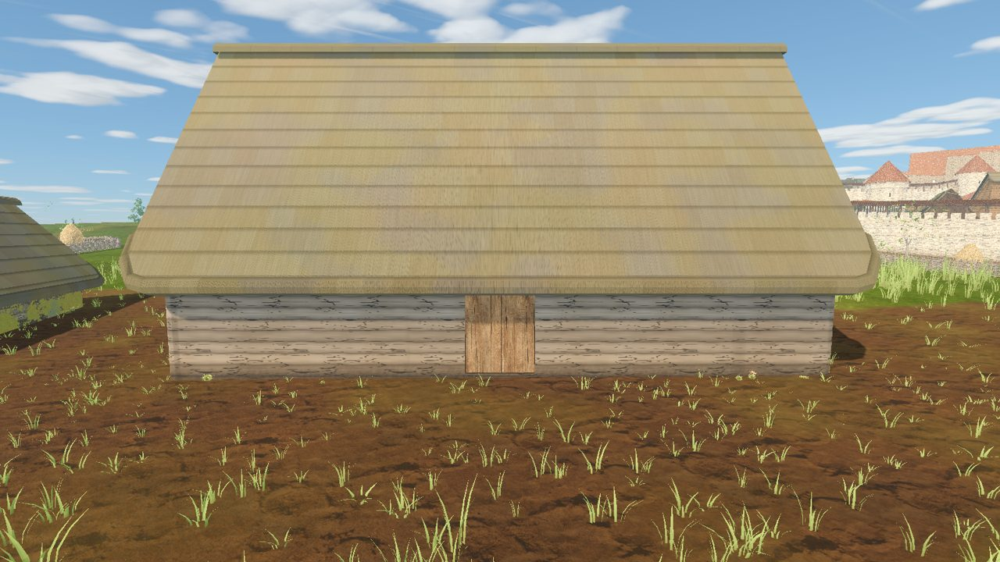 | 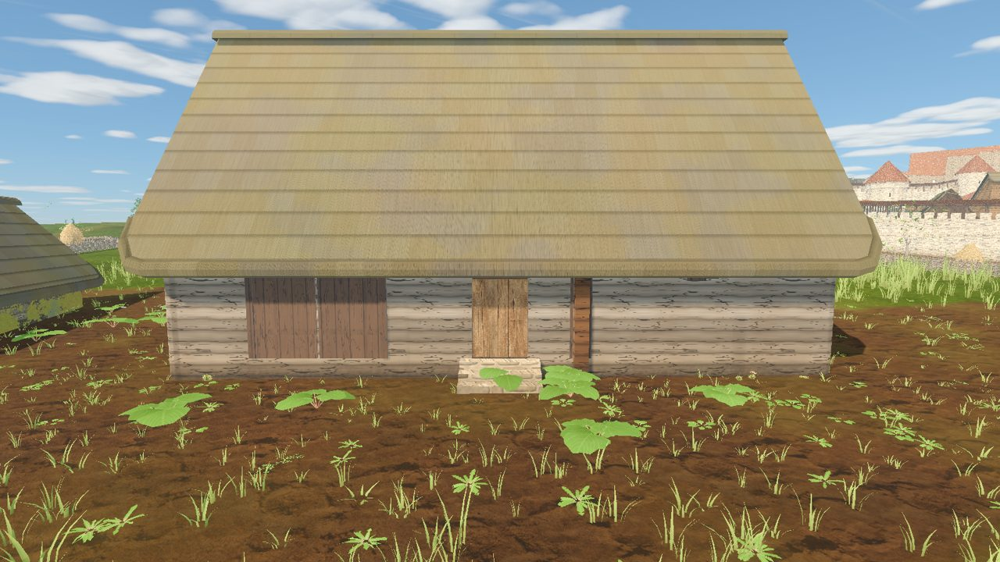 |
| 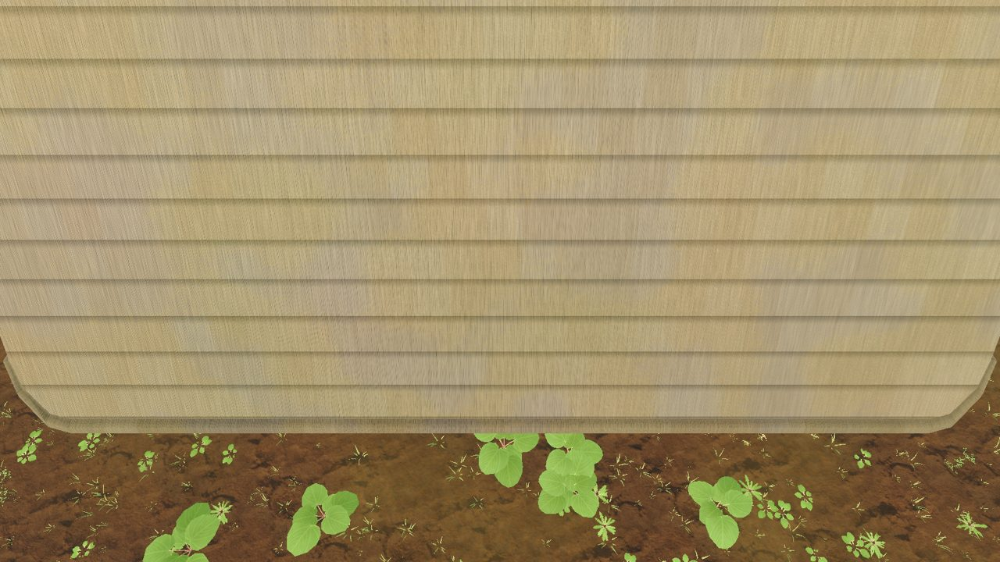 | 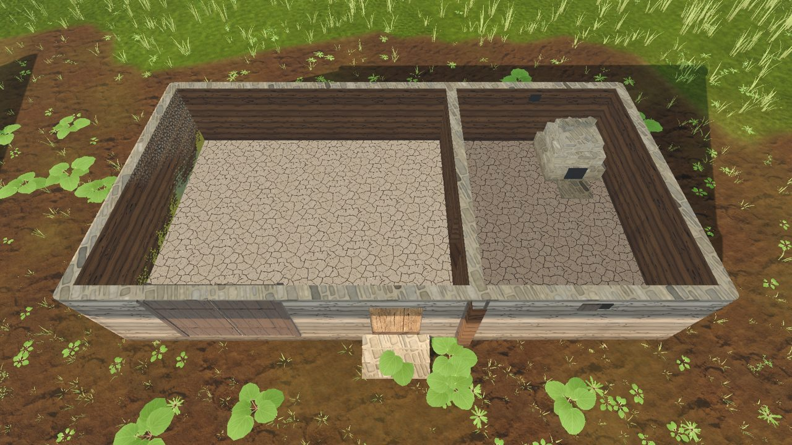 |
| 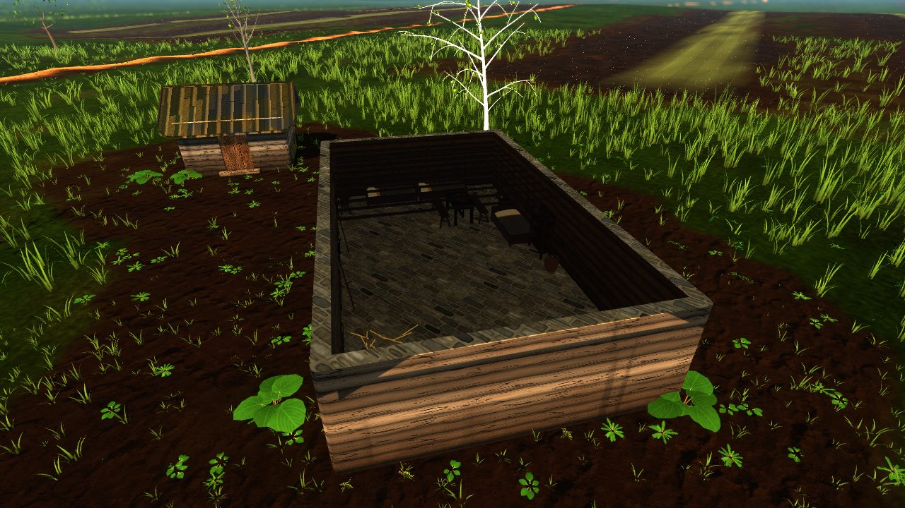 | 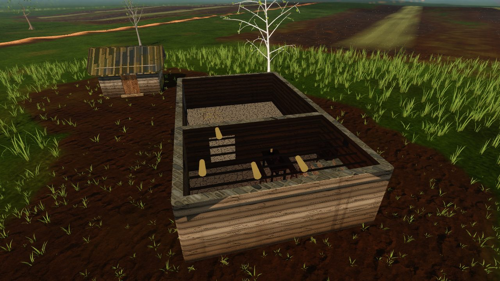 |

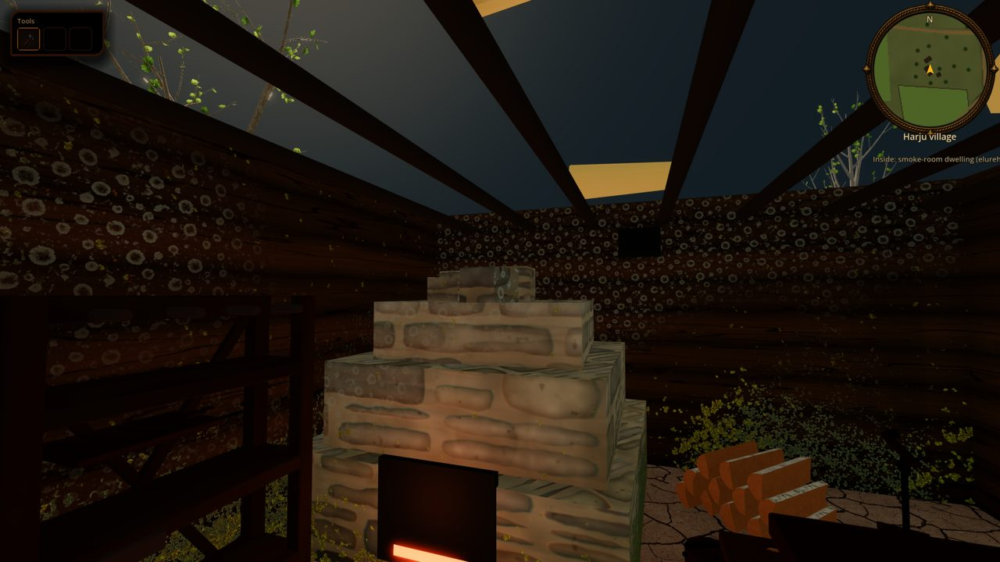

Limits:

- Footprints are unchanged: the generator's barn-dwellings (14-18 x 6.8-8 m, 95-144 m2) are the size of the mature later *rehemaja* and too large for a 1343 *elurehi*; the Harju smoke rooms (12.5 x 7 m) are closer. A follow-up task decides smaller footprints.
- One wall height for both bays: the heated room is not built higher than the threshing floor, and the roof (R-1632) is unchanged.
- No smoke leaves the vents or the door; the smoke cottage lost its chimney plume and has no replacement plume yet. No smoke-blackened gradient on the upper logs, no sooting on the gate side.
- The gate is closed scenery (no swing, no carts through it); the inner door has no leaf.
- The heap oven is box masonry in the building shell (no authored model); the household cooks at its mouth.
- Saaremaa smoke rooms follow the North Estonian rule; the island form (bays of equal width and height) is not modelled.

## Harbour and Kalamaja

Sources: [`harbour-and-shoreline.md`](../../history/dossiers/topography/harbour-and-shoreline.md), [`kalamaja-fishing-shore-1343.md`](../../history/dossiers/topography/kalamaja-fishing-shore-1343.md). Plan key `harbour` plus `bridges` entries of kind `jetty` / `beach_deck`, built by `harbour_features` in the generator.

- **Coastline** (`tools/city/reval_1343_overlay.json` `sea.shoreline_m`, plausible composite): the 1343 wet margin follows the real geography of Tallinn bay. From the Hareapea mouth in the east it runs west-northwest to the fish landing below the Coastal Gate, then turns northwest along the Kalarand beach and leaves the plan bounds at the top edge (x about 0), parallel to and ~45 m inland of Kalaranna street (the 19th-century beach road, from OpenStreetMap). Kalamaja and the ground north of Toompea are dry land, not open sea; post-1840 harbour fill stays sea. The shore is authored, not traced from a 1343 survey; reasons are in the overlay's `shoreline_note`.
- **Merchant landing** under the Coastal Gate: two short timber jetties (walkable), one treadwheel crane (`CityHarbour`, a reversible plausible composite), cargo and bale stacks, plank cargo sheds, cogs in the roadstead (`CityShips`). No continuous stone quay, no foregate, no Fat Margaret.
- **Kalamaja fishing shore**: three beach decks, three net yards with two long pole racks each, hung with big grey wind-cloth drying nets (`CityHarbour`, R-1640, [`CITY_SEA.md`](./CITY_SEA.md#kalamaja-drying-nets-and-fish-racks-r-1640)), fenced with `CityFences` wattle or pole runs (grey weathered wood, never stone, `forced_kind`), two smoke sheds, a salt shed, the boatwright's timber and cart, and 8 clinker boats drawn up on the sand. The `bldg.kalarand.*` huts are the fisher dwellings, strung along the beach lane `road.kalarand_beach` that leaves the landing road, skirts the shore pond and runs northwest about 40 m behind the waterline; `road.coast_west` comes down to them from the Nuns' Gate past the Toompea foot. The front-row huts have one or two full-size fish drying racks each (`harbour.fish_racks`, 27 racks). The beach layout is authored in shore-local axes (`KJ_SEA` seaward to the northeast, `KJ_ALONG` along the beach, `KJ_STATIONS` for the three decks in `build_reval_city_plan.py`), so decks, yards, sheds and boats face the diagonal shore.
- The yard and boat counts (3 yards, 6 to 8 boats) are bounded gameplay composites; documentary support is thin (dossier open question).

## Field soil

Tilled fields and gardens use a dark cultivated-soil treatment, not turf. This is a rendering choice, not a claim that all local soil is black earth. `render_splat` paints each non-fallow field as full packed earth plus a mud-channel marker `FIELD_MUD_LEVEL` (110/255), with the outline warped by smooth noise so strips are not ruler-straight. `city_ground.gdshader` (`field_zone`, `field_height`) reads that band as ploughed soil: dark desaturated earth, lighter dry clods, warped ridges, scattered stones, plus clod relief in the normal map. `CityGrass.field_share` keeps the grass scatter off it. Fallow strips stay rough grass. Review: `tools/godot_render.sh --script tools/capture_city_farmland.gd -- --only=field_rye_game --date=4-21`. Limits: no straight furrow lines in the ground (rows come from the crop plants), and a house seam in the mud channel at the same value would read as field soil.

## Far fields

`CityFarmland._rebuild_far` draws every sown field as a translucent, row-banded crop wash (`FAR_SHEET_ALPHA`) that hugs the ground, thins to a ragged margin and fades in with the plants (bare soil gets no sheet, the ground shader shows it), so fields read from the whole city and beyond `DRAW_RANGE`. Colour follows crop and date (`far_color`): tilled soil, greening, then gold. In April winter grain is green and spring fields are brown; wheat and barley turn gold in July and August (`--date=7-25` in the capture tool).

Strip frame (task **R-1627**): Reval strips are rectangles whose first edge runs along the strip. Regional-site strips (`tools/city/build_site_plan.py`) are clipped to their field block and can have 5 or 6 corners with the first edge on the block boundary. `CityFarmland.strip_frame(polygon, angle)` returns the rectangle for the first kind and, for a clipped strip, the bounding box along the strip `angle`; crop plants and far-sheet cells of a clipped strip are kept only inside the polygon (a sheet cell only when all four corners are inside). Reading a clipped strip as a rectangle drew crops and the sheet across the next road at Harju. Tests: `test_clipped_site_strips_frame_along_the_strip_and_bound_it`, `test_reval_strips_keep_their_rectangle_frame` in `tests/godot/test_city_farmland.gd`.

## Bridges and the east moat

- **Bridges.** Plan key `bridges` (`bridge.viru`, `bridge.tartu`): where an extramural road crosses the Hareapea the generator records the crossing and `CityBridges` builds a plank deck on pile trestles. `CityPlan.bridge_deck_height` makes the deck walkable (ramped between bank heights) and keeps Kalev out of the swim state. No 1343 bridge is attested: a reversible reconstruction. The Viru (Narva) road now bends inland to cross the stream instead of running into the bay. The stream is graded (2026-10-08): plan `harjapea.surfaces` gives the water level per trace point (valley floor minus 1.6 m, never rising downstream, 0 at the mouth), the bed is 0.9 m under it and the banks blend over 14 m, so the deck meets the banks instead of hanging over a 12 m gorge. Stream segments feed `water_surface_at` like the moat pools. Test: `test_stream_is_graded_and_bridges_sit_on_the_banks`. Weathering (2026-10-08): the deck is individual planks (one MultiMesh per hewn-oak grain variant, per-board jitter, tone and rot via instance colour) on three stringers, rails are two-rail hewn beams, piles split into a dark glossy water-soaked foot (up to `SPLASH_HEIGHT` over `water_surface_at`) with a darker green-tinted tone, and dark checks across the deck. Boards use Leonardo-generated 1024x128 weathered-oak strips with matching normals (`assets/materials/pbr/bridge_timber/`, moss and lichen baked in), UV-fitted via `hewn_timber_for_size`. Moss/lichen discs were dropped: they read as stray circles. Test: `test_bridge_builds_weathered_planked_deck`.
- **Moat.** The ditch now runs up the east curtain from the Viru gate to the Sand gate as well as round the south (canon: new irrigated moat on the southern and eastern sections; Ülemiste water rights only 1345, so the water is a presentation choice, see `docs/CANON.md`).
- **Not built, by canon.** The four-tower Viru barbican and round foregate towers are 1370s to 1460s (`history/dossiers/topography/walls-gates-towers.md`: "Viru: present/unfinished, no foregates or barbicans in April 1343"). Viru is a plain gate house between two slim round drums (`w` 6.5, cone `roof_h` 6.5; maintainer direction 2026-10-08, the four-tower barbican was withdrawn the same day, so `plan.barbicans` is empty).

## Kitchen gardens

Status: implemented (task **R-1645**). Scope: the clearance-tested yard vegetable patches of eligible farmhouses in the open city and the `kitchen_garden` map prop, both built by one model. Out of scope: picking or tending crops, garden ownership, kitchen gardens in Lower Town back plots or regional sites (their plans carry no `farmsteads`).

- **Model.** `MapViewKitchenGardenModels` (`scripts/map/view3d/map_view_kitchen_garden_models.gd`): low raised beds of dark, mounded and clodded soil with shallow furrows, edged with woven wattle (stakes every 0.2 m, three withy courses), a trodden path between beds, and rows of cabbage, turnip or onion using the shared crop meshes (`MapViewPlantMeshes`, the same species as the garden strips). Neighbouring beds never repeat a crop; the seed id picks the first crop and one of four cached soil/wattle variants. Garden onions are drawn at half height so a small bed does not read as a reed stand. It replaced flat plank slabs with pale green spheres that read as eggs ([before/after](../reports/images/props/kitchen_garden_before_after.jpg)).
- **Placement.** `CityFarmland.kitchen_gardens_for` (pure, deterministic) gives each plan `farmsteads` entry whose building is a `house` one feature `garden.<farmstead id>` (kind `kitchen_garden`) with 2-3 beds of 3.4 m x 1.0 m (`GARDEN_BED`, `GARDEN_PATH` 0.45 m). It tries behind the house (away from the door), then each gable end, then in front beside the door, 1.4 m from the wall and lying along it, and takes the first spot whose 0.8 m halo touches no building, road body (roads raster), field, pasture or orchard, keeps 1.2 m from every tree, stays out of the moat and landmark sites, and rises at most 0.2 m corner to corner. The patch sits at its lowest corner so no bed floats. A house with no such spot gets no garden. Gardens stream with the other farmland features (`BUILD_RANGE`/`FREE_RANGE`), are visual only (no collision) and grow on the `garden` calendar (`CityFarmland.growth`): seedlings on the 21 April opening, full heads by July.
- **Map prop.** `kitchen_garden` (`rect=2,1`) builds two beds scaled to the map view (`MapViewMeshBuilderRuralLifeProps`, seeded by the stable prop ID).
- **Verify.** `godot --headless --path . --script tools/run_godot_tests.gd -- --filter=test_kitchen_garden`; plates `tools/godot_render.sh --script tools/capture_kitchen_garden_preview.gd` (`build/previews/kitchen_garden_preview*.png`) and `tools/godot_render.sh --script tools/capture_city_farmland.gd -- --only=kitchen_garden,kitchen_garden_close --date=7-15` ([farmstead plate](../reports/images/props/kitchen_garden_farmstead.jpg)).
- **Limits.** Short yard grass can show through the path between beds; the prop is not in `SCATTER_BLOCKING_PROP_KINDS`, so map-view verge tufts may stand inside the beds. No garden tools or crocks beside the beds, no weeds or harvested state.

## Verify

```bash
python3 tools/city/build_reval_city_plan.py --check
godot --headless --path . --script tools/run_godot_tests.gd -- --filter=test_city_farmland
tools/godot_render.sh --script tools/capture_city_farmland.gd -- --only=field_rye_game,pasture --date=4-21
```

### Screenshot recipes and coverage

Run GPU captures through `tools/godot_render.sh` (minimized, no focus); `--headless` is for tests, not image capture. Commands below are **reproduction recipes**, not a claim they were run for R-1700. The documentation review reused archived plates because the shared checkout had unresolved merge conflicts in render code.

```bash
# April baseline: field, croft, orchard, house and yard-garden detail.
tools/godot_render.sh --script tools/capture_city_farmland.gd -- --only=field_rye_game,field_rye_top,field_barley_game,pasture,orchard,yard_barn_dwelling,kitchen_garden,kitchen_garden_close --date=4-21 --tag=apr_review
# Same rye camera in summer; this is not the opening-date evidence.
tools/godot_render.sh --script tools/capture_city_farmland.gd -- --only=field_rye_game,field_rye_top --date=7-25 --tag=jul_review
# Standalone model plates: these do not establish world placement or navigation.
tools/godot_render.sh --script tools/capture_country_fences.gd
tools/godot_render.sh --script tools/capture_hay_stack.gd -- --tag=review
# Adjacent bridge/moat details already mentioned on this page.
tools/godot_render.sh --script tools/capture_city_farmland.gd -- --only=bridge_moat_viru_side,moat_reeds --date=4-21 --tag=apr_review
```

| Tool | Output | What it cannot establish |
|---|---|---|
| `capture_city_farmland.gd` | `build/farmland/<shot>_<tag>.png`, 1600 x 900, day progress 0.42; nearest matching feature to the plan origin for generic crop/croft/orchard views | It builds `CityWorld3D`, not the full playable scene. No proof of workers, fauna routines, player collision or save/load. It updates near streaming for 40 frames; verify that the relevant detail is loaded. |
| `capture_country_fences.gd` | `build/fences/country_fences.png` | A material/shape comparison, not enclosure access or collision. |
| `capture_hay_stack.gd` | `build/hay/hay_{sizes,close,pushed,gale,gale2}_review.png` | Scale, a scripted push and a sampled gust; not live collision or motion over time. |

For a new plate, record **source commit plus dirty-state note, plan hash, command, in-game date, camera/feature ID and renderer** in its caption or companion manifest. Generic nearest-feature selection can change after regeneration. Keep selected evidence under `docs/reports/images/`, not links into ignored `build/`. Do not infer season or revision from a filename alone. For workers, livestock and collision, capture the live scene and test behaviour separately.

### Data and persistence checks

Review snapshot for R-1700: `plan.json` SHA-256 `1131108fcd5f36c2123203591595e28bf297752fe3cb57fd2501c7245d8f03bc`, read on 11 October 2026: **99 fields, 34 pastures, 9 wood records, 185 farmsteads, 30 orchards, 6,816 tree entries**. This is a data inventory, not garden-placement coverage or a medieval census; regional sites have separate plans.

Stable IDs include `field.<block>.<strip>`, `farmstead.<suburb>.<n>`, `orchard.<n>` and runtime `garden.<farmstead id>`. The garden feature is derived at runtime and is not another saved plan list. Farmland has no independent persistent crop/harvest state: plan data and the supplied calendar date reconstruct its appearance. Hay deformation is transient and not saved. No new input or controller bindings are introduced here.

```bash
# Additional focused regressions for the features described on this page:
godot --headless --path . --script tools/run_godot_tests.gd -- --filter=test_kitchen_garden
godot --headless --path . --script tools/run_godot_tests.gd -- --filter=test_city_fences
godot --headless --path . --script tools/run_godot_tests.gd -- --filter=test_hay_stack
# Documentation gates:
python3 tools/docs_index.py --check
python3 tools/generate_active_docs_report.py --check
git diff --check -- docs/SYSTEMS/FARMLAND.md
```

## Limits

- Beyond the near-detail draw range (150 m), sown fields use a banded colour sheet rather than individual plants.
- Farm hands only walk; there is no sowing, hoeing or ploughing animation and no ox team.
- Crop stage uses fixed day-of-year anchors, not weather.
- Outbuildings use the shared log/thatch kit pending R-1632. Fenced crofts, ricks and clearance-tested garden beds exist, but these do not provide every yard with a complete fence, well, fuel, manure or work layout (R-1594). Do not describe the whole countryside as lacking hay or fences.
- Outbuildings other than the barn-dwelling have no interiors. The barn-dwelling footprints (14-18 m) are larger than the 1343 evidence supports; see [Rural dwelling plan](#rural-dwelling-plan) limits.


## Moat (east and south ditch)

`tools/city/build_reval_city_plan.py` rounds the ditch line (`smooth_ditch`, kept 11.5 m from the curtain), cuts it with a long soft bank profile, grades the splat from grass through wet earth to mud, and cuts the ditch unbroken: every road crosses it on a timber bridge (`bridges` entries with `kind: "moat"`, `bridge.moat.viru|karja|harju`), not an earth dam.
Both ends of the ditch run out gently (2026-10-08): depth and width fade by smoothstep over the last `MOAT_TAPER_M` (80 m) in the generator (`build_reval_city_plan.py`), and `CityWorld3D._moat_pools` narrows the water ribbon over the same stretch, so the ditch no longer stops at a blunt cut-off at the south-west corner.
`CityWorld3D` draws the water with `city_moat_water.gdshader` (murky silt colour, depth-buffer edge fade) on a ribbon `CityPlan.MOAT_WATER_HALF_FACTOR` wide, so it meets the sloping bank. `CityMoatPlants` adds reed and cattail clumps rooted in the shallows plus floating lily pads and duckweed. `CityPlan.in_moat` keeps trees, shrubs and fauna (horses at the gates) out of the ditch. Review shots: `tools/capture_city_farmland.gd --only=viru_aerial,moat_reeds,bridge_moat_viru_side`. Limits: no flow, plants are static, bridge piles are the Hareapea trestle kit.

## Hay stacks

Status: implemented. Review plates: `tools/godot_render.sh --script tools/capture_hay_stack.gd -- --tag=<t>` writes `build/hay/hay_{sizes,close,pushed}_<t>.png`. Tests: `tests/godot/test_hay_stack.gd`.

- **Shape.** `MapViewHayMeshes` builds the tall field stack of the Baltic hayfield (forked up round a pole): 2.8 m canonical height (small 2.2 m, medium 2.8 m, tall 3.5 m), taller than a man and taller than wide (belly about 2.2 m across), narrow foot, belly at a third of the height, long convex shoulder and a tight leaning crown. The surface is one dense mass with soft lumps, combed vertical streaks and faint horizontal courses (periodic value noise, no loose stalks poking out). Three contour variants (seeded by prop id) differ in lean and plan oval.
- **Ground litter.** A flat second mesh (`GroundLitter`) lays strands and forkfuls round the foot, with a denser drag fan on the side the hay was carried from, so the base is not a clean disc. It is excluded from the stack bounds.
- **Solid.** In the seamless city `CityFarmland` adds a `StaticBody2D` circle (`MapViewHayMeshes.collision_radius`, layer `WORLD`) per rick under `collision_parent` (set by `reval_city.gd`); it is freed with its field. Hay stacks on the district maps are no longer climbable (`MapClimbableProps`): a 2.8 m stack is a wall, not a step.
- **Yielding flank.** `HayRickReaction` (the node `add_rick` returns) reads the actor pose that `update_grass_interaction` already feeds the grass (static `set_actor`). Within 0.7 m of the blocking radius the body mesh compresses on the actor side, widens across the push and leans its crown away (about 11 % squash, 0.13 shear), harder when the actor runs into it, then springs back with a damped wobble. Idle (one distance check) when nobody is near.
- **Fur and colour.** The body is drawn by `map_view_hay_stack.gdshader` (`MapViewMaterials.hay_stack(layer)`): an opaque body plus three fur shells (`FurN` children of `HayBody`, no shadows) that keep only pixels on a strand lattice in the stack's model space, so the silhouette and lit surface are hairy rather than an egg. Colour is grey-gold (damp dark root, bleached tips, per-strand tone, biplanar `hay_fibers.png`), not saturated yellow; the shared `hay` role colour used by litter and wagon loads is muted the same way.
- **Wind.** Both shaders read the global gust field (`wind_field.gdshaderinc`, ADR VEGR-2): the mass leans with height squared, and the outer fur shells lean downwind and flutter more, so a gust front ripples the loose top layer. Wagon loads get the same body and fur, no wisps.
- **Shed wisps.** `Wisps` (`MapViewHayMeshes.wisp_mesh`, `map_view_hay_wisps.gdshader`): 28 loose strands tucked on the upper stack. Stateless from `TIME`: at each cycle start the gust at the stack is compared with the wisp's own threshold (breeze lets a few go, a gale most); a released strand lifts, tumbles downwind with drag, falls to the ground, lies, then shrinks away. Review plate `build/hay/hay_gale_<tag>.png` from `tools/capture_hay_stack.gd`. Limit: the ground plane is the stack's base height, so on steep ground strands land at that level.
- **Wagon loads** use `add_rick(..., as_load = true)`: the same profile squashed into a low loaf, no litter and no reaction.
- **Limits.** The give is a transform on the body mesh, not true vertex deformation; no dent shape, and NPCs and animals do not press the stack. Hay left on the ground is static (not trampled or kicked). Collision exists only in the city scene; stacks on district maps keep their prop footprint. Not saved.

## Drying loft and threshing floor

Status: implemented (task **R-1630**, partly: loft and threshing floor; the stone heap oven model, plank bunks and a cart are not done). Scope: the upper zone of a 1343 smoke dwelling (`type: smoke_room`, the Harju and Saaremaa farmsteads) shows its second job, drying grain: drying poles (Estonian *parred*) above head height over the oven, loaded with sheaves by season, and a threshing floor in the anteroom. Visual and seasonal only: no gameplay, no collision, no saved state. Out of scope: the 15th-16th c. *rehealune* barn hall, chambers (first evidence early 17th c.), animals in the dwelling, picking sheaves up.

**What the player sees.** In a smoke dwelling, 11-12 peeled poles run wall to wall across the oven end of the room at 2.05 m, with rows of sheaves laid across pairs of poles. Late summer to autumn (poles full from about 13 August to 12 October) they carry a full load; from late November the load thins as the grain is threshed, to a few bundles in spring, and the poles are bare from about 10 May to 24 July (before the harvest). The anteroom end holds a patch of trodden straw with two hand flails lying on it and a basket beside it. Review plates: `docs/reports/images/sites/harju_day_interior_15-9.png` (autumn), `harju_day_interior_21-4.png` (the slice opening day), `harju_day_interior_top_15-9.png` (plan view of both zones).

**Evidence and confidence** (`history/dossiers/architecture/rural-smoke-dwelling-and-farmstead-1343.md`; sources Lavi 2001 *Eesti Arheoloogia Ajakiri* 5:1; Estonian Open Air Museum "Rehemaja"; et.wikipedia *Rehi*, *Rehielamu*):

| Claim | Confidence |
|---|---|
| The heated smoke room also dried grain, with a threshing floor beside it, in the barn-dwelling (first written mention 14th c.) | attested at type level |
| Sheaves dried on poles (*parred*) over the oven in autumn; movable poles about 12, 2-2.5 m high, wall to wall | plausible composite: the numbers and the "autumn" rule are 18th-19th c. EVM ethnography (the museum's rehielamu), used as the nearest analogy, not a 1343 measurement |
| Rye and barley as the dried grains | plausible composite (canon diet note; no per-farm record) |
| Threshing by hand flail on the anteroom floor | plausible composite (the flail itself is a later-attested tool form) |
| Exact pole spacing, sheaf size, the load curve by date | invented for the game, derived from the harvest calendar (rye from late July, barley in August) |

**How it is built.**
- `HouseholdLayout._furnish_loft` (`scripts/city/household_layout.gd`) runs last for `smoke_room` buildings only, on its own RNG seeded by `<building id>:loft`, so the existing furniture, slots and RNG stream of every house are unchanged. `_loft_zones` splits the house along its length: a partitioned dwelling uses its rooms, the common one-room plan is split 60% smoke room (the hearth's end) and 40% anteroom. Items are `loft_pole`, `loft_sheaf` (each with a seeded `rank` 0..1), `straw_litter`, `threshing_flail`; none is solid or occupies floor, and poles and sheaves sit above 2 m, so no citizen slot, path or collision changes.
- `DryingLoft` (`scripts/city/drying_loft.gd`) holds the constants, the pure load curve `sheaf_load(day_of_year)` and the procedural meshes. These are structural fixtures built in code, like partitions: they are not object-catalog entries (see Limits).
- `CityInteriors` mounts poles and floor items as nodes, and all sheaves of a house as one `MultiMesh` ordered by rank; `visible_instance_count` is the day's load share. `CityMapView.set_calendar_date` forwards the campaign date to `CityInteriors.set_calendar_date`, so the poles load and empty with the same date as crops. The state is a pure function of the date: nothing is saved, a reload shows the same poles.

**Verify.** `godot --headless --path . --script tools/run_godot_tests.gd -- --filter=test_drying_loft` (curve by season, poles above head height, threshing floor beyond the poles in all seven Harju dwellings, determinism, no loft in town houses, models build). Plates: `tools/godot_render.sh --script tools/capture_hinterland_sites.gd -- --only=harju_day_interior,harju_day_interior_top --date=15.9` (`--date=D.M` sets the 1343 date and suffixes the file).

**Limits.** No catalog entries or GLBs yet for the poles, sheaves and flails (follow-up: catalogue them, then model them). A site mounts `CityInteriors` with the default date (21 April) until `set_calendar_date` is called. Sheaves are one shape; no sheaf-by-crop variation, no smoke blackening of the sheaves, no loose grain, winnowing basket is the shared `obj.basket_wicker`. R-1630 items still open: stone heap oven model, bunks, a cart.
