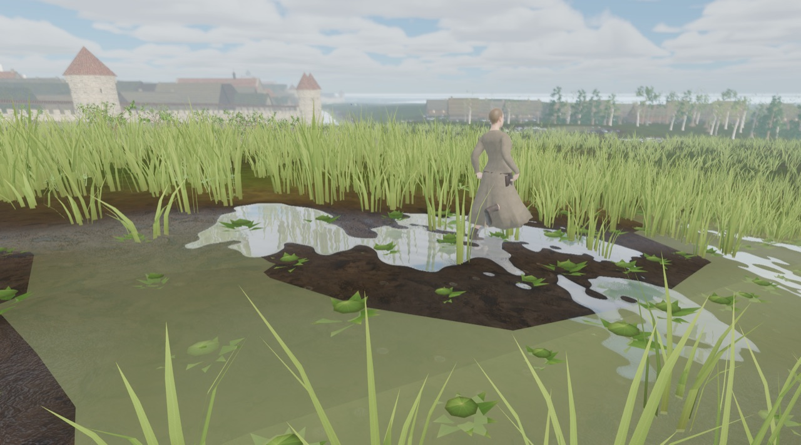

# Farm work: the peasant year in the fields round Reval

Status: planned (epic **R-2246**, tasks **R-2247**..**R-2259**; decisions in [ADR 0063](../adr/0063-farm-calendar-and-field-labour.md), proposed). Nothing on this page is built yet except what is listed under **Today**.

Scope: what the people of the Reval farm suburbs (Harju, Karja, Toompea foot) and the hinterland villages do in their fields, meadows, gardens and yards on any date of 1343, with which tools and animals, how the field changes while they work, and where every crop goes after the harvest: drying, threshing, storage, seed, food, dues and fodder for the animals.

Out of scope: a harvest economy, yields or quantities in `GameState`, player farming, property or dues simulation, weather-driven agronomy, new quests. All farm work is **presentation**: a pure function of (date, hour, weather, field id), like crop phenology and the drying loft.

> **Evidence status.** The calendar, roles, tools and chains below are an **agent draft (2026-10-17) to verify** in the research dossier **FW-1 R-2247**. Every row will carry a label (attested / plausible composite / later analogy / invented / exclude) once the dossier lands. Folk-calendar anchors (Jüripäev, Jaanipäev and so on) are mostly 18th-19th c. ethnography and must not be presented as 1343 facts until checked. Do not implement a row the dossier marks `exclude`.

## Today

- **Farm hands only walk.** `CityNpcs._stream_field_workers` (`scripts/city/city_npcs.gd`) puts a shared `Walker` on one furrow line in about half of the spring- and garden-sown `field` features within 75 m of Kalev (max 6). No tool, no work clip, no link to a farmstead, the date, the hour, rain or standing water: on 17 October 2026 the maintainer captured a farm woman walking through a puddled garden strip with nothing to do.

  

- **Fields change by date only.** `CityFarmland.growth` / `tint` scale crop height and colour; discrete stages (ploughed, sprout, heading, ripe, stubble, stooks) are planned in FLORA-2 **R-2133**.
- **Stores already exist in part.** The barn-dwelling has drying-loft poles whose sheaf load follows the date and a threshing floor with two flails ([Farmland, Drying loft](./FARMLAND.md#drying-loft-and-threshing-floor)); hay stacks stand in crofts ([Hay stacks](./FARMLAND.md#hay-stacks)); `store` outbuildings are closed boxes; animals are in their sheds or on pasture by date (`CityFauna`).
- **Tools that exist:** `obj.sickle`, `obj.scythe`, `obj.rake`, `obj.pitchfork`, wooden shovel ([Object catalog, Farm hand tools](./OBJECT_CATALOG.md)), levy flail and hayfork (R-2014), `wooden_cart`, `obj.hay_wagon`, `obj.basket_wicker`. Missing: ard, harrow, seed basket, hoe, spade, sheaves, stooks, granary bins and the rest of the kits below.

## Design

### Farm calendar (draft, Julian dates, to verify in FW-1)

The campaign opens on 21 April 1343, two days before St George's Night: the spring field work is in full swing and last year's grain is running low.

| Window | Fields | Meadows and gardens | Yard and barn |
|---|---|---|---|
| Mid April - mid May | Plough and harrow the spring field; broadcast-sow oats, then barley and peas; manure on the strips nearest the farm | Dig garden beds, sow peas, onions, turnip in beds | Stock still fed from the stores until the cattle turnout (Jüripäev 23 April is the later folk date: to verify); fence mending |
| Late May - June | Sow flax; weed flax and the young spring grain; plough the fallow (kesa) and cart and spread manure | Plant out cabbage, hoe and weed gardens | Sheep shearing; herding on the common |
| Late June - July | Weeding ends; fallow ploughed a second time | **Haymaking** from about midsummer: men mow with scythes, women turn and rake, everyone stacks; leafy branches cut for sheep fodder | Hay carted or left in meadow stacks |
| Late July - August | **Rye harvest**: women reap with sickles, men bind sheaves, stooks stand to dry; then barley and peas; flax pulled by hand | Garden peas and onions lifted | Sheaves carted to the barn-dwelling and laid on the loft poles |
| Late August - September | **Winter rye sown** on the fallow, harrowed in; oat harvest; stubble grazed by sheep, geese and cows after gleaning | Turnips lifted; flax rippled and spread to ret; hops picked | Loft full; first threshing |
| October - November | Autumn ploughing of stubble where the rotation needs it | Cabbage cut; roots into clamps | Threshing and winnowing; slaughter before winter (Martinmas, to verify) |
| December - March | Snow on stubble and winter rye | Hay and leaf fodder brought from meadow stacks by sledge | Threshing continues; stock stalled and fed twice a day; flax broken, scutched and spun indoors; carting dues to the manor and town |

Daily rhythm (draft): out at sunrise, a midday meal at the field edge, home at dusk; no field work on Sundays and feast days (see [Social life](./SOCIAL_LIFE.md)) or in rain, and never on waterlogged ground.

Rotation: the regional framework is open strips with spring field, winter field, fallow and hay meadow ([Harju village dossier](../../history/dossiers/hinterland/harju-village-and-manor.md)). Whether Reval's suburbs ran a strict three-field rotation is **unknown**; FW-1 decides what the plan may show.

### Who does what (draft)

| Work | Crew | Tools and animals |
|---|---|---|
| Ploughing | Man at the ard stilts, child with a goad at the team's head | Forked ard (*harkader*), ox pair under a yoke or one horse |
| Harrowing | Youth leading the horse | Branch harrow (*okkaäke*) |
| Sowing | Man or older woman walking ahead of the harrow | Seed basket on the hip, broadcast by hand |
| Manuring | Two people | Cart or drag sledge, manure fork |
| Weeding, hoeing | Women and children, stooped along the rows | Hands, hoe (*kõblas*) |
| Haymaking | Men mow; women turn, rake and windrow; all stack | Scythe, rake, hayfork, stack pole |
| Reaping grain | 3-5 women in a line; 1-2 men bind and stook | Sickle, straw bands |
| Flax | Women pull, ripple and spread | Hands, ripple comb, bundles |
| Carting | Man with the team | Cart or sledge with a sheaf or hay load |
| Threshing | 2-4 people in rhythm on the threshing floor | Flails (hinged form to verify, else beating sticks) |
| Winnowing | One person at the open threshing gate in the wind | Winnowing basket or shovel, sieve |
| Feeding stock | Housewife, children | Baskets, bucket, armfuls of hay and straw |

### From field to use (draft)

| Crop | Harvest | Kept where | Used for | Leftovers to the animals |
|---|---|---|---|---|
| Rye (`crop.rye`) | Sickle, sheaves, stooks | Dried on loft poles, threshed, grain in the granary (*ait*) bins; best sheaves kept as seed | Bread (main food), dues and tithe, sale in town | Straw: bedding, winter fodder, thatch and mattresses; chaff mixed into fodder (and into bread in famine years) |
| Barley (`crop.barley`) | Sickle | Granary | Porridge, groats, malt for beer | Straw and chaff as fodder |
| Oats (`crop.oat`) | Sickle or scythe | Granary | Horse feed first, porridge | Oat straw is the best straw fodder |
| Wheat (`crop.wheat`) | Sickle | Granary | Manor and town bread, dues | Straw |
| Peas, broad beans (`crop.pea`, `crop.broad_bean`) | Pulled, dried | Dry pods threshed, peas in bins or sacks | Soup and porridge | Haulm for sheep and cattle |
| Flax (`crop.flax`) | Pulled by hand | Bundles; retted in water or on the meadow, then broken and scutched | Linen thread and cloth; linseed for oil and next year's seed | Linseed cake and shives (to verify) |
| Hemp (`crop.hemp`) | Pulled or cut | Retted like flax | Rope, coarse cloth, seed | Seed for hens (to verify) |
| Turnip (`crop.turnip`) | Lifted | Earth and straw clamps, cellar | The staple root: boiled, baked | Leaves and small roots for cattle and pigs |
| Cabbage (`crop.cabbage`) | Cut | Barrels as sauerkraut (to verify for 1343 rural use), cellar | Winter vegetable | Outer leaves to the pigs and cows |
| Onion, garlic | Lifted | Strings hung in the dwelling | Food, charms | - |
| Hops (`crop.hops`) | Poles pulled, picked | Dried in sacks | Beer | - |
| Hay (meadow) | Scythe, rake, stack | Pole stacks on the meadow, hay in the barn, fetched by sledge in winter | - | Main winter fodder for cows and horses |
| Leaf fodder | Leafy birch and ash branches cut in early summer | Dried bundles by the sheep shed | - | Sheep and goats in winter |

**Who eats what (draft).** Cows: hay, straw, chaff, turnip tops, summer pasture and stubble. Horses: hay and oats. Sheep and goats: leaf fodder, hay, pea haulm, stubble. Pigs: wood pasture, kitchen and threshing waste, bran from milling, whey. Hens and geese: gleanings, chaff and spilt grain; geese on the stubble after harvest. The cat lives on mice in the granary and barn: that is its job.

### Work front (FW-3)

A strip is never half "growing" and half "being worked" at random. `FarmCalendar.progress(field, task, date, hour)` gives a 0..1 front along the strip's long axis, with a deterministic per-field start inside the task window so neighbours differ. Behind the front the next stage shows (furrows, harrowed soil, reaped stubble with sheaves, then stooks); the crew stands at the front.

### Crews (FW-8)

Every field, garden and meadow belongs to a farmstead (deterministic, nearest by lane). Its household comes out of the yard gate at work start, does the calendar task as a crew at the work front with tools in hand and the right clips, rests at midday at the field edge, and goes home at dusk. On Sundays, feast days and in rain the fields are empty and the household does yard chores (outdoor chores **R-2227**). Crews never stand in puddles or waterlogged cells ([Weather on the ground](./WEATHER_GROUND.md)).

### Labour clips (FW-4)

New looping clips on the shared human rig, each with a tool socket: `farm_plough_follow`, `farm_sow_broadcast`, `farm_harrow_lead`, `farm_hoe`, `farm_weed`, `farm_reap_sickle`, `farm_bind_sheaf`, `farm_mow_scythe`, `farm_rake`, `farm_fork_lift`, `farm_pull_flax`, `farm_dig_spade`, `farm_thresh_flail`, `farm_winnow`, `carry_sheaf_shoulder`, `carry_basket_hip`. Hoe, dig and carry are shared with the outdoor chores task R-2227. Each loop is scored by the injury model (see [Motion style](./MOTION_STYLE.md)).

## 3D models

Under the asset freeze each kit task names its exact files and `assets/SOURCES.csv` rows. Forms follow the FW-1 dossier.

| Kit | Items | Task |
|---|---|---|
| A, tillage and sowing | forked ard, ox yoke, branch harrow, seed basket, iron-shod wooden spade, hoe, manure fork, birch-bark basket | FW-5 **R-2251** |
| B, harvest and storage | sheaves (rye, barley, oat, wheat), stooks, flax bundles and retting rows, flail, winnowing basket, sieve, granary bin, root clamp, leaf-fodder bundles, hand quern, drag sledge and sheaf loads | FW-6 **R-2252** |
| Draught team | ox (cattle variant), work horse in harrow tack | FW-7 **R-2253** |

## Tasks

| ID | Task | Depends on |
|---|---|---|
| **R-2247** FW-1 | Research dossier: the peasant farm year round Reval c. 1343 | - |
| **R-2248** FW-2 | Farm calendar data and `FarmCalendar` pure lookup | FW-1, ADR 0063 |
| **R-2249** FW-3 | Work front: strips show the day's progress | FW-2, R-2133 |
| **R-2250** FW-4 | Field labour clips | FW-1 (shares clips with R-2227) |
| **R-2251** FW-5 | 3D kit A, tillage and sowing | FW-1 |
| **R-2252** FW-6 | 3D kit B, harvest and storage | FW-1 |
| **R-2253** FW-7 | Draught team: ox and work horse | FW-1, FW-5 |
| **R-2254** FW-8 | Field crews replace the furrow walkers | FW-2, FW-3, FW-4, FW-5 |
| **R-2255** FW-9 | Haymaking and leaf fodder | FW-6, FW-8, R-2130 |
| **R-2256** FW-10 | Harvest to store: carting, loft, threshing, granary | FW-3, FW-6, FW-8 |
| **R-2257** FW-12 | Gardens and fibre crops | FW-6, FW-8, R-2122 |
| **R-2258** FW-11 | Feeding the stock; stubble grazing; gleaning | FW-8, FW-9, FW-10 |
| **R-2259** FW-13 | Monthly farm-year audit | FW-8..FW-12 |

Related: FLORA-2 **R-2133** (crop stages), FLORA-5 **R-2122** (garden and fibre crop models), FLORA-10 **R-2130** (meadow mowing), outdoor chores **R-2227**, used yards **R-1594**, grain sacks **R-2188**, water buckets **R-1816**. The earlier ploughing idea R-1596 is folded into FW-7 and FW-8.

## Verification (when built)

Each task names its test and capture. The page moves to `Status: implemented` with entry points (`FarmCalendar`, `FieldCrew`, `DraughtTeam`), stable ids (`farm.*` tasks, new `obj.*` items), tests and the FW-13 monthly plates once FW-2, FW-3 and FW-8 land.

## Limits

- Until FW-8 lands, the [Farmland](./FARMLAND.md) farm hands keep walking furrows.
- The calendar is a draft until FW-1; folk-day anchors may move or be dropped.
