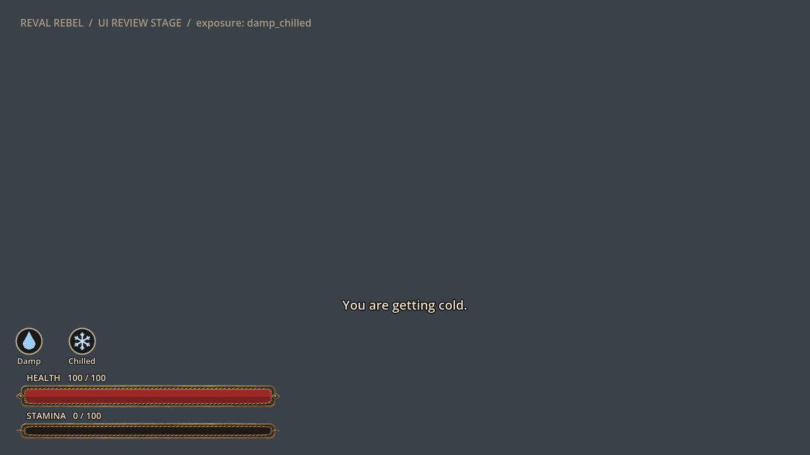
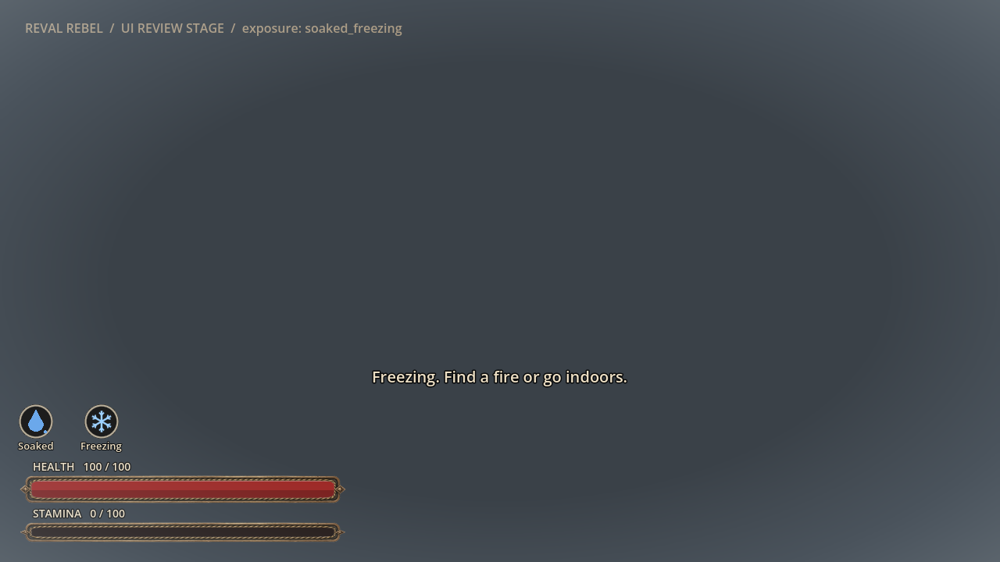
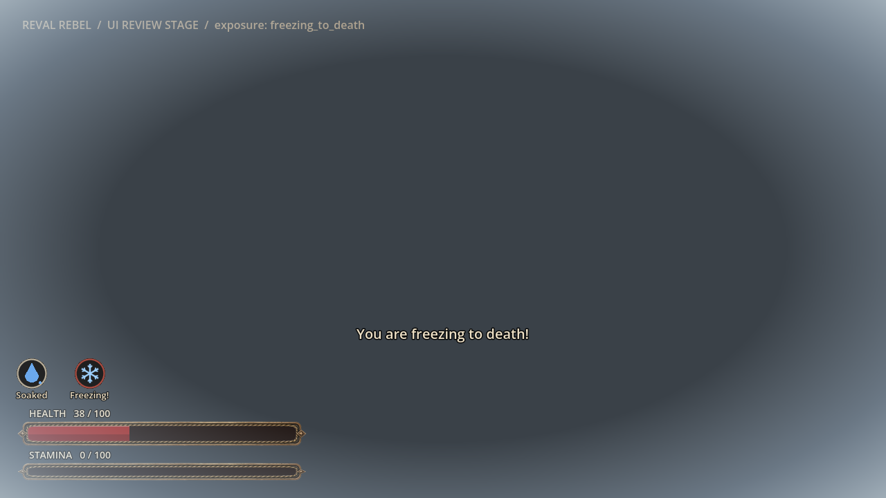

# Hero exposure: getting wet, freezing, warming up

Status: implemented in the seamless city (tasks **R-2183**, **R-2184**, **R-2185**; epic **R-1830**; [ADR 0061](../adr/0061-hero-cold-and-wetness-exposure.md)). Out of scope: frostbite, hunger, thirst or sleep, clothing warmth (later, with the [citizen wardrobe](CITIZEN_WARDROBE.md)), fire healing health, a dedicated cold death illustration (R-2186), spoken lines (R-2187) and the old 2D maps.

## What the player sees

- **Wet.** Rain soaks the hero outdoors when he is not under a roof (snow soaks about a third as fast); a puddle wets only his feet; wading wets him up to the depth; swimming soaks him through at once. A droplet icon appears above the vitals bars: **Damp** from 15%, **Soaked** (darker, dripping) from 60%.
- **Cold.** Below about +10 C felt temperature the body loses heat. Wet clothes feel up to 8 C colder and lose heat up to twice as fast; wind adds up to 60% outdoors. A snowflake icon shows **Chilled** (body heat under 75%), **Freezing** (under 35%: the hero walks slower, down to 60% speed, and frost creeps in at the screen edges) and **Freezing!** (no heat left: the icon rim pulses red, health drains and he can die).
- **Shivering.** Once body heat drops under 90% the body shivers: it burns stamina (0.5 per second) and, while stamina lasts, halves the heat loss. The hero's motion style hunches and hugs itself and shivers from the same meters ([`MOTION_STYLE.md`](MOTION_STYLE.md)).
- **Warming.** Inside a room the air is at least +12 C and the walls stop the wind: he always warms there (full in about 4 minutes, half as fast when soaked) and dries over about 10 minutes, so getting indoors stops a freezing death. Within 2.5 m of a lit fire (a house hearth while it burns, the smithy forge) he warms fully in about 45 s and dries in about 90 s; the effect fades out by 5 m. A roof outdoors (porch, gate passage) stops rain but not cold or wind.
- **Messages.** One line, once per worsening stage, above the vitals: "Your clothes are getting wet.", "Soaked to the skin. Dry off by a fire.", "You are getting cold.", "Freezing. Find a fire or go indoors.", "You are freezing to death!"; and "The fire's warmth seeps in." when a cold hero reaches a fire.
- **Death.** A cold death opens the death screen with damage type `cold`; until R-2186 it shows the neutral illustration.

Rough times (no stamina left, no shelter): dry at -5 C without wind, about 15 minutes to zero body heat; soaked at -10 C in full wind, about 2.5 minutes; then about 75 s from full health to death.

## How it works

1. **Model** (`scripts/player/hero_exposure.gd`, preloaded as `HeroExposure`): pure static functions. `step(player_state, dt, env)` advances `PlayerState.wetness` and `PlayerState.body_heat` and returns `{stamina_cost, damage_share, shivering}`; `felt_temperature_c`, `fire_factor`, `speed_multiplier`, `wet_stage`, `cold_stage`, `motion_channels`. All tuning constants live at the top of the file with the reason for each.
2. **World hookup** (`scripts/world/hero_exposure_hazard.gd`, `HeroExposureHazard`, added by `scenes/world/reval_city/reval_city.gd`): every frame reads `SkyWeather3D.air_temperature_c()`, `rain_intensity()` (weather-wide, not the presentation-only local rain), `precipitation_snow_share()` and `wind_strength()`; `CityWorld3D.enclosed_interior` (inside a room) and `CityPlan.is_under_roof()`; `Player.water_medium()`/`water_depth()`; the puddle wetness of the shared `MotionEnvironment` while moving; and the nearest node of group `heat_source`. Time is play seconds times `Player.time_flow_scale`. It subtracts the shivering stamina, sets `Player.cold_speed_multiplier` (folded into the encumbrance factor, so it applies on land and in water) and applies cold damage in 0.5 s chunks through `Player.take_cold()` (unavoidable like lightning, no hit stun).
3. **Heat sources** (group `heat_source`): `ForgeFireLight3D` joins it in `configure()` and answers `heat_position()`; `CityInteriors` puts a home's hearth holder in the group while `HouseholdDay.hearth_state()` is `lit` and takes it out when the fire is banked to embers. Only furnished homes near the hero have hearth nodes, which is all the hero can stand next to.
4. **HUD** (`scripts/ui/exposure_status_hud.gd`, `ExposureStatusHud`, child of the hazard, canvas layer 21 like the vitals): code-drawn icons (no image assets, asset freeze P0-040), the message label and a radial frost vignette. `show_exposure(wetness, body_heat, fire_m)` each frame; Settings > Reduced motion stops the pulse and the message fade.
5. **Motion style**: `MotionStylePresenter.vitals_conditions()` adds `wet` and `core_cold` (= 1 - body heat) for the `Player`, stepped to 0.05; the agent keeps the larger of these and its own physiology.

## Data, state and saves

`PlayerState.wetness` (0 dry .. 1 soaked) and `PlayerState.body_heat` (1 comfortable .. 0 freezing) are saved in the `player` block of the save (`game_state_persistence.gd`); saves from before this feature load dry and warm. Everything the model reads comes from the saved weather state and the clock, so the same save behaves the same.

## Verification

- `godot --headless --path . --script tools/run_godot_tests.gd -- --filter=test_hero_exposure`: rain soaks outdoors but not under a roof, snow slower; swimming soaks at once, wading partly, puddles cap at 20%; warm dry air costs nothing; cold drains heat, wet and wind faster; soaked at -10 C in wind freezes in 2-5 minutes; shivering burns stamina and slows the loss; a fire warms and dries in a minute; an interior warms in winter, even a soaked hero at zero heat; a porch roof stops rain but not wind; damage only at zero heat and never at a fire; speed and stage thresholds; save roundtrip and old-save defaults; a cold death reports `cold` and the death screen falls back to neutral; HUD icons, one-shot messages, the warming line and the vignette; the hero's motion channels follow the meters.
- HUD capture (UI review stage, not gameplay): `tools/godot_render.sh --script tools/capture_exposure_hud.gd`.

## Limits

- The player's stamina never regenerates today (only drains), so in practice the shivering stamina is soon gone and heat loss runs at the full rate.
- Warmth inside a building is binary: any enclosed room counts as at least +12 C, unheated barns and lofts included; a lit hearth matters only within 5 m.
- Campfires, braziers, kilns and bath-house stoves are not heat sources yet (only house hearths and the smithy forge).
- Only the seamless city level mounts the hazard (regional sites run the same level, so they have it too); legacy 2D scenes do not chill the hero.
- No clothing warmth: the hero is equally dressed in every season.
