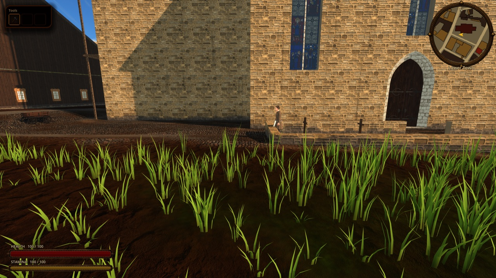
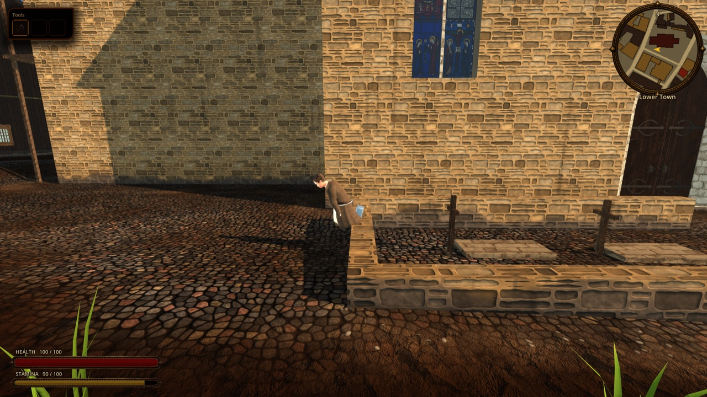
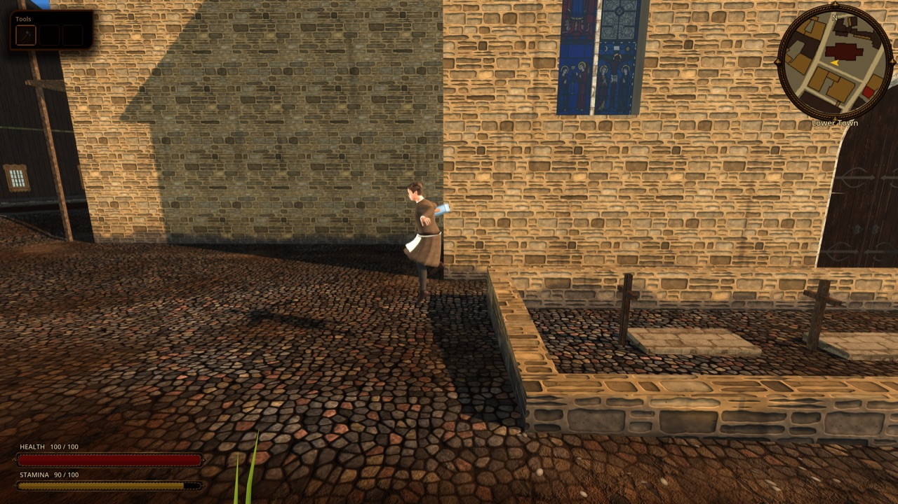
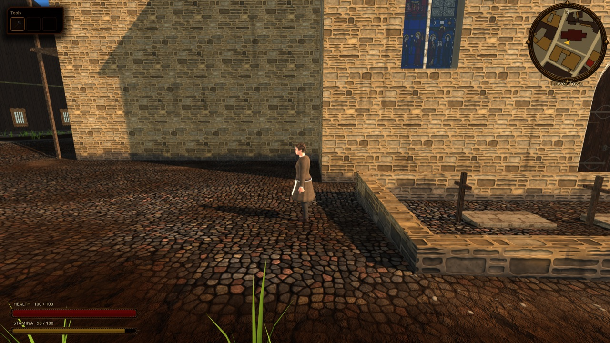
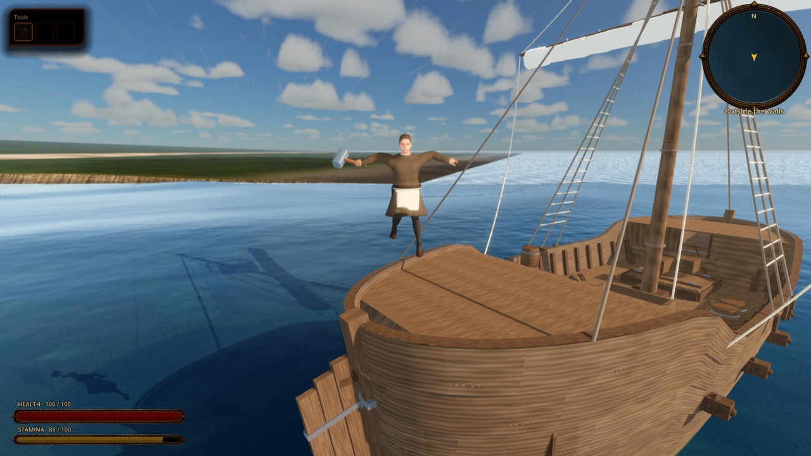
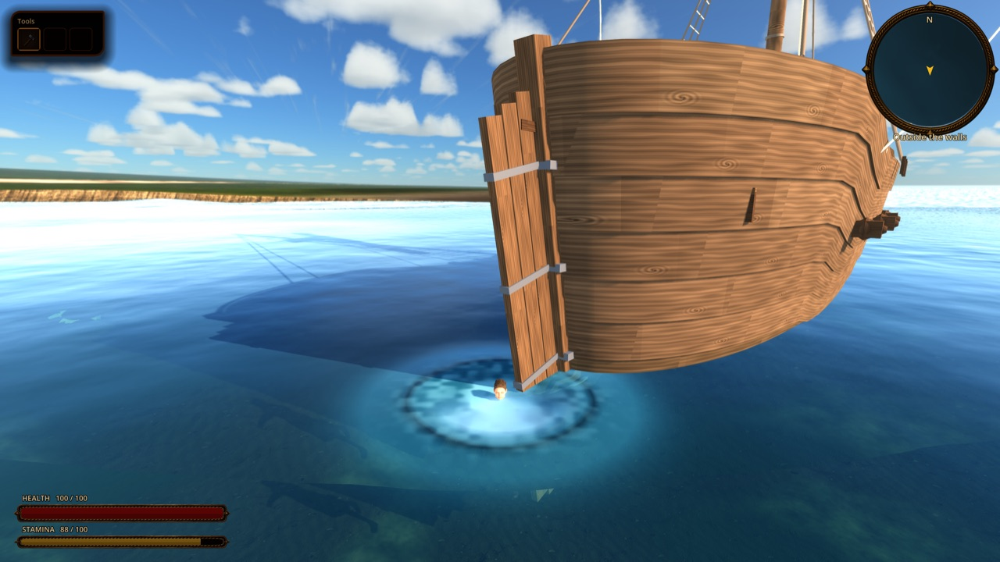
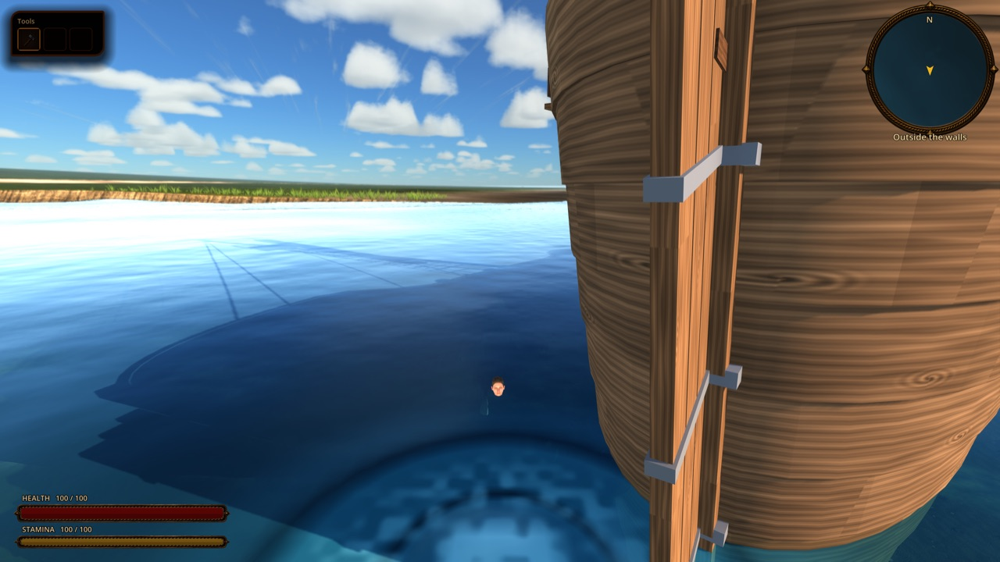
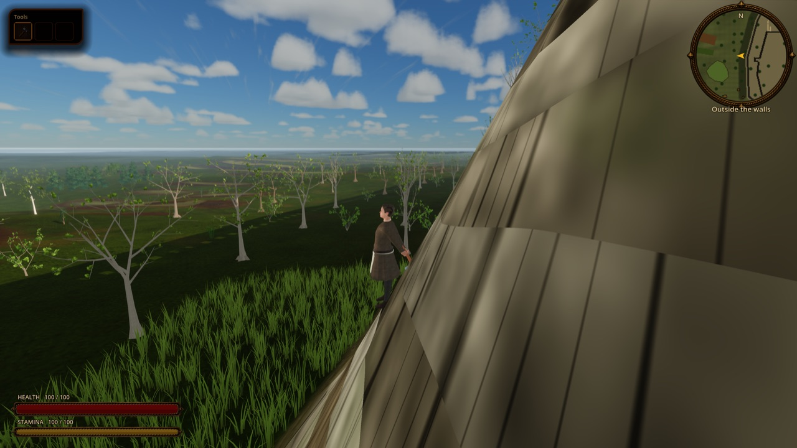

# Leaping: one jump key, chosen by what lies ahead

Status: implemented for the hero in the seamless city ([ADR 0053](../adr/0053-context-aware-jumping-leap-network.md), proposed; board task pending). Out of scope: citizens and animals jumping, fall damage, maps without ground heights (they keep the fixed hop of [`SEAMLESS_CITY.md`](SEAMLESS_CITY.md)).

## What the player sees

`player_jump` (`Z`, gamepad right stick press) in the walking direction (or the facing when standing). What happens depends on what is in front of Kalev and on his state:

| In front of him | Normal | On ice | Sprained ankle | Heavy load |
|---|---|---|---|---|
| Flat street | a short hop | stays | a small hop | a small hop |
| Churchyard wall, 0.85 m | vaults it: hands on the top, body dives over, lands beyond | refuses | refuses | refuses |
| Wall 1.3 m | vaults | refuses | refuses | refuses |
| Wall 2.2 m | refuses | refuses | refuses | refuses |
| Platform 0.7 m / ledge 1.4 m | pulls himself up onto it | refuses | pulls up | pulls up onto 0.7 m |
| Drop 1 m | jumps down, knees give | refuses | jumps down | jumps down |
| Drop 2.5 m or 6 m onto stone | refuses | refuses | refuses | refuses |
| Quay or deck over deep water, summer | jumps in | refuses | jumps in | refuses (would sink) |
| The same in cold weather (sea at 4.5 C) | refuses | refuses | refuses | refuses |
| Cliff over shallow water | refuses | refuses | refuses | refuses |

(The network's answers in skeleto-nn `python -m adapt.leap --probe` and the golden cases; the city decides from real heights.) A refusal is a short balk at the edge: weight back, arms forward. Landing in deep water hands over to swimming.

Review plates (`tools/godot_render.sh --resolution 1600x900 res://tools/capture_city_leap.tscn`, real city): vaulting out of St Olaf's churchyard over its 0.67 m wall; jumping off a cog's deck into the sea in summer and refusing at the same edge on the city's own (cold) date; refusing a 4 m bank.

## How it works

1. **Probe** (`scripts/motion/motion_leap_probe.gd`): 20 samples every 0.25 leg lengths (0.215 m for Kalev) along the jump direction. Each sample is the walk height (`CityPlan.walk_height`: ground, floors, bridge decks), raised to the top of a wall where the logic collision has one: `CityCollisionBuilder` tags site fabric walls with `top_y` (site level + fabric `y1`, `CitySiteKit.walk_walls` passes it on); other solids (houses, fortifications, walls authored only as `walk.walls`) count as 12 m. Water depth comes from `CityWorld3D.water_surface_at`. Nothing inside a solid is a landing place.
2. **Decision** (`scripts/motion/motion_leap_net.gd`, weights `assets/motion/leap_net.json`): for every sample as a landing place, one MLP (41 inputs: body, the 24 channels of [`MOTION_STYLE.md`](MOTION_STYLE.md), ten numbers about that place; two hidden layers of 96; about 14,000 weights, so 20 evaluations per key press) gives a score against staying and the jump program: `take` (step before take-off), `apex`, `hands`, `tuck`, `flex`, `roll`, `lower` (hang from the edge first), `arms_out`, `lean`. The best place wins, or staying. Channels come from the hero's style agent (`MotionStylePresenter.channels_of`, fed into `Player.leap_channels` by `MapViewRuntimeActors.sync_player`): ice, wet, cold, pain per limb, blood loss, fatigue, load, darkness. Spent stamina lowers the leg power. The labels (hop, vault, pull up onto, jump down, jump into water, hang-drop, refuse) are only for logs and tests.
3. **Motion** (`scripts/player/player_leap.gd`, held by `Player`): approach to the take-off point, crouch 0.18 s (or lowering 0.75 s), ballistic flight, landing 0.18 to 0.53 s (a roll 0.6 s). Logic collision is off from take-off to landing; water medium updates pause in the air; a landing in a steep strip leaves the slide to carry him out. While the hands bear on a wall the body passes low over it (hips a hand's breadth above the top), as the network's cost counted the support. Stamina: 0.6 to 1.2 times the hop's 8 by flight time.
4. **Presentation**: `view_animation()` returns `jump_start`, `jump_air`, `jump_land` (rig clips `Jump_Start`, `Jump_Idle`, `Jump_Land`) or `roll_forward`; `MotionStylePresenter.leap` installs `LeapPoseModifier` (`scripts/characters/leap_pose_modifier.gd`, after the style layer, before the muscles): crouch, tucked legs, both hands to the wall top by two-bone reach with the trunk diving forward, landing give and arms out, the balk.
5. **Without heights** (other maps, tests constructing `Player`): no `set_leap_ground_provider`, so `try_jump` keeps the fixed `PlayerJumpState` hop.

## Retraining and adding situations

- A new situation that maps onto existing channels (slush, a greasy floor, a hailstorm) changes jumps with no retraining (it already reaches the hero's style agent).
- A new physical effect: a channel and a cost term in skeleto-nn (`adapt/schema.py`, `adapt/leap.py` `cost`), then `python -m adapt.leap` (12k steps, about 12 minutes), `python -m adapt.leap --check`, `python -m adapt.export_engine <game>/assets/motion`, and move `leap_net_golden.json` and `style_net_golden.json` to `tests/godot/fixtures/motion/`.
- New obstacle heights: tag the collision polygon with `top_y` (see `CityCollisionBuilder._sites`).

## Data, state and saves

Nothing is saved: a jump lasts about a second and the decision is a pure function of the probe, the channels and stamina. Stable files: `assets/motion/leap_net.json` (format `skeleto-nn/leap-net/1`).

## Verification

- `godot --headless --path . --script tools/run_godot_tests.gd -- --filter=test_motion_leap`: the GDScript network decides like Python on 69 golden scenes (action, landing place, knobs, arc); the probe reads tagged wall tops and counts untagged solids as tall; the hero vaults a 0.85 m wall with his hands on the top and lands beyond it; jumps off a quay into deep water; refuses a 6 m drop onto stone and balks; refuses the wall on ice; the pose layer brings the hands to the wall top.
- Real city: `tools/capture_city_leap.tscn` (above), exit 1 when a scene is missing or the decision is not the expected kind.
- skeleto-nn: `python -m adapt.leap --check` (91 % of the per-case optimum's gain over staying, same jump-or-stay decision in 95 % of held-out cases), `tests/test_leap.py`.

## Limits

- Citizens and animals do not jump yet; the network covers quadrupeds (a dog at a 0.6 m fence is a golden case).
- No fall damage: a jump the network chose lands; a refused jump simply does not happen.
- Walls authored only as `walk.walls`, houses and fortifications count as 12 m; crates, carts and hay (`MapClimbableProps`) exist only on hosted maps and are not in the city probe.
- The hang-drop (lowering oneself from an edge) is in the network but did not win at any city edge tested; at 2.5 m it refuses instead.
- The landing roll uses the procedural `roll_forward` clip without moving the body forward.
- The 4 m bank plate has the camera close to the slope.
