# Living vegetation: trees, shrubs, grass and ground cover

Status: implemented; visual and performance acceptance remains partial. Reorganized in **R-1696**, merged with the former vegetation realism plan (epic **R-1319**) in **R-1704**; rewritten feature by feature with pictures on 11 October 2026. Implemented: 20 procedural tree species with seasons, wind and city LOD; shared wind field (**R-1321**); procedural textures (**R-1329**); ecology placement (**R-1322**); seamless-city rooting and the coastal pine heath (**R-1617**); Weber-Penn skeletons and leaf clusters (**R-1324**); city blade grass (**R-1323**, partial); 3D wild plants with seasons (**R-1519**, **R-1557**, **R-1559**); snow cover (**R-1327**, partial); moss, lichen and the forest floor (**R-1661**, **R-1683**, **R-1684**). Not built: grain fields, the full tree LOD chain, impostors, grass seasons (see the [roadmap](./VEGETATION_ENGINEERING.md#roadmap)).

Scope: identifying, locating and changing vegetation models, their placement and rendering. Presentation only: no damage, felling, harvesting, collision changes or saved per-plant state. Out of scope: a crop or harvest mechanic (needs an ADR), new biomes, imported game assets, a renderer change (GL Compatibility stays). Farmland crops: [Farmland](./FARMLAND.md); calendar: [Seasons](./SEASONS.md). Budgets, workflow, capture commands, limits and roadmap: [Vegetation engineering](./VEGETATION_ENGINEERING.md).

Pictures are repository captures under `docs/reports/images/vegetation/`. The three animations were rendered by [`tools/capture_vegetation_animations.gd`](../../tools/capture_vegetation_animations.gd) on 11 October 2026; older plates are visual references, not proof that every defect is resolved. Click an image for full resolution.

## At a glance

| Feature | Looks like | What drives it | Section |
|---|---|---|---|
| 20 tree species | Distinct silhouettes, forks, drooping or upright limbs | Species key, branching preset, size profile | [Trees](#trees) |
| Seasons | Bud-burst, full leaf, autumn colour, bare winter, fruit | Campaign date | [Seasons](#seasons-and-fruit) |
| Wind | One gust front crosses grass, then crowns; trunks bend | Weather state, shared wind field | [Wind](#wind) |
| Detail by distance | Needle fronds up close, cheap crowns far away | Camera distance | [Detail by distance](#detail-by-distance) |
| Shrubs | Canes and tree-mesh bushes | City plan species | [Shrubs](#shrubs) |
| Blade grass | Individual curved blades, trampling, snow | Wildness fields, player position | [Grass](#grass) |
| Wild plants | Dandelion, plantain, clover, burdock by month | Date, habitat fields | [Wild plants](#wild-plants-forbs) |
| Ecology | Sedge at the bank, clear road verges, pine heath on sand | Water, road, shade, soil fields | [Placement and ecology](#placement-and-ecology) |
| Moss and fungi | Moss on north sides, mushrooms in the woods | Sun side, shade mask, date | [Moss, lichen and the forest floor](#moss-lichen-and-the-forest-floor-r-1661) |

## Trees

A tree is assembled at runtime from a **branching skeleton**, wood, **leaf-cluster cards** and optional fruit; it is not a `.glb` file. Meshes are cached per species and drawn as MultiMesh batches, so one species can have many placements at no extra model cost. The seamless city adds metre-scale bark, camera-dependent crown detail and whole-tree wind bending; district (blueprint) maps share species and seasons but not every city feature.

```text
plan entry (species, position, size) -> growth profile + branching preset
  -> deterministic skeleton -> cached wood + canopy + fruit meshes
  -> MultiMesh batches -> seasonal materials, weather, camera detail
```

### Species

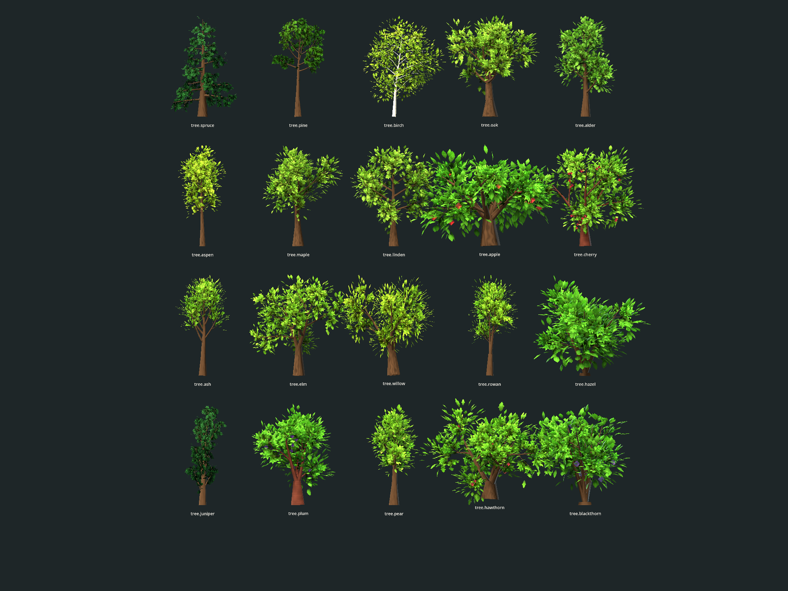

*A shape catalog, not a height chart: every tree is normalized to one display height.* Real heights: [relative silhouettes](../reports/images/vegetation/r1324_tree_silhouettes_after.png) and [crown close-ups](../reports/images/vegetation/r1324_tree_closeups_after.png).

The registry is [`MapViewTreeSpecies.ALL_SPECIES`](../../scripts/map/view3d/map_view_tree_species.gd). District variants are `tree.<species>` (optionally `.small`, `.medium`, `.large`); `tree.mixed`, `tree.deciduous` and `tree.orchard` are weighted pools. City plans use the bare species key.

| Habit | Species (model key) |
|---|---|
| Evergreen | Norway spruce `spruce` (cone, low skirt), Scots pine `pine` (clear bole, high open crown), juniper `juniper` (compact column) |
| Tall, airy broadleaf | birch `birch` (white bole, gold autumn), aspen `aspen`, ash `ash`, alder `alder` |
| Broad dome, late leaf | oak `oak` (low crooked fork, brown autumn), maple `maple` (red/orange), linden `linden`, elm `elm` |
| Wet ground | willow `willow` (leaning bole, hanging shoots) |
| Orchard and fruit | apple `apple` (fruit Aug-Oct), sour cherry `cherry` (July), plum `plum` (Aug-Sep), pear `pear` (Aug-Oct) |
| Small and thorny | rowan `rowan` (berries Aug-Nov), hawthorn `hawthorn`, blackthorn `blackthorn` (sloes Sep-Nov), hazel `hazel` (stool, no trunk) |

"Early" and "late" leaf are rendering groups, not botanical simulation. Leaf-card families are shared (ash, rowan and willow borrow the birch tile), so identity comes from branching, proportions, tint and bark as well as the card. Only Baltic 1343 species are allowed ([`FLORA_FAUNA.md`](../FLORA_FAUNA.md)). `pine_tall` is a city form of `pine`, not a 21st species: 23 m, 13 primary limbs, needles on the outer third of each shoot; see `MapViewTreeMeshes.CITY_FORMS`.

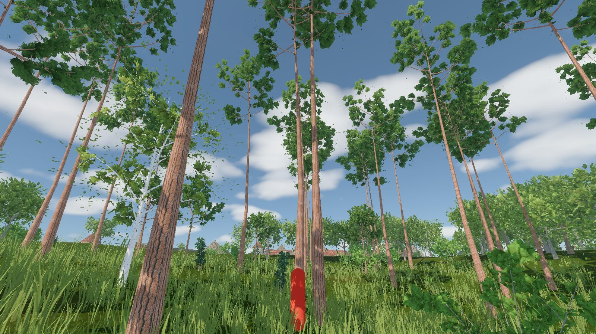

*`pine_tall` in the coastal pine heath (R-1617).* [Wide view](../reports/images/vegetation/r1617_pine_heath_wide.jpg).

### Skeleton, wood and leaves (R-1324)

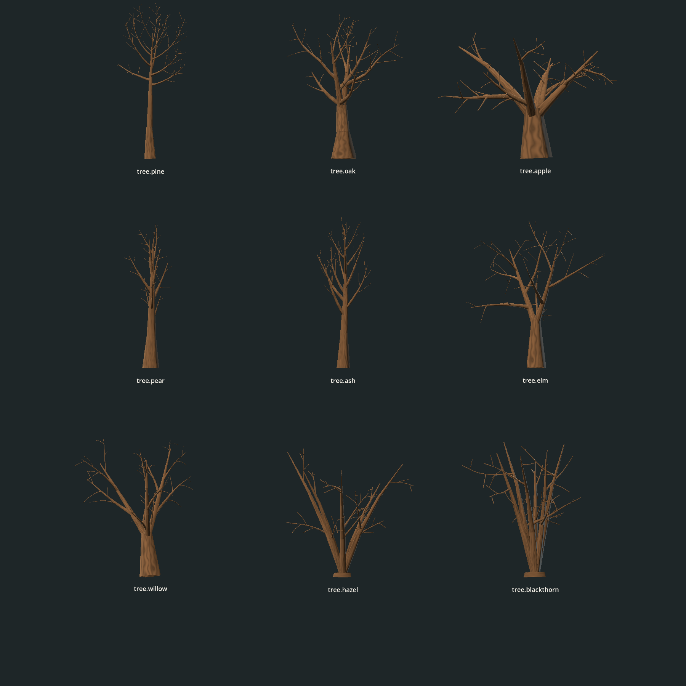

*Bare wood. Use this view when changing forks or drooping shoots; foliage hides bad junctions.*

- **Branching.** [`TreeSkeletonWeberPenn`](../../scripts/map/view3d/tree_skeleton_weber_penn.gd) (Weber and Penn 1995, written from the paper in GDScript) gives each species a preset: trunk lean and taper, per-level branch count, angle, curvature and gravity or light attraction. `splits` forks the bole: one split is an oak or maple fork, many low splits a hazel stool, a split at a third of height an orchard head.
- **Smooth limbs and collars.** Limbs are Hermite-smoothed; each branch base gets a flared collar; boles widen into a root flare (buttress roots for `ROOTED_SPECIES`). About 65 % of city trees get leaf or needle litter at the foot.
- **Bark.** City bark tiles along limbs at about 0.55 m with UVs that follow the branch frame; families are shared (aspen uses birch, juniper spruce, orchard trees cherry).
- **Leaves.** Crowns mix folded leaves with folded **cluster cards** (a small surface carrying an image of several leaves or a needle spray), placed over the outer `cluster_span` of each shoot. The [canopy shader](../../scripts/map/view3d/map_view_canopy.gdshader) adds species and season tint, dark interiors, wrapped normals, backlight, rain wetness and wind.

| Spruce needles at arm's length | Oak bark | Birch bark |
|---|---|---|
| 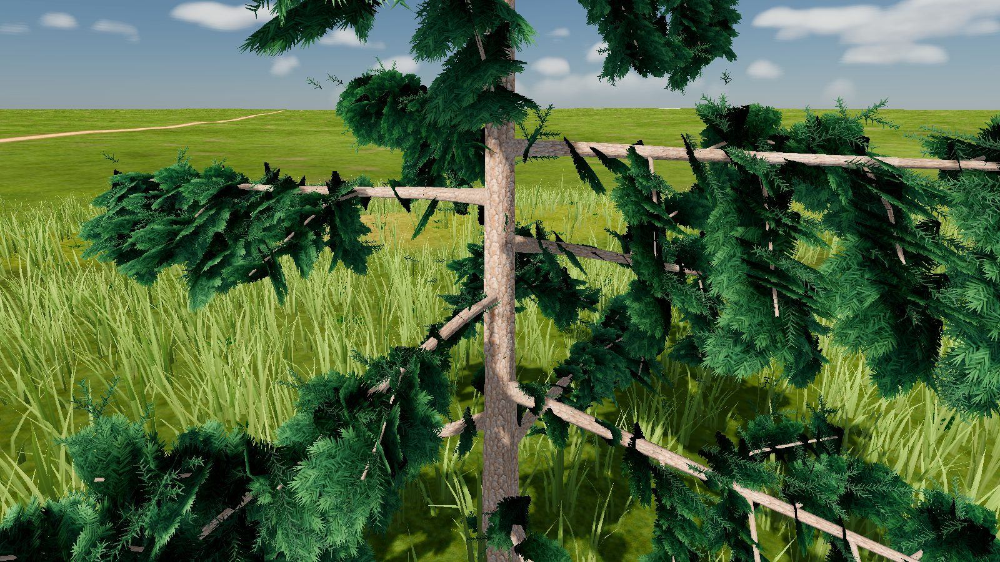 | 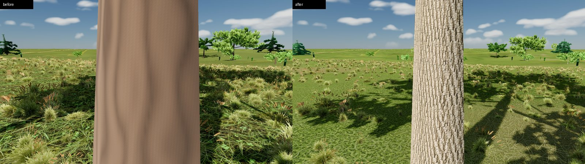 | 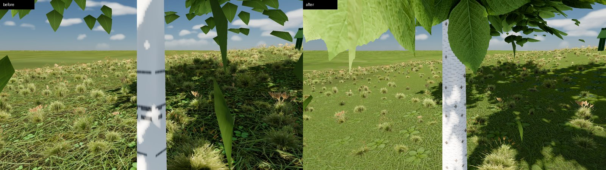 |

More: spruce [beside a human](../reports/images/vegetation/veg_city_spruce_scale.jpg) and [at gameplay camera](../reports/images/vegetation/veg_city_spruce_gameplay.jpg); [pine needle crown](../reports/images/vegetation/veg_city_pine_macro_after.jpg); bark continuity across forks on [oak](../reports/images/vegetation/veg_bark_joint_oak_before_after.jpg), [birch](../reports/images/vegetation/veg_bark_joint_birch_before_after.jpg), [spruce](../reports/images/vegetation/veg_bark_joint_spruce_before_after.jpg), [cherry](../reports/images/vegetation/veg_bark_joint_cherry_before_after.jpg).

### Detail by distance

City detail follows the **active camera** ([`CityTreeLod`](../../scripts/city/city_tree_lod.gd)); separate enter and exit distances avoid flicker, and graphics quality scales the radii.

| Tier | Base rule | Drawn |
|---|---|---|
| Macro conifer | in within 10 m, out beyond 13 m | Outer shoots as real 3D needle fronds over darker inner cards |
| Near crown | in within 34 m, out beyond 42 m | Small clusters (0.62 m broadleaf, 0.58 m conifer cards) |
| Far crown | beyond the near set | Cheaper large-card crown on the same skeleton |
| Coarse | distant batches | Reduced crown triangles, trunk-only wood |

| Near card crown | Macro fronds | Same view, swap boundary |
|---|---|---|
| 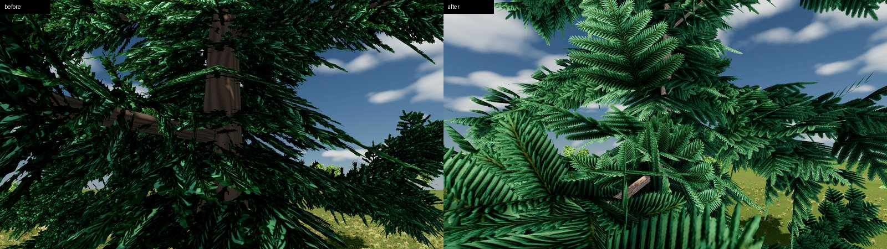 | 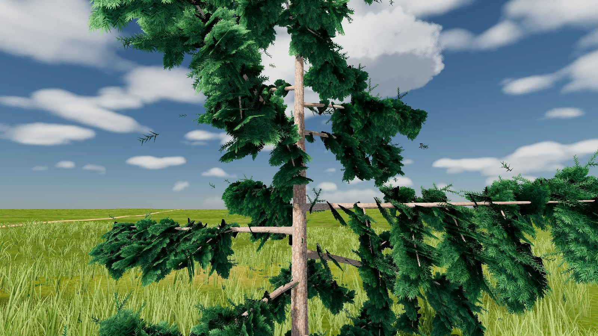 | 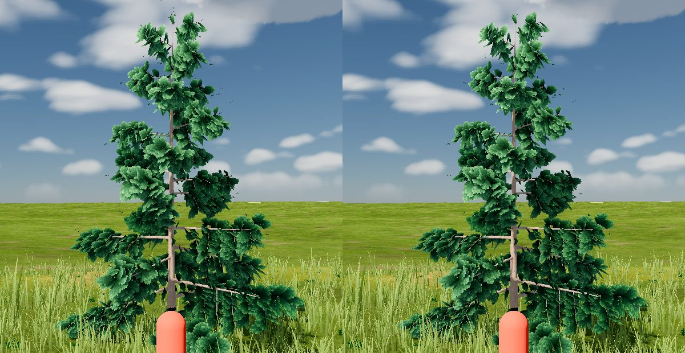 |

District maps have no LOD chain yet; impostors are planned. LOD choice is reconstructed from the camera and never saved.

## Seasons and fruit

[`VegetationPhenology.state_for(species, date)`](../../scripts/map/view3d/vegetation_phenology.gd) computes the look from the campaign date. Birch, oak, maple, apple and spruce on the 1st and 15th of each month, April 1343 to March 1344:

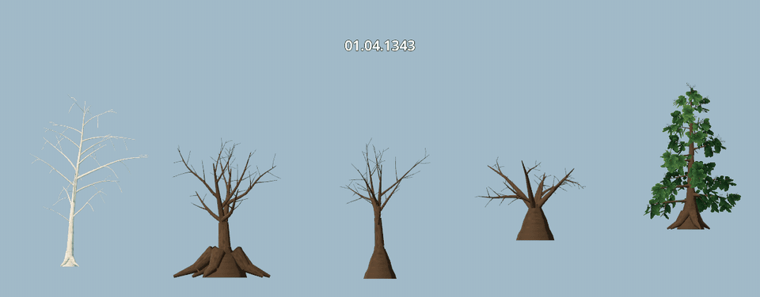

| Season | What changes |
|---|---|
| Spring | Small, pale, sparse leaves expand into a full crown; early and late species follow different curves |
| Summer | Full leaf; fruit meshes show in the species windows above |
| Autumn | Species colours mix within a crown and leaves shed gradually; a per-cluster seed decides which turn first |
| Winter | Deciduous trees bare; spruce, pine and juniper keep needles, duller and bluer |

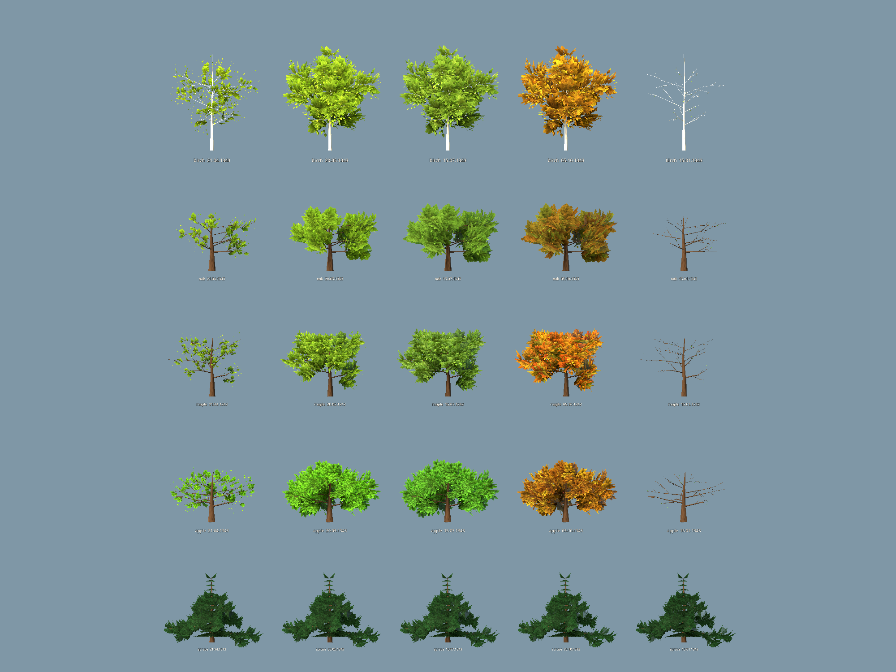

*Rows: birch, oak, maple, apple, spruce. Columns: 21 April, 20 May, 15 July, 5 October, 15 January (R-1194).* April greenery on the opening date is an art choice, earlier than real Tallinn budburst. No blossom, no snow on branches.

**Snow (R-1327).** `VegetationPhenology.snow_cover_for(date)` is 0 before mid-December, 1 by mid-January and melts out from 1 March to early April. It sinks and whitens grass blades and tints the terrain (less on trodden mud). Date only: no weather input, no depth.

**Rain.** Active rain darkens leaves and bark and changes gloss through the material layer. Leaves do not wait for puddles.

## Wind

One weather-driven wind field (**R-1321**) supplies crowns, grass, wild plants, flags, banners, sails, ropes and nets. A gust crosses a field, then reaches the trees, then the flags. The sea has its own wind path; smoke and rain particles do not use this field.

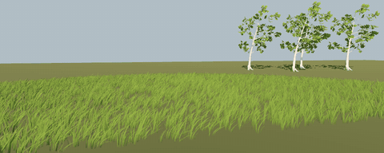

*Wind left to right. The bend travels through the grass as a visible wave and reaches the crowns later.* Analysis: [calm vs storm meadow](../reports/images/vegetation/r1321_wind_calm_storm.png), [front sheet](../reports/images/vegetation/r1321_wind_front_sheet.png) (each frame beside its gust map; the warm band should move left to right).

[`WindField`](../../scripts/map/view3d/wind_field.gd) publishes global shader parameters (heading, strength, gust amplitude and wavelength, speed, turbulence) declared in [`project.godot`](../../project.godot). The [shader include](../../scripts/map/view3d/wind_field.gdshaderinc) samples analytic value noise by world position and time at two scales, so the bend is a travelling wave, sampled once per tuft or tree rather than per vertex. Direction, strength and gustiness come from the weather state ([contract](../SKY_WEATHER_STATE_CONTRACT.md)). Do not add per-material wind clocks.

### Whole-tree bending (city)

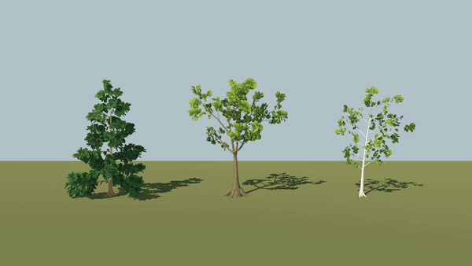

*Calm, storm gust, calm. The bole stays rooted, the trunk curves, limbs heave and twigs shiver; flexible birch moves more than stout oak.*

City bark and every crown tier share [`tree_wind.gdshaderinc`](../../scripts/map/view3d/tree_wind.gdshaderinc), so leaves stay on their shoots. Limb flexibility is stored in `COLOR.a` of the wood mesh (0 bole, 1 twig tip). The model is a loaded cantilever in metres: about 1.3 m of lean at the top of a 9 m tree in a storm gust and centimetres in a breeze, a slow sway ring after gusts, per-limb lag and a twig shiver, bounded at 30 degrees. Per-species stiffness is `sway_strength`, so tall pines move more than oaks. It is an analytic approximation: no breakage and no collision movement. **District maps:** crowns move but wood stays rigid; do not approve city bending from a district capture.

### Weapon response and falling leaves

| Effect | Implementation | Persistence |
|---|---|---|
| Player swing shakes a crown and releases leaves | District `MapView3D.strike_vegetation`, [`TreeLeafFall3D`](../../scripts/map/view3d/tree_leaf_fall_3d.gd) | Temporary, no damage |
| Ambient leaf fall | District `TreeLeafFall3D`; city [`CityLeafFall`](../../scripts/city/city_leaf_fall.gd) | Particles only |
| Gust leaf loss upwind of the player | `TreeLeafFall3D` `GustLeaves` when local wind passes about 0.9 | Particles only |
| Litter under city trees | `CityVegetationBuilder.litter_mesh` | Deterministic decoration |

Heavy attacks shake harder; autumn yields more leaves, bare crowns none, conifers a few needles. NPC attacks, spells and projectiles do not use this path.

## Shrubs

| Dog rose | Raspberry | Elder (hazel mesh) |
|---|---|---|
| 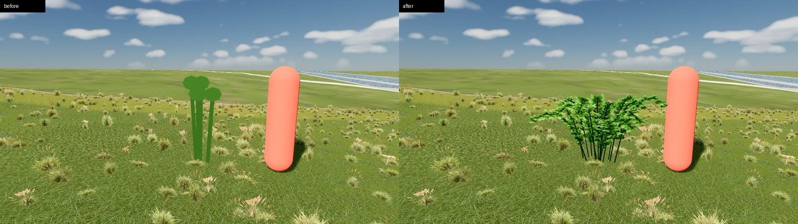 |  | 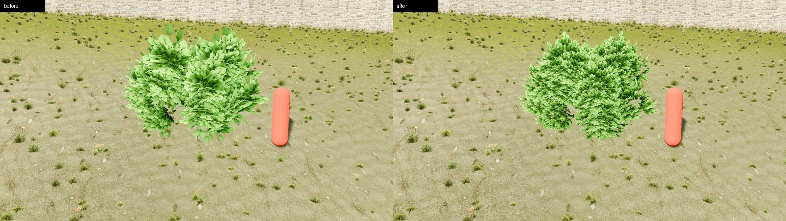 |

City shrubs reuse tree meshes through [`CityVegetationBuilder.SHRUB_AS_TREE`](../../scripts/city/city_vegetation_builder.gd):

| City plan species | Rendered model |
|---|---|
| `elder`, `hazel_shrub`, `guelder_rose`, `willow_shrub`, `alder_shrub` | Hazel tree mesh, scaled |
| `hawthorn`, `spindle` | Hawthorn tree mesh |
| `blackthorn`, `sea_buckthorn` | Blackthorn tree mesh |
| `juniper_shrub` | Juniper tree mesh |
| `dog_rose`, `raspberry` | Curved canes with leaf cards ([`MapViewBushMeshes.city_mesh_for`](../../scripts/map/view3d/map_view_bush_meshes.gd)); rose uses rowan leaves, raspberry hazel; no flowers or fruit |

Species with neither a proxy nor a city mesh are skipped rather than drawn as a blob.

### Legacy shrub mesh removed

District maps no longer draw the old ellipsoid and cone shrubs: `bush.*` scatter and authored `bush` props have no model. The data still slows movement through [`TerrainVegetation`](../../scripts/map/terrain_vegetation.gd) and counts in composition accounting. **Invisible shrub geometry does not mean the gameplay data was deleted.** Restoring district shrubs needs a new reviewed model.

## Grass

Implemented for the seamless city (**R-1323**; open: blueprint-map carpet and grass seasons). Decision (user, 2026-10-08): the ground texture is a primitive colour field and every recognisable plant is 3D geometry. Target: individual curved blades with wind rolling across them as a visible front.

| City grass at eye level | City grass, wide |
|---|---|
| 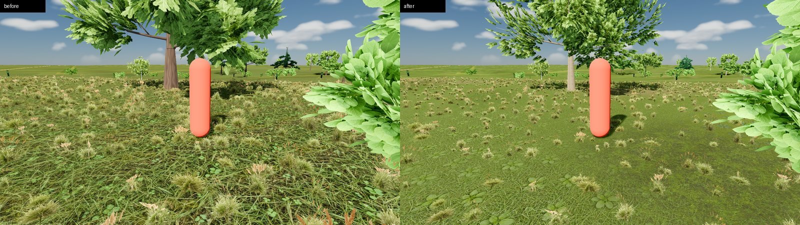 | 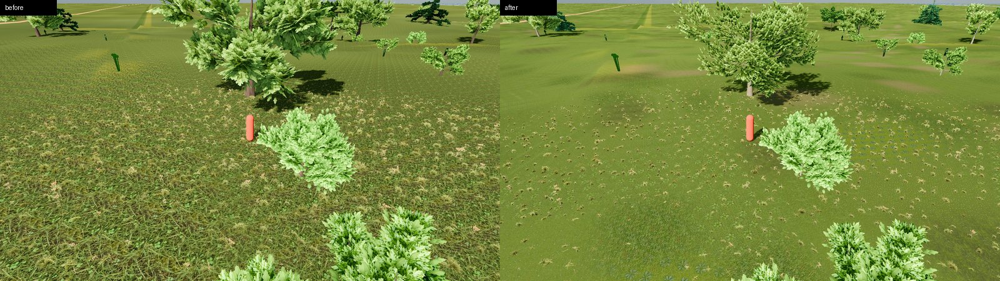 |

- **Ground.** Plates from [`generate_simple_grass_plates.py`](../../tools/assets/generate_simple_grass_plates.py): soft tonal patches, no plants in the image. Slices 0-7 green, 8 dry, 9 moss, 10 litter, 11 trodden.
- **Blades.** [`CityGrass`](../../scripts/city/city_grass.gd) scatters `grass_blade_clump_mesh` (six curved tapered blades) in three MultiMesh tiers with GPU wind and trampling:

| Tier | Chunk | Density | Range (scale cross-fade) |
|---|---|---|---|
| Near | 8 m | 4.5 clumps/m2 | 0-12 m, out by 17 m |
| Mid | 16 m | 1 clump/m2, larger | 9-46 m |
| Far | 32 m | 0.25 clumps/m2, double width | 36-118 m |

- **Streaming.** Missing chunks are built nearest first within a 3.5 ms frame budget (at least one per frame); placement stays on the CPU (GL Compatibility has no compute).
- **Shading.** Root-to-tip gradient with warm, partly dry tips, root colour melting into the ground, rounded normals, backlight, wind sheen. No shadows.
- **Trampling.** `VegetationInteractionBuffer` keeps the last 8 player positions so a flattened path stays for a few seconds. NPCs are not fed yet.
- **Blueprint maps** still use textured tuft cards (`MapViewTerrainDetails`).

## Wild plants (forbs)

Implemented (**R-1519**, seasons **R-1557**, blueprint maps **R-1559**). Decision (user, 2026-10-09): flat accent diamonds were rejected; plants must read as real botany up close. [`CityForbMeshes`](../../scripts/city/city_forb_meshes.gd) builds eight cached models, each with a far variant at a quarter of the triangles or less.

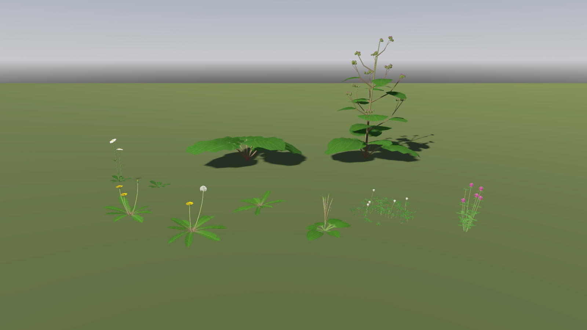

| Dandelion | Plantain | Clover | Burdock |
|---|---|---|---|
| 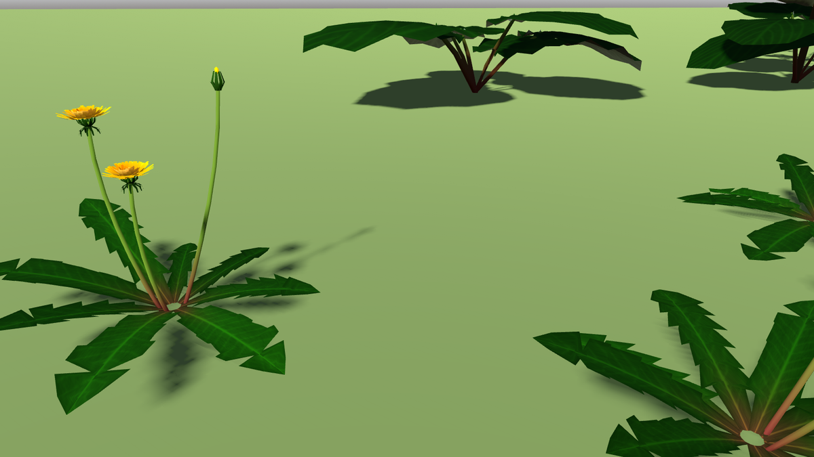 | 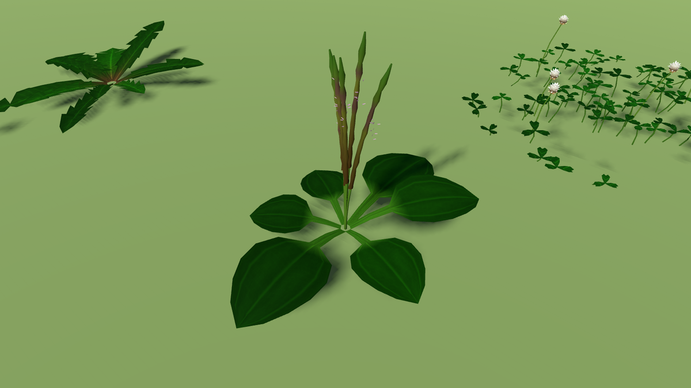 | 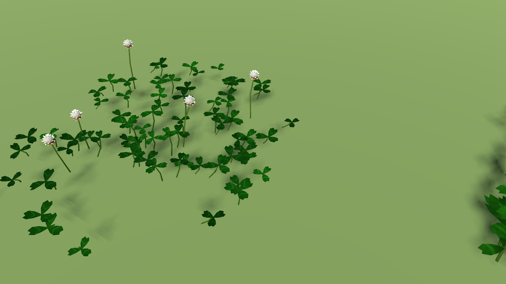 | 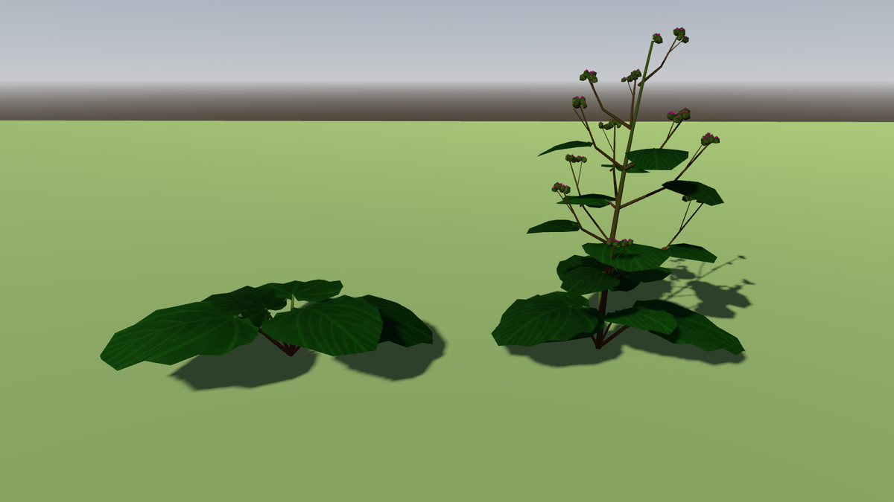 |
| Short grass round settlement | Worn verges and yards | Short turf (white); uncut meadow only (red) | Wall feet and road edges; 1.1-1.3 m when uncut |

Placement ([`CityForbs`](../../scripts/city/city_forbs.gd)) reads the fields that drive grass height (wildness, road, house distance, bareness) with fixed-seed noise patches. Drawing is one MultiMesh per model and detail level in 8 m chunks, about 16 draw calls, with shared wind and a shrink-out fade; [`city_forb.gdshader`](../../scripts/city/city_forb.gdshader) gives burdock its pale woolly undersides. Leaf venation comes from the procedural atlas [`forb_leaf_detail.png`](../../assets/vegetation/forbs/forb_leaf_detail.png).

### Wild-plant seasons (R-1557)

[`VegetationPhenology.forb_phase`](../../scripts/map/view3d/vegetation_phenology.gd) is a pure function of the day of year: nothing above ground from 16 November to 14 April.

| May | June | October (wall foot) | January |
|---|---|---|---|
| 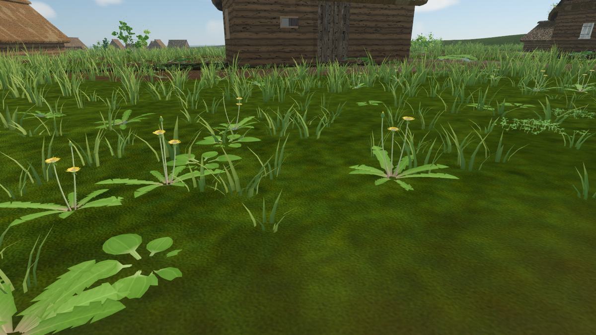 | 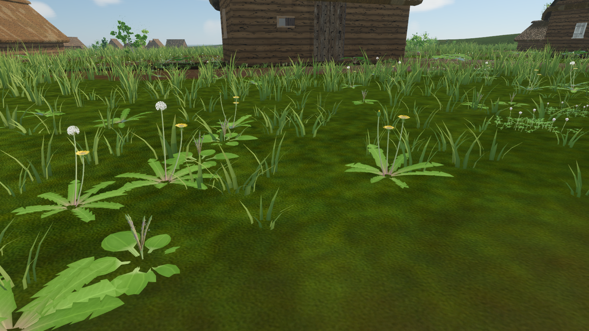 | 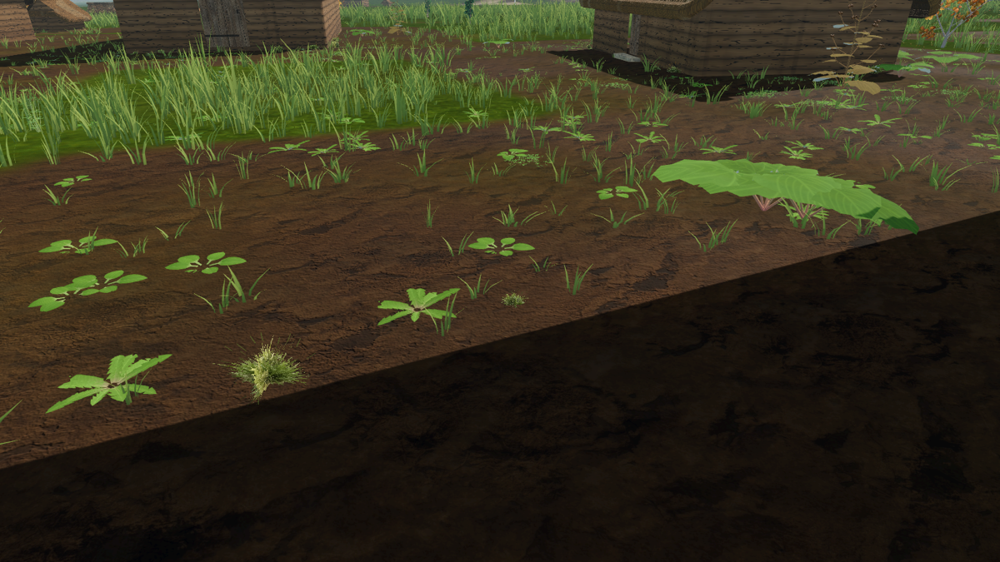 | 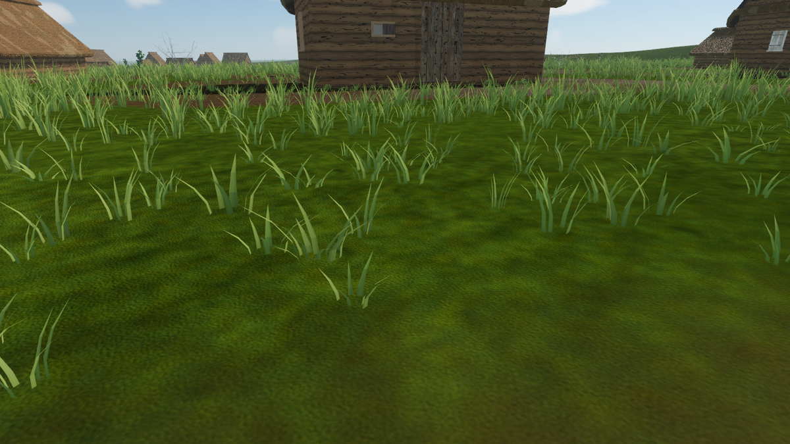 |

| Dates | Dandelion | Plantain | Clover | Burdock |
|---|---|---|---|---|
| 15 Apr - May | rosettes, 60 % flowering in May | rosettes | leaves | rosettes |
| June | flowers, seed clocks | 80 % spiked | in flower | rosettes |
| Jul - Aug | rosettes | 80 % spiked | in flower | second-year plants with green burrs |
| Sep - Oct | rosettes | spiked until Sep | leaves | dry brown burr stalks |

The season only picks which model a candidate becomes; it never changes random draws, so every spot keeps its plant all year. `CityForbs.set_calendar_date` drops cached chunks only when the season key changes. Nothing is saved.

**Blueprint maps (R-1559).** `plant.plantain`, `plant.dandelion`, `plant.clover` and `plant.burdock` zones scatter the same models with no distance fade, using a fixed high-summer mix (`MapViewPlantSpecies.forb_kind_for`). Before and after: [dandelion](../reports/images/vegetation/blueprint_forbs_dandelion_after.png), [burdock](../reports/images/vegetation/blueprint_forbs_burdock_after.png).

## Placement and ecology

Realism comes more from where things grow than from how each plant is drawn.

### District and blueprint maps (R-1322)

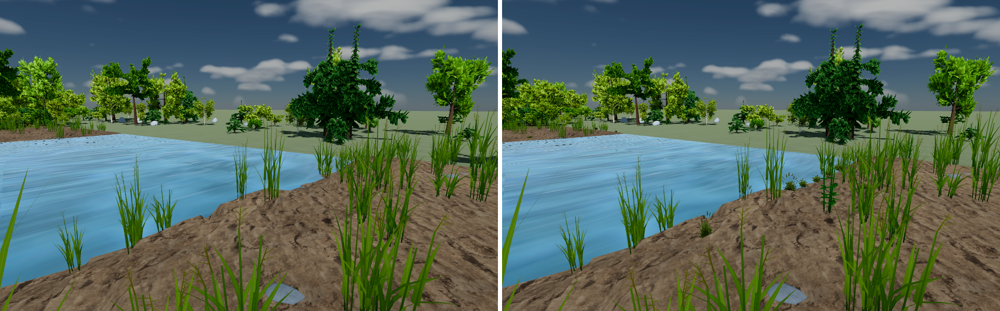

*Water edge on `viru_gate_foreland`, ecology on.* Also: [woodland edge](../reports/images/vegetation/r1322_woodland_edge.png) (trees thinned by fertility), [road verge](../reports/images/vegetation/r1322_road_verge.png) (wall foot cleared).

| Rule | Effect |
|---|---|
| Roads and wall feet | Nothing grows on a trodden road; trees and bushes keep a cell clear |
| Water | Sedge on the first two bank cells; nettle at wall feet and damp ground |
| Shade | Fern and moss only under conifers; grass thins under crowns |
| Soil | Juniper on dry limestone rims; weeds only on field margins; thickets at wood edges |

Trees are only ever thinned, never above the authored density. [`VegetationEcology`](../../scripts/map/vegetation_ecology.gd) is built per chunk by [`MapViewMeshBuilderScatter.begin_scatter`](../../scripts/map/view3d/map_view_mesh_builder_scatter.gd) from the compiled definition, grid and seed alone, with fields capped at 8 cells, so chunk splits are byte-identical. The authored override mask (`vegetation_mask`, [map authoring](../MAP_AUTHORING.md#ecology-placement-and-the-vegetation-override-mask-r-1322)) is the only ecology data on `MapDefinition`. Authored props always win. Ecology is derived on demand, never stored per cell.

### Seamless city: rooting and the coastal pine heath (R-1617)

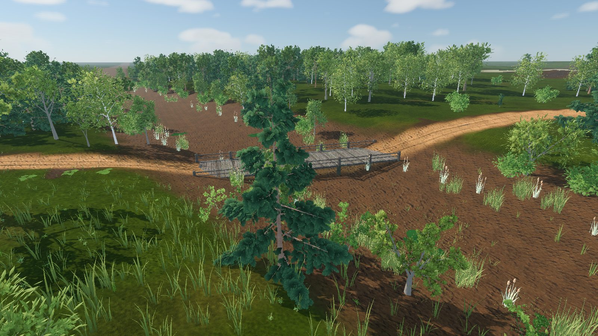

*No crown through a bridge deck.* [`CityVegetationBuilder`](../../scripts/city/city_vegetation_builder.gd) consumes the plan's `trees` and `bushes`; [`CityWorld3D`](../../scripts/city/city_world_3d.gd) removes trees planted in water. The plan generator [`vegetation_habitat.py`](../../tools/city/vegetation_habitat.py) holds two rule sets:

- **Clearance.** A trunk keeps 2 m beyond every carriageway edge and 5 m off every bridge or deck; shrubs keep 1.5 m off bridges.
- **Soil.** Ground within 420 m of the 1343 shoreline and at most 10 m above the 1343 sea is sandy heath (62 % `pine_tall`, 18 % `pine`, 8 % birch, 12 % juniper, plus a pine bor on a 7 m grid broken by glades); the beach strand stays sand and juniper. Inland loam keeps mixed spruce, oak and birch.

Stable IDs: species re-picks use a position hash, the bor its own RNG after all seeded loops, and clearance runs last, so existing field, wood, orchard and farmstead IDs are unchanged. The plan is static content; nothing is saved.

## Moss, lichen and the forest floor (R-1661)

Implemented (**R-1661**; walls **R-1683**; roofs and bark **R-1684**). Decision (user, 2026-10-11): moss and lichen grow on the north side of some trees and buildings, on shaded ground and the forest floor; the forest also gets mushrooms. Out of scope: the woods' tall-grass understorey (R-1595), roof placement rules (R-1465), gathering mushrooms, blueprint forest floors, snow.

| North side of a birch | North wall foot | Forest floor, April | Forest floor, August |
|---|---|---|---|
|  | 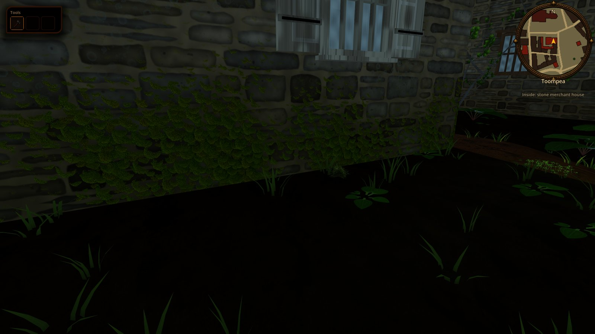 | 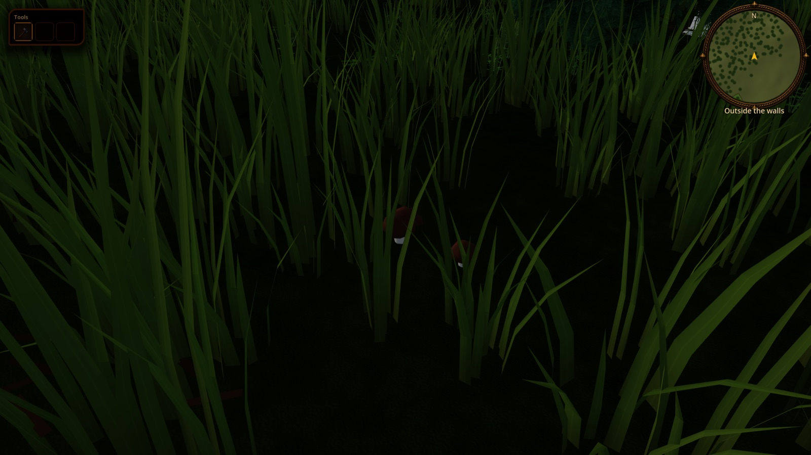 | 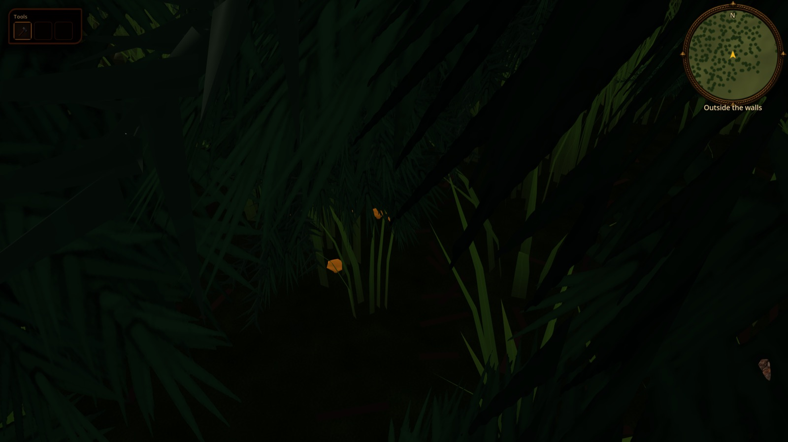 |

Also: [whole north wall](../reports/images/vegetation/r1661_wall_north_moss.jpg), [shaded ground](../reports/images/vegetation/r1661_shaded_ground.jpg), [woods in April](../reports/images/vegetation/r1661_woods_april.jpg) and [August](../reports/images/vegetation/r1661_woods_august.jpg), roofs: [tile](../reports/images/vegetation/r1684_roof_tile.jpg), [shingle](../reports/images/vegetation/r1684_roof_shingle.jpg).

- **Trunks** (`map_view_bark_wind.gdshader`): a moss skirt up to about 2.6 m on the north side and pale lichen crusts from shin height, seeded per tree so only some carry them (`moss_amount` 0.6, `lichen_amount` 0.5).
- **Walls** (`shade_growth` in `city_weathering.gdshaderinc`, half strength on limewash): cushion moss at the damp foot of north faces up to about 1.6 m with a dark halo, sparse lichen above. South faces stay clean.
- **Roofs:** the same plates on shingle, thatch and clay tile ([city roofs](./SEAMLESS_CITY.md#how-buildings-are-built)).
- **Shaded ground** (`city_ground.gdshader`): ragged moss cushions where [`CityShadeMask`](../../scripts/city/city_shade_mask.gd) reports shade; trodden paths stay bare.
- **Forest floor** ([`CityForestFloor`](../../scripts/city/city_forest_floor.gd)): moss cushions round each tree of a closed stand (8+ forest neighbours within 15 units), biased north, plus fungi by mycorrhizal partner, visible to 110 units (moss) and 70 (fungi).

| Kind | Species | Grows by | Days of year |
|---|---|---|---|
| `gyromitra` | false morel | pine | 100-152 (Apr-May) |
| `chanterelle` | *Cantharellus cibarius*, troops of 3-7 | spruce, pine, birch | 182-280 |
| `porcini` | *Boletus edulis* | spruce, pine, birch, oak | 196-288 |
| `fly_agaric` | *Amanita muscaria* | birch, spruce | 205-295 |
| `bracket` | tinder fungus, 1-3 shelves | birch | all year |
| `moss` | moss cushions | any forest tree | all year |

On the opening date (21 April 1343) the woods show moss, brackets and false morels. Plates are in [`assets/materials/pbr/wall_growth/`](../../assets/materials/pbr/wall_growth/), built by `tools/assets/build_wall_growth_plates.py`; coverage is thresholded in [`city_growth_plates.gdshaderinc`](../../scripts/city/city_growth_plates.gdshaderinc). Bark uses continuous mesh UVs, so growth does not swim under wind. Deterministic, seeded by position; nothing saved.

## Where the code and assets live

Most trees are cached procedural `ArrayMesh` geometry, so a mesh profile edit is a model edit even though no Blender or GLB file changes.

| Part | Source |
|---|---|
| Species registry, tints, bark families | [`map_view_tree_species.gd`](../../scripts/map/view3d/map_view_tree_species.gd) |
| Branching presets (all 20) | [`tree_skeleton_weber_penn.gd`](../../scripts/map/view3d/tree_skeleton_weber_penn.gd) `PRESETS` |
| Height, radius, leaf size, fruit | [`map_view_tree_mesh_profiles.gd`](../../scripts/map/view3d/map_view_tree_mesh_profiles.gd) |
| Wood, canopy, fruit meshes, city forms, LOD geometry | [`map_view_tree_meshes.gd`](../../scripts/map/view3d/map_view_tree_meshes.gd) |
| Leaf and needle geometry, atlas tiles | [`map_view_leaf_geometry.gd`](../../scripts/map/view3d/map_view_leaf_geometry.gd), [leaf atlas](../../assets/materials/pbr/foliage_cards/leaf_card_atlas.png) |
| City bark plates | [`assets/materials/pbr/bark_*`](../../assets/materials/pbr/) |
| Materials (crown, bark, grass, season, wetness) | [`map_view_wind_materials.gd`](../../scripts/map/view3d/map_view_wind_materials.gd), [`map_view_prop_materials.gd`](../../scripts/map/view3d/map_view_prop_materials.gd) |
| Shrub canes | [`map_view_bush_meshes.gd`](../../scripts/map/view3d/map_view_bush_meshes.gd) |
| Grass blades and shader | [`map_view_foliage_meshes.gd`](../../scripts/map/view3d/map_view_foliage_meshes.gd), [`map_view_grass.gdshader`](../../scripts/map/view3d/map_view_grass.gdshader) |
| Wild plants | [`city_forb_meshes.gd`](../../scripts/city/city_forb_meshes.gd), [`city_forb.gdshader`](../../scripts/city/city_forb.gdshader) |

The [sacred-grove ancient oak GLB](../../assets/props/environment/sacred_grove_ancient_oak/sacred_grove_ancient_oak.glb) is a separate authored prop; it does not join the crown, LOD or strike systems. Provenance lives in [`assets/SOURCES.csv`](../../assets/SOURCES.csv); add any copied open-source code there with its license first.

**Runtime entry points.** District date: `MapView3D.set_calendar_date`; district weather: `MapViewMaterials.apply_weather_presentation`; city date: [`CityMapView.set_calendar_date`](../../scripts/city/city_map_view.gd) (feeds `CityWorld3D.apply_season`, `CityForbs`, `CityForestFloor`); city weather: `CityWorld3D.apply_time`; district melee: `MapViewRuntimeActors._on_player_melee_attack_resolved`.

**Save/load.** Species, placement, calendar and weather reconstruct the look; meshes, LOD choice, gust phase, shake and particles add no save fields. Wind depends on render time, so a load does not resume the exact animation frame.

## Where to go next

- Texture pipeline, performance budgets, how to change a model, capture and test commands, known limits, roadmap: [Vegetation engineering](./VEGETATION_ENGINEERING.md).
- [Farmland](./FARMLAND.md): crops, gardens, pastures and woods outside the walls.
- [Flora and fauna](../FLORA_FAUNA.md) and [biomes and wildlife](../LOCATIONS/BIOMES_AND_WILDLIFE.md): species inventory and authored map evidence.
- [Seasons](./SEASONS.md) and [weather ground](./WEATHER_GROUND.md): date controls, snow and ground weather.
- [World presentation](./WORLD_PRESENTATION.md), [Seamless city](./SEAMLESS_CITY.md), [Map authoring](../MAP_AUTHORING.md): how and where vegetation is placed and drawn.
- [Art bible](../ART_BIBLE.md) ("Vegetation realism (P0-208)").

Implementation lineage, for lookup only: seasonal crowns **R-1187**; cluster cards **R-1194**; procedural atlas **R-1329**; shared wind **R-1321**; branching presets **R-1324**, orchard habits **R-1391**; city-scale pass **R-712**; shrub cards **R-1315**; macro needles **R-1404**; whole-tree storm bend **R-1433**; ecology **R-1322**; pine heath **R-1617**; city grass **R-1323**; forbs **R-1519**/**R-1557**/**R-1558**/**R-1559**; snow **R-1327**; moss and fungi **R-1661**/**R-1683**/**R-1684**; docs **R-1696**, **R-1704**.
