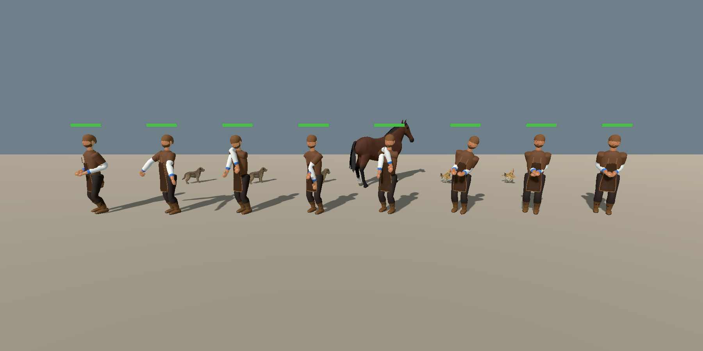
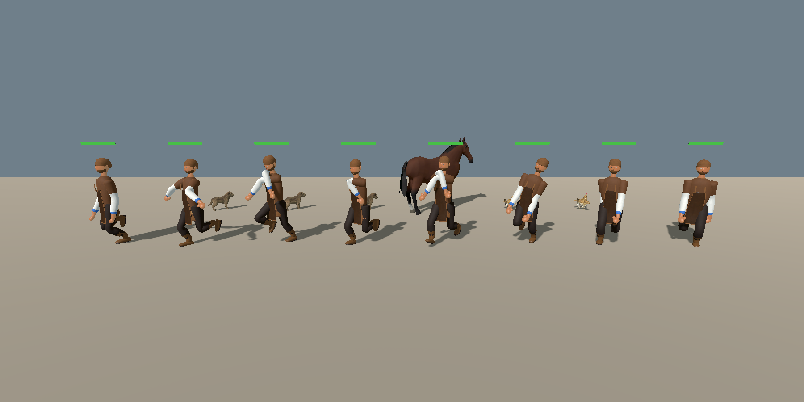
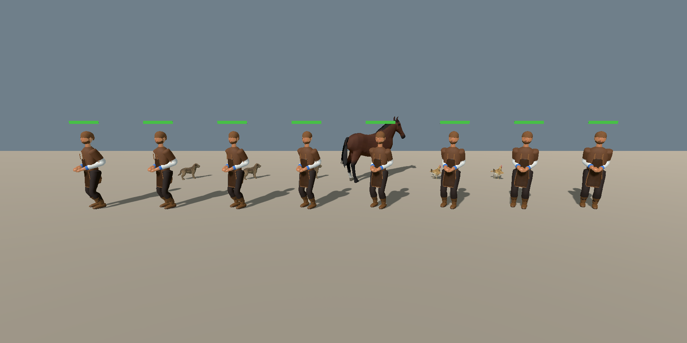
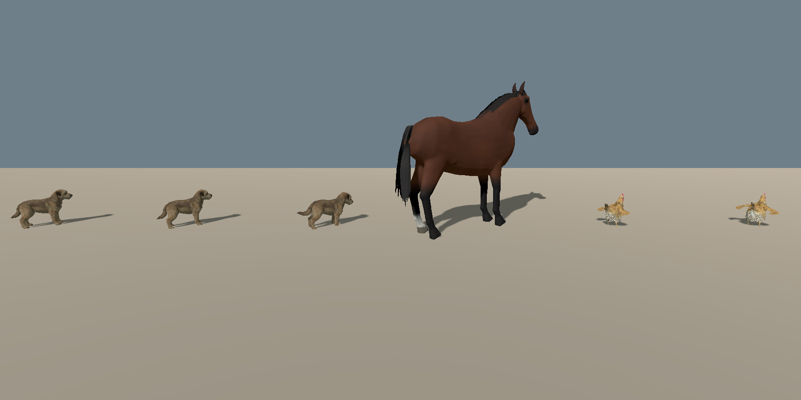

# Motion style: creatures adapt to ice, cold, rain, wind, wounds and fatigue

Status: implemented ([ADR 0051](../adr/0051-condition-adaptive-motion-style-network.md), proposed; board task pending). Scope: every humanoid rig in the city (citizens, named NPCs, the hero), the city's skinned animals (dogs, cats, horses, cattle, pigs, sheep, goats, foxes, hares, hens, geese, ducks) and the flying birds. Out of scope: physics-driven falls or slips (combat animation still owns knock-downs), moving citizens off their timetable, flocks drawn as flipbooks, district maps other than the seamless city.

## What the player sees

The same clips play, but how a creature carries itself follows the situation it is in:

| Situation (from the world) | People | Animals | Birds |
|---|---|---|---|
| Puddles below freezing (ice) | arms out for balance while walking (a hand holding a weapon, lantern or shield keeps it), knees bent, short flat-footed steps at a quicker cadence | body lowered, careful, slower wandering | (hens and geese should open their wings; see Limits) |
| Wet cobbles after rain | slightly shorter, flatter steps | slightly careful | |
| Lying snow | shorter steps, slower | slower | |
| Rain on an unsheltered body, cold air | over minutes: arms hugged across the chest, shoulders up, head down, shivering | hunched, head low, tail tucked, fur fluffed, shivering | plumage fluffed; in flight a wet bird beats faster and wider |
| Wind | leans into a side wind, forward into a headwind | leans into the wind | |
| Night | (higher swing clearance; not drawn by clips) | | |
| Lost health / spent stamina | trunk guarded, a slight hunch; tired posture | | |
| A wound (API, see below) | a hand pressed on the wound, a limp off a hurt leg, slower when the blood loss grows | a limp off a hurt leg, slower | a hurt wing flaps less |

Nothing names a situation in code: these are the outputs of one small network for any body, as answers to physical channels (friction, wetness, heat loss, wind, pain, blood loss). In a normal situation the layer is calibrated to change nothing.

Review plates (`tools/godot_render.sh --script tools/capture_motion_style.gd -- [--walk] [--animals] [--off]`). People, left to right: dry and mild; ice; soaked at 3 C; bleeding left thigh; broken right arm; gale from the left; deep snow in frost; smoke. Animals: dog dry, dog on ice, dog soaked and cold, horse lame on the left, hen on ice, hen soaked and cold.

## How it works

1. **Situations are data** (`assets/motion/motion_conditions.json`). A condition only says which channels it changes: `ice` sets friction 0.09, `deep_snow` makes the feet sink, `bleeding` opens a wound at a body region, `gale` adds wind from a bearing. A condition list may also hold measured values (`{"air_temp": -6.0, "insulation": 0.7}`).
2. **The world becomes conditions** (`scripts/motion/motion_environment.gd`). `CityMapView._process` refreshes one snapshot per frame from `SkyWeather3D` (rain, puddles, wind), `SeasonState` (mean temperature, clothing warmth as insulation), the day blend (darkness) and `CitySnow.depth_at` (snow depth). `conditions_at(position, facing)` turns that into conditions for one creature: lying snow, ice (puddles below -0.5 C), packed snow, wet cobbles; wind as a bearing relative to the body; night; temperature and insulation last so measured values win.
3. **One agent per creature** (`scripts/motion/motion_style_agent.gd`, stored in the creature's metadata). At 4 Hz it merges the conditions with the creature's body state, asks the network for a style and steps the body state; every frame it eases the style. Body state (`motion_body_state.gd`): wetness (rain unless sheltered, drying with warmth and wind), core cooling (heat balance of the style in use), blood lost and wounds (a pressing hand slows both loss and clotting time), fatigue, pain.
4. **The network** (`scripts/motion/motion_style_net.gd`, weights `assets/motion/style_net.json`): 31 inputs, two hidden layers of 64, 24 outputs; about 7,800 weights. Inputs are the body (biped, quadruped or bird; mass; leg length; flying; speed as a Froude number) and 24 channels; outputs are style knobs (speed share, stride, stance width, crouch, trunk pitch and roll, arms out, each arm hugged, each hand pressed, head down, shrug, shiver, flat feet, clearance, limp side, caution, tail tuck, fluff, wingbeat rate, amplitude and glide). Results are cached by quantised input, so creatures in the same weather share evaluations. The applied style is `neutral + net(situation) - net(no situation)`.
5. **Presentation** (`scripts/motion/motion_style_presenter.gd`):
   - People: `MapViewRuntimeActors` calls `MotionStylePresenter.humanoid` after `set_locomotion_speed` for every rig and the hero (not while swimming). It installs `MotionStyle` (`scripts/characters/motion_style_modifier.gd`, a `SkeletonModifier3D` before `AnatomicalMuscles`): trunk pitch and roll on `spine` and `chest`, head, crouch on the legs with the hips lowered, limp roll while the sore leg carries, two-bone arm reach toward the blend of wound, hug and out goals, shiver. The walk clip plays faster by 1/stride so short steps are not skating. Health and stamina feed `pain_torso` and `fatigue` (`vitals_conditions`).
   - Arms out is a mid-stride balance reflex (R-2036): the presenter eases the modifier's `balance` from 0 standing to 1 at 0.9 m/s, so a resident standing on ice keeps the idle arms, and a hand with something in its slot (`held_l` / `held_r`: spear, sword, lantern, shield) never swings out. Before this a watchman standing on ice held both arms out with the spear diagonal, which read as a T-pose.
   - Animals: `CityFauna._advance` calls `MotionStylePresenter.animal`. `AnimalStyleModifier` (`scripts/characters/animal_style_modifier.gd`) poses `Body` (hunch, lower, lean, fluff scale, shiver), `Head`, `Tail` and `Wing.L/R` where the skeleton has them. Wandering speed is multiplied by the agent's `speed_factor` (`MapViewGroundWander.advance` reads `motion_speed_factor`); wandering animals are presentation only.
   - Flying birds: `MapViewBirdFlight._advance_flap` takes its flap profile through `MotionStylePresenter.bird_profile`: frequency times `flap_rate`, stroke up and down times `flap_amp`, longer pauses with `glide`. One agent per species (all birds of a species share the weather).
6. **Settings:** `rebel/motion/style_network` (project setting, default on) disables the layer.

## Adding a situation or retraining

- **New condition over existing channels** (slush, a greasy floor, a hailstorm): add an entry to `adapt/conditions.py` in [skeleto-nn](https://github.com/tot-ra/skeleto-nn) and re-export, or add it to `motion_conditions.json` directly. No retraining.
- **New physical effect** (a new channel): add the channel and a cost term in skeleto-nn (`adapt/schema.py`, `adapt/model.py`), warm-start `python -m adapt.train --init results/style_net.json --steps 800` (about 10 s), export.
- **Export:** in skeleto-nn, `python -m adapt.export_engine <game>/assets/motion`, then move `style_net_golden.json` to `tests/godot/fixtures/motion/` (the Godot test checks the GDScript port against it). The trainer's docs are skeleto-nn [`docs/ADAPT.md`](https://github.com/tot-ra/skeleto-nn/blob/main/docs/ADAPT.md).
- **Wounds from gameplay:** `MotionStylePresenter.agent_for(rig, &"biped", 70, 0.9).add_wound("thigh", "L", rate, pain)`; regions are those of `motion_conditions.json` (`head`, `face`, `neck`, `chest`, `belly`, `flank`, `back`, `shoulder`, `upper_arm`, `forearm`, `hand`, `thigh`, `knee`, `shin`, `foot`). The healer loop ([`HOUSEHOLD_CURE.md`](HOUSEHOLD_CURE.md)) and brawls are the natural callers; neither calls it yet.

## Data, state and saves

- Stable files: `assets/motion/style_net.json` (format `skeleto-nn/style-net/1`), `assets/motion/motion_conditions.json`.
- Body state lives in the presentation agents only. It is not in `GameState` and is not saved: after a load, wetness and cold build up again from the weather. Deterministic: fixed rates, no randomness.

## Verification

- `godot --headless --path . --script tools/run_godot_tests.gd -- --filter=test_motion_style_net,test_motion_style_presenter`: the GDScript network, conditions and body state equal the Python trainer on golden cases; ice gives arms out and short steps, a dry day is neutral, a wound brings the hand and blood loss, a dog cannot press but limps, a wet bird flaps harder; puddles below freezing are ice; wind bearings are relative to the body; vitals become pain and fatigue; on a real rig the modifier is installed and ice spreads the arms while walking but not standing. `--filter=test_armed_kit_idle`: every armed kit (watch, crown, sergeant) plays Idle within 30 frames of spawn and, standing on ice, keeps its hands within 10 % of an arm length of the unstyled idle.
- Cost: one network evaluation 0.14 ms; 40 agents 0.34 ms per frame (headless GDScript, M5 Pro).
- Visual: the review plates above; `--off` renders the same scene with the layer disabled. Armed kits on ice: `tools/godot_render.sh --script tools/capture_armed_kit_ice.gd -- [--legacy]` writes `docs/reports/images/motion_style/armed_kit_ice.png` (`--legacy`: the pre-R-2036 T-pose).

## Limits

- The style modulates clips; it does not simulate a slip or a fall, and feet are not re-planted (crouch and stance width are small so the clip's feet stay close to the ground).
- Citizens keep their timetable speed (their position is a function of the clock), so on ice they take shorter, quicker steps instead of slowing down; only wandering animals slow.
- Air temperature is the season's daily mean (no daily cycle); there is no ice-puddle visual yet, so "ice" follows wet ground below freezing.
- No gameplay system creates wounds, drink or smoke yet; the API is ready.
- Flocks (flipbook birds) keep their species profile; perched birds do not exist in the city.
- Hen and goose wings: the network asks for wings out on ice and tight when cold, but in the review plate the storybook hen's `Wing.L/R` rotation does not visibly change the wing; the bone axes of those rigs need checking. Fluff (a slight swelling of the body) does show.
- The teacher model's constants are order-of-magnitude values; acceptance is visual.
- The hero's `wet` and `core_cold` also come from the gameplay meters of [`HERO_EXPOSURE.md`](HERO_EXPOSURE.md) (ADR 0061); the agent keeps the larger of those and its own physiology.
- The same channels decide jumps: [`LEAPING.md`](LEAPING.md) (ADR 0053).
- Research context and the earlier hard-coded experiments: [`MUSCLE_LOCOMOTION.md`](MUSCLE_LOCOMOTION.md); licence survey of existing solutions: [`procedural_motion_existing_solutions.md`](../reports/procedural_motion_existing_solutions.md).
