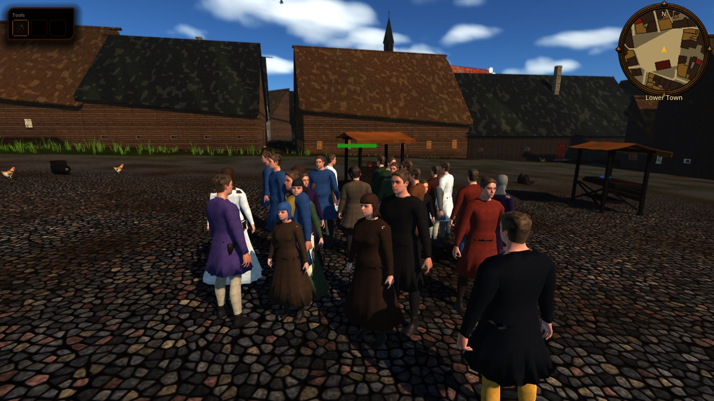
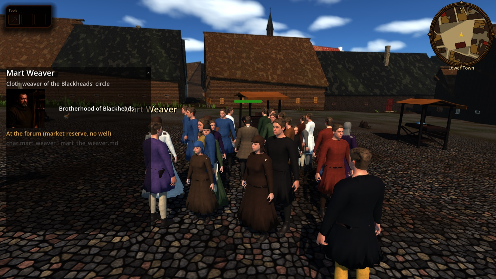
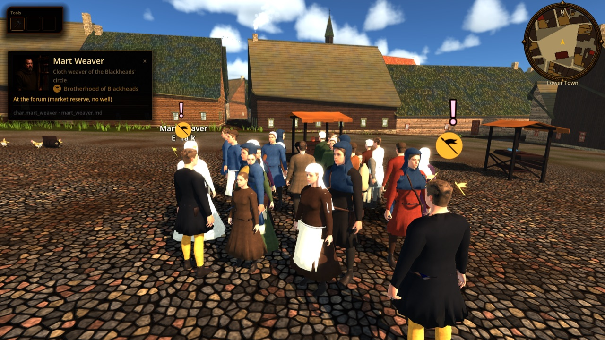

# Named NPCs: registry and city presence

Status: implemented (tasks **R-1562** registry, **R-1563** seamless-city spawn and info panel; epic **R-1560**, [ADR 0044](../adr/0044-named-npc-presentation-tier.md) proposed). Scope: one data registry of the politically and professionally notable people from `characters/**`, and their presence in the seamless Reval city at posts that follow the clock, with a click panel showing portrait, title and faction. Out of scope here: the overhead `!` marker (NPC-4 **R-1564**), custom 3D models (NPC-7 **R-1567**), dialogue and quests. Dialogue portrait resolution is documented in [`DIALOGUE.md`](./DIALOGUE.md#named-npc-portraits-r-1566).

## In the city

- Walking Reval, the player meets named NPCs at believable places and hours: Konrad Preen at the castle on Toompea, Hinrik the Cartographer at the fish landing, Martin at the smiths' street, Johann von Minden and Mart Weaver at the forum in the morning, the Town Guard Captain at the council watch by day and at the Coastal Gate in the evening.
- Each stands on its own spot round its post, facing it, and walks the census street graph between posts (1.2 m/s). Going `home` it walks to its `home_anchor` and disappears on arrival; it reappears from there for the next post.
- Click a named NPC (left mouse) or press `interact` near them (keyboard or gamepad) to open the citizen information card with the portrait (when the registry has one), title, faction name with the faction chip in `FactionBadge` (R-1565), what it is doing now, and its id and source sheet. Within 4 m this also starts a conversation (or a spirit duel in spirit sight) with the registry portrait and name ([`DIALOGUE.md`](./DIALOGUE.md#talk-to-anyone-r-1887), task **R-1887**). Hover or select shows the name above the head, at a constant small screen size, plus what a click does within reach (task **R-1885**). `Esc` or the × closes the card.
- Named NPCs take clicks before the census crowd (a hit is consumed; a miss falls through to `CityCitizens`). They have their own cap of 12 live actors, separate from the 30-resident crowd cap, so the crowd budget never culls them within the 62 m spawn radius (freed beyond 80 m).
- A census resident that a named NPC `replaces` is never spawned by `CityCitizens`, so the same person never walks twice; the named NPC wears that resident's body and clothes and the panel adds the resident's trade and household.
- Only NPCs whose `act_gate` is at most the current act appear. The campaign has no act state yet, so the city uses act 1 (Wave A); `--city-act=N` on the command line pins it for review.





## Registry data

`content/npcs/named_npcs.json`: `{schema_version: 1, npcs: [...]}`, one row per person. Seeded with Wave A and Wave B of [`cast_faction_promotion.md`](../cast_faction_promotion.md) (17 rows; Brother Hermann has no sheet in `characters/` and is not seeded).

| Field | Meaning |
|---|---|
| `id` | Stable `char.<slug>`; must not equal a census deep-card slug unless the row replaces that resident |
| `display_name`, `title` | Panel name and role line |
| `faction` | `faction.<id>` from `FactionLedger.ACTIVE_FACTIONS` or `FactionCandidateSeats.CANDIDATE_FACTIONS`, or `null` (no seat, e.g. Nikolaus von Danzig's Lizard Union cell) |
| `source_sheet` | The `characters/**.md` sheet |
| `portrait` | `res://assets/characters/portraits/npc/<slug>.png` or `null` (Old Toomas and Ironhand have none yet) |
| `model_scene` | Custom model scene (NPC-7) or `null`: the census blank body named in `body.variant` is used |
| `census_id`, `census_mode` | ADR 0044 section 5: `replaces` with a `cit.*` id (the NPC is that resident), or `extra` with `null`. All seeded rows are `extra`: no Wave A/B person is in the census |
| `home_anchor` | Where the NPC goes when the schedule says `home` |
| `schedule` | `[{from, to, anchor}]` covering 0..24 without gaps; `anchor` is a city anchor or `home`. The registry schedule always applies, also for `replaces` rows |
| `body` | Fallback look: `variant` (census blank in `assets/characters/variants/`), `height_scale`, `head_scale`, `cloth` and `under` dye colours |
| `act_gate`, `wave` | First act the NPC appears in (1..3) and promotion wave (A, B, C) |
| `marker` | `available` or `none` (read by NPC-4) |

Anchors are the ids of `points_of_interest` and `gates` in `content/world/reval_city/plan.json` (for example `poi.forum`, `poi.fish_landing`, `poi.barracks.castle`, `gate.coastal`).

## Runtime entry points

- `NamedNpcRegistry` (`scripts/npc/named_npc_registry.gd`): `load_default()`, `load_file(path)` (rejects unknown factions, bad census links and broken schedules; `errors` says why), `get_npc(id)`, `by_faction(faction)`, `by_census_id(cit)`, `replaced_census_ids()`, `post_at(id, hour)`. `get_npc(id)["portrait"]` is the explicit optional portrait resource path consumed by `DialoguePortraitResolver`; null means no portrait, even when an NPC-id-shaped filename exists.
- `CityNamedNpcs` (`scripts/city/city_named_npcs.gd`), created by `CityNpcs` in the Reval city only (not at regional sites): `resolve(npc, hour)` is a pure function of the registry row and the hour (position, facing, moving, visible); `refresh(world_xz)` seats and frees actors; `describe(npc, hour)` is the panel's "now" line.
- `NamedNpcActor` (`scripts/city/named_npc_actor.gd`): logic body mirrored by `MapViewRuntime`, like `CitizenActor`.
- `CitizenInfoPanel.show_named(npc, census, now)` and its `faction_badge` slot; `CityCitizens.suppress_residents(ids)`; `CitizenRoster.route_between(a, b)`.

Save/load: nothing is saved. The registry is static content and positions come from the clock.

## Overhead marker (task R-1564)

`NamedNpcMarker` (`scripts/npc/named_npc_marker.gd`): a billboard font glyph ("!") above every live named NPC whose registry `marker` is `available`, parented to the mirrored rig by `CityNamedNpcs._update_markers`. It bobs gently, uses normal depth testing so opaque walls and other foreground geometry occlude both the glyph and faction chip, grows with camera distance (up to 2x) to stay legible in the isometric view, and fades out between 32 and 40 m.

- **Shape carries the meaning, tint is decoration:** states `AVAILABLE` ("!"), `NONE` (nothing). `QUEST_READY` ("?") and `SPOKEN` (dim "!") exist for the future quest system and are not wired. The tint comes from `FACTION_TINT` (faction id, default gold), so the cue works without colour vision.
- **Hidden** during dialogue and duels (groups `demo_dialogue_active`, `dialogue_active`, `spirit_duel_open`), cutscenes (group `cutscene_active`, reserved), and in spirit sight.
- **Setting:** "Show NPC markers" (`GameplayAccessibilitySettings.show_npc_markers`, default on, persisted).
- Procedural font glyph only, no HUD art (P0-040).
- Proof: [`named_npc_markers_forum_10h.jpg`](../reports/images/city/named_npc_markers_forum_10h.jpg) (forum, 10:00, markers over named NPCs in the crowd).
- Test: `godot --headless --path . --script tools/run_godot_tests.gd -- --filter=test_named_npc_marker`.

## Faction identity (task R-1565)

Named NPCs wear their faction's livery (tunic and hose dyes plus an emblem decal), the marker carries a faction chip and tint, and the panel shows the chip beside the faction name. Data, rules and proof plate are in [`FACTIONS_AND_ECONOMY.md`](./FACTIONS_AND_ECONOMY.md#faction-visual-identity-task-r-1565).

## Verification

```bash
python3 tools/validate_named_npcs.py
python3 -m unittest tests.python.test_named_npcs -v
godot --headless --path . --script tools/run_godot_tests.gd -- --filter=test_named_npc_registry,test_city_named_npcs
tools/godot_render.sh --resolution 1600x900 res://tools/capture_city_citizens.tscn -- --city-spawn=poi.forum --city-hour=10 --tag=named
```

The validator also checks that sheets, portraits and model scenes exist, that anchors are real, that no census resident is linked twice and that dye colours and scales are sane. The capture lists the named NPCs in view and saves `citizens_<tag>_named_panel.png` after clicking one.

## Limits

- No act state in the campaign yet: the city always runs act 1 unless `--city-act` is passed, so Wave B rows never appear in play.
- Named NPCs are always outdoors at their posts; they are not shown inside furnished houses (`HOUSEHOLDS.md`) and do not sit or sleep.
- A `replaces` row uses its registry schedule, not the resident's census timetable.
- Faction accents are emblem decals on the blank bodies, not modelled garments; Black Cloaks show no emblem or chip.
- Portraits are `candidate` rows in `assets/SOURCES.csv` until ADR 0044 is accepted and each passes its visual check.
