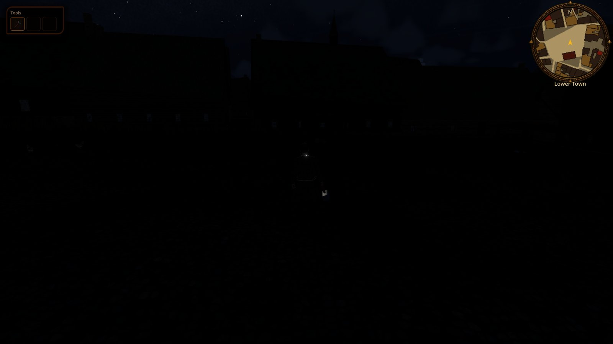
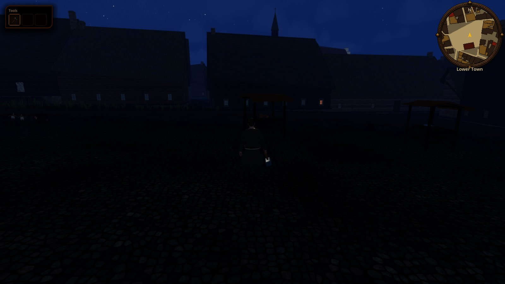
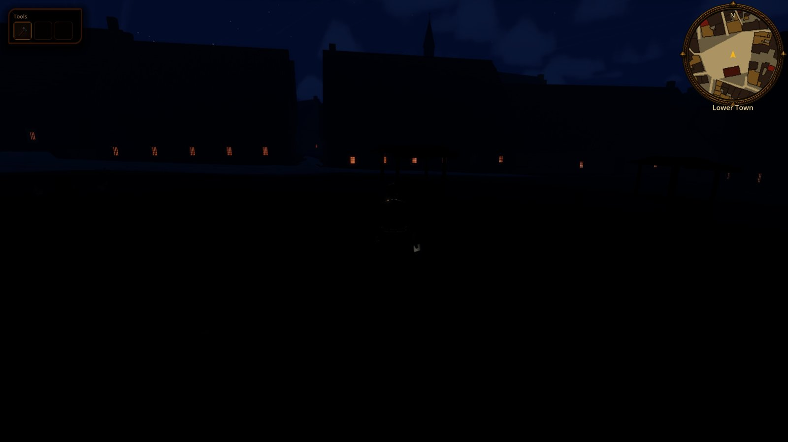
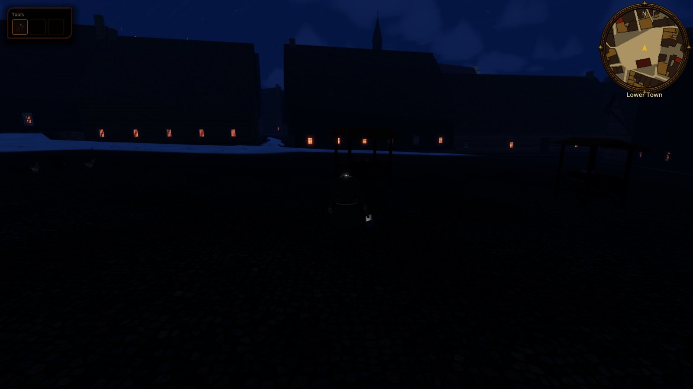
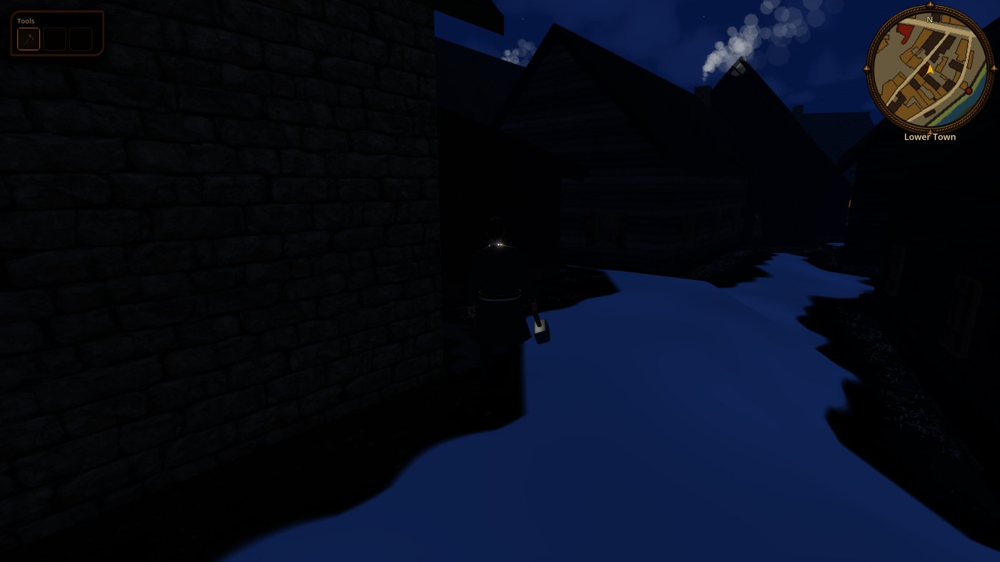
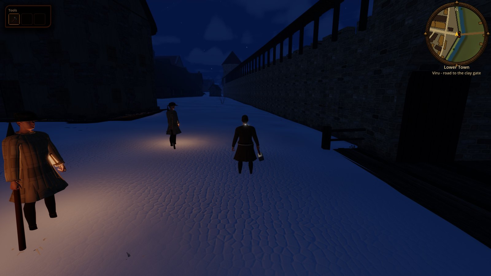

# Night lighting and fire

Status: slice implemented (tasks **R-2054**, **R-2180**, epic **R-2053**). Scope: what lights the seamless Reval city at night and how it follows history: season-aware darker outdoor night exposure, moon and snow fill, light leaking from lived-in houses on the household's schedule, and the night watch's horn lanterns. Out of scope (each a task under R-2053): churches at night (R-2058), venues, bakers and night-work bans (R-2059), shutters closing and chimney sparks (R-2060), smoke huts and regional sites (R-2061), gate passages (R-2062), feast fires (R-2063), siege watchfires (R-2067), a curfew-light gameplay rule (ADR first, R-2056), an authored lantern model (R-2057).

## Historical basis

Sourced rows cite the project dossiers [`social-life-and-daily-rhythm-1343`](../../history/dossiers/dailylife/social-life-and-daily-rhythm-1343.md) (*SL*), [`watch-duty-and-town-defence`](../../history/dossiers/military/watch-duty-and-town-defence.md) (*WD*) and [`reval-law-codex-arms-and-watch`](../../history/dossiers/power/reval-law-codex-arms-and-watch.md) (*LC*). Rows marked "to source" were written from general knowledge; a dedicated lighting dossier and canon review are owed (**R-2055**). Confidence uses the [`CANON.md`](../CANON.md) scale.

| Light | Who, where, when | Game rule | Confidence |
|---|---|---|---|
| Public street lighting | None in 1343; lantern ordinances for householders are much later (London 1417, Paris 1667) | No wall torches, lamps or braziers on streets | to source (absence general; ordinance dates are later evidence) |
| Night bell | Night rest from the nine o'clock bell; whoever walks after it is taken home or locked up; beer-shops close and the watch checks them | After 21:00 houses go dark (HouseholdDay bedtime); only the watch walks with a light | attested late 14th c. (Reval Bursprake, LUB 4 no. 1516 §80), plausible composite for 1343 (*SL* 2) |
| Fire and light discipline | "Light was expensive and fire feared: walking with an open flame was fined"; *Feuer und Licht* in the Burspraken; the watch doubles as fire watch | No open torches carried in town; banked hearths at night | attested (Livonian town ordinances, *SL*), plausible composite (*LC*, *WD* 7) |
| Night workers | Bakers, brewers and the watch are the only routine night workers; ship crews sleep aboard | Venues, bakers: R-2059; harbour dark at night | plausible composite / attested c. 1360 for crews (*SL*) |
| Night watch | Burgher watch on walls and gates, lantern patrols in the streets near the gates; silhouette padded jack, iron cap, spear or crossbow, lantern | Night-shift watch, crown men-at-arms and the sergeant carry a horn lantern | plausible composite (*WD*, night patrol table and art note) |
| Siege watchfires | April-May 1343 siege posture: watchfires and fire baskets on tower platforms, rebel camp fires visible outside | R-2067 | plausible composite (*WD* 5) |
| Hearth | The main light of most homes: cooking fire morning and evening, banked at night | Hearth-room windows glow orange and flicker while the fire burns | to source (general) |
| Pine splint (*peerg*), grease or train-oil lamp | Light of the poor and of country smoke rooms | Poor houses: hearth glow, a weak table light only; smoke huts R-2061 | to source (Estonian ethnography is later; practice old) |
| Tallow and beeswax | Tallow for middling households; wax costly, for churches and the rich (Livonian wax trade through Reval) | Middling and rich houses add candlelight; rich houses light more rooms | to source |
| Windows | Small; boards, shutters, horn or oiled cloth in poorer houses, glass for the rich; shut for the night | Light leaks through horn and glass, closed shutters block it; closing at bedtime is R-2060 | to source |
| Churches | Lamp before the sacrament all night; Matins at St Catherine's about 02:00 | R-2058 | attested for the convent office (*SL* timetable); lamp to source |
| Moon and snow | People planned night journeys by the moon; snow doubles what little light there is; June nights at 59 N barely darken | Night fill follows moon phase, altitude, clouds and snow | physics; habit to source |

## What the player sees

- **A dark town after the bell.** There is no street light anywhere. On a moonless, cloudy night the streets are lit only by the sky and by what leaks from houses; with a bright moon, and more so over snow, lanes, walls and people read clearly in a cold blue light.
- **Lit windows by the household's day.** Every building with a census household ([`CITIZENS.md`](./CITIZENS.md)) has a glow card behind each window. In the dark it lights on the same clock as the indoor fire and table light ([`HOUSEHOLDS.md`](./HOUSEHOLDS.md)): hearth glow (orange, flickering, brighter at the sill) 05:24-08:36 and 16:36-21:24, shifted up to 18 min per house; a steady table light 04:54-21:30. Poor houses show mostly hearth glow; middling and rich houses add candlelight and light more rooms. After bedtime the town is dark except about 3 in 100 houses keeping a vigil light (sickbed, birth, wake). Windows of empty buildings, closed-shutter houses and smoke dwellings stay dark. On a spring evening it is light until about 21:45, so few windows glow before the bell; on a December evening most houses glow from 16:00.
- **The night watch carries lanterns.** Night-shift guards (burgher watch, Danish men-at-arms and the night sergeant, [`GATE_GARRISONS.md`](./GATE_GARRISONS.md)) carry a horn lantern in the left hand (unless they carry a shield), lit after dusk, throwing a small warm pool on the ground around them. Off duty at home they put it down.
- **Season-aware night exposure.** The entire outdoor night image is about 25-35% darker than the previous exposure baseline: deepest in winter, then spring/autumn, slightly brighter in summer. Daylight and enclosed interiors keep their existing exposure. The moon, clouds and snow still change their relative contribution to the night fill.

Plates (`tools/capture_city_lighting.gd`, 1600x900):

| Before | After |
|---|---|
|  |  |
|  |  |




## Runtime entry points

| Piece | File | Role |
|---|---|---|
| Night fill | `MapViewLighting.night_ambient_energy(moon_visibility, snow_cover)` in `scripts/map/view3d/map_view_lighting.gd` | Replaces the flat `AMBIENT_NIGHT_ENERGY` floor: x`NIGHT_MOONLESS_SCALE` (2.4) .. x`NIGHT_FULL_MOON_SCALE` (4.0) by `WeatherPresentation.moon_visibility` (phase x altitude x clouds), then x(1 + `NIGHT_SNOW_GAIN` 0.6 x snow, halved on a moonless night). The scales also stand in for night vision: AgX crushed the old fill to black |
| Night street gain | `MapViewLighting.outdoor_exposure_gain(fill_blend, seasonal_brightness)` in `scripts/map/view3d/map_view_lighting.gd` | The R-1748 outdoor gain now scales seasonally at night: x0.65 in winter, x0.70 at the equinox and x0.75 in summer, so scene exposure falls 35%, 30% and 25% against its former night baseline. Day stays at 1.9. The sky dome compensates this outdoor gain; its camera-visible floor has a separate 0.70 multiplier while preserving the seasonal grade. Enclosed interiors still get no outdoor gain |
| Snow input | `MapViewLighting.night_snow_cover`, set by `CityWorld3D.apply_season`, reset in `_exit_tree` | Seasonal ground snow |
| Window glow card | `CityWindows._glow_card` (`scripts/city/city_windows.gd`), surface key `window_glow`, material `CityWindows.glow_material()` | One outward quad 10 cm inside each window opening of a lived-in house; vertex colour carries `HouseholdDay.house_shift` (r), wealth tier (g), a per-window pick (b) and "household lives here" (a); `look["glow"]` set in `CityBuildingBuilder.build_building` from `CityHouseWealth.has_household` |
| Glow shader | `scripts/city/city_window_glow.gdshader` | Unshaded additive; reads the global `city_night_clock` (x hour, y darkness 0..1, z seconds) and mirrors the `HouseholdDay` hearth windows and table light. No OmniLight per window |
| Night clock | `CityWindows.set_night_clock`, called from `CityWorld3D.apply_time` | Darkness = 1 - smoothstep(0.25, 0.45, day_blend), straddling `CityInteriors.DARK_BELOW` |
| Watch lantern | `scripts/city/watch_lantern.gd` (`WatchLantern`), mounted by `CitizenGear._carry_lantern` | Procedural horn lantern (bail, cone cap, horn body, iron posts), `OmniLight3D` 7.5 m without shadows, gentle tremble; group `city_cycle_lights`; lit while `DayNightCycle.day_blend` < 0.35. `CityCitizens._pose_rigs` hides it while the guard is at home |
| Global | `project.godot` `[shader_globals] city_night_clock` | Default noon, no darkness |

## Content and stable IDs

No new content IDs. Reads the census households and duty shifts in `content/world/reval_city/citizens.json` (`duty.shift == "night"`). The lantern stands in for `obj.hanging_lantern_iron` (still `planned` in [`OBJECT_CATALOG.md`](./OBJECT_CATALOG.md), model task R-2057).

## Save and load

Nothing is saved: all of it is a pure function of the plan, the census, the season and the clock.

## Verify

```bash
godot --headless --path . --script tools/run_godot_tests.gd -- --filter=test_night_lighting,test_map_view_lighting,test_city_windows,test_city_window_openings,test_citizen_wardrobe
tools/godot_render.sh --resolution 1600x900 res://tools/capture_city_lighting.tscn -- --tag=after --states=h22,h23,dec_h17,dec_h20,dec_h23
```

`tests/godot/test_night_lighting.gd` covers the moon/snow fill, the night gain, the glow card (inputs, placement, material) and the lantern's day/night switch. The capture writes `build/city_lighting/<state>_<spot>_<mode>_<tag>.jpg` for the forum, the forge lane and (night states) the Viru gate, and prints the environment's exposure, ambient and sun values for each frame; `dec_*` states pin 15 December 1343.

## Limits

- Window glow is emissive only: it does not light the street or the wall around it. Real lights stay with the furnished houses near Kalev (`CityInteriors`).
- Interior lights cast no shadows. New indoor lights must call `CityDoors.keep_indoors(light)` so they skip the street face of door leaves ([`CITY_DOORS.md`](./CITY_DOORS.md)); otherwise a candle behind a shut door glints through it.
- The glow schedule copies `HouseholdDay` constants into the shader; change both together.
- Bare paving (Raekoja plats) on a moonless night is still near black; tuning and review in R-2064.
- The lantern is primitive geometry and reads as a glow in the fist (R-2057). Guards do not raise it or react to the hero's light (R-2056).
- Legacy district maps (`MapView3D`) keep their own `BuildingWindowLights3D`; they get the night gain and moon fill but not the glow cards.
