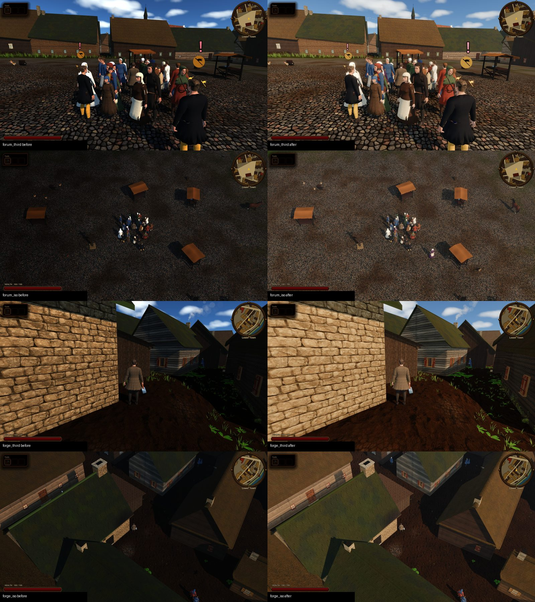
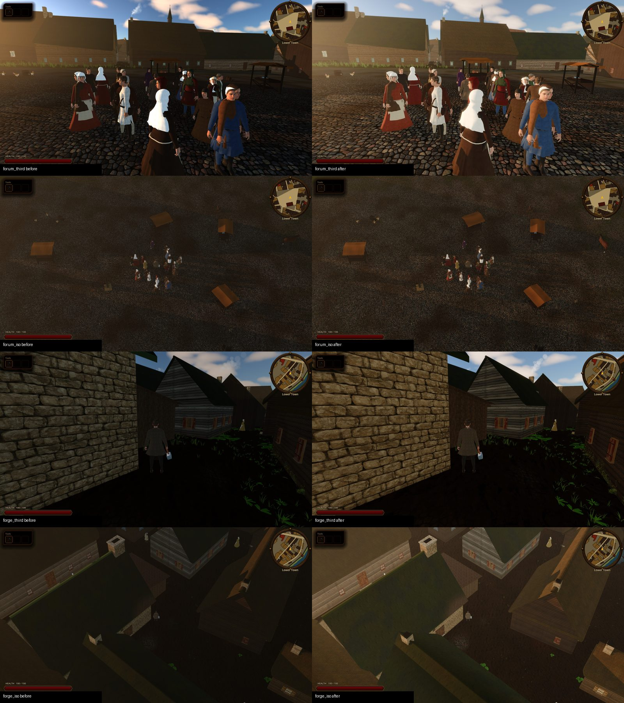
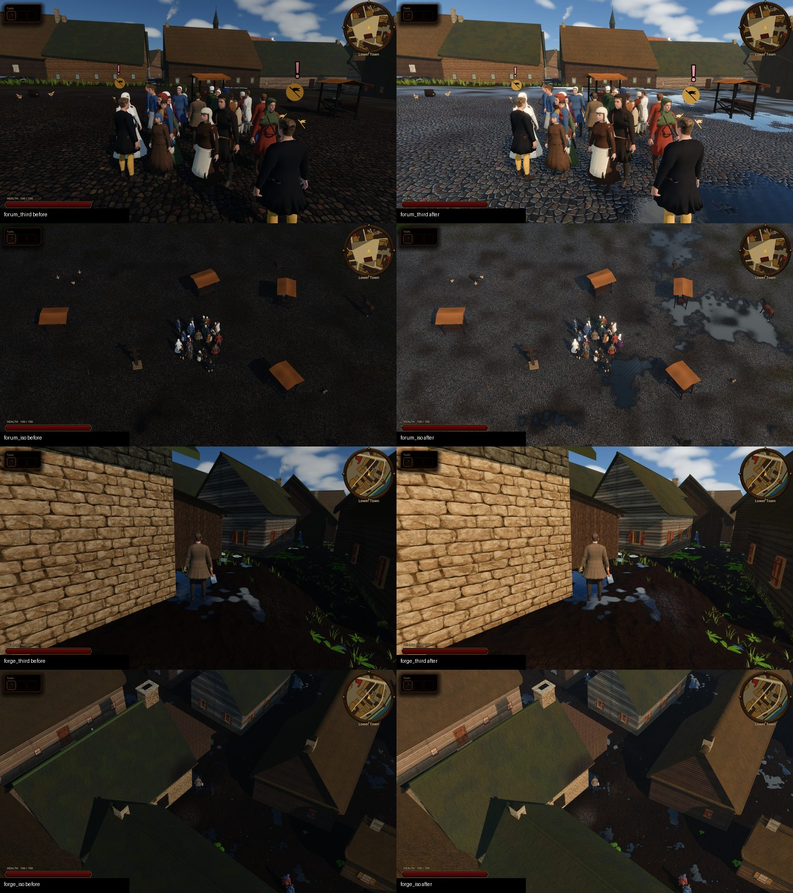

# Renderer, post-process grade and HDR output

Status: implemented (task **R-1537**, [ADR 0043](../adr/0043-mobile-renderer-and-hdr-output.md); grade values from [ADR 0018](../adr/0018-saturated-hdr-fantasy-anime-visual-direction.md), P0-141; warm daylight grade, outdoor exposure, soft sun and screen-space ambient occlusion from task **R-1748**).

Scope: the renderer the game ships on, the shared 3D post-process grade (tonemapper, glow, colour adjustment, outdoor and interior exposure), the warm daylight art direction, the screen-space ambient occlusion pass of the seamless city, and opt-in HDR (macOS EDR) output with its Settings toggle. Out of scope: HDR10 / wide-gamut delivery claims, eye adaptation, Godot's built-in SSAO and other Forward+-only features (SDFGI, SSIL, volumetric fog), removing the remaining `CURRENT_RENDERER == RENDERER_COMPATIBILITY` shader branches (follow-up).

## Player-facing behavior

- The game renders on the **Mobile** renderer with the **Metal** driver (`project.godot`: `rendering/renderer/rendering_method="mobile"`, `rendering/rendering_device/driver.macos="metal"`).
- On a Mac with an EDR/XDR screen, the sun, fire, forge glow and lamps can render brighter than UI white; UI stays at reference white. On an SDR screen the OS grants no headroom and the picture is the ADR 0018 SDR grade.
- **Settings → Graphics → HDR output (EDR displays)** turns the HDR request on or off live. Default on. Saved with the other user settings, outside campaign slots ([Settings and accessibility](./SETTINGS_AND_ACCESSIBILITY.md)).

## Runtime entry points

| Piece | Where |
|------|------|
| HDR request at startup | `project.godot`: `display/window/hdr/request_hdr_output=true`, `rendering/viewport/hdr_2d=true` |
| HDR toggle (live) | `GraphicsSettings.hdr_output` (`scripts/settings/graphics_settings.gd`) → `UserSettings._apply_graphics_settings()` sets `Window.hdr_output_requested` on the root window (skipped under the headless display server, which has no HDR API); UI row in `scripts/ui/game_settings_overlay.gd` |
| 3D grade | `MapViewLighting.configure_post_process()` (one-time: AgX, screen glow, adjustments) and `apply_post_grade()` / `apply_post_grade_snapshot()` (per cycle) in `scripts/map/view3d/map_view_lighting.gd` |
| Interior exposure | `MapViewLighting.interior_exposure_factor(fill_blend)`, applied in `apply_cycle_progress()` when `enclosed_interior` |
| Prologue grade | `scripts/prologue/conversation_shot.gd` (shot grade over the live city world); the almshouse hall's own AgX grade was retired with the hall |
| HDR sun disk and aureole | `scripts/map/view3d/sky_weather_3d.gdshader` uniforms `sun_disk_hdr_gain` (20), `sun_halo_hdr_gain` (3.0), `sun_corona_strength` (4.5) / `sun_corona_width` (3.0), visible sky pass only |
| EDR headroom global | shader global `edr_headroom` (`project.godot`), published by `UserSettings._publish_edr_headroom()` from `Window.output_max_linear_value_changed` |

## Warm daylight look (R-1748)

The art target is the painted reference set (`~/Desktop/Medieval Tallinn Market Gate After Rain.png`): warm sun, readable warm shade, dark contact lines, wet cobbles after rain. Before/after plates (left before, right after; rows: forum third person, forum painted iso, forge lane third person, forge lane painted iso):

| 10h | 18h | After rain (10h) |
|---|---|---|
|  |  |  |

- **Outdoor exposure.** On Mobile the city materials linearise their sRGB-authored colours (`city_albedo` in `scripts/city/city_plate_hint.gdshaderinc`). That is correct, but it left daylight gameplay frames at 25-50/255 mean luma against ~75 for the reference. `MapViewLighting.OUTDOOR_DAY_EXPOSURE_GAIN` (1.9) multiplies `tonemap_exposure` outdoors, lerped by the twilight fill blend (`outdoor_exposure_gain()`), so night, twilight and enclosed interiors keep the R-1537 grade. Measured after: 46-77/255.
- **Warm sun and shade.** `SUN_ART_TINT` (1.0, 0.94, 0.84) warms the physical sun colour (a low sun is already orange and only deepens). `AMBIENT_ART_TINT` (1.0, 0.93, 0.84, hue only: `ambient_day_color()` keeps the calibrated fill luminance) and a stronger warm ground bounce (`AMBIENT_GROUND_BOUNCE_WEIGHT` 0.55) take the blue out of street shade. `AMBIENT_DAY_ENERGY` rose 1.7 -> 2.1; the AO pass takes that fill back in crevices. `INTERIOR_AMBIENT_ENERGY_SCALE` was rescaled (0.486) so rooms keep their old fill.
- **Grade.** Day contrast 1.06 (was 1.04). Saturation stays 0.98: ADR 0022 keeps the grade naturalistic, so the warmth comes from the light, not a saturation boost. Night values are unchanged.
- **Soft shadows.** The sun's `light_angular_distance` follows the quality preset (`sun_angular_distance`: low 0.5, mid 1.0, high 1.5 degrees): Mobile's soft-shadow filter widens the penumbra with distance from the caster, so long evening shadows soften toward their tips. Applied by `GraphicsPresets.apply_to_sun()`.

## Ambient occlusion (R-1748)

Mobile has no built-in SSAO (Forward+ only) and no normal buffer, so `scripts/map/view3d/ambient_occlusion_pass.gd` mounts a full-screen overlay (`ambient_occlusion_pass.gdshader`) in the seamless city (`CityMapView._create_ambient_occlusion_pass()`).

- The shader rebuilds view-space positions and a face normal from `hint_depth_texture` and samples two golden-angle rings, rotated per pixel by interleaved gradient noise: a **contact** ring (0.35 m: feet, barrels, stall legs, wall bases) and an **area** ring (2.4 m: alleys, courtyards, the wall under an eave). Occluders fade quadratically past the ring radius; the effect fades out between 70 and 160 m.
- It mixes black over the frame (`blend_mix`, like `CloudShadowPass`), drawn at render priority -101, before cloud shadows and water. A post pass cannot tell sun from sky light, so it also greys sunlit corners a little: opacity is 0.55 in full sun, 0.7 under overcast, 0.35 at night (`AmbientOcclusionPass.strength_for()`).
- Taps per ring follow the quality preset (`ao_contact_samples` / `ao_area_samples`): low 0 + 0 (pass hidden), mid 4 + 4, high 6 + 6. Live with **Settings -> Graphics -> Quality**.
- Metal/Vulkan projections flip Y, so the shader takes `abs()` of the projection scale; a signed radius silently skipped every ring.

## Grade values

- **Tonemapper:** AgX everywhere (3D views and the almshouse prologue). Filmic ignores EDR headroom, so it is no longer used.
- **Glow:** `GLOW_BLEND_MODE_SCREEN`, threshold 1.05, levels 1-3, intensity 0.14 day / 0.34 night. Soft-light glow is SDR-only (a no-op under HDR output). Screen glow lifted the smithy plates about 3-5% over soft light at the old 0.20 / 0.48, so intensity dropped 30%.
- **Interior exposure:** enclosed interiors multiply `tonemap_exposure` by 0.48 at night to 0.70 by day (`INTERIOR_EXPOSURE_NIGHT` / `_DAY`, lerped by the twilight fill blend). On Mobile, hearth, candle and window lights read 1.4x brighter by day and 2.2x by night than on GL Compatibility, where the ADR 0018 grade was tuned. The lights live in many prop builders, so the grade compensates instead. Kalev smithy, 32 day and night shots: mean luma ratio Mobile / GL Compatibility went from a median of 1.54 to 1.05 with the shipped values (day 1.07, night 1.02).
- **Sun disk and aureole:** the sky disk was calibrated to a scene-linear peak of 2.4 for SDR, which AgX shows at only ~1.2x UI white at headroom 4.0, so on EDR the sun read as a small white dot. The visible sky pass multiplies the disk by `sun_disk_hdr_gain` (noon centre near scene-linear 16, the probe's "sun" patch) and the halo by `sun_halo_hdr_gain`, so the sun uses the full headroom and carries a glare a few degrees wide. A Gaussian corona (`sun_corona_*`) holds the ring next to the disk at about 60-70% of the disk on EDR (probe: 73% at 1.5 disk radii, 62% at 2, 53% at 3). It is scaled by `smoothstep(1, 2, edr_headroom)`, so SDR screens (headroom 1) get no corona; otherwise it would clip to a large white disk. The radiance cubemap pass (`AT_CUBEMAP_PASS`) keeps gain 1 so sky reflections and glossy highlights do not brighten. On SDR the brighter disk clips to white. Measured 2026-10-10 on the XDR panel (`--sun-map=smithy_courtyard`, cloudless noon, headroom 5.9): sun peak 2.8x -> 5.6x UI white with gain 7; gain 20 now clips the disk at the panel limit (108% of headroom 6.07).
- **Headroom is dynamic.** Code that needs it reads `Window.get_output_max_linear_value()` per frame or listens to `output_max_linear_value_changed`. It is never cached.

## Verify

- R-1748 plates: `tools/godot_render.sh --resolution 1600x900 res://tools/capture_city_lighting.tscn -- --tag=after [--states=h10,h18,after_rain] [--ao=0]` writes `build/city_lighting/<state>_<spot>_<mode>_<tag>.jpg` (clear sky pinned; after_rain = clear sky, puddle wetness 0.85, rain stopped two minutes ago).
- AO cost: `tools/godot_render.sh --resolution 1920x1080 --disable-vsync --script res://tools/benchmarks/player_view_frame_time.gd -- --quality=high --hide=ao` against the same run without `--hide=ao`.
- `godot --headless --path . --script tools/run_godot_tests.gd -- --filter=test_ambient_occlusion_pass,test_graphics_presets`

- `tools/godot_render.sh --rendering-method mobile --rendering-driver metal --script tools/probe_hdr_output.gd -- --screen=<XDR index> --map=kalev_smithy` writes `build/hdr_spike/hdr_probe.json`. Expect `hdr_output_enabled=true`, `ui_white` 1.0, `shipped_agx_screen` sun patch above 2x UI white at headroom 4.0, and the shipped variant different from `agx_no_glow`. Pick the XDR screen from the `screens` list in the JSON: indices change when monitors are reconnected.
- Add `--sun-map=smithy_courtyard` to the probe to frame the real sky sun on a cloudless noon. It writes `sun_frame` (peak, `peak_over_ui_white`) to the JSON plus `build/hdr_spike/<renderer>_sun_<map>.{exr,png}` and a `_heat.png` false-colour map (grey up to UI white, yellow 1-2x, orange 2-4x, red 4x and above). Expect `peak_of_headroom` near or above 1.0 and `aureole_rings` r1.50-r2.00 at 0.6-0.75 of the peak. `--edr-headroom=1` previews the SDR result.
- `godot --headless --path . --script tools/run_godot_tests.gd -- --filter=test_game_settings_overlay,test_map_view_3d_lighting,test_map_view_lighting,test_sky_weather_optical_effects`
- Tracked renderer comparison plates: [city day](../reports/images/hdr_output_spike/lower_town_forum_day_mobile.png), [city night](../reports/images/hdr_output_spike/lower_town_forum_night_mobile.png), [forge hearth](../reports/images/hdr_output_spike/forge_hearth_night_mobile.png), and [almshouse Kalev](../reports/images/hdr_output_spike/almshouse_kalev_mobile.png). These are historical spike comparisons, not post-R-1537 acceptance captures; see the [spike report](../reports/hdr_output_spike_2026-10-09.md) for dates and limitations.

## Limits

- R-1748 AO is screen-space and single-pass: no blur, so it shows fine grain at low render scale, it cannot see occluders off screen or behind the front surface, and it darkens directly lit corners slightly. It is mounted in the seamless city only; district maps (`MapView3D`) and the prologue have none.
- The outdoor exposure gain is a fixed stand-in for eye adaptation: a dark alley and an open square share one exposure. At 18h most of the square is in building shadow and the painted-iso view reads as a warm brown haze.
- Roof thatch and shingle albedo stay dark (material work, not lighting).

- On 2026-10-10 the probe ran with `hdr_output_enabled=true` but macOS granted headroom 1.0 on the XDR panel (reference = peak = 1600 nits, panel brightness at maximum). The 4.0x headroom numbers come from the [2026-10-09 spike](../reports/hdr_output_spike_2026-10-09.md). A human eyeball check of a visible window on the XDR panel is still owed.
- **Headroom depends on panel brightness.** macOS shrinks EDR headroom as the display brightness goes up and grants 1.0 (no HDR) at maximum brightness or with a fixed reference preset where SDR white equals peak. With headroom 1.0 the game is correctly SDR. Check `output_max_linear_value` in the probe JSON before judging the picture.
- Agent captures run minimized (`tools/godot_render.sh`), and macOS often grants a minimized window no EDR headroom. Screenshots cannot show EDR.
- Shaders still carry `RENDERER_COMPATIBILITY` branches. ADR 0043 removes them after the switch; that cleanup is a separate task.
- No eye adaptation: `low_sun_exposure_factor()` stays as its stand-in.
