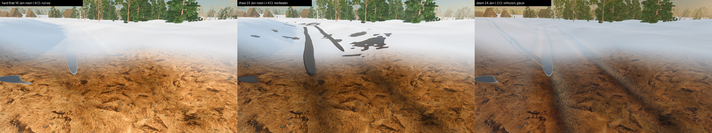
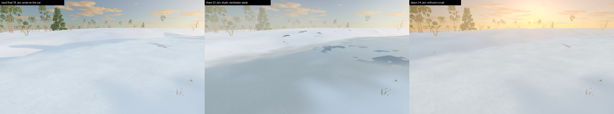
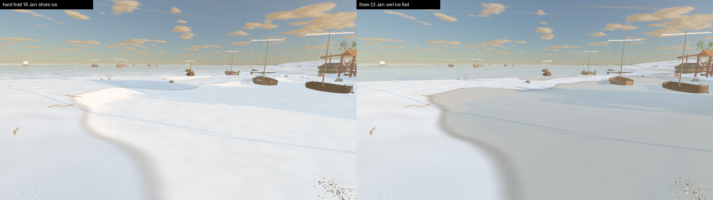

# Seasons

Status: partial (core **SeasonState** implemented; presentation tasks planned, [ADR 0045](../adr/0045-seasons.md)). Scope: the yearly cycle on top of day/night: climate, snow, ice, vegetation looks, sky, sea, clothing, smoke, movement. Out of scope: seasonal quests or economy effects (separate task and ADR if wanted).

## Player-facing behavior (target)

- Spring: buds, blossom, melt, mud and puddles. Summer: full leaf, fruit, short nights. Autumn: yellowing crowns, falling leaves that drift in wind and lie under trees. Winter: bare trees, grey straw-coloured grass, snow, ice, long nights.
- Snow falls slowly (fine), fast (heavy) or in large flakes. It settles on ground and roofs, grows icicles under eaves in the cold, and melts by itself when it warms.
- Puddles freeze in winter, then ponds, the moat and rivers, last the sea shore.
- Deep snow slows walking; over 0.5 m only roads are passable. Footprints stay for a while, like the mud trail logic.
- Citizens dress for the season. Chimneys smoke more in winter.
- The date and time are shown beside the map (already present); a debug control forces the date and season.

## Runtime entry points

| Piece | File | Status |
|---|---|---|
| `Snowfall3D` emitter | `scripts/map/view3d/snowfall_3d.gd` | implemented (test `tests/godot/test_snowfall.gd`, plates `tools/capture_snowfall.gd`) |
| `SeasonState` (pure climate by date) | `scripts/global/season_state.gd` | implemented (test `tests/godot/test_season_state.gd`) |
| Calendar, sun path | `scripts/global/game_calendar.gd`, `scripts/map/view3d/sky_astronomy.gd` | existing: the sun already follows the date |
| Crown phenology, falling leaves | `vegetation_phenology.gd`, `tree_leaf_fall_3d.gd` | existing |

`SeasonState.snapshot(date)` returns: `season`, `weights`, `temperature_c`, `temperature_anomaly_c`, `snow_cover_target_m`, `snow_share`, `ice_puddle|fresh|sea` (mean climate), `heating_demand`, `clothing_warmth`. Climate is a Tallinn-normals sinusoid (coldest day 30 at about -4 C, warmest day 212 at about +17 C). The day's weather on top of it (thaws, cold snaps) is under **Daily weather on the ice**.

## Task plan

| # | Task | Notes |
|---|---|---|
| 1 | Core `SeasonState` | done |
| 2 | Debug season/date control | done: `[` `]` step a day (Shift: 30 days), `F5`..`F8` jump to winter/spring/summer/autumn; clock speed already on the existing ladder |
| 3 | Snowfall weather | done: three looks (fine, flakes, heavy), one pooled GPU emitter, see **Snowfall** |
| 4 | Ground snow, roof snow, icicles, melt | shader `snow_depth` uniforms, thaw by temperature |
| 5 | Movement in snow, depth and footprints | done: depth map, drifts, trenches, walking drag, prints, crunch |
| 6 | Ice on puddles, ponds, moat, rivers, shore | done for the seamless city, see **Water, reeds, lilies and ice**; daily weather on it (R-2075), see **Daily weather on the ice** |
| 7 | Vegetation seasons: blossom, fruit, wither, grass, litter under trees | extends phenology |
| 8 | Sky, clouds, sea per season | |
| 9 | Citizen winter/summer wardrobe | `clothing_warmth` |
| 10 | Chimney smoke by `heating_demand`; wall weathering; save; docs | |

Every visual task must record High (25 fps) and Medium (30 fps) results from the F3 monitor.

## Snowfall

Status: implemented (precipitation only; ground and roof snow are the next tasks).

- When the weather state rains and the date's `snow_share` is 0.5 or more (about November to early April), `SkyWeather3D` shows the snow emitter instead of the rain streaks. `precipitation_snow_share()`, `snow_emitter_visible()`.
- Three looks picked from intensity and wind, no RNG (`Snowfall3D.kind_for`): **fine** (small, light, slow), **flakes** (big soft flakes sinking slowly), **heavy** (dense, fast, wind-driven blizzard). Wind drives it (below).
- **Wind:** `snowfall_particles.gdshader` is a small custom particle shader. Each flake's velocity relaxes toward "wind plus fall" every frame, so a gust shoves every flake in the air at once; wind strength also decides the look (`kind_for`). Rain was already wind-driven: `rain_slant()` leans the streaks with sustained wind and gusts (R-1501).
- Snow does not fill puddles (`_advance_ground_water` uses the liquid share only) and drums a tenth as loud on roofs.
- Cost: one `GPUParticles3D`, the rain tier's particle budget (700 Medium-class minimum, 2200 recommended), one billboard quad each. The rain emitter is hidden while it snows, so total particle cost does not add up. Flakes dim with the sun so unshaded flakes do not glow at night.
- Gotchas found while building it (keep): `billboard_keep_scale = true` is required or flake size is dropped; `ParticleProcessMaterial` turbulence made flakes vanish in the Mobile renderer, so the motion is a custom particle shader; `RANDOM_SEED` is the same for every flake in a particles shader, so positions are hashed from `INDEX` and spawn time; the follow camera looks down, so the flake column runs 8 m above to 8 m below the lens and sits 10 m ahead of it.
- Not yet measured in the city with the F3 monitor (task 10 gate: 25 fps High, 30 fps Medium).

## Winter ground, grass and trees

Status: implemented for the seamless city (the date drives all of it).

- **Trees:** crowns follow `VegetationPhenology` through `MapViewMaterials.apply_vegetation_season`. The city view overrode `set_calendar_date` without calling it, so city trees never changed; `CityMapView.set_calendar_date` now applies it (regression test in `test_season_state.gd`).
- **Grass:** `map_view_grass.gdshader` has `dormancy` (0 growing season, 1 deep winter, from `SeasonState` weights: all of winter plus a third of autumn). Dormant blades are a quarter of summer height, straw-brown with brown roots. `snow_cover` (existing R-1327 curve) presses blades down and whitens tips.
- **Ground:** `city_ground.gdshader` has `winter` (turf turns pale straw) and `snow_cover` (snow settles in patches, thinner on roads, paving, puddles and rock). Pushed by `CityWorld3D.apply_season(date)`.
- **Cold ground:** below freezing the sun no longer bakes soil or starts droughts, soil re-dampens and puddles evaporate at 15% speed (`SkyWeather3D.ground_warmth()`), so winter shows no cracked crust. Puddles freezing over is the ice task.
- **Snow is not rain:** the weather presentation's `rain_intensity` is scaled by the liquid share, so snowfall does not wet the ground, ring puddles or darken walls.
- Review plates: `tools/godot_render.sh --script tools/capture_city_forbs.gd -- --date=1343-12-10 --tag=dec` (writes `build/forbs/*_dec.png`).

## Autumn leaf fall

Status: implemented for the seamless city.

- `CityLeafFall` (`scripts/city/city_leaf_fall.gd` + `city_leaf_fall.gdshader`) is one pooled GPUParticles3D (900 slots). Every 0.3 s it reads the trees within 36 m of the player from `CityTreeLod.trees_near`, weighs them by view direction and shedding, and uploads the top 16 as crown centres, leaf colours and ground heights.
- A tree sheds in proportion to the leaves it still carries (`VegetationPhenology.state_for`: `leaf_density`, `fall_rate`) and the wind (`CityLeafFall.shed_weight`): a bare crown drops nothing, an October crown a steady trickle, a stiff wind or a gale much more (a gale even strips summer crowns). Leaf colours match the species' crown today.
- Rate is in real leaves per second: each tree drops `shed_weight * LEAVES_PER_SECOND_PER_WEIGHT` (1.0) leaves/s, so a birch on 20 October drops about 0.15 leaves/s in calm air and about 0.5 in a gale, and `amount_ratio` is that total over the emitter's full rate (900 / 10 s). There is no floor. Earlier the emitter saturated its budget (90 leaves/s) at three trees and kept a 5 % floor, which read as a leaf blizzard. `test_city_seasons.gd::test_leaf_fall_rate_per_tree_is_realistic` guards the range.
- Leaves ride the shared wind (velocity chases wind plus fall each frame, so gusts shove them), tumble and flutter, and vanish when they reach the ground they were shed over: nothing lies around.
- Cost: one particle draw, two triangles per leaf, nothing when no leafed tree is near. Not yet measured with the F3 monitor.
- Gotchas: `CUSTOM` is not preserved between frames in a particle shader (recompute from `INDEX`); `return` is not allowed in `start()`; frames outrun the clock in a minimized capture window, so the plate tool preprocesses 10 s.
- Plate: `tools/godot_render.sh --script tools/capture_city_leaves.gd -- --date=1343-10-20 --wind=0.6`.
- Older `TreeLeafFall3D` (hit bursts, district maps) is unchanged; the city never used it for ambient leaves (its trees are not in the canopy groups).

## Water, reeds, lilies and ice

Status: implemented for the moat, the Hareapea stream, lakes, the sea shore and puddles in the seamless city.

- **Reeds and cattails** (`CityMoatPlants.apply_season`) yellow through autumn (`SeasonState.reed_dead_share`), lose stems as the water cools and are gone in a hard winter (`reed_standing`, via `MultiMesh.visible_instance_count` over a shuffled stand, so it thins evenly).
- **Lily pads and duckweed** fade with `water_plant_vigour` (water trails the air by about a week and a half); pads turn brown in autumn; **lily flowers** need warmer water than the pads.
- **One ice look** (`scripts/city/ice_surface.gdshaderinc`, `ice_look()`), shared by the moat, the sea and puddles. Ice reads through sharp structure, not soft noise: pans (3.2 m Voronoi plates, each clear black ice or milky snow-ice, more snow-ice at the bank and in a snowy winter) with pale refrozen seams; a domain-warped crack net in clusters (white planes in clear ice, grey lines in milky ice, hidden under snow); air bubbles frozen into clear ice; snow lying in streaks along the wind (sastrugi), drifted deeper against the bank, with wind-scoured glassy patches mid-channel even at full cover; grey slush where snow lies on thin ice. Every line is antialiased against the pixel footprint, so detail fades to its average instead of shimmering. Colours are sRGB tones decoded like `city_albedo`, so snow on the ice matches snow on the ground (the old moat ice wrote sRGB constants into linear albedo and glared white).
- **Photo scans (R-2066):** hosts that `#define ICE_PHOTO` (moat, stream, lakes; the sea on Mobile/Forward+, not GL Compatibility, which has no sampler units left) shade the bare ice with CC0 ambientCG scans in `assets/materials/pbr/lake_ice/` (Ice003 clear black lake ice, Ice004 milky plate ice, Snow014 wind crust; packed into four textures by `tools/assets/pack_lake_ice_textures.py`, bound by `scripts/city/ice_textures.gd`). The scans' mean colour is divided out (`ICE_*_PHOTO_MEAN`) so they keep their plates, flecks and cracks but take the game tone; roughness and normal come from the scans too. Each warped crack polygon (~1.2 m) samples the 1.8 m repeat with its own rotation and offset, so tiling never lines up and the patch seam hides in a hairline crack (`textureGrad` with the unrotated derivatives keeps mips continuous across seams). Snow on the ice takes the crust scan's relief. Puddles stay procedural (the ground shader is at its sampler budget).
- **Moat, stream, lakes:** `city_moat_water.gdshader` has `ice` (thickness 0..1 from `SeasonState.ice_cover_target(ICE_FRESH)`) and `ice_snow`. The freeze front runs pan by pan, shallows first, with a crisp pale edge against open water; running water (the stream) freezes later; waves die out. Pushed to every moat/stream/lake material by `CityWorld3D.apply_season`.
- **Waterline (R-2066):** the moat, stream and lake shader reads the water column per pixel from the terrain heightmap (`ground_height`/`ground_rect`, `CityPlan.height_texture`) instead of the three-row vertex column, so the waterline and its soft fade follow the bank contour. The moat ribbon overhangs into the banks (`MOAT_MESH_OVERHANG`, 35 % of the half width) and `CityWorld3D._moat_surface` keeps the water level `MOAT_FREEBOARD_M` below the ground at the ribbon's outer edges (at least `MOAT_MIN_DEPTH_M` deep): where the field falls away outside the ditch the old 1.1 m level left the ribbon perched over the field, ending in a straight cut in mid-air. Once the moat bears ice, `city_ground.gdshader` `moat_ice` snows over the bed and banks under the water (CitySnow land mask 0) and the ice fades out raggedly over its last 0.4 m of depth, so it meets the bank snow without a line.
- **Snow on the banks:** `CitySnow.bake` only keeps texels bare whose centre lies within the water's half width plus `WATER_MARGIN` (2 m). It used to clear a square of half width + 3 m rounded up to whole 8 m texels, which left 15-20 m of brown bank on both sides of a snow-covered frozen moat.
- **Sea shore** (`map_view_water.gdshader`, `sea_ice`, `sea_ice_snow`, from `ICE_SEA`, about 0.2 in a mean February): fast ice locks the shallows out to `SEA_ICE_REACH_M` (6 m) x `sea_ice` of water depth, with a pan-ragged edge; beyond it a band of broken floes (4.5 m Voronoi plates with a pushed-up pale rim) thins out with depth, with matte grey slush between them. Waves, run-up and the swash film stop under the fast ice (vertex lock, `_sea_ice_lock`), floes still ride 40 % of the swell, and the ice keeps the sea's soft waterline. The ground paints an **ice foot** over the strand from 0.8 m below to about 1 m above sea level (`city_ground.gdshader` `coast_ice`), where the snow map is bare. `MapViewMaterials.apply_sea_ice` pushes it and damps the shore swash state.
- **Puddles** (`city_ground.gdshader` `puddle_ice`, from `ICE_PUDDLE`): a frozen puddle has a white opaque rim with growth rings following its shoreline (the water drained from under the skin as it froze) and a clear dark centre with cracks and bubbles; no rain rings or wind ripples. Ice does not evaporate, so the deepest hollows and ruts keep their ice through a dry frost (`pool_level = max(puddles, puddle_ice x 0.55)`), on land only: the snow map is RG8 and its G channel (`CitySnow.bake`, 0 over the moat, stream and lakes) keeps ice off the water bed seen through open water. Snow buries frozen puddles like the ground round them, so they show on bare roads and before the first snow.
- Plates: `tools/godot_render.sh --script tools/capture_winter_ice.gd -- --date=1343-02-05 [--time=0.5 --exposure=0.45]` (moat from the follow camera, close and above; the harbour shore; a road rut). `--exposure` and `--ice-snow` (snow on the moat ice, e.g. 0.1 for bare black ice) are review-only knobs; the game's daylight exposure clips snowfields to white (see Limits). Shots: `moat_game`, `moat_close`, `moat_bank` (both waterlines), `moat_high`, `sea_shore`, `sea_wide`, `sea_edge`, `puddle`. Older moat plates: `tools/capture_city_season.gd -- --date=1343-01-15`. Review plates of 2026-10-16 (game exposure, low February sun, plus early January): `docs/reports/images/winter_ice/`.

## Daily weather on the ice

Status: implemented for the seamless city (task **R-2075**). Scope: the day's weather moves the ice off the mean climate: thaw days with meltwater on the ice, overnight refreeze into glaze, thin ice after a mild spell, thicker ice after a cold snap. Out of scope: settled snow does not thin or deepen with the day's weather (it follows the date's cover curve), district maps (MapView3D) keep the mean-climate ice, the Markov weather chain is not biased by the anomaly (a thaw is not rainier than a frost day).

- **Day's temperature (pure, no saved state):** `SeasonState.temperature_anomaly_c(date)` is red noise on the absolute day (`day_index`, Julian Day Number): each day adds a hashed shock (`ANOMALY_SEED`) and keeps 0.8 of the day before, so spells last several days (lag-1 correlation about 0.8). Spread about 4.6 C in January-February, 2.1 C in summer; warm departures saturate softly at +7 C, cold ones stretch in winter (Tallinn thaws are capped by sea air, Siberian highs are not); a bias term keeps the long-run mean on the climate. A day is equally warm whenever it is revisited, on any machine, and needs no save field. The seed was picked so 21 April 1343 (campaign opening) is a near-normal spring day and mid-January 1343 a plain frost.
- **Hour:** `SeasonState.air_temperature_c(date, progress, cloud)` adds the daily swing (half range 2.5 C in January, 4.5 C in July; coldest about sunrise, 08:30 in January and 04:30 in July, warmest at 14:00), widened by a clear sky and flattened by overcast (`cloud` = the weather profile's cover). Daily anomalies sit at noon and blend into the next day, so a thaw does not switch on at midnight. `SkyWeather3D.air_temperature_c()` reads only saved weather state (date, cycle progress, cloud profile), so a save round trip continues identically.
- **Ice lags by kind:** puddles answer the hour (`ice_weather().ice_puddle`: 85 % the air an hour and a half ago, 15 % the last day; solid 2 C below the -0.5 C freeze); the moat, stream and lakes (`ice_cover_for(ICE_FRESH, date)`) and the sea shore (`ICE_SEA`) are stepped day by day from 1 September: ice grows toward the day's target at 1/7 (fresh) or 1/22 (sea) per day and only melts while the day is above freezing (`ICE_MELT_PER_DAY` per 3.5 C of thaw). A cold week's moat ice survives a two-day thaw, a mild week thins it to open leads, the sea answers slowest. With the mean climate it peaks like the old target and clears in April. Memoised, so the first call of a season steps at most a year of days.
- **Rain on frozen ground:** a thaw day rains instead of snowing (`precipitation_snow_share` from the air now). `SeasonState.soil_frost(date)` stops the soil drinking, so rain fills puddles 1.8x faster; snow lying on a thaw day melts into the hollows (`MELT_FILL_PER_SECOND`); frozen puddles do not evaporate. At night those puddles freeze (`pool_level = max(puddles, puddle_ice ...)` in the ground shader), so a thaw-and-frost leaves wide frozen puddles where a dry frost leaves only the deepest ruts iced.
- **Puddles under lying snow stay ice:** snow cover follows the date while `ice_puddle` follows the hour, so a thaw noon used to cut black open water into a snowed field. `SeasonState.puddle_ice_with_snow(ice_puddle, snow_cover)` keeps puddle ice at least `smoothstep(0.15, 0.5, snow_cover)` (lying snow means frozen ground, the water freezes from below); `CityWorld3D.apply_ice_weather` pushes that to the ground. A thaw then shows as the `ice_melt` wet film on the ice, not open water. Bare ground (autumn frosts, late spring) still follows the hour alone. Plates (thaw noon 1343-01-23, `--only=puddle`): `docs/reports/images/winter_ice/puddle_snow_thaw_before.jpg` (open water in the snow) and `puddle_snow_thaw_after.jpg`.
- **Wet ice and glaze:** `ice_weather()` also returns `melt` (the air above freezing, or rain) and `glaze` (a thaw within the last 36 hours and frost now). `CityWorld3D.apply_ice_weather` pushes them every frame (moat and sea only when they change): `ice_melt`/`ice_glaze` on the moat, stream and lake shader, `sea_ice_melt`/`sea_ice_glaze` on the sea (`MapViewMaterials.apply_sea_ice_weather`), `ice_melt`/`ice_glaze` on the ground (puddle ice, ice foot, and a glaze sheet on wet roads, paving and trodden earth where rain or meltwater froze). One shader helper, `ice_weather()` in `ice_surface.gdshaderinc`: a thaw darkens the ice into a mirror, sinks the snow on it into grey slush and gathers meltwater pools in the low parts of each pan; glaze is glassy refrozen film, and snow lying on refrozen ice or ground wears a hard, shinier crust. No texture fetches, two value-noise lookups per iced pixel, nothing when both are 0.
- **Verify:** `godot --headless --path . --script tools/run_godot_tests.gd -- --filter=test_city_seasons` (determinism and spells, lag order puddle > moat > sea, overnight freeze and noon melt, glaze after a thaw, rain on frozen ground, meltwater, save round trip, material pushes). Plates: `tools/godot_render.sh --script tools/capture_winter_ice.gd -- --date=1343-01-23 --time=0.55 --settle=30` (thaw after the cold spell of 16-20 January), `--date=1343-01-24 --time=0.39 --settle=30` (refrozen at sunrise), `--date=1343-01-18` (hard frost). `--settle` runs the weather at that hour first, `--weather=` picks the state. Review plates: `docs/reports/images/winter_ice/daily_*.png`.

Puddles on a hard-frost noon, a thaw noon (meltwater) and the dawn after it (refrozen puddles, glaze in the wet ruts):

Moat ice: snow on the ice in the frost, grey slush and meltwater pools in the thaw, refrozen crust at dawn:

## Snow depth, drifts and trenches

Status: implemented for the seamless city.

- **Real depth, not just white:** `city_ground.gdshader` lifts the terrain by the snow surface (`snow_lift`), in the chunk, relief-mesh and far-terrain vertex stages, so snow stands above the ground and drifts have a silhouette. The fragment stage reads the same height for coverage, drift shading (normal from the surface slope) and trench walls.
- **Depth map:** `CitySnow.bake` (once, the first time snow lies: about 0.4 s, 8 m texels, `snow_depth_map` / `snow_map_rect`) stores a relative depth FACTOR. Wind-drift noise (long dunes plus short ridges, `drift_factor`), deeper in woods (tree density within 1 texel), bare on paving, water, roofs, sites and steep slopes. Depth in metres = `cover x 0.5 x factor - 0.04` (`CitySnow.depth_at`, mirrored in the shader as `snow_depth_m`): drifts pass half a metre at full cover and a third of the country is knee-deep or more.
- **No snow indoors:** an 8 m texel is coarser than a house, so the bilinear depth used to bleed from the street through walls and lift the ground above interior floors. `CitySnow.bake` also rasterises a 1 m shelter mask (`snow_shelter_map` / `snow_shelter_rect`, `CitySnow.shelter_at`) from every building footprint, site building and site room, grown by 1.5 m (eaves). The shader and `factor_at` multiply the depth by `1 - shelter`, so floors, prints, the crunch and the walking drag all agree that nothing lies under a roof. Falling snow is gated separately by the roof check (`enclosed_interior`, R-1539). Test: `test_city_seasons.gd::test_snow_never_lies_indoors`.
- **Walking:** `CitySnow.walk_drag(depth)` (free under 6 cm, then 0.8 speed easing to 0.3 at 50 cm and over, R-1907; cleared paving and roads are bare in the map, so roads are the way through). `reval_city.gd` takes the lowest of the grass, soft-ground and snow drag (see SEAMLESS_CITY **Ground speed**).
- **Wading furrows (R-1968):** once the snow is 8 cm deep `CityGroundTrail.stamp_wade` ploughs one furrow per leg behind the walker (centres `WADE_HALF_GAUGE` 13 cm either side of the walk line, about 17 cm wide), deeper as the snow deepens, with an untouched ridge between them. The furrows are deliberately ragged, like Red Dead Redemption 2 snow: width, depth and line wander with deterministic noise keyed to the distance waded (frame-rate independent), each swinging leg bows outward mid-stride, every footfall punches a deeper post-hole (`_post_hole`) and shoves a heap forward, and now and then a boot flicks a clump out over the wall (`stamp_heap`). Past 30 cm of snow the shins and coat drag the ridge down too (full at 50 cm), so very deep snow reads as one trench with two deeper leg lines. In the shader a pressed line packs the snow to about 8 % of its height; raised trail relief (rims, heaps, clumps) now lifts the snow as spoil (`SNOW_SPOIL`, at most 30 cm), so furrow walls stand up. Plain footprints (below) still show in thin snow. Hooves and wheels use the same trail map (their rims heap snow the same way).
- **Cost:** one extra texture fetch per terrain vertex only where snow lies (`snow_lift_vertex` returns early at `snow_depth_m = 0`, so the other seasons pay nothing); no new draw calls or meshes. Not yet measured with the F3 monitor on a full winter city.
- **Limits:** the snow surface is the terrain mesh, so a drift is as smooth as the chunk grid (the relief mesh near Kalev is finer); trees, bushes, rocks and fences do not sink into the snow (their feet stay at ground level, so knee-deep drifts hide trunk bases); NPCs do not wade or leave trenches; the leg furrows follow the walk line, not the animated foot bones; the relief texel is 4 cm and only the fine relief mesh near Kalev (about 3 m) has the vertices to show two furrows as geometry, further out they read through shading; snowfall does not deepen the map over time yet (depth follows the date's cover curve).
- Plate: `tools/godot_render.sh --script tools/capture_snow_prints.gd` (walks a trench through the deepest open drift).

## Snow footprints and the crunch

Status: implemented for the seamless city (Kalev, NPCs, hooves and wheels all use it).

- **Prints:** `CitySnow.patch(xz, cover)` is `depth_at / 5 cm` (1 once the snow is 5 cm deep). `CityGroundTrail.snow_cover` (set by `CityWorld3D.apply_season`) makes snow count as "give" even on paved ground (only fully paved ground stays hard), deepens the stamp (`_weight(snow)`), and a boot in snow kicks up a small white powder puff. In the shader a print thins the snow and shades the packed floor blue-grey.
- **Crunch:** new footstep surface `snow` (`SurfaceResolver.SURFACE_SNOW`, `with_snow`): turf, earth, mud and gravel under settled snow answer `sfx.footstep.snow.walk` (6 steps, `sounds/footsteps/snow_step_NN.mp3`). `CitySurfaceSampler.surface_at(..., snow_cover)` decides, `CityMapView.footstep_surface_at` passes the date's cover. Boards, flagstones and water stay as they were.
- **The clips are synthesised** (no CC0 snow recording is cleared): `python3 tools/audio/generate_snow_footsteps.py` builds a low "press" plus 90-260 crystal grains per step, mono 44.1 kHz, -17 dBFS loudest 50 ms, 128 kbps; rows in `assets/SOURCES.csv` (`--print-sources`). Replace by catalog ID with a real recording if one is cleared later.
- **Limits:** prints do not fill in under new snowfall or melt away on their own (the shader hides them as the snow thins, like mud prints it is a window image); no wind-blown drift; the crunch has not been judged by ear yet.

## Debug controls

- **Debug overlay (mouse).** Open the quick menu and press **Debug**. The panel has a **Date and Season** block: the current date, season and mean temperature, buttons `-30d`, `-1d`, `+1d`, `+30d`, and `Winter`, `Spring`, `Summer`, `Autumn` that jump forward to 15 Jan, 21 Apr, 15 Jul and 15 Oct. Clock speed and pause are in the **Time Controls** block above it.
- **Keys (3D runtime).** `[` / `]` step a day back / forward (Shift: 30 days); `F5` winter, `F6` spring, `F7` summer, `F8` autumn.
- Elapsed campaign days never go negative, so a step back past the phase's start date wraps to the same calendar day next year (`GameCalendar.days_until`). The sun, HUD date, phenology, farmland and forbs follow through `set_calendar_date`.
- Entry points: `MapViewRuntime.shift_calendar_days`, `jump_to_season`, `calendar_date`; UI in `scripts/ui/debug_overlay.gd`; keys in `map_view_runtime_input.gd`. Test: `tests/godot/test_debug_overlay.gd`.

## Verify

`godot --headless --path . --script tools/run_godot_tests.gd -- --filter=test_season_state`

## Limits

Snowfall consumes the climate; everything else (ground and roof snow, ice, vegetation, sky, clothing, smoke, movement) is still planned.

Ice limits: the day's weather moves the ice in the seamless city only (see **Daily weather on the ice**); the ice look is shading only (no ice geometry, pressure ridges or holes, and walking on the ice is not modelled); district maps (MapView3D) take sea ice only through `MapViewMaterials.apply_sea_ice` and have no frozen puddle decals; at the game's noon exposure a full snowfield clips to white, which flattens snow and snow-covered ice alike (a lighting follow-up, not an ice one). Not yet measured with the F3 monitor (the ice adds two or three Voronoi lookups per frozen pixel and nothing in summer: every ice branch is gated on its uniform).
