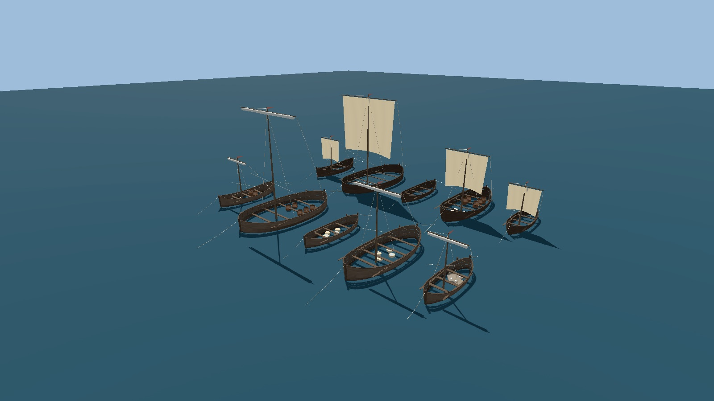
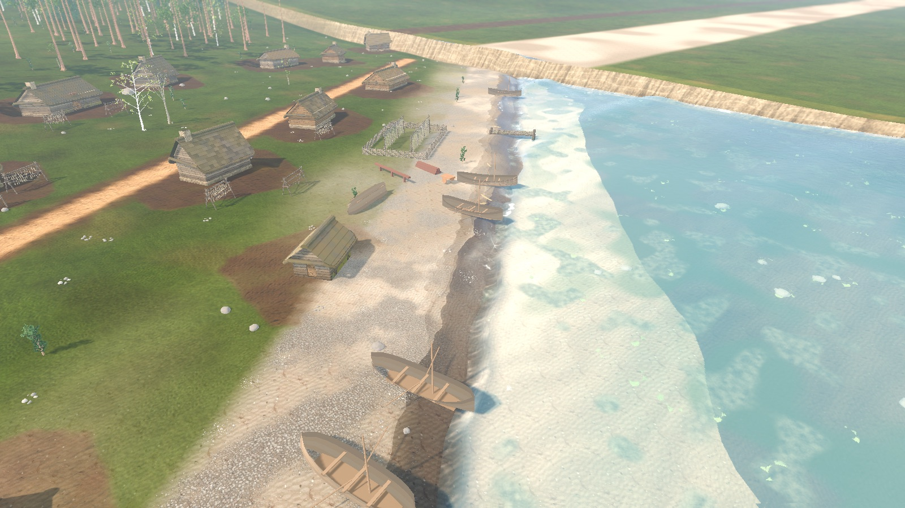
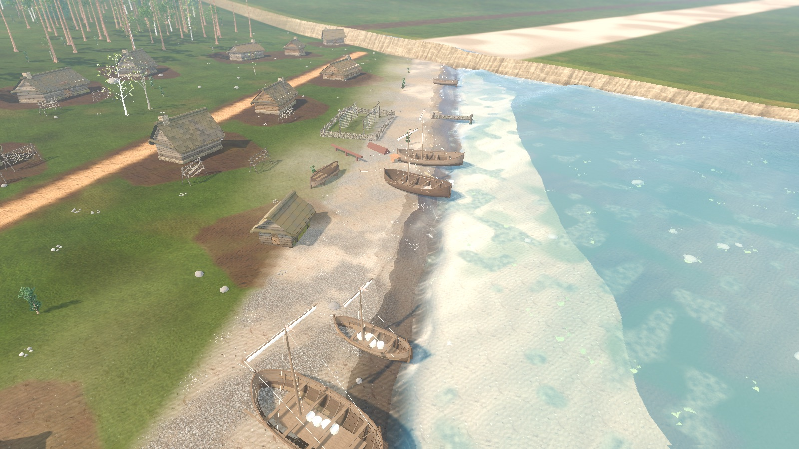

# Ships and working craft

Status: implemented (cog: ship detail pass of the seamless city, ADR 0031; working craft and cog wear variants: task **R-953**, CO-06). Scope: the cog (`CogModel`) seen anchored and under way off Reval, in true metres, with a walkable deck, cabins and hold; the small working craft of the two shores (`VesselFleet`). Out of scope: ship physics and steering, mast climbing as a mechanic, boarding the cog under way, rowing or sailing the small craft, cargo or trade gameplay, rig and oar animation (CO-07, **R-954**). Shore placement and boarding of small boats: [`CITY_SEA.md`](./CITY_SEA.md).

## What the player sees

- **Hull** (`CogHull`): one lofted clinker shell, ~21 m over the stems and ~7 m abeam, flat-floored amidships with a raked stem and sternpost, ten lapped side strakes and bottom planks. Plank tones vary per strake and the lap edges carry a ledge, so the hull reads as overlapping boards, not a smooth shell. The inner skin is built from the same loft, so the deck seen from above shows no gaps through the hull.
- **Interior** (`CogInterior`): laid deck, through-beams, a hold well with a stair to the hold floor, a cargo hatch, a stern cabin and a forecastle store (both with a door, roof and fittings), windlass and bitts, deck cargo, and a boarding ladder over the side.
- **Rig** (`CogRig`): mast with a masthead top, a yard, a square sail, stays, shrouds with ratlines up to the top, backstays, halyard, lifts, braces, sheets, tacks and bowlines. The ratlines are how a crewman gets aloft.
- **Rudder**: hung on the raked sternpost with pintles and gudgeons (`RudderPivot/Rudder`); the tiller enters the stern cabin. `CityShips` swings it a few degrees at anchor and holds a constant helm under way.
- **Wind**: ropes and sail are not simulated on the CPU. `cog_rope.gdshader` sags and bellies every rope with the shared world wind; `cog_sail.gdshader` fills the sail from the wind seen in the ship's own frame (from astern: bellied forward; from ahead: laid back against the mast; abeam: part-filled), pins its head to the yard and its foot to the clews, and shivers the free edges in a luff. A cog at anchor has the sail furled on the yard; the cog under way has it set.
- **Scale**: the hull is true metres with no rescale (Kalev is ~1.8 m). The waterline is the node origin.

- **Wear** (R-953): `CogModel.build(..., wear)` takes `0` (weathered oak, the default) or `1` (freshly tarred hull, `CogModel.tarred_wood_material()`). `CityShips` builds one anchored template per wear and gives each roadstead cog the one its stable id (`cog.roads.<n>`) hashes to.

## Working craft (R-953)

Five designs in true metres (`scripts/city/vessel_fleet.gd`), one per card of [`baltic_vessels_1343.md`](../reports/baltic_vessels_1343.md). Unknown card fields are scaled from named comparanda in its **R-953 addendum**:

| Design | Card | Size (LOA x beam) | Rig | Where it appears |
|---|---|---|---|---|
| `fishing_boat_small` | V2 | 6.0 x 2.07 m | small square sail | Kalamaja sand, fish landing, map `fishing_boat` props |
| `fishing_boat_large` | V3 (*mündrik* boat) | 9.0 x 3.74 m | small square sail | same, about one slot in three |
| `rowing_boat_open` | V4 | 6.5 x 2.26 m | none, four oars | Kalamaja `skiff` slots |
| `lighter_lodja` | V5 (*lodi*) | 10.5 x 5.4 m | square sail, two sweeps | coastal timber landings (`lighter` slots) |
| `strait_craft_saaremaa` | V6 | 6.8 x 2.36 m | small square sail | not placed yet (Saaremaa ferry landing, follow-up) |

- **Hull**: a lofted clinker shell with lapped strakes (lap ledge per strake), inner skin, gunwale cap, keel, stem and sternpost, ribs, thwarts and floorboards; one mesh per (design, wear), shared by every boat of that variant. Origin = keel amidships, +X bow; afloat hulls are lowered by `VesselFleet.draught(design)`.
- **Variants** (`VesselFleet.variant_for(design, map_seed, id, hauled)`): wear `fresh_tar` (tarred all over), `weathered` (tar below the wale, silvered oak above), `patched` (weathered with raw replaced planks); load `empty`, `nets` (tarred net heap with floats), `fish_baskets` (wicker baskets of herring), `cargo` (sacks and barrels). Fishing slots pick small or large with `VesselFleet.fishing_design_for(map_seed, id)`. All picks go through `VesselFleet.stable_hash` (djb2 plus an avalanche finaliser, pinned by a test), so a map always shows the same boats and neighbouring ids differ: the six Kalamaja clinker boats are six different looks.
- **Pose**: beached hulls (plan `lift` > 0) rest keel on the sand, never bob, and run a bow line to a stake; afloat hulls ride the swell and run a bow and a stern line into the water. Sails are furled on the yard in both; `VesselFleet.set_sail(vessel, true)` shows the set cloth.
- **Named sub-nodes for CO-07** (`VesselFleet.RIG_NODES` / `ROW_NODES`): `Hull`, `Mast` (pivot at the step) with `Mast/Yard/Sail` (a `SAIL_COLS` x `SAIL_ROWS` = 10 x 8 cloth on the cog sail shader), `Mast/Yard/FurledSail`, `Mast/Pennant`, `Sheet`, `Brace`, `Halyard`, `Lift`, `Shroud0`, `Shroud1` (cog rope shader), `Oar0..n` (each pivots at its thole, shipped fore-and-aft), `Rudder` (side rudder on the starboard quarter) with `Rudder/Tiller`, `MooringLine0..1`, `Load`.
- **LOD**: ropes, oars, pennant, tiller bar and load dressing carry `visibility_range_end = 140 m` and cast no shadow; the hull, mast and yard stay visible to the horizon.
- **Map view**: `fishing_boat` props build a fishing design and `merchant_boat` props a cog, scaled into map units; `MapViewMeshBuilderPropModels.boat_half_extents` feeds both `BoatFloat3D` and the 2D collision capsule, so each design pitches on its own length. No active map places boat props today; the asset showcase does.







Report and the full plate set (clear and storm, Compatibility and Metal, before and after): [`co06_vessel_fleet.md`](../reports/co06_vessel_fleet.md).

## Entry points

`CogModel.build(faction, sail_set, anchored, wear)`; `VesselFleet.build(variant)`, `VesselFleet.variant_for(...)`, `VesselFleet.overturned(design, wear)`, `VesselFleet.deck(design)` (boardable floor, used by `CityShips.deck_height_at`), `VesselFleet.hull_half_extents(design)`; `CogModel.walk_height(x, z)` (deck, cabins and hold well; used by `CityShips.deck_height_at` through `CityPlan.dynamic_deck`); `CogModel.rudder_of(node)`. `CityShips` builds one anchored cog and duplicates it per hull (meshes are shared).

## Sources

Dimensions and the attested/composite split are in [`docs/reports/baltic_vessels_1343.md`](../reports/baltic_vessels_1343.md) (Bremen cog 1380, Lootsi wreck). Shroud and brace counts are plausible composites, not attested.

## Verify

```bash
godot --headless --path . --script tools/run_godot_tests.gd -- --filter=test_vessel_fleet,test_boat_float_3d,test_boat_collision,test_city_shore
tools/godot_render.sh --script tools/capture_co06_vessel_fleet.gd -- --tag=after   # build/co06/<shot>_after.png
godot --headless --path . --script tools/run_godot_tests.gd -- --filter=test_cog_model
tools/godot_render.sh --script tools/capture_cog.gd -- --tag=x   # build/cog/<shot>_x.png
```

## Limits

- Ratlines are visual: there is no climb-the-mast mechanic yet; Kalev walks the decks, cabins and hold only.
- The cog under way cannot be boarded.
- Working craft never move under oar or sail: CO-07 (**R-954**) drives the named rig nodes. Set sails only appear on the line-up plate.
- The Saaremaa strait craft is built and tested but not placed: the Saaremaa ferry landing is a separate world map.
- Small-craft hull planks use the shared hewn-timber texture with per-plank vertex tones; there is no dedicated hull plate or baked normal detail per design.
- Plank texture is the shared hewn-timber material with vertex tones, not a dedicated hull plate.
