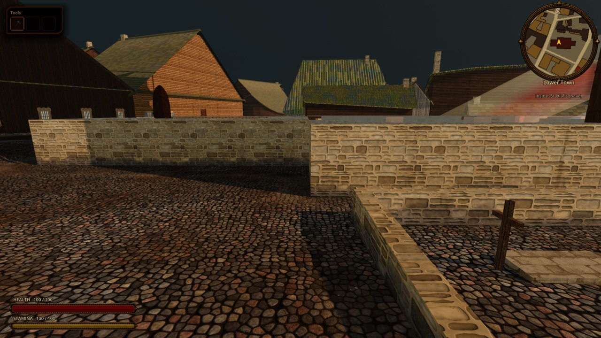
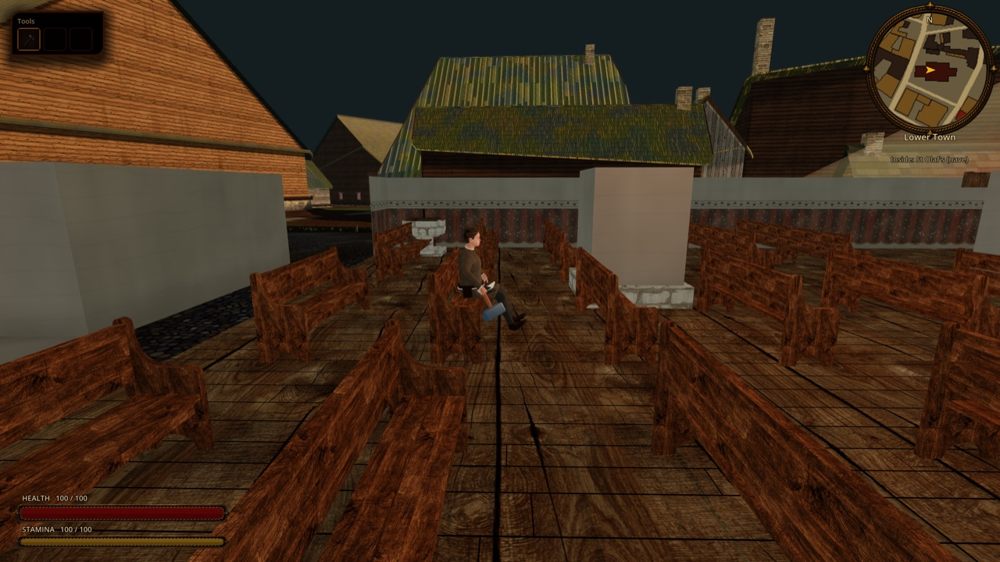
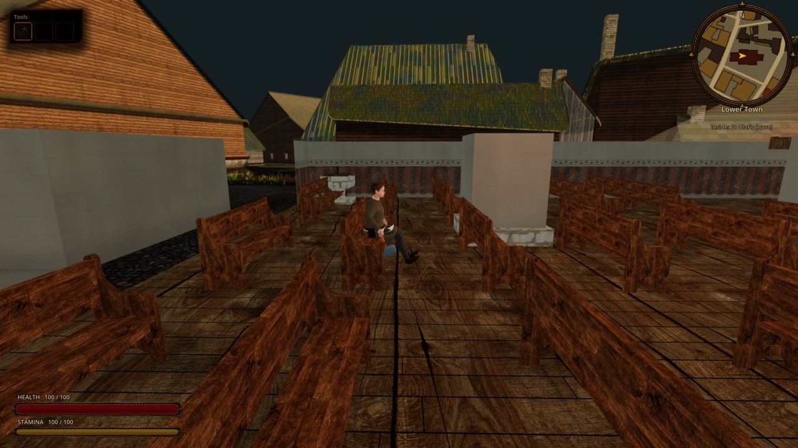

# Sitting: benches, stools and chairs

Status: implemented in the seamless city ([ADR 0054](../adr/0054-hero-sits-on-seats.md), proposed; board task pending). Out of scope: resting benefits, ownership or trespass rules, seats outside the city, the town hall, choir stall and cog seats (geometry without seat data).

## What the player sees

Next to a free seat the prompt shows **Sit** (`interact`: `E`, Enter). Kalev sits down (1.2 s), stays seated, and the prompt becomes **Stand up**; any movement key, jump or interact gets him up (1.0 s) a step in front of the seat. A seat where a resident is sitting is not offered. On a backless bench he sits facing the side he came from. While seated the motion style layer ([`MOTION_STYLE.md`](MOTION_STYLE.md)) still poses his trunk, head and arms (wet and cold, he hugs himself on the bench); his legs stay on the clip.

Review plates (`tools/godot_render.sh --resolution 1600x900 res://tools/capture_city_sit.tscn`, real city): a nave bench in St Olaf's.

## How it works

1. **Seats** (`scripts/world/city_seats.gd`, `CitySeats`, built by `reval_city.gd`): household sit slots of the furnished homes (`CityInteriors.furnished_indices()`, `HouseholdLayout.slots_of(&"sit")`: position, facing, seat height), nave benches from site manifests (`benches: [{at, len}]`, one seat every 0.55 m, facing site-local +x towards the altar, seat height 0.45 as `ChurchFurnishings.BENCH_SEAT_Y`) and catalogue dressing whose household piece has a `seat_h` (`obj.bench_plank` 0.46 with a seat every 0.55 m on both sides, `obj.stool_three_leg` 0.44, `obj.chair_smithy` 0.47). Taken seats: `reval_city._seated_people()` lists residents shown sitting at home (`CitizenActor.at_home` and `pose == &"sit"`); a seat whose sitting point (0.44 m in front of it) has someone within 0.3 m is skipped.
2. **Prompt** (`scripts/world/seat_prompt.gd`, `SeatPrompt`): one `Interactable` (radius 44 px), moved every 0.15 s to the nearest free seat within 1.3 m of Kalev, or onto him with "Stand up" while he sits; disabled when there is nothing in reach. `InteractionController` focuses and prompts it like any other.
3. **Kalev** (`scripts/player/player_seat.gd`, held by `Player`): `sit_on(seat)` (refused while jumping, swimming, in an action or a menu), `stand_up()`, `is_sitting()`, `seat_height_offset()`. The logic body stands at the seated point with `collision_mask` 0; `view_animation()` gives `sit_down`, `sit_idle`, `sit_up`; `view_facing()` the seat's facing; `MapViewRuntimeActors.sync_player` lowers the rig by `seat height - 0.95` (the clip's thigh height, as `CitizenActor.view_height_offset`). `MotionStyleModifier.seated` (set by `MotionStylePresenter.humanoid` while a `sit_*` clip plays) skips crouch, stance width and limp.

## Data, state and saves

Nothing is saved: a load stands Kalev up. Seats are derived from the plan, the site manifests and the household layouts every session.

## Verification

- `godot --headless --path . --script tools/run_godot_tests.gd -- --filter=test_sitting`: the city's sites offer nave and refectory seats with layout seat heights; the nearest free seat skips a taken one and turns a backless bench to the sitter; sit down, stay seated (no jump from a seat), stand up with collision restored a step in front; the prompt follows the nearest seat, sits him on interact, offers to stand, and disappears when nothing is in reach.
- Real city: `tools/capture_city_sit.tscn` (above), exit 1 when a seat is not found or he does not sit.

## Limits

- Household rooms and the refectory: the seats work (tests), but a hero teleported into them keeps the outside camera behind a wall, so the plate is the cut-away nave.
- The town hall benches and high-backed chair, the friars' choir stalls and chapter bench, and the cog's stools are geometry boxes without seat records.
- No benefit from sitting (no stamina or time skip) and no reaction from the owners of a seat.
