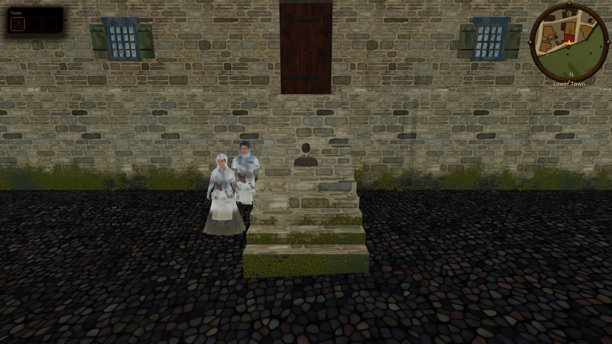
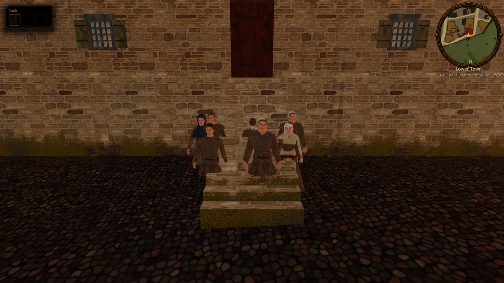

# Social life: venues, the week and the night bell

Status: first slice implemented (task **R-1984**, epic **R-1966**); the rest is planned under [ADR 0050](../adr/0050-social-life-venues-and-weekly-rhythm.md) (**proposed**). Scope: where the census residents of the seamless city go after work, on Saturday and on Sunday, and when they must be home. Out of scope today: venue buildings and interiors, guild feasts, weddings and funerals, travel between towns, venue dialogue (planned tasks below). Evidence: [social life and daily rhythm dossier](../../history/dossiers/dailylife/social-life-and-daily-rhythm-1343.md) (R-1967).

## What the player sees

- **After the evening bell** (work stops about 18:00-19:00) about one adult man in two and one woman in eight goes out. Councillors and merchants go to the **council wine cellar** under the town hall; masters of St Olaf's trades (butchers, masons, carpenters, coopers, furriers, saddlers, ropemakers) to **St Olaf's guild house** at Pikk 24 (held by the guild from 1341); everyone else to one of the two nearest **beer-shops**. Most drinkers sit inside (not drawn), about a third stand at the door. Those who stay in either talk with the neighbours on their doorstep or are indoors.
- **Beer-shops** are the houses of the 40 census households headed by a brewer, alewife or innkeeper (37 in the Lower Town, three in the Viru and Karja road suburbs: the krugs outside the gates). The host sells beer at the door until about nine.
- **The night bell at nine:** everyone is home; hosts close about then (a host open past nine was fined). Only the night watch is out.
- **Saturday:** in the afternoon those who bathe walk to the bath house by the Nuns' Gate (`poi.bath.nunne`): German, Danish and Swedish burghers mostly, Estonian and Finnish residents and the poor far less. Craftsmen who do not bathe work at their door as usual.
- **Sunday:** no work and no trade. Water at dawn, church in the morning (the generic church slot until [ADR 0046](../adr/0046-church-services-and-collective-channeling.md) services replace it), dinner at home, a walk after 13:30 and from 15:00 the week's longest evening out; a quarter more people go out than on weekdays. Beer-shops open after dinner. Children play at the door and walk out in the afternoon.
- The information card says where a resident is: "Drinking at a beer-shop", "At St Olaf's guild house", "Drinking in the council wine cellar", "At the bath house", "Talking with the neighbours on the doorstep", "Selling beer at their door".

## Model

All of it lives in the existing census timetable ([`CITIZENS.md`](./CITIZENS.md)); a resident's place stays a pure function of (weekday, hour), with nothing to save.

- **Weekday variants:** `patterns` in `content/world/reval_city/citizens.json` carry `craft@sat`, `craft@sun`, `host`, `host@sat`... `CitizenRoster._entries` picks `<pattern>@sat` on Saturday and `<pattern>@sun` on Sunday when they exist, else the base pattern. `CitizenRoster.weekday` (static, `GameCalendar.weekday_index`, Monday=0) is set by `CityMapView.set_calendar_date`.
- **Conditional keys** resolved per resident (`CitizenRoster._effective`): `evening` and `sunday` become the resident's venue (`evening` place, `evening_kind` beershop / guild_st_olaf / wine_cellar) when `evenings` / `sundays` is true, otherwise `doorstep` (if `strolls`) or `home`; `bath` becomes the bath house when `bathes`, otherwise the door for craftsmen and hosts, else home. A drinker with `evening_inside` is not drawn, and is never seated in their own house interior (indoor seating applies only when `dest == "home"`).
- **Builder:** `tools/city/build_citizen_runtime.py` (constants `HOSTS`, `WINE_STATUSES`, `OLAF_TRADES`, `GUILD_HOUSES`, `WINE_CELLAR_POI`, `BATH_POIS`, `EVENING_SHARE`, `EVENING_WOMEN`, `SUNDAY_EXTRA`, `BATH_SHARE`). All choices are hashes of the resident id, so existing assignments do not change.
- **Calendar fix:** `GameCalendar.weekday_index` now uses the Julian form of Zeller's congruence (the campaign dates are Old Style): Easter 1343 is Sunday 13 April and St George's Day Wednesday 23 April. Before, every weekday was one day early.

## Review

`--city-weekday=N` (Monday=0) pins the weekday next to `--city-hour=H`:

```bash
tools/godot_render.sh --resolution 1600x900 res://tools/capture_city_citizens.tscn -- --city-spawn=poi.forum --city-hour=19.6 --city-weekday=2
```

Meinhard Brawer's brew-house on Lai (`bldg.osm.w134801478`), Wednesday: at 10:30 only the household is at the door; at 19:36 the evening's drinkers stand outside (most of its 57 customers are inside).

| 10:30 | 19:36 |
|---|---|
|  |  |

## Verify

```bash
python3 tools/city/build_citizen_runtime.py --check
godot --headless --path . --script tools/run_godot_tests.gd -- --filter=test_citizen_roster,test_population_market_day_focus
```

`test_citizen_roster` covers the Julian weekdays, a drinker at the beer-shop door, hidden drinkers not seated at home, the host at the door, everyone home after the night bell on Wednesday, Saturday and Sunday, the Saturday bath and Sunday rest.

## Planned (ADR 0050)

| Task | What |
|---|---|
| R-1986 (SOC-4) | 24h and weekday capture strip, presence tuning (crowd per beer-shop, outside share), quick perf report |
| R-1987 (SOC-5) | St Canute's guild house (held from 1326) on the empty Pikk 20 plot, harbour beer booth, bath POIs by St Olaf and on Sauna street |
| R-1988 (SOC-6) | Beer-shop dressing (ale bush on a pole, benches, barrels) and two venue interiors |
| R-1989 (SOC-7) | Guild feasts (night bell at eleven), weddings, funerals and proclamations as dated deterministic evenings |
| R-1990 (SOC-8) | Travel: merchants and skippers away by date, guest merchants with burgher hosts, Harju peasants at the gates |
| R-1991 (SOC-9) | Venue lines and barks, the watch at the night bell |

## Limits

- No venue is dressed or has an interior yet: a beer-shop looks like any house with people at the door.
- St Canute's guild (the larger craft guild) has no house in the plan, so its masters go to beer-shops; there is one bath house in the plan, so every bather walks to the Nuns' Gate.
- A popular beer-shop can have about 60 customers in an evening; at most 12 outdoor bodies are drawn near Kalev, so the door never shows them all.
- The Lower Town legacy crowd ([`LIVING_WORLD.md`](./LIVING_WORLD.md)) keeps its own tavern zone mapping.
- Feast days, the market weekday (unknown for 1343) and the siege do not change the week yet.
