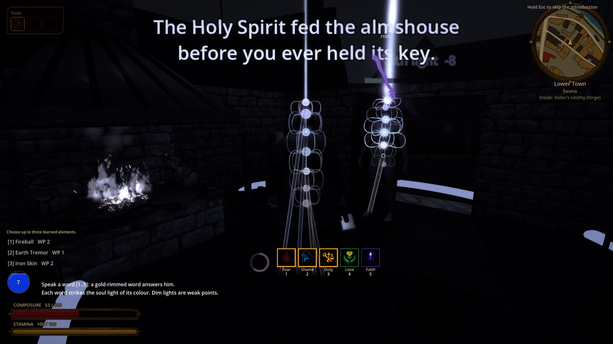
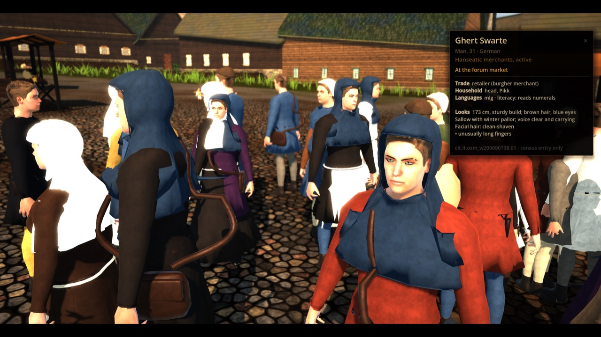
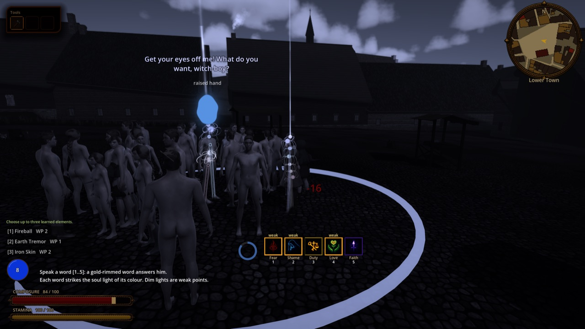

# Spirit dialogue combat

Status: partial (SW-1, R-1348; reflection panel and first explorable Hingepuu hub are implemented). Scope: the current Hingepuu visit loop over the active city scene. Out of scope: a full spirit-world map, phantom encounters, authored open-world duels, rites, and comprehensive spirit combat; see the SW task chain.

Canon labels: Hingepuu, spirit world, creatures, and guilt rites are `folklore` / `invented` per [`docs/CANON.md`](../CANON.md). The hero's perception is never given a clinical diagnosis.

## Player behavior

Press **H** to enter or leave Hingepuu (when entered from the city player). Move with **WASD**, arrow keys, or the left stick. **E / gamepad A** interacts with the central tree mark; **Esc** returns. The symbolic tree has three visible marks. The central mark opens the existing reflection panel when available; other marks currently provide a placeholder response. Leaving restores the exact city player transform because the player and city scene remain resident underneath the overlay.

## Runtime and persistence

- `scripts/reflection/hingepuu_hub.gd` draws and controls the minimal explorable hub as a `CanvasLayer` overlay.
- `scripts/reflection/reflection_controller.gd` owns the hub and bridges the central mark to `ReflectionModel` / `ReflectionOverlay`.
- The hub stores the return position and active-visit bit in `GameState`'s existing `location_states` dictionary, which is already serialized by `GameStatePersistence` and `SaveService`. `restore_after_load` resumes the visit without replacing the saved return point.
- The hub blocks city movement through `modal_input_overlay` while active. Inputs use existing `ui_left/right/up/down`, `interact`, and `ui_cancel` mappings. `interact` already includes keyboard and gamepad A.

## Verification and limits

Run `godot --headless --path . --script tools/run_godot_tests.gd -- --filter=test_hingepuu_hub,test_reflection_overlay,test_save_service`.
The current host is a lightweight symbolic illustration rather than a dedicated streamed location or detailed art environment. Enter/exit is exposed by `ReflectionController.enter_hingepuu()` and `leave_hingepuu()`; an in-world access prompt/anchor, world-tree art, dedicated hub save-slot location, and integrated return-after-process-restart scene restoration remain follow-up work. No visual capture is accepted as historical reference.

## New Game duel in the smithy (R-1872)

Status: implemented (task **R-1872**). Scope: the opening porter duel as a combat mode inside normal play. Out of scope: other authored open-world duels (SW-3 **R-1350**), new word elements, a duel-specific camera.

**Story.** The boy has run from the almshouse to Kalev's smithy with the loaf and the cold-store key; the porter Hanß bursts in after him. The duel is fought by the hearth; Kalev then walks in from the living room and takes the boy as his apprentice. The porter leaves, Kalev stays in his forge, and play simply continues where the boy stands. Decision 2026-10-12 (maintainer request; the narrative option was the recommended one when the question timed out).

**Player behavior.**

- Main menu **Start** loads the seamless city at spawn `kalev_smithy`; no separate opening scene is loaded. The duel opens a few frames after arrival.
- The hero is the normal city `Player`: same third-person camera (orbit, zoom), walking, running, roll (`player_dodge`) and guard (`player_guard`). The duel only clamps him to a 3.2 m disc in the forge bay and greys the world with the duel grade (spirit sight).
- Health reads as in normal play: the hero's **composure** is the top bar of the bottom-left vitals block (`COMPOSURE 70 / 100`), and the porter's **pressure** is the standard overhead bar (`CharacterHealthRing3D`) above his head. The old 2D "Your composure" / "Their pressure" strips are gone in the real-time arena (they remain only for the 2D overlay duel).
- Hold **Esc** to skip the whole opening; while the opening runs Esc does not open the pause menu.

### Word spells: what happens in a spirit duel

A spirit duel is an argument fought with emotions. Each of the five slot keys (**1..5**, or the gamepad spell slots) speaks a **word** of one element. Each slot has a painted sigil (`assets/UI/spirit_words/word_<element>.png`) framed in its colour, with the word's name and key under it.

| Key | Word | Sigil | Strikes the opponent's soul light | What the word does in the argument |
|---|---|---|---|---|
| 1 | Fear | crimson eye in a flame | `aspect.nature` | names what the opponent is afraid of |
| 2 | Shame | blue bowed, hooded head | `aspect.resonance` | holds up what the opponent did |
| 3 | Duty | golden key over a scale | `aspect.tenacity` | reminds of an obligation |
| 4 | Love | green hands round a sprout | `aspect.unity` | appeals to care for someone |
| 5 | Faith | violet candle over a cross | `aspect.light` | appeals to God and conscience |

Rules (`SpiritWordSpells`, `SpiritDuel`):

1. **Cast at any time.** A word speaks the duel topic's line for its element (`duel.topic.lines`) and flies as a bolt in its colour at the opponent's soul light of that element. It costs 1 willpower and the slot cools down for 1.5 s (dark sweep on the icon).
2. **Answering.** When the opponent waits for a reply and one reply has the word's element, the slot gets a **gold rim**: the word *is* that reply and the dialogue follows it. Otherwise the word is a free strike for 6 pressure before modifiers.
3. **Topic.** Replies on the duel topic (the porter's `rusted_key`: key, bread, orphans, hunger) land x1.5; off-topic x0.6.
4. **Weak points.** A closed light (level 0) takes x1.5, an ember (level 1) x1.25; such slots carry a `weak` tag, and the hit label at the light says so (`Faith light -8`, `weak point x1.5`). The hero's own light of the same element scales his word too.
5. **Defence.** The opponent's lines are blows: a red zone on the floor marks where it lands. Roll out of it or face the opponent and hold guard.
6. **End.** Pressure 0 wins (banner, then the arena closes itself); composure 0 loses. The resolution node sets the prologue flags (spared, broken, punished, struck), and striking the porter physically is recorded as guilt.

**Runtime.** `scripts/prologue/smithy_opening.gd` (`SmithyOpening`: `start_new_game`, `consume`, `begin_duel`, `skip`); `scenes/intro/start_label.gd`; `scenes/world/reval_city/reval_city.gd` (calls `SmithyOpening.consume`); `scripts/combat/spirit_arena_host.gd` (`hero_composure`, `opponent_ring`, compact layout); `scripts/ui/player_vitals_hud.gd` (`COMPOSURE` mode); `scripts/combat/spirit_cast_bar.gd` (`ICONS`). Dialogues: `dialogue.prologue.porter_confrontation`, `dialogue.prologue.kalev_arrives` (lines reworded for the smithy). Writes `flag.prologue.apprenticed` and the duel's resolution flags; nothing else is saved (sight stays transient).

**Verify.** `godot --headless --path . --script tools/run_godot_tests.gd -- --filter=test_smithy_opening,test_almshouse_opening,test_spirit_arena_hud,test_spirit_word_spells`. Plates: `tools/godot_render.sh --resolution 1600x900 --script tools/capture_smithy_opening.gd -- --out=res://build/smithy_opening`.

**Limits.** The duel grade desaturates the porter's overhead bar along with the world, so its green reads grey-green. The porter wears a crowd body (no bespoke model). Kalev stands still in the forge after the dialogue (no schedule or talk yet). The staged almshouse hall (`scenes/prologue/almshouse_opening.tscn`, `AlmshouseStage`) is no longer reachable from New Game; it remains as the duel's test and capture fixture until a follow-up retires it.

## Spirit duel with anyone (R-1889)

Status: implemented (task **R-1889**, [ADR 0047](../adr/0047-interaction-stances-and-conversation-camera.md)). Scope: any census resident or named NPC in the seamless city. Out of scope: lasting consequences of a duel with a stranger (flags, guilt, reputation), per-person duel topics.

**Player behavior.** In spirit sight (`V`), the name tag over a person within 4 m reads `E  Spirit duel`; a click or `interact` opens the duel against that person where they stand. Outside sight, the conversation reply *[Look at them with the inner eye]* does the same after the conversation camera cranes up to the play view. The person holds still for the duel (the arena may move them) and goes back to their day when it closes; sight stays on, as after any duel.

**Runtime.** `CharacterConversation.begin_duel()` / its inner-eye escalation (`scripts/dialogue/character_conversation.gd`) attach the arena (`SpiritArenaHost.attach_arena` with the person's logic body as the opponent), give the person's rig the pressure bar and soul-light view (`SpiritArenaHost.present_opponent`), pass the person's name through `SpiritArenaHost.speaker_names`, and open `dialogue.city.spirit_duel` with `open_scripted`. Topic `daily_burden` (work, bread, family, sin, fear) with two lines per element; resolutions `resolved_eased`, `resolved_broken`, `resolved_left`. Nothing is saved.

**Verify.** `godot --headless --path . --script tools/run_godot_tests.gd -- --filter=test_character_conversation`.

**Limits.** One generic duel for everyone; the stranger's soul lights come from the aura view of their rig. A person released after a duel snaps back to where the clock puts them.

## Spirit-duel building blocks

The sections below document the spirit-duel subsystems the duels above are built on. Other system pages link to them by anchor; keep the headings stable. Tests are run with `godot --headless --path . --script tools/run_godot_tests.gd -- --filter=<name>`.

### Dialogue move tags (implemented, SD-02)

A dialogue record may declare a top-level `duel` and tag nodes and choices with a `move` ([`schemas/dialogue.schema.json`](../../schemas/dialogue.schema.json), shared defs in `common.schema.json`):

- `duel`: `stakes[]` (declared stakes) and `resolution_node_ids[]` (how the duel can end).
- `move` (on a node or a choice): `kind` (`attack`, `defense`, `feint`, `appeal`, `pressure`, `evade`), `element` (`fear`, `shame`, `duty`, `love`, `faith`, `coin`), optional `stakes[]` (`respect`, `secret`, `obligation`, `balance`) and `spirit_image_id`.
- Validator codes (`tools/validate_content_semantics.py`): `DUEL_MISSING` (a move without a `duel`), `DUEL_UNTAGGED` (a `duel` with no move), `DUEL_STAKE` (a stake not declared in `duel.stakes`), plus `REFERENCE` / `REACHABILITY` for an unknown or unreachable resolution node. Untagged dialogue stays valid.
- Runtime: `DialogueRunner.get_duel()` and `get_current_move()` return copies of the markup; resolved choices carry `move`. The runner only exposes the tags; the arena that uses them is SD-04. Fixture: `content/examples/valid/dialogue.test_duel.json`.
- Verify: `python3 -m unittest tests.python.test_validate_content -v`, `--filter=test_dialogue_move_tags`.

### Guilt (implemented, SD-03)

`GuiltLedger` (`scripts/state/guilt_ledger.gd`, `GameState.guilt`) keeps three independent levels, `guilt.church`, `guilt.folk` and `guilt.civic`, each 0..10. There is no combined score and it never touches the faction ledger.

- `record_act(act_id, circumstance, lethal)` adds the circumstance weights once per `act_id`: `act.self_defence` (church 1), `act.defend_other` (church 1), `act.provoked` (2/1/1), `act.unarmed_victim` (4/3/3); a lethal blow adds church 3, folk 4, civic 2. Unknown circumstances and repeated acts return `{}`.
- `debuff_tier(school)`: 0 for level 0, 1 for 1-2, 2 for 3-5, 3 for 6+. SD-07 applies the tier as the spirit-layer debuff.
- `absolve(school, amount, rite_id)` lowers one school once per rite (confession, cleansing, apology); returns the amount removed.
- Save: `guilt` section with levels, recorded act IDs and used rite IDs; saves without it load as zero guilt. Verify: `--filter=test_guilt_state`.
- Recorded in play by physical blows (SD-07, [below](#hybrid-combat-and-guilt-implemented-sd-07)) and by the prologue shove (`act.almshouse_porter.blow`, R-1335). No rite content exists yet.

### Spirit arena (implemented prototype, SD-04)

- **Model:** `SpiritDuel` (`scripts/combat/spirit_duel.gd`) is a dialogue presenter that runs a tagged dialogue record as a fight on top of `DialogueRunner` (text, choices, effects, `once`) and `CombatVitals` / `CombatDefensePose`. Hero composure is `CombatVitals.health` (100), resolve is stamina (100); the opponent's pressure is health (60). `hero_id` (default `char.apprentice`) marks which speaker is the hero.
- **Telegraphed blows:** an opponent line whose move is `attack` (20), `pressure` (14) or `feint` (10) opens a 1.2 s window. Hold guard (`player_guard`) to block at a resolve cost; raising it within the last 0.18 s parries, which returns 15 pressure; `player_dodge` avoids the blow once for 25 resolve. Other moves are spoken without a blow.
- **Replies:** the hero's choices carry moves. A reply counters the incoming kind (defense beats attack, attack beats feint, feint beats defense, appeal and pressure beat each other) for 30 pressure; the same element adds 8; an untagged reply deals 0; a neutral reply 12; being countered 4. Each exchange restores 25 resolve.
- **Ending:** reaching a `duel.resolution_node_ids` node wins and reports `resolution_node_id` and whether the opponent was `broken` (pressure 0). Composure 0 loses; `retry()` restores the `EncounterCheckpoint` armed at the start and restarts with fresh vitals.
- **Screen:** `SpiritArenaHost` (`scripts/combat/spirit_arena_host.gd`) freezes the world (`SceneTree.paused`, restored on close), shows the line, bars and the reply hotbar, and works with keyboard, mouse and gamepad. `open(content_db, state, dialogue_id)`, `close()`, signals `opened` / `closed(outcome)`. It refuses a record without a `duel`.
- **Verify:** `--filter=test_spirit_arena`; frames with `tools/godot_render.sh --resolution 1280x720 --script tools/capture_spirit_arena.gd`.
- **Limits:** no spells or hero moves beyond replies; NPC temperaments do not change damage yet (SD-15); the numbers are prototype values.

### The apprentice at the anvil (implemented, SD-12)

- **Secret methods:** a commission forging option may declare `apprentice_method` (`quiet_modification`, `substitution` or `concealment`, [`schemas/commission.schema.json`](../../schemas/commission.schema.json)). Once `flag.prologue.apprenticed` is set the commission snapshot reports `apprentice_secret_available`, and `ForgeCommissionRunner.select_option(option_id, true)` does that option behind the master's back. A secret attempt on an option without a method, or before the apprentice is taken in, fails with `Result.SECRET_NOT_POSSIBLE`.
- **Same records:** a secret option writes exactly the `ForgedRecord` and effects of the master's version (`forged.<commission>.<option>`, the option's own flags), so every downstream consequence is unchanged; the only addition is the mark `flag.forge.secret.<commission>.<method>`. The forged-record schema is untouched.
- **Authored today:** `commission.watch_buckle_repair` (`subtle_defect` quiet modification, `secret_feature` concealment), `commission.lantern_hook_rush` (`subtle_defect` substitution), `commission.bitter_brew` (`subtle_defect` quiet modification, `secret_feature` concealment).
- **Screen:** `ForgeCommissionOverlay` adds a "...and do it quietly (method)" button under each such option when the secret path is available, and `ForgeCommissionUiPresenter` routes it to the runner.
- Verify: `--filter=test_apprentice_commissions` and the existing commission tests.
- **Limits:** nothing reads the secret marks yet (Kalev never discovers or reacts to them); Kalev is not mounted as a master-smith NPC in the smithy (the smithy routine system still drives him as before; see row SD-17 in `TODO.md`); the player has no way to be apprenticed in the running game until the prologue is wired.

### Magic in the spirit world (implemented, SD-14)

- **World casts are refused:** `SpellforgeController` checks `SpellforgeModel.is_spirit_world()` before any cast (number keys, learned-spell clicks, the cookbook's cast). The feedback line is "Magic answers only in the spirit world." and no willpower is spent.
- **Spirit world flag:** `GameState.in_spirit_world` is true from `SpiritDuel.begin` / `SpiritObservation.begin` until the duel or observation ends (win, loss, close). It is transient and never saved.
- **Arena casts:** `SpiritDuel.cast_spell(id)` (phases telegraph and answer) calls the same `MagicResolver.cast`, so locks, willpower and piety, and conduit rules are unchanged. Effects by authored impact: `damage` -> pressure (amount x 1.5), `stagger` / `knockback` -> the next blow is halved, `heal_over_time` -> +12 composure, a self `modifier` -> the hero's timed buffs (damage reduction and damage bonus apply to blows taken and replies dealt), a summon has no arena effect.
- **Screen:** `SpiritArenaHost` casts learned spells with `spellforge_element_1..5` in the 2D overlay (in the real-time 3D arena the slots are word spells, SA3D-3), shows the spell hint, and counts as a modal overlay so the world controller stands down while it is open.
- **Cast and blow effects (task **R-1332**):** `SpiritArenaHost` mounts `SpiritArenaVfx` (`scripts/combat/spirit_arena_vfx.gd`), a presentation-only `Control` bound to `SpiritDuel.exchange_resolved` while a duel is open. Looks follow the exchange, never a spell id: `spell` + `arena_effect` `pressure` -> a fireball flies from the hero (lower centre) to the opponent (upper centre) and bursts; `stagger` -> a dust ring and a heavy screen shake at the opponent's feet; `buff` -> an iron shimmer around the hero; `heal` -> a green pulse with `+12`. A landed `reply` flashes on the opponent. An `incoming` blow: `hit` -> red sparks, screen shake and a red edge vignette; `parried` -> a gold spark shower; `guarded` -> a small iron spark; `invulnerable` (dodge) -> a whoosh. Every composure or pressure loss floats a number (pressure loss is read from the change in `pressure_left`) and flashes its bar. Everything is procedural (`CPUParticles2D`, `_draw`, the soft sprite and colour ramps of `map_view_magic_vfx_parts.gd`; no texture assets, P0-040); `SpiritDuel` is unchanged and stays deterministic. The shake moves the arena layer's `offset` and is reset on close and retry.
- **Accessibility:** `SpiritArenaVfx.refresh_accessibility()` reads `UserSettings` on bind: screen shake only when `gameplay.allows_screenshake(dialogue.reduced_motion)`; reduced motion lands the fireball at once and keeps numbers in place; reduced flashing scales flashes, bar flashes and the vignette to 30 %.
- Verify: `--filter=test_spirit_magic`, `--filter=test_spellforge_hud`, `--filter=test_spirit_arena_vfx` (effect per exchange kind and outcome, shake gated off, unbind on close); plates via `tools/godot_render.sh --resolution 1280x720 --script tools/capture_spirit_arena_vfx.gd -- --out=res://docs/reports/images/spirit_arena_vfx` (`fireball_flight`, `fireball_impact`, `tremor`, `iron_skin`, `hit`, `parry`).
- **Limits:** the 2D world delivery nodes (`MagicProjectile2D`, pulses) and the 3D `MapViewMagicVfx` are still not used in the arena (the arena effects are their 2D look-alikes); the opponent casts no spells, so only its blows have effects; the anchors are fixed screen fractions, not the opponent's spirit form; the iron shimmer is a one-off flash, not held for the buff's duration; the new-game starter grants (fireball, earth tremor, iron skin) are unchanged.

### Traits and temperaments (implemented, SD-15)

- **Hero traits** (`SpiritTraits.TRAITS`, `GameState.grant_trait(id, origin)`): `trait.hears_fear`, `trait.watchful`, `trait.stubborn`. Each comes in two variants by how it was gained, `gift` or `scar`, and every variant has both a boon and a cost (checked by `SpiritTraits.is_double_edged`). Modifiers: reply damage by element, incoming blows by kind, dodge cost, parry window, composure. A trait is held once; saved under `traits` (optional in older saves).
  - `hears_fear`: gift fear replies x1.25 but pressure blows x1.15; scar fear x1.1, pressure x1.3, composure -10.
  - `watchful`: gift parry window +0.07 s, dodge cost +5; scar +0.04 s, dodge cost +10.
  - `stubborn`: gift composure +15, shame replies x0.8; scar composure +5, love replies x0.75.
- **Opponent temperament:** an optional `duel.temperament` list on the dialogue record (`impulsive`, `procrastinator`, `creative`, `proud`, `anxious`) scales the damage of the hero's reply kinds (for example impulsive: defense x1.3, evade x1.2, appeal x0.7; creative: feint x0.6, appeal x1.3). Tags multiply and the product is clamped to 0.5..2.0. Fixture: `content/examples/valid/dialogue.test_duel_temperament.json`.
- Applied inside `SpiritDuel` together with guilt and counters. Verify: `--filter=test_spirit_traits`.
- **Limits:** nothing grants a trait in play yet (no content or choice calls `grant_trait`), the three traits are examples, and no prologue duel declares a temperament.

### Talking to yourself (implemented, SD-09)

- **Action:** `player_self_talk` (`T` on keyboard, left trigger on gamepad; rebindable under Combat). `Player.perform_self_talk()` runs `SelfTalk` (`scripts/player/self_talk.gd`): a 12 s, 20% incoming-damage reduction through `CombatTimedModifiers` (id `self_talk`), then a 20 s cooldown. `Player.self_talk_performed(result)` carries the result.
- **Witnesses:** nodes in the `self_talk_witnesses` group within 420 px that implement `witness_info()` -> `{id, faction}`. `NPC` joins the group and exposes `witness_faction` (a `FactionLedger` id such as `livonian_order`); it is the only witness class so far.
- **Reaction table** (fixed, no randomness): `livonian_order` suspicion (standing -1, city suspicion +1); `danish_crown`, `hanseatic` contempt (suspicion +1); `pskov_novgorod` unease (suspicion +1); `harju_kings`, `black_cloaks` awe (standing +1); `cult_metsik` recognition (standing +1); `vitalienbruder` amusement (nothing); unaffiliated townsfolk unease (suspicion +1, capped by `PRESSURE_MAX`).
- **Once per witness per save:** the memory `memory.<witness>.saw_self_talk` marks a witness as having reacted; standing changes are faction events `faction.event.self_talk.<witness>`.
- Verify: `--filter=test_self_talk` (also `test_input_bindings` for the new action).
- **Limits:** the 3D city NPCs and map-view actors are not witnesses yet; there is no HUD cue for the buff or its cooldown; the buff does not touch the spirit arena.

### Language comprehension (implemented, SD-08)

- **State:** `GameState` keeps comprehension 0..100 per language: `lang.estonian` (always 100), `lang.german`, `lang.latin`, `lang.russian`, `lang.danish`. The orphan starts with a little Latin (20) and street German and Russian (10 each). `train_language(id, amount)` raises it; `language_tier(id)` is 0 imagery (<20), 1 fragments (20-49), 2 gist (50-79), 3 fluent (80+). Saved under `language_comprehension` (optional in older saves).
- **Content:** a dialogue node may set `language`, `gist` (shown at tier 1) and `imagery` (shown at tier 0); a choice may set `comprehension: {language, min_tier}` to stay disabled, with a reason, until the hero understands enough. Fixture: `content/examples/valid/dialogue.test_language.json`.
- **Rendering:** `DialogueLanguage.render` (used by `DialogueRunner`) shows imagery, then the gist, then the real line at tier 2 and above. Nodes without `language`, or in Estonian, are unchanged.
- **Spirit layer:** while a line is not readable (tier below 2) the arena shows only the kind of blow, not its element or stakes (`SpiritDuel.kind_only`), and watching such a conflict teaches no move.
- **Accessibility:** Settings -> Dialogue -> "Always translate foreign speech" (`DialogueSettings.always_translate`) shows every line in full; imagery is never the only channel.
- Verify: `--filter=test_language_comprehension`.
- **Limits:** nothing trains languages in play yet (no teacher, book or conversation content); only one fixture uses it; voice playback is not changed.

### Hybrid combat and guilt (implemented, SD-07)

- **Hook:** after every player melee pulse, `Player._on_attack_impact` calls `PhysicalBlowGuilt.record_hits(SessionState.state, targets)`. Only targets that implement `guilt_context()` carry guilt (training dummies do not). `CombatRoomEnemy` implements it: `guilt_actor_id` (default the lowercase node name), `guilt_armed` (false makes it an unarmed victim), `guilt_defending_other`.
- **Circumstance** (`PhysicalBlowGuilt.classify`): animal -> none; an aggressor (it had already noticed the hero before the first blow: detect, chase, telegraph or attack) -> `act.self_defence`, or `act.defend_other` when the hero protects someone; unarmed and not an aggressor -> `act.unarmed_victim`; otherwise (a calm armed guard) -> `act.provoked`.
- **Once per act:** a target records `act.<id>.blow` once however many swings land, plus `act.<id>.kill` (`GuiltLedger.record_kill`, the lethal weight only) once when it dies.
- **Spirit debuffs:** a reply of an element is weakened by 15% per debuff tier of its school (floor 40%): faith and shame by church, love and fear by folk, duty and coin by civic. The opponent's blows are sharpened by 10% per tier summed over all schools (cap 1.6). Both apply inside `SpiritDuel`.
- Verify: `--filter=test_hybrid_combat_guilt`.
- **Limits:** no content gives a rite to lower guilt yet; the only dialogue-flag blow converted into guilt is the prologue shove (R-1335); enemies other than `CombatRoomEnemy` and any NPC without `guilt_context()` carry none.

### Observation mode (implemented prototype, SD-06)

- `SpiritObservation` (`scripts/combat/spirit_observation.gd`) plays a tagged dialogue record with no input: `begin(runner, content_db, state, dialogue_id)`, `step()`, `play_all()`. It refuses a record without a `duel`. Choices in an observed record are taken in authored order (first enabled), so the outcome is deterministic.
- **Learning:** every move the hero sees is learned once through `GameState.learn_move`, with the stable id `move.<kind>.<element>` (for example `move.attack.shame`); saved under `learned_moves` (optional in older saves). Watching again teaches nothing new. Nothing consumes learned moves yet (the arena does not gate replies on them).
- **Intervention:** `intervene(speaker_id)` sides with a participant once before the conflict ends and sets `flag.duel.<dialogue_id>.sided_with.<speaker_id>`. No consequence reads the flag yet.
- **Screen:** `SpiritArenaHost.observe(content_db, state, dialogue_id)` dims and freezes the world, shows each line with its move, auto-advances every 2.4 s (`interact` skips ahead), offers "Side with ..." buttons, and reports `moves_learned` when closed.
- Verify: `--filter=test_spirit_observation`, frame `observation.png` from `tools/capture_spirit_arena.gd`.
