# Spirit sight, auras and soul lights

Status: partially implemented. Duel readability (**R-1764**) is implemented. The spirit sight toggle SS-1 (**R-1484**), aura profile data SS-2/SS-2b (**R-1485**, **R-1496**), the aura look SS-3 (**R-1486**), soul lights in a duel SS-5 (**R-1488**), the duel layer SS-6 (**R-1489**), duel entry SS-7 (**R-1490**), hero growth SS-8 (**R-1491**), reading a soul SS-4 (**R-1487**) and unclothed citizens in sight (**R-1870**) are implemented. Epic **R-1483**, [ADR 0041](../adr/0041-spirit-sight-auras-and-soul-lights.md) (accepted).

Scope: a spirit-sight layer the hero toggles anywhere on the same map, auras with seven soul lights on every person and animal, reading a soul, soul lights feeding the spirit duel, and duels that keep the building but hide furniture under a focused grade. Out of scope: a universal good/evil score, duels with animals, a separate spirit-world copy of the map, new art assets (P0-040). The duel rules themselves live in [`SPIRIT_DIALOGUE.md`](./SPIRIT_DIALOGUE.md).

Canon: the soul lights (*hingetuled*), auras and spirit sight are **`invented`**, folklore-inspired like the Hingepuu ([`CANON.md`](../CANON.md)). The seven soul lights are the seven NATURAL aspects ([`NATURAL.md`](./NATURAL.md)) shown on the body: light ids are the `aspect.*` ids and the hero's levels come from his NATURAL ranks (ADR 0041 revision, 2026-10-09). The word "chakra" is an anachronism and appears nowhere in ids or player-facing text.

**Contents:** [Three layers](#three-layers-on-one-map) - [The seven soul lights](#the-seven-soul-lights) - [Reading an aura by eye](#reading-an-aura-by-eye) - [Spirit sight toggle](#spirit-sight-toggle-ss-1-r-1484) - [Entering a duel](#entering-a-duel-ss-7-r-1490) - [Duel layer](#duel-layer-ss-6-r-1489) - [Soul lights in a duel](#soul-lights-in-a-duel-ss-5-r-1488) - [Hero growth](#hero-growth-ss-8-r-1491) - [Reading a soul](#reading-a-soul-ss-4-r-1487) - [Soot and church services (planned)](#soot-and-church-services-planned-adr-0046) - [Aura data reference](#aura-data-reference-ss-2-r-1485-r-1496) - [Aura rendering reference](#aura-rendering-reference-ss-3-r-1486) - [Save state, verification, limits](#save-state-and-ids)

## Three layers on one map

| Layer | Entered by | World | Hero can |
|---|---|---|---|
| Physical | default | normal grade, all props | everything |
| Spirit sight | `player_spirit_sight` toggle | same map, cold desaturated grade, props stay, auras on | walk, look, read, challenge |
| Spirit duel | Challenge from spirit sight, or a scripted duel | same place, indigo duel grade, furniture and clutter hidden, only the two fighters glow | fight ([ADR 0038](../adr/0038-realtime-3d-spirit-arena-and-topic-spells.md)) |

Nothing is loaded or unloaded between layers. A duel starts only from spirit sight and ends back in spirit sight.

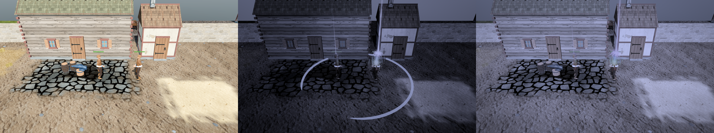

*Left to right: physical, entering spirit sight (the ripple ring spreads from the hero, auras appear), and the duel layer. From `tools/capture_spirit_duel_layer.gd`.*

## The seven soul lights

Every person carries seven lights up the body, and each has a level 0..5. The aura also has one **clarity** value 0..1. Six lights guard the six duel elements; the seventh, awareness, is sight and guards none.

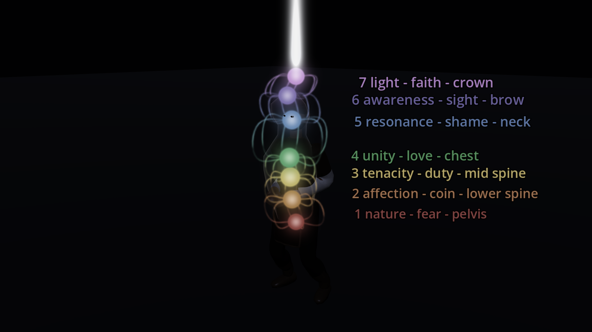

| Light | Code id | Anchor | Guards element | Colour |
|---|---|---|---|---|
| 1 | `aspect.nature` | perineum | fear | red |
| 2 | `aspect.affection` | below the navel | coin | orange |
| 3 | `aspect.tenacity` | solar plexus | duty | yellow |
| 4 | `aspect.unity` | mid sternum | love | green |
| 5 | `aspect.resonance` | throat (mid neck) | shame | blue |
| 6 | `aspect.awareness` | forehead | sight (none) | indigo |
| 7 | `aspect.light` | on the crown of the skull | faith | violet |

**Meaning, not morality:** bright lights = a strong soul, a closed light (level 0) = a weak point, low clarity = a troubled soul. The aura never says whether someone is good.

## Reading an aura by eye

What the player sees once sight fades in. The auras fade with the sight `blend`, so they come and go with the ripple.

### Level: size and brightness

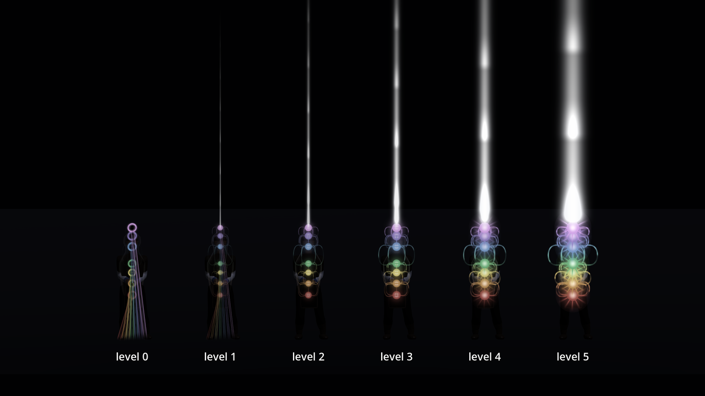

- **0 - black hole.** It keeps its colour: black at the centre, the colour returning in a concentric gradient toward a glowing rim, swirling inward. It drags a dark earth tether into the ground (see below).
- **1 - ember**, **2 - glow**, **3 - bright**, **4 - radiant** with a corona of rays, **5 - blazing.** A lit light is a small solid coloured bead (about 8 cm across at level 3, 10 cm at 5) with a crisp antialiased rim and only a faint tight halo, a touch brighter than the lit world around it but never sun-white; the core whitens a little and the halo widens with the level (maintainer requests 2026-10-11 and 2026-10-12). The edge stays one pixel sharp at any camera distance.
- Every light breathes slowly (about 0.2 Hz, phase-shifted per light). Position, not colour alone, tells which light is which.

### Field lines between the lights

Each pair of neighbouring lights (root-belly, belly-plexus .. brow-crown) is joined by six nested arcs, drawn as crisp thin lines (a solid core with a one-pixel antialiased edge, no soft blur up close), like iron filings round a bar magnet: an arc leaves the lower light, overshoots past it, swings out to the side and comes round into the upper light. The aura is a stack of six small dipoles up the spine; only the crown sends the sky beam on upward (maintainer request 2026-10-11). Comets of light climb each arc from the lower light to the upper; the arc colour blends its two lights, and a link is as strong as its weaker end (a black hole starves the arcs it touches). The mean level sets the speed and the spread. A faint fresnel **shell** hugs the torso and head, tinted by the level-weighted light colour.

### Clarity: calm or troubled

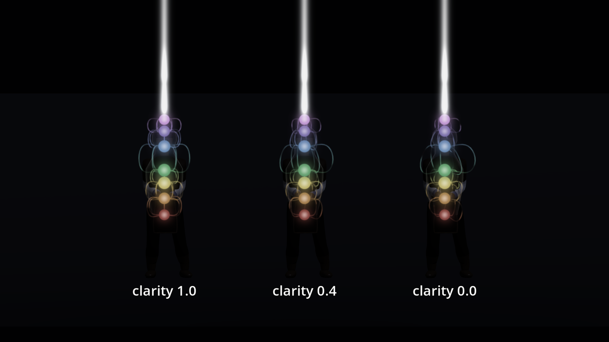

Low clarity carries the arcs through a divergence-free (curl) field in small jerks and lays dark smoke streaks along them, and makes the sky beam stutter in broken pieces. In motion the difference is much stronger than in a still; for the hero clarity comes from guilt (see [Aura data reference](#aura-data-reference-ss-2-r-1485-r-1496)).

### Sky beam and earth tethers

| Bright, clear soul | Dim, murky soul |
|---|---|
| 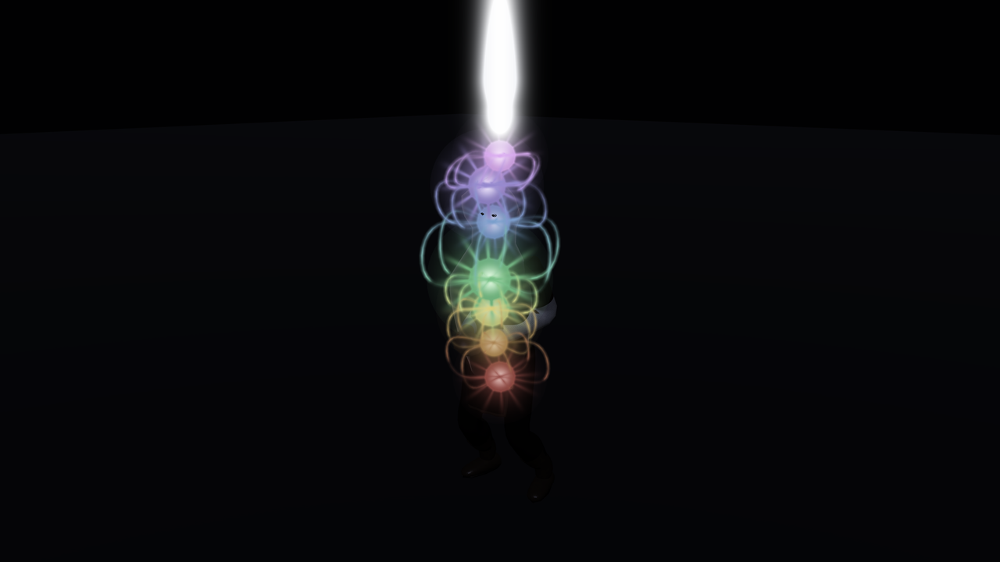 | 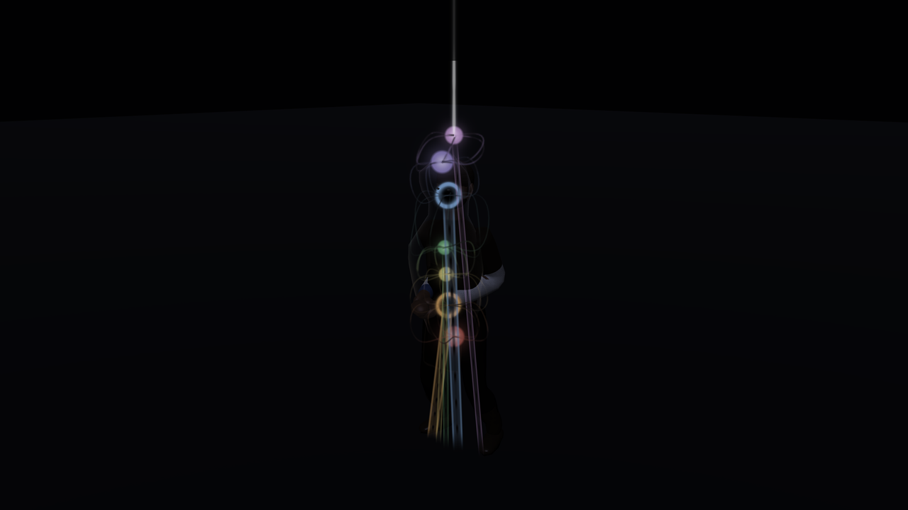 |
| **Whole soul (all 5): a pillar** | **All blazing, crown at 1: a thread** |
| 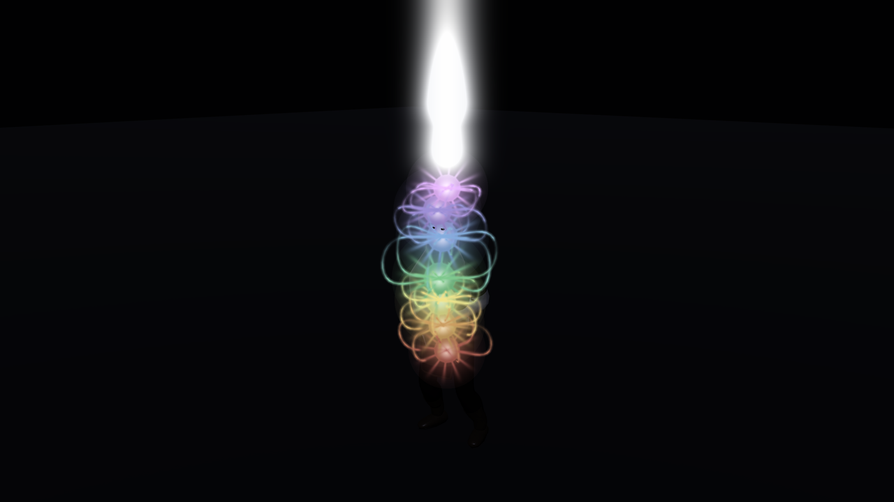 | 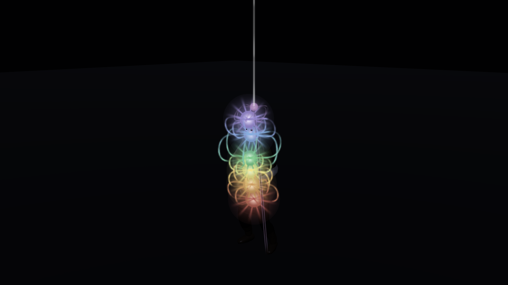 |

- **Sky beam** (the tie to the sky, maintainer requests 2026-10-09 and 2026-10-11): a white column rising from the crown light, with pulses climbing it. Strength = min(sum of all seven levels / 35, crown level / 5): every light together feeds it and the crown is the bottleneck, so a soul blazing everywhere but with a dim crown still shows only a thread, a closed or absent crown has no beam, and a whole soul at 5 has a pillar about as wide as the body, 12 m high. The width grows with the square of the strength. Reduced flashing slows the pulses and stills the stutter. It shows strength, not virtue.
- **Earth tethers** (the tie to the earth, the beam's counterweight, maintainer request 2026-10-11): every black hole drags a dark tether, rimmed with its light's colour, from the **root light** (all seven tethers start there, 2026-10-13) down into the ground under the body, with dark knots sliding down it; an ember (level 1) drags a faint thread, a light at 2 or above none. Strength per light = clamp((1.5 - level) / 1.5, 0, 1) (`SpiritAuraView.earth_tether_for_level`), on the float level the shader sees, so a word that dims a light in a duel briefly pulls it toward the earth too. The tethers splay apart toward the ground so several read as separate chains, each in the colour of the light it belongs to; read together they are the soul's attachments hanging from the root. Light balls are drawn at full brightness (`vivid_for_world`: the brightest channel is lifted after the saturation spread, white core only a hint).
- Together the beam and the tethers show whether a soul is held more by the sky or by the earth. Both are drawn at the full tier only; animals have no crown light and no beam, and an animal's absent lights have no tether.

### Crowds and animals

| Crowd: 12 full auras, the rest as glows | Dog: lights along the back |
|---|---|
| 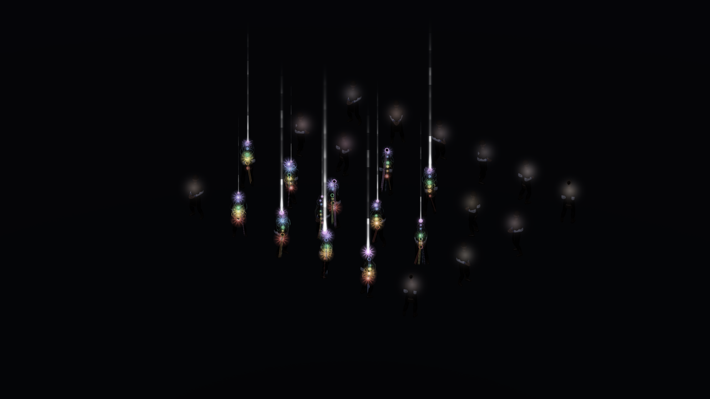 | 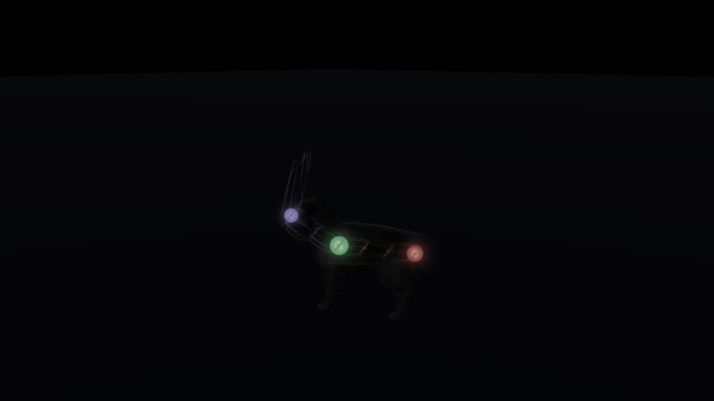 |

- **Crowd:** the 12 nearest beings within the sight radius get a full aura, everyone else within 40 m a single soft glow, nothing beyond (budget details in the [rendering reference](#aura-rendering-reference-ss-3-r-1486)).
- **Animals:** the same picture fitted to the animal's mesh bounds, lights along the back from the hindquarters (nature) to the head (awareness), scaled to the body. Lights a species does not have are absent rather than knots, so a dog shows no false weak point.

## Spirit sight toggle (SS-1, R-1484)

Status: implemented (task **R-1484**). Scope: the toggle, the grade, the ripple, the walk-only limits and transient state. Out of scope: auras (SS-3), reading (SS-4), Challenge and duel entry (SS-7), the observation grade swap and the witness stare reaction (not wired yet, see Limits).

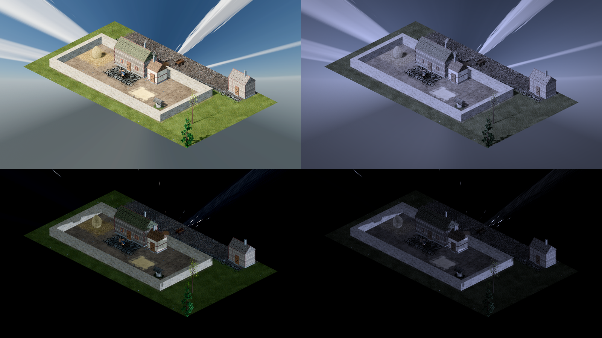

*`smithy_courtyard`, day (top) and night (bottom), physical on the left and spirit sight on the right. From `tools/capture_spirit_sight.gd`.*

**Player:** press `player_spirit_sight` (`V` / gamepad left stick click, rebindable; the left stick click no longer walks) anywhere and the same place turns cold and desaturated; press again to return. A ripple spreads from the hero over 0.6 s and runs back on exit; with reduced motion it is a 0.2 s cross-fade with no ring or displacement. Settings -> Gameplay accessibility -> **Spirit sight grade intensity** (0-100 %) scales only the look.

**While on:** walk speed only (keyboard, stick and click-to-move); no attack, heavy charge, guard, sidestep, roll or self-talk. Any interaction (key, click, click-to-travel arrival, cursor pickup) leaves sight first and then runs normally; the exception is **Challenge** on a duel-ready person (SS-7).

**Unavailable:** during dialogue (`demo_dialogue_active`), cutscenes (`cutscene_active`, joined by `CutscenePlayer` while playing), visible modal overlays (`modal_input_overlay`), a paused tree, swimming and diving, a running duel or observation, while the player is locked in an action or `combat_input_enabled` is off (scripted moves). If one of these starts while sight is on, sight drops at once on the next tick.

**Runtime:**

| Piece | File | Role |
|---|---|---|
| `SpiritSight` | `scripts/combat/spirit_sight.gd` | Child node `SpiritSight` of `Player`. Reads the input, tweens `blend`, composes the grade each frame and restores it before the next frame. |
| Ripple / tint / vignette | `scripts/combat/spirit_sight_ripple.gdshader` | Full-screen `canvas_item` pass on a CanvasLayer: blue-violet tint, soft vignette, travelling ring from the hero's screen position. |
| Walk cap and limits | `scripts/player.gd` (`is_walking`, `spirit_sight_blocked`, `leave_spirit_sight`) | |
| Exit before use | `scripts/interaction/interactable.gd`, `scripts/world/world_item_controller.gd` | |

**Grade (one recipe, never per map):** on the active camera or world `Environment`: saturation lerps to 0.25, ambient energy x0.6, ambient colour 35 % toward blue-violet, and the `Sun` light of that world x0.6; the shader adds the cold tint and the vignette. The weather keeps owning the physical values: the controller snapshots them after the weather update, grades, and restores the snapshot at the start of the next frame, so time of day and storms keep moving and the grade never compounds. Exit restores the latest ungraded values exactly.

**State:** `GameState.spirit_sight` (sight) and `GameState.spirit_encounter_active` (duel or observation) are transient and never written by `save_payload`; `load_payload` clears both and a replaced session state leaves sight. `GameState.in_spirit_world` is derived: true in sight or an encounter. Existing duel/observation code still assigns it, which sets only the encounter flag, so ending a duel never clears sight. Spellforge casting checks `spirit_encounter_active`, so casting stays limited to duels.

**Verify:**

```bash
godot --headless --path . --script tools/run_godot_tests.gd -- --filter=test_spirit_sight
tools/godot_render.sh --resolution 1280x720 --script tools/capture_spirit_sight.gd
```

## Entering a duel (SS-7, R-1490)

Status: implemented (task **R-1490**). Scope: how a duel starts from spirit sight (Challenge), how scripted duels pass through sight, and what layer the hero is in afterwards. Out of scope: new duel content and open-world duel triggers with stakes (SW-3, **R-1350**), the look of the duel (SS-6).

```
physical --V--> spirit sight --Challenge (E / A)--> duel --close--> spirit sight --V--> physical
                     ^
scripted duel -------+ (open_scripted switches sight on with its ripple first)
```

- **Challenge:** in spirit sight, a person with a duel record shows the prompt **Challenge** instead of their normal one. Interact (`E` / `Enter`, gamepad A) opens the duel in place and sight stays on. The duel opens in the same place on the frozen world with the arena panel. Outside sight the same person gets the normal interaction, and every other interactable still leaves sight first, then interacts (SS-1). No second challenge opens while one is running.
- **Duel record:** the first dialogue, in id order, with a non-empty `duel` block whose `participants` contain both the person's `char.*` id and the hero (`char.apprentice`). An observed quarrel between two other people (`dialogue.prologue.almshouse_quarrel`) is not a challenge. The person behind a talk sensor is `Interactable.character_id`; a sensor without one never offers a challenge.
- **Scripted duels:** `SpiritArenaHost.open_scripted(db, state, dialogue_id)` asks the scene's spirit-sight controller to switch sight on with its ripple (`enter_for_script`, which bypasses the toggle's availability rules), then opens the arena in the same call, so callers keep a synchronous contract. A scene without a controller only sets the transient flag. If the dialogue is not a duel, the sight it switched on is undone and nothing opens.
- **The gate:** `SpiritArenaHost.open` returns false and changes nothing when `GameState.spirit_sight` is off. Every scripted caller (the prologue, tests, capture tools) goes through `open_scripted`. `observe` (watching a quarrel) is not gated.
- **Smithy porter (New Game, R-1872):** `SmithyOpening` runs in the city, so the Player's own `SpiritSight` opens through `open_scripted` and closes with the reverse ripple when Kalev walks in.
- **Retired almshouse hall:** the staged hall that used to mount its own `SpiritSight` controller (`AlmshouseOpening`, `AlmshouseStage`) was deleted; tests that need the opening use `tests/godot/fake_smithy_city.gd` with the Player-less city's sight controller attached by hand. A skip leaves sight at once.
- **After the duel:** closing the arena ends the encounter (`spirit_encounter_active` false) but leaves `GameState.spirit_sight` on, so `in_spirit_world` stays true until the player leaves sight. While a host is open it sits in the group `spirit_duel_open`, and `SpiritSight.enforce_availability` does not cancel sight for the duel's pause or modal flags.

Runtime entry points: `scripts/combat/spirit_sight.gd` (`duel_for`, `challenge_dialogue`, `challenge`, `enter_for_script`, `challenge_host`, `CHALLENGE_PROMPT`), `scripts/combat/spirit_arena_host.gd` (`open` gate, `open_scripted`), `scripts/interaction/interactable.gd` (`character_id`, Challenge prompt and interact routing), `scripts/prologue/smithy_opening.gd`. Saves nothing: sight stays transient and a loaded game starts physical.

**Verify:** `godot --headless --path . --script tools/run_godot_tests.gd -- --filter=test_spirit_sight_duel_entry,test_smithy_opening`. `test_spirit_sight_duel_entry` covers the duel-record rule, the Challenge prompt only in sight, interact opening the duel with sight kept and no second challenge, the normal interaction outside sight, the `open` refusal outside sight, the scripted path turning sight on (ripple running) before `opened`, a scripted non-duel undoing sight, return to sight on close, keyboard `E` and gamepad A through `InteractionController`, and the smithy porter duel passing through sight.

**Limits:** a city Challenge opens the frozen-world arena panel, not the real-time 3D disc; mounting the disc needs the opponent's 3D rig, which the NPC presenters do not expose by character id yet. No live NPC talk sensor sets `character_id` yet, so the Challenge prompt appears in play only once SW-3 (**R-1350**) adds duel-ready people; the prologue porter is the only duel reachable today, so there is no in-city Challenge plate yet.

## Duel layer (SS-6, R-1489)

Status: implemented (task **R-1489**). Scope: what the world looks like during a 3D spirit duel and how it returns. Out of scope: starting a duel from sight (SS-7). The arena mechanics (hide list, restore, tests) are documented in [`SPIRIT_DIALOGUE.md`](./SPIRIT_DIALOGUE.md) "3D arena disc and duel layer".

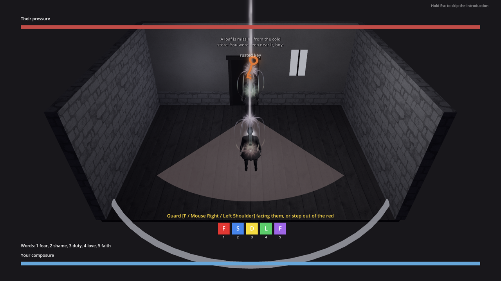

*The almshouse porter duel (historical plate): the hall keeps its walls, floor and door; furniture is gone and only the two fighters glow. Captured before the almshouse hall was retired; the capture tool no longer exists, and New Game now fights the duel in the city smithy (R-1872). Before R-1489 the hall was stripped to a bare floor disc. The outdoor sequence is the third panel of the [three-layer strip](#three-layers-on-one-map).*

The building stays: walls, floor, pillars, stairs and building shells keep their place and collision. Furniture, props, loose items, decor and clutter are hidden through one named list of node groups (`SpiritArena3D.HIDE_GROUPS`), as are people outside the duel. This replaces the ADR 0038 interior stripping to the floor.

- **Duel grade** (`scripts/combat/spirit_sight.gd`, `DUEL_SATURATION`, `DUEL_AMBIENT_ENERGY`, `DUEL_AMBIENT_COLOR`, `DUEL_SUN_SCALE`): nearly monochrome deep indigo, ambient light cut and tinted, sun cut to a sliver, every light but the arena key and fill off. `SpiritSight.duel_amount` (0..1, owned by the open arena) layers it over the sight grade in the same restore-then-compose pass, so closing returns exactly to the sight grade, and leaving sight afterwards restores the physical environment exactly. Sight is not cancelled by the duel's modal flags while `duel_amount > 0`. Stages without a controller (the almshouse prologue) are graded and restored by the arena through the same `grade_environment` recipe.
- **Fighters-only auras:** `SpiritAuraManager.set_duel_fighters` (group `spirit_aura_manager`) shows the two fighters' full auras at full strength regardless of the sight blend and hides every other aura; an empty list returns to the normal budget. A scene without a manager gets a private one for the duel.
- **Return:** closing the arena restores visibility, lights, environment and aura budget, and leaves the hero in spirit sight.

## Soul lights in a duel (SS-5, R-1488)

Status: implemented (task **R-1488**). Scope: the opponent's and the hero's soul lights changing the numbers of a `SpiritDuel`, the aura feedback and the element colours. Out of scope: who supplies the opponent's profile in play (SS-6/SS-7 callers).

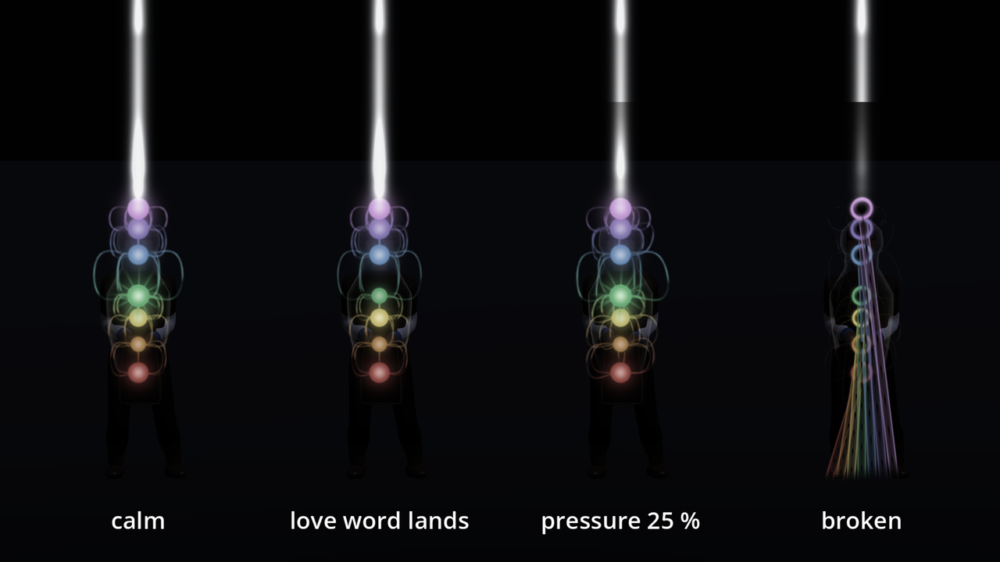

*Aura feedback: a landed love word dims the green chest light; at 25 % pressure clarity drains and the flow turns choppy; a broken opponent's lights collapse into black holes. Staged by `capture_spirit_auras.gd` (`duel_feedback`) through the same `SpiritAuraView` calls the duel uses.*

All numbers are constants in `SpiritDuel`. Light and element pair as in [the seven soul lights](#the-seven-soul-lights) (`SpiritDuel.light_for_element`); sight guards no element and never scales a word.

| Rule | Value |
|---|---|
| Opponent pressure pool | `PRESSURE_MAX x sum(levels) / 14`, factor clamped 0.5..2.0 (neutral soul = 60) |
| Opponent blow of an element | x(1 + 0.1 x (level - 2)) by the light guarding that element |
| Hero word into a closed light (level 0) / level 1 | x1.5 / x1.25 |
| Hero's own light | his words and replies x(1 + 0.1 x (own level - 2)) |
| Combined word product | trait x temperament x topic x light, clamped 0.5..2.0 as one (`SpiritDuel.word_product`); guilt stays outside |

- **Neutral soul:** `opponent_aura` / `hero_aura` null (or all levels 2, clarity 1) leave every number as before. The one deliberate difference: the 0.5..2.0 clamp now covers the whole product, so topic x temperament x trait beyond 2.0 is capped even without a profile.
- **Spells:** `cast_spell` (MagicResolver) keeps its NATURAL aspect scaling and applies no light factor. A spoken word that is the reply, and free word strikes (`land_word`), do use it.
- **Entry points:** `SpiritDuel.opponent_aura` / `hero_aura` (set before `begin`), `SpiritArenaHost.opponent_aura` / `hero_aura` (the hero's profile is derived from NATURAL ranks when only the opponent's is set) and `SpiritArenaHost.opponent_aura_view`.
- **Aura feedback** (`SpiritAuraView.bind_duel`): a landed reply or word dims the light that guards its element (`dim_light`, 70 % at most, recovers in under a second); falling opponent pressure lowers clarity down to 35 % (`set_pressure_fraction`, more turbulence); a broken opponent shatters the aura over 0.8 s (`shatter_now`, levels to 0, turbulence to 1), mirroring the SD-19 crack of `SpiritFormView`. Exchange results also carry `element` and `light_id`.
- **Colours:** `SpiritSpellCard.ELEMENT_COLORS` follow the soul lights: fear red, coin orange, duty yellow, love green, shame blue, faith violet.
- **Verify:** `godot --headless --path . --script tools/run_godot_tests.gd -- --filter=test_spirit_duel_aura,test_spirit_arena,test_spirit_word_spells,test_spirit_traits,test_spirit_magic`.
- **Limits:** only the almshouse porter duel supplies an opponent profile in play (R-1764, below); city Challenge duels still fight a neutral soul. The sky beam reads the profile's integer levels, so a shattered aura keeps its beam (visible in the "broken" panel).

### Reading a duel: words strike soul lights (R-1764)

Status: implemented (task **R-1764**). Scope: making the porter duel readable: which light a word hits, what it did, when the duel ends. Out of scope: aiming at a light other than the word's own, new art (P0-040), balance changes.

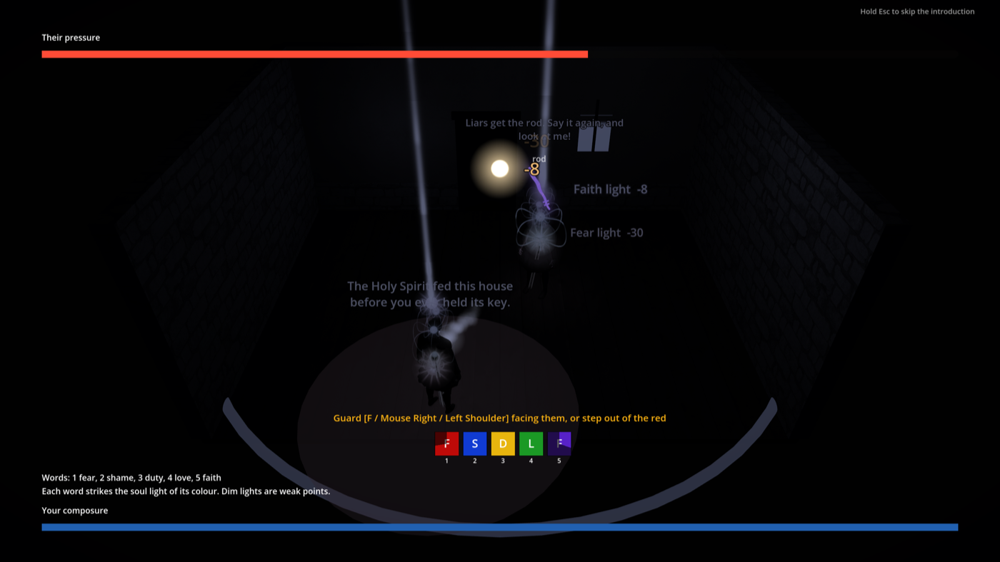

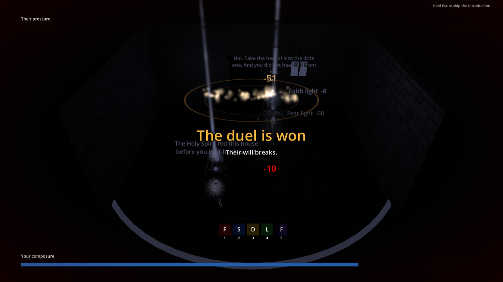

- **One rule, stated on screen:** each word (slots 1..5: fear, shame, duty, love, faith) strikes the opponent's soul light of its colour, per the table above (`SpiritDuel.light_for_element`). The hint under the words says so: "Each word strikes the soul light of its colour. Dim lights are weak points." (`SpiritArenaHost.LIGHT_RULE_HINT`).
- **The word flies at the light:** `SpiritArenaHost.light_target(element)` returns the world anchor of that light on the opponent's aura view; the bolt ends there (`SpiritWordBolt.setup(..., target_lift = 0)`). Without an aura view the bolt flies at the body as before.
- **The hit is marked at the light:** on arrival `mark_light_hit` flashes the light in its colour, dims it (`SpiritAuraView.dim_light`) and floats a label beside it, e.g. `Love light  -9`, with `weak point  x1.5` (closed light) or `x1.25` (ember) when the word found a weak point, or `no effect` when nothing was dealt. An answering word deals its pressure when cast (the dialogue moves on at once); its amount is shown when its bolt arrives. The opponent flinches on word hits as on replies (`SmithyOpening._react_to_exchange`). Marks rise and fade over `HIT_MARK_SEC` (1.6 s).
- **Weak points on the cast bar:** a slot whose light is level 0..1 on the opponent carries a `weak` tag over its tile (`SpiritCastBar`, slot field `weak`, `SpiritArenaHost.is_weak_light`).
- **The porter's real soul:** `SmithyOpening` feeds the porter's visible aura profile into the duel (`SpiritArenaHost.opponent_aura`), so the lights the player sees are the ones scored (pool size, weak-point factors). Before R-1764 the porter fought as a neutral soul.
- **No orbiting:** the opponent no longer circles the hero on `feint` or unlabelled lines; it holds (`SpiritArenaMotion.BEHAVIOUR_BY_KIND`). Players read the circling as the duel rotating for no reason.
- **A clear end:** a won duel shows a centred banner ("The duel is won", subtitle "Their will breaks." or "The dispute is settled.") and the arena closes itself after `WIN_AUTO_CLOSE_SEC` (2.5 s; `interact` closes sooner), so the prologue continues to Kalev without a hidden keypress. A lost duel shows "Your composure broke" with the Retry button; Retry hides the banner.
- **Verify:** `godot --headless --path . --script tools/run_godot_tests.gd -- --filter=test_spirit_word_spells,test_smithy_opening,test_spirit_arena_3d_motion` (light aim, hit label, weak flag, hint, porter aura wiring, banner and auto-close, no orbit).
- **Limits:** the duel grade desaturates the 3D world, so the hit labels and speech bubbles read in muted colour; the banner can overlap a speech bubble for its 2.5 s.

## Hero growth (SS-8, R-1491)

Status: implemented (task **R-1491**). Scope: the apprentice's starting lights, growth through NATURAL and the awareness-driven sight radius. Out of scope: a separate light currency, cap or save section (ADR 0041 revision 2026-10-09), `natural.lock_aspect` (not implemented in `GameState` yet).

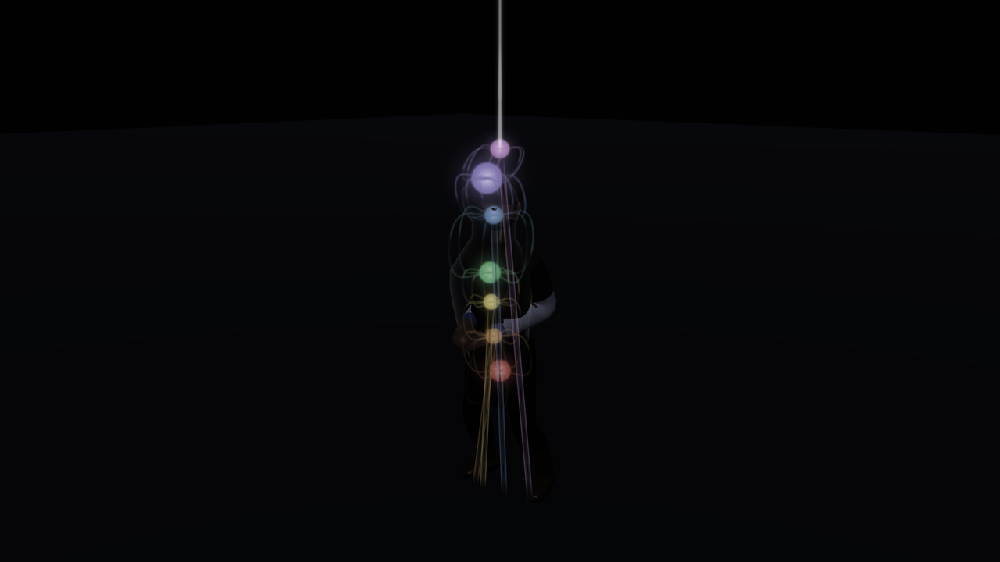

*The New Game apprentice: awareness at 3 (the clairvoyant gift), nature and unity at 2, the other lights embers trailing faint earth threads.*

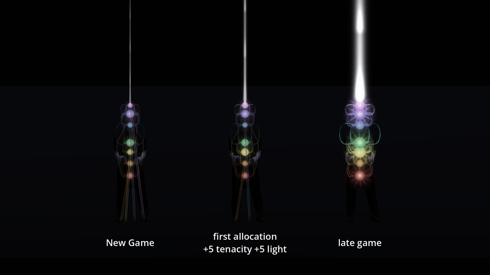

*Growth through NATURAL: New Game, the first Hingepuu allocation (+5 tenacity, +5 light), and a late-game build. Where points come from and what else a rank drives (spell multipliers, sub-stats) is pictured in [`NATURAL.md`](./NATURAL.md#35-soul-lights-the-aspects-seen-in-spirit-sight).*

Hero lights are his NATURAL ranks seen as levels (`SpiritAuraProfile.level_for_rank`, `RANK_BANDS = [5, 10, 15, 25, 40]`). They grow only through NATURAL (`natural.grant_points`, `natural.spend_point` at the Hingepuu): a spend that crosses a band brightens the light on the next aura refresh. The reader uses **stored** ranks, not temporary psyche-effective ranks.

| Stored rank | Level |
|---|---:|
| below 5, or locked | 0 |
| 5-9 | 1 |
| 10-14 | 2 |
| 15-24 | 3 |
| 25-39 | 4 |
| 40-50 | 5 |

- **Starting lights:** `SessionState` starts a New Game from `GameState.new_apprentice_game()`: nature 10, unity 10, awareness 15, the rest 5, i.e. levels 2 / 1 / 1 / 2 / 1 / 3 / 1 bottom-up. A bare `GameState.new()` stays at a flat 5 (level 1 everywhere), because the save loader, debug presets and scratch states build on it.
- **Sight radius:** `SpiritAuraProfile.sight_radius_for_level(level)` = 12 m + 4 m per awareness level above 2 (never below 12 m): 16 m at the start, 20 m at level 4, 24 m at 5. `SpiritAuraManager` re-reads it from the session state each frame while it follows the session; detached fixtures keep the `sight_radius` they set. The 12-aura and 40 m glow budget is unchanged.
- **Locks:** `level_for_rank(rank, true)` closes a locked aspect, but `natural.lock_aspect` is contract-only and GameState exposes no lock state. Runtime lock wiring must accompany that feature; no flags or second persistence source are invented here.
- **Reading depth:** the same awareness level (see Reading a soul).
- **Saves:** nothing new. Ranks travel in the existing `natural` section; old saves keep their stored ranks (aspects missing from a save load as 5), so a Kalev-era save starts with lights 1 and a 12 m radius.
- **Verify:** `godot --headless --path . --script tools/run_godot_tests.gd -- --filter=test_soul_lights_state,test_p7_011_natural_psyche,test_magic_natural_scaling` (baseline, band edges, locked = 0, a spend crossing a band, save round trip, old save, awareness -> radius).
- **Limits:** returning to the main menu and choosing New Game in the same process does not rebuild `SessionState.state` (pre-existing behaviour), so the baseline applies to the first New Game of each launch; a second New Game in that process inherits the previous run's ranks.

## Reading a soul (SS-4, R-1487)

Status: implemented (task **R-1487**). Scope: focusing a being in spirit sight, the reading card and its depth by the hero's awareness light. Out of scope: soul reading inside a duel (the arena owns the screen), temperament data for shipping characters (see Limits), saving anything.

| Awareness 3 (New Game) | Awareness 5 |
|---|---|
| 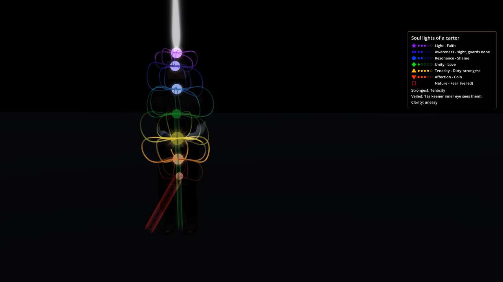 | 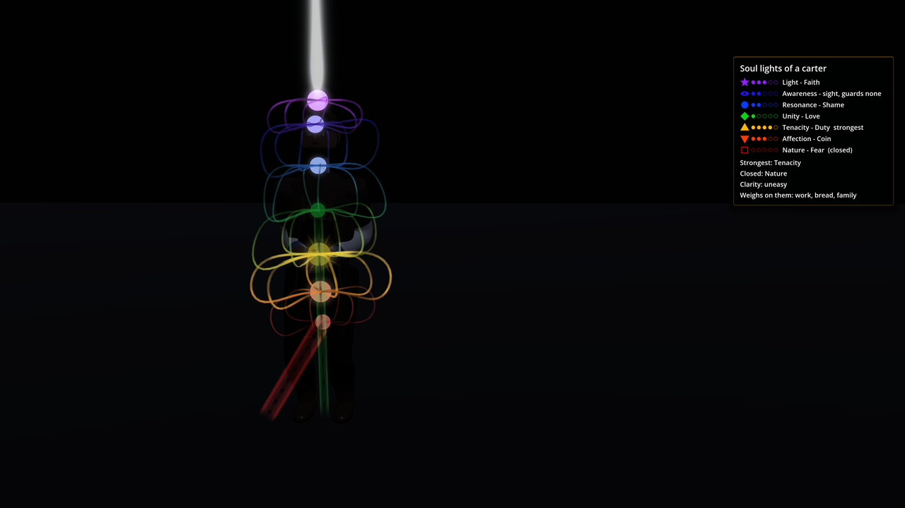 |

*The same resident read twice by `tools/capture_spirit_reading.gd`: the masked root light is veiled at the New Game awareness and shows as closed at 5, where the topic hint is added.*

**Player:** in spirit sight, rest the mouse cursor on a person or an animal with a full aura for 0.5 s (`SpiritReading.FOCUS_DELAY`). On a gamepad, or with a captured mouse, the camera centre is the focus: aim with the right stick. The card opens top-right and follows the look: a new being under the focus for 0.5 s replaces it; looking away closes it after 0.3 s (`LOST_GRACE`), so sweeping across a crowd does not flicker. Leaving sight closes it at once, and so does an opening duel. The hero never reads himself and a distant glow (outside the full-aura budget) is too faint to read. Moving the mouse returns to cursor focus; any gamepad stick or button switches to the camera centre.

**Card, crown on top so it reads like the body:** each light has its drawn glyph (root square, belly down-triangle, plexus up-triangle, heart diamond, throat circle, brow eye, crown star; shape, not colour alone, tells them apart), its aspect name from `GameState.NATURAL_ASPECT_DISPLAY_NAMES`, the duel element it guards (awareness: "sight, guards none"), five level pips and a mark for **strongest**, **closed**, **veiled** or **absent**. Under the lights: the strongest lights (ties all listed), the closed lights, the number of veiled lights, and clarity in words: **calm** (0.67 and above), **uneasy** (0.34 and above), **torn**. The wording describes strength and trouble, never virtue.

**Depth by the hero's awareness light** (`SpiritAuraProfile.hero_awareness_level`, the stored NATURAL rank, read live so a Hingepuu spend deepens an open card):

| Awareness level | Adds |
|---|---|
| 2 and below | the base card; closed lights listed in the being's `closed_mask` show as **veiled** (level unknown, not named as closed) |
| 3 | temperament tags (SD-15), sorted |
| 4 | veiled lights revealed as closed |
| 5 | "Weighs on them": the first three tags of the duel topic |

- **Animals:** lights a species does not have are **absent**, never closed weak points; animals show no temperament or topic.
- **Who and what:** the being's `char.*` id comes from the rig name (`<Actor>Rig`, as the aura manager resolves profiles) or a `char_id` meta. The title uses the character record's `name`, else a `display_name` meta, else "Soul lights". Temperament is the record's `temperament`, else the duel block's `temperament`. The topic is the person's own duel (`SpiritSight.duel_for`), else the stranger duel `dialogue.city.spirit_duel` (anyone can be dueled on `daily_burden`, R-1889).
- **Runtime:** `scripts/combat/spirit_reading.gd` (`SpiritReading`: `read`, `depth_for`, `clarity_word`, `context_for`, `char_id_for`, `pick_focus`, pure and static), `scripts/ui/spirit_reading_panel.gd` (`SpiritReadingPanel`, CanvasLayer 19: `tick`, `focus_point`, `use_pointer`, the dwell timer). `SpiritSight._ready` mounts it as `SpiritReadingPanel` next to `SpiritAuras` and hands it the aura manager; it reads the profile already on each `SpiritAuraView`, so the card and the aura can never disagree.
- **Saves:** nothing. The card is transient UI.
- **Verify:** `godot --headless --path . --script tools/run_godot_tests.gd -- --filter=test_spirit_reading` (depth at awareness 1..5, closed mask, strongest ties, clarity words, animal lights absent, content context, focus delay and grace, focus switch, live awareness change, gamepad camera-centre focus, the hero and a far glow never read, hides on sight exit and on a duel, mounted by SpiritSight). Plates: `tools/godot_render.sh --resolution 1280x720 --script tools/capture_spirit_reading.gd -- --out=res://docs/reports/images/spirit_reading`.
- **Limits:** no shipping character or duel record carries `temperament` yet (only the content examples), so the awareness-3 line appears in play only once authored data adds it. The aura itself still draws a masked closed light as a black hole; the mask conceals only the card's wording. A body without a rig (scripted figure) is read with animal rules. No in-city plate yet; the plates use the aura capture's stand-in grade.

## Soot and church services (planned, ADR 0046)

Status: planned (epic **R-1735**, tasks **R-1736..R-1743**; [ADR 0046](../adr/0046-church-services-and-collective-channeling.md) is **proposed**, no code until it is approved). Nothing in this section is runtime truth yet.

- **Soot** (*tahm*, CS-1 **R-1736**): a dynamic 0..1 burden per light on top of the NATURAL-driven level. It dims the light (effective float level), lowers clarity and, through the existing tether rule, drags the light toward the earth. Levels, ranks and duel multipliers are untouched.
- **Sources** (CS-3 **R-1738**): daily trade and season wear, Living City Fear, a lost spirit duel (on the guarded light), bestiary night visitors such as the luupainaja, guilt events.
- **Services** (CS-2 **R-1737**, CS-4 **R-1739**, CS-5 **R-1740**): at mass and vespers each congregant's crown beam threads to the priest, whose beam becomes a column through the vault, peaking at the elevation bell; pulses fall into step and clarity is pulled toward the priest's. The church cleans mainly the upper lights and only Christian guilt, scaled by the priest, the participant's faith light and regularity; a corrupt priest drains.
- **Hero** (CS-6 **R-1741**): passive attendance clears part of `guilt.church` and upper-light soot; an annual confession dialogue clears more; no NATURAL points.
- **Folk rites** (CS-7 **R-1742**): sauna, hiis and offering stone clean the root lights and `guilt.folk`.
- **Saves:** crowd soot is derived and never saved; the hero's and named NPCs' soot will be.

## Aura data reference (SS-2, R-1485, R-1496)

Status: implemented (tasks **R-1485**, **R-1496**). Pure profile data and offline validation; rendering, reading, duel scaling and hero growth are the sections above.

### Runtime API and precedence

`SpiritAuraProfile` (`scripts/combat/spirit_aura_profile.gd`) is a `RefCounted` value holder with `levels: Dictionary[StringName, int]`, `clarity: float` and `closed_mask: Array[StringName]`. Each call returns independent data; it does not mutate ContentDB, GameState, the RNG or any scene.

| Who | Levels come from | Clarity comes from |
|---|---|---|
| NPC with an authored `aura` block | the block (all seven required) | the block (default 1) |
| NPC without a block | stable hash of id, faction, profession, temperament | the same hash |
| Animal (`species`) | species table | 1 |
| Hero (`char.apprentice` or `is_player: true`) | live NATURAL ranks, [rank bands](#hero-growth-ss-8-r-1491) | live guilt |

- `SpiritAuraProfile.for_character(id, content_db, state)` reads `ContentDB.get_character(id)`. Null/unloaded DB or a missing record falls back to a stable id-only profile. `from_record(id, record, state)` accepts the same fields for in-memory citizen metadata.
- **Authored block** wins over derivation and species defaults. It requires **all seven** `levels` (integers 0..5); optional `clarity` defaults to 1. `closed_mask` defaults to an empty array and lists unique closed (level 0) light IDs concealed from shallow reading. It does not change levels or implement reading itself.
- **NPC fallback:** SHA-256 of compact JSON `[id, faction, profession, sorted_unique_temperament]`. `faction` and `profession` are optional strings; `temperament` is an optional string array on the character record (not a lookup of a dialogue's duel tags). The first seven digest bytes modulo 6 give the levels; byte 7 divided by 255 gives clarity. Missing fields use empty strings/array. The fixed golden-vector test pins the result across processes; tag ordering/duplicates do not change it.
- **Hero:** levels come live from `GameState.get_natural_aspect_rank`, not from authored aura levels or separate saved lights. The light list reuses `GameState.NATURAL_ASPECT_IDS`. An authored mask may conceal currently closed lights only. Clarity **always** comes from live guilt: `1 - max(GuiltLedger.debuff_tier(school)) / 3`, across all three schools. Tiers 0/1/2/3 give clarity 1/0.667/0.333/0. This depicts conflict, not a summed morality score. A null state is guilt-free.
- **Species:** `for_species(species)` or a record's optional `species` string uses the table below, case-insensitively. All unlisted lights are 0, clarity is 1, mask is empty. Unknown species use the default rather than humanoid derivation. The animal path does not offer a duel. An explicit authored block can override species defaults.

| Species | Nature | Unity | Awareness |
|---|---:|---:|---:|
| dog | 3 | 3 | 2 |
| horse | 3 | 2 | 1 |
| cat, cow, pig, goat | 3 | 2 | 0 |
| sheep, default/unknown | 2 | 2 | 0 |
| chicken, crow | 2 | 1 | 0 |

### Authoring and validation

```json
"aura": {
  "levels": {
    "aspect.nature": 0, "aspect.affection": 1, "aspect.tenacity": 2,
    "aspect.unity": 3, "aspect.resonance": 4, "aspect.awareness": 5, "aspect.light": 1
  },
  "clarity": 0.75,
  "closed_mask": ["aspect.nature"]
}
```

The optional block and metadata are defined in `schemas/character.schema.json`. Existing records without an aura remain valid. The semantic validator emits `AURA_LIGHT` for unknown light IDs (levels or mask) or duplicate mask IDs; `AURA_LEVEL` for non-integer/out-of-range levels or masking a non-closed light. Structural errors, missing levels and clarity outside 0..1 emit `SCHEMA`. Aura diagnostics run before schema rejection, so the stable codes are not hidden by a schema error. Valid/invalid fixtures live in `content/examples/{valid,invalid}/character.aura*.json`.

### Persistence and verification

No new save fields. NPC/species profiles are rebuilt from content; hero levels and clarity are recalculated from the existing persisted NATURAL ranks and guilt ledger, including after save/load. Spending NATURAL points changes a light as soon as its rank crosses a band. No `soul_lights` save section is introduced. Keyboard/gamepad input is unchanged.

```bash
python3 -m unittest tests.python.test_validate_content -v
godot --headless --path . --script tools/run_godot_tests.gd -- --filter=test_spirit_aura_profile
python3 tools/validate_content_examples.py
```

Tests cover the cross-process hash vector, metadata changes and tag reordering, independent copies, missing records, authored/default precedence, ranges and masks, all guilt tiers/schools, all rank-band boundaries and lock conversion, live NATURAL point spending and save/load, species and element mapping.

## Aura rendering reference (SS-3, R-1486)

Status: implemented (task **R-1486**). Scope: drawing every nearby person and animal's aura while spirit sight is on, the LOD budget and reduced flashing. The look is described in [Reading an aura by eye](#reading-an-aura-by-eye). Out of scope: reading (SS-4), automatic animal registration (see Limits).

| Piece | Path | Role |
|---|---|---|
| `SpiritAuraView` | `scripts/combat/spirit_aura_view.gd` | One aura: three draw calls (ribbons, shell, lights) on shared meshes built once; updates the seven anchor uniforms every frame, never the meshes. Tiers `NONE`, `GLOW`, `FULL`. |
| `SpiritAuraManager` | `scripts/combat/spirit_aura_manager.gd` | Budget and visibility; mounted as `SpiritAuras` under the SS-1 controller (`scripts/combat/spirit_sight.gd`) and fades with its `blend`. |
| Flow shader | `scripts/combat/spirit_aura_flow.gdshader` | Field-line arcs between neighbouring lights (`RIBBON_LINKS` x `LINES_PER_LINK`) and the fresnel shell (`shell_mode`). |
| Light shader | `scripts/combat/spirit_aura_light.gdshader` | The seven billboarded lights, the sky beam (quad 7, upright billboard, `beam_strength`) and the seven earth tethers (quads 8..14, down to the `ground` uniform at the body's footing) in one draw call, or one soft glow (`glow_only`). |
| Anchor list | `SharedCharacterRig.SPIRIT_AURA_ANCHORS` | The one const list of anchors: a point `t` along the `hips`->`head` bone segment (the rig has no neck bone, and the chest bone height varies between MPFB bodies) plus a forward offset. Rigs join group `spirit_aura_bearer`. |

- **Budget** (`SpiritAuraManager.assign_tiers`): nearest first from the hero rig (`PlayerRig`), ties in candidate order. The 12 nearest within the sight radius get a full aura, every other being within 40 m gets a single soft glow, nothing beyond. The radius follows the hero's awareness light ([Hero growth](#hero-growth-ss-8-r-1491)). Tiers are re-ranked every 0.25 s; bone anchors follow every frame. Views are created on first need, kept with their body (a child, freed with it) and hidden, not rebuilt, when sight closes.
- **Profiles:** `PlayerRig` gets the hero profile (`char.apprentice`, live guilt clarity, re-read on every re-rank). Actor rigs are named `<Actor>Rig`; a ContentDB record `char.<actor>` supplies authored data, otherwise the stable id-only derivation applies. `register(body, profile)` adds or overrides any body.
- **GL Compatibility:** plain vertex/fragment shaders, uniform arrays, no compute, no Decal, no textures (P0-040). The lights and the field lines get a depth-only bias toward the camera (`depth_biased_clip` in both aura shaders) so the torso does not hide them; their screen position stays on the bones, so an orbiting perspective camera sees no parallax slide (review plate: `tools/godot_render.sh --script tools/capture_spirit_aura_parallax.gd -- <tag>` writes left/front/right shots to `build/spirit_aura_parallax/<tag>/`). Buildings still occlude.
- **Reduced flashing** (`gameplay.reduced_flashing`): shimmer drops to 15 %, the breathing pulse and the corona drift to 15 %, the black-hole swirl stops turning, the beam pulses slow and its stutter stills.
- **Save/load:** nothing saved. Views are transient presentation.
- **Frame budget** (`--bench`, crowd of 25 rigs, hero at the centre, 2026-10-09): 12 full auras and 13 glows add 49 draw calls (12 x 3 + 13 x 1) to the 851 the rigs already cost, and 29.7k primitives (+8.5 %). Per-frame CPU work is seven bone reads and three uniform writes per visible aura; meshes are never rebuilt. GL Compatibility reports no GPU timing, and the minimized render window is throttled by macOS, so the bench prints measured render time only as a noisy hint. `tools/run_performance_report.sh --quick` measures the continuous city since R-1536, but it does not switch sight on, so the aura cost is not in that report.

```bash
godot --headless --path . --script tools/run_godot_tests.gd -- --filter=test_spirit_aura_view
tools/godot_render.sh --resolution 1280x720 --disable-vsync --script tools/capture_spirit_auras.gd -- --bench
```

`test_spirit_aura_view` covers anchors following bones and the rig, shared meshes that are never rebuilt, crown on the skull and brow on the forehead, level -> intensity, clarity -> turbulence, the sky beam (needs the crown, grows with all lights, the crown as bottleneck), the earth tethers (black hole full, ember faint, absent none, ending at the body's footing), reduced flashing, the 12 / 40 m budget, hidden outside sight and shown inside, absent animal lights and the animal layout.

## Unclothed in sight (R-1870)

Status: implemented (task **R-1870**). Scope: adult census citizens are drawn without clothes while spirit sight is open: sight shows the soul and the body, not rank or trade. Out of scope: heroes and named characters (Tier 1 bodies have no nude model yet; they stay dressed until their own task), held items (weapons, shields and tools stay in hand), anatomical detail beyond the MakeHuman base mesh.

- **Who:** every rig whose body has a `layers/nude.glb` twin: the 28 adult and elder census bodies `citizen_{m,f}_{adult,elder}_*`. Never minors: child bodies have no twin and are refused by name (`child`, `apprentice`, `boy`, `girl`), and the player rig (`PlayerRig`, `char.apprentice`) is skipped.
- **When:** `SpiritAuraManager` undresses every eligible rig in group `spirit_aura_bearer` on its 0.25 s re-rank once the sight fade reaches 0.5, so citizens streamed in during sight are caught too, and restores them all the frame sight closes.
- **How** (`scripts/combat/spirit_undress.gd`, `SpiritUndress`): a crowd body bakes its outfit into one mesh with no skin under it, so the nude body is a separate skinned layer. `undress(rig)` mounts it as garment `spirit_nude` and hides the baked `Anatomy_CrowdBody` and every mounted garment (hoods, aprons, armour, duty hats), remembering each mesh's visibility; `restore(rig)` unmounts it and puts that visibility back. Both are idempotent.
- **Assets:** `assets/characters/realistic/<body>/layers/nude.glb`, about 11.5k triangles (the crowd body budget) and 0.4-0.5 MB each; textures link the body's shipped skin, eye, brow, lash and hair maps, so no new texture ships. Build or rebuild one with `Blender --background --python tools/assets/realistic_humans/build_human.py -- --character=<body> --nude-only`: the same MPFB body as the crowd body, no garments, no braies, no covered region dropped. The shipped body GLB and its textures are not touched. Child bodies exit with an error.
- **Save/load:** nothing saved; undressing is transient presentation.
- **Limits:** the nude layer has no LOD steps, so in sight a far citizen draws its full 11.5k triangles instead of the dressed body's LOD mesh (also hidden in sight). Heroes and named characters stay dressed until their own nude bodies exist.

```bash
godot --headless --path . --script tools/run_godot_tests.gd -- --filter=test_spirit_undress
tools/godot_render.sh --resolution 1280x720 --script tools/capture_spirit_undress.gd
```

`test_spirit_undress` covers a twin for adult and elder bodies of both sexes, only the nude layer drawn in sight (with a hood layer mounted), no cloth material on the layer, idempotent undress, the exact meshes drawn again after sight, and children, the apprentice and a hero untouched. The capture writes `build/spirit_undress/{dressed,sight,sight_back,restored}.png` (three adults and a child; plates are kept out of `docs/`).

## Save state and IDs

- Stable ids: the NATURAL aspect ids `aspect.nature`, `aspect.affection`, `aspect.tenacity`, `aspect.unity`, `aspect.resonance`, `aspect.awareness`, `aspect.light` as light ids; input action `player_spirit_sight`.
- Saved: nothing new. Hero lights are the already saved NATURAL ranks; spirit sight, auras and duel visibility are transient.

## Verification

Each task names its filter: `test_spirit_sight`, `test_spirit_aura_profile`, `test_spirit_aura_view`, `test_spirit_reading`, `test_spirit_duel_aura`, `test_spirit_arena_3d`, `test_spirit_sight_duel_entry`, `test_soul_lights_state` (rank bands and apprentice baseline), `test_spirit_undress`.

Every image on this page is a reproducible capture (GPU run, never a visible window):

| Plates | Command |
|---|---|
| `spirit_sight/sheet.png` | `tools/godot_render.sh --resolution 1280x720 --script tools/capture_spirit_sight.gd` |
| `spirit_auras/*.png` (all eleven) | `tools/godot_render.sh --resolution 1280x720 --script tools/capture_spirit_auras.gd -- --out=res://docs/reports/images/spirit_auras` |
| one aura plate only | add `--only=levels_0_to_5,duel_feedback` (file names without `.png`) |
| `spirit_duel_layer/outdoor_before_duel_after.png` | `tools/godot_render.sh --resolution 1280x720 --script tools/capture_spirit_duel_layer.gd -- --out=res://docs/reports/images/spirit_duel_layer` |
| `spirit_duel_layer/almshouse_duel_hall.png` | historical, no longer reproducible (the almshouse hall and its capture tool were retired) |

The aura plates stand on a dark stand-in for the sight grade, not a real map; the sight and duel-layer plates are real scenes.

## Limits

- Observation mode (SD-06) still uses its own dimming; NPC stare reactions (SD-09 reuse) are not wired. The ripple origin uses the 32 px/cell logic-to-world bridge.
- The sight and duel grades are a whole-screen saturation adjustment. `SpiritAuraView` pushes the frame's `adjustment_saturation` to the aura shaders (`world_saturation`), which pre-saturate their colour by the inverse so the lights and field lines keep their hue; colour channels cannot go below zero, so under the duel grade (0.1) they still pale a little; untagged props stay visible until their spawner joins a hide group.
- Animals are drawn only when registered with `SpiritAuraManager.register` (as the capture does). Ambient animal actors do not join the aura group yet; wiring them needs a task that may touch the animal presenters.
- Anchors are fractions of the hips->head bone segment, tuned on the MPFB man, woman and child (`test_upper_lights_sit_on_the_neck_forehead_and_crown`); the head's own nod is not followed, and seated bodies keep the same fractions.
- A shattered aura keeps its sky beam (the beam reads integer profile levels, not the shatter).

Open balance questions: light-level multipliers, the 12-aura budget in dense crowds, and how many NPCs get an authored `aura` block versus a derived one.
