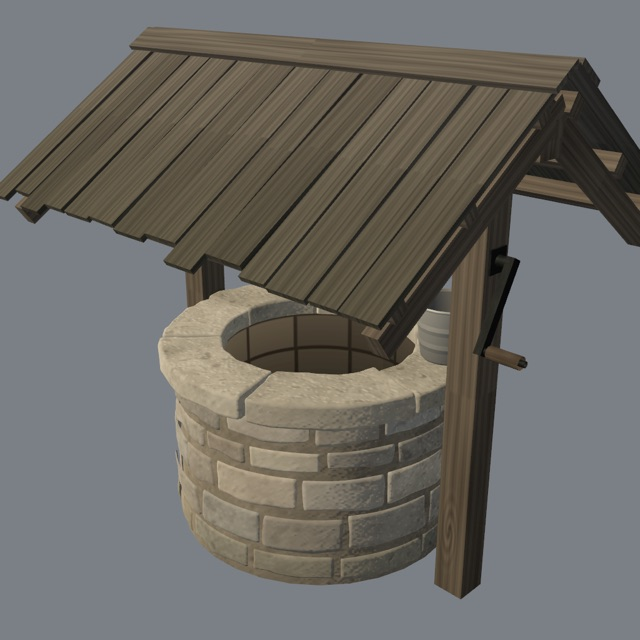
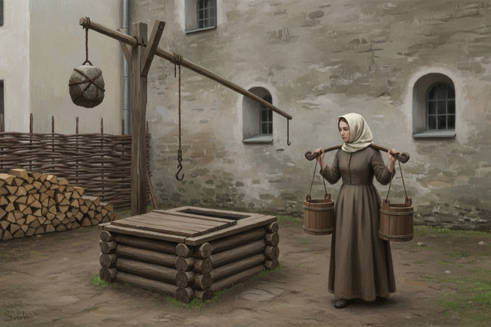
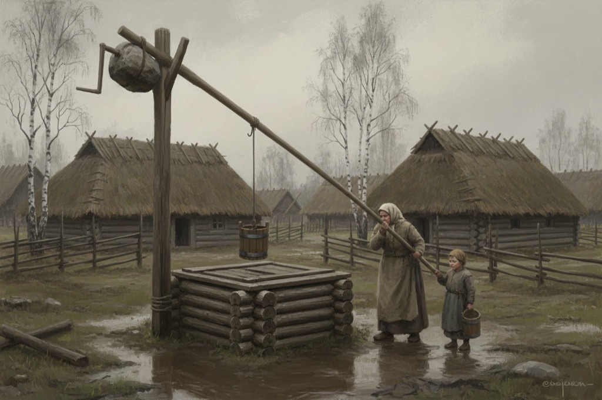
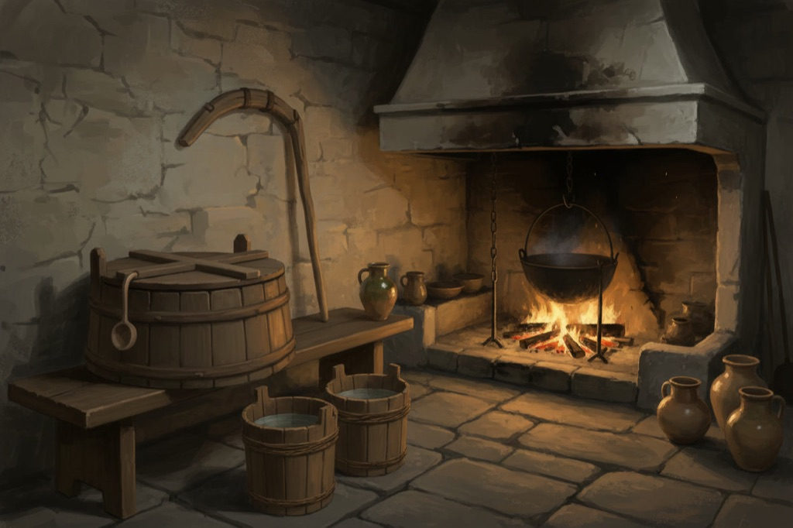

# Water supply: wells, buckets and household water

Status: planned (epic **R-1815**, tasks **R-1816**..**R-1824**). Nothing on this page is built yet except the pieces listed under **Today**.

Scope: where the people of Reval and its villages get fresh water in 1343, the wells they draw it from, the vessels they carry and store it in, who fetches it and when, and how the protagonist can draw water. Evidence: [`water-supply-1343`](../../history/dossiers/dailylife/water-supply-1343.md) dossier and section 1 of [`reval_domestic_infrastructure_1343.md`](../reports/reval_domestic_infrastructure_1343.md).

Out of scope: thirst, hygiene or any needs simulation for the player or citizens (survival sims are out of scope in [`AGENTS.md`](../../AGENTS.md#scope)); the Ülemiste canal (granted 1345), the Harju-gate stone conduit and timber pipes to public wells (late 14th century), which are all after 1343; the 1375 Rataskaev wheel well; sewers.

## Today

- **One well model**, `scripts/map/view3d/map_view_well_models.gd` (`obj.well_stone`, `well` prop kind): coursed limestone shaft, ring of curb slabs, two posts with a log windlass and crank, hemp rope, gabled board roof, fake-depth shaft shader, tinned-iron bucket. See [Object catalog](./OBJECT_CATALOG.md) (Public draw-well).

  

  It is a decent "storybook" well, with four realism problems: (1) the tinned-iron bucket, where an ordinary 1343 well has a coopered wooden one; (2) the curb is high and the gabled roof makes every well look like a precinct well; (3) there is no board lid; (4) there is only one type, so a back yard, the castle and a village would all get the same well.
- **The model is only used by the legacy district maps** (`map_view_mesh_builder_prop_models.gd`). In the seamless city the 7 Reval well points (`poi.well.dominican`, `poi.well.bishop_garden`, `poi.well.castle`, `poi.well.yard.pikk_north`, `poi.well.yard.lai`, `poi.well.yard.viru`, `poi.well.yard.harju`) and the regional-site wells (`harju.poi.well` "sweep well on the common", `padise.poi.well`) are **invisible points**: citizens walk there but nothing is drawn.
- **Citizens already have water errands**: `tools/city/build_citizen_runtime.py` sends residents to the nearest well (`water` / `well` kinds, "Drawing water at the well" in `citizen_roster.gd`), and washerwomen work at wells. They carry nothing and do nothing there.
- **Households have a bucket**: `HouseholdLayout` puts `obj.water_bucket` (0.25 per resident, `content/objects/_household_needs.json`) near the hearth.

## Design

### Water sources

| Place | Source | Well type | Confidence |
|---|---|---|---|
| Burgher and craft plots | private well in the rear yard, often shared by 2-4 plots | `yard`: limestone-lined shaft, square timber collar, board lid, sweep or hook pole | B (placement), construction U -> plausible composite |
| Dominican close, Bishop's garden | precinct well | `public`: limestone curb, windlass, small roof | A (existence) |
| Street on the Rataskaevu belt | at most one plain street well | `public` without roof, no wheel | B/C |
| Toompea castle | castle well | `castle`: wide dressed shaft, big windlass with hand-wheel, roof, iron-hooped bucket | plausible composite |
| Villages (Harju) and farmsteads | log-crib well with a sweep, or a spring box | `sweep`, `spring` | plausible composite (simplified later form) |
| Padise monastery | cloister well | `public` | plausible composite |
| Härjapea river, mill pond | washing, brewing, animals; not drinking | none | B rule |

No drinking from the harbour, moat or ditches.

### Vessels

| Object | Form | Notes |
|---|---|---|
| `obj.water_bucket` | coopered pail, 14-18 tapered staves, 2-3 withy hoops, two raised ears with a rope or withy bail; ~10-12 l | empty/full states; replaces the tinned-iron bucket on wells |
| `obj.water_yoke` (new) | carved shoulder beam ~1.4 m with a neck hollow and two rope/hook drops | servants and women in town; Estonian term to confirm |
| `obj.water_tub` (new) | coopered tub ~60-100 l, board lid, wooden dipper on the rim | one per lived-in house, by the hearth |
| rain butt | half-barrel under an eaves channel | richer yards |
| smithy slack tub | quench tub by the anvil | Kalev's forge |

### Fetching water

- Each household has one deterministic **carrier** chosen from the census: servant or maid, else an adult daughter, else the wife, else an apprentice or boy; peasants send women and children.
- **1-3 trips a day** (dawn, before the midday meal, evening), from the clock, no saves.
- Out with empty buckets, back with full ones: a yoke with two buckets (town servants and women), one or two buckets by hand (others), one small pail (children). Full buckets slow the walk and add a lean.
- At the well: a 20-40 s draw (windlass crank, sweep pull, or dip at a spring); others queue about 1.5 m apart. This is where gossip barks belong.
- Each trip brings ~20-25 l. Household use is an `invented` (D) 5-8 l per person per day for cooking and washing; beer and small beer stay the everyday drink. The tub's water level is a function of the clock and the trips, so the morning tub is full and the evening tub low.

### Player

The protagonist can take an empty bucket, draw water at any well, carry it (slower walk, spilled if dropped) and pour it into the smithy slack tub or a house tub. This is a chore hook for Kalev (`flag.smithy_tub_filled_today`), not a needs system.

### Seasons

Frost puts an ice skin on tubs, buckets and the well water and makes drawing slower; snow sits on lids and well roofs; rain fills rain butts.

## Making the wells look real

1. **Wooden, not metal, buckets** with withy hoops and stave ears (WS-1).
2. **Three town types and two rural types** instead of one (WS-2, WS-3). A low curb or timber collar with a board lid is the common case; a roof only on precinct and castle wells.
3. **Wells where people live**: in rear yards, shared between plots, not in the middle of streets (WS-5).
4. **Context dressing**: a trodden muddy apron round the well, a wet dark ring on the curb and lid, a spare bucket, a trough for animals at village wells, nettles and plantain at the edge (reuse the vegetation and weather-ground systems).
5. **Life around it**: the morning and evening queue of carriers with yokes (WS-6).
6. **Seasons**: ice and snow (WS-9).
7. Build the models as procedural, deterministic GDScript meshes like the current well, so they share the city's lighting, weathering and wind; AI image tools are used for concept references only, not as meshes.

### Concept references

AI concept images (Leonardo, Gemini 2.5 Flash Image, 2026-10-12) for form and mood. They are references, not production art, and carry errors that must not be copied: the yard image shows a metal downpipe and glazed windows (post-1343 for an ordinary yard), the village image puts a crank handle on the sweep, and the kitchen image is a later-style hood.

| Yard well with sweep, maid with yoke | Village sweep well (`vinnkaev`) | Kitchen water tub by the hearth |
|---|---|---|
|  |  |  |

## Tasks

| ID | Task | Depends on |
|---|---|---|
| **R-1816** WS-1 | Water vessels kit: coopered bucket, yoke, kitchen tub with dipper, rain butt; wooden bucket on the well | - |
| **R-1817** WS-2 | Town well variants: `public` (rework), `yard`, `castle` | (WS-1 bucket, can stub) |
| **R-1818** WS-3 | Village sweep well and spring box | (WS-1 bucket, can stub) |
| **R-1819** WS-4 | Render a well model at every well point in the seamless city and regional sites | WS-2, WS-3 (current model as fallback) |
| **R-1820** WS-5 | Private yard wells in rear yards; citizens use their own or shared well first | WS-4 |
| **R-1821** WS-6 | Citizens fetch water visibly (carrier, yoke/buckets, draw at the well, return) | WS-1, WS-4 |
| **R-1822** WS-7 | Household water tub with a clock-driven level; smithy slack and drinking tubs | WS-1 (WS-6 for trip times) |
| **R-1823** WS-8 | Player draws water and fills the smithy slack tub | WS-1, WS-2, WS-4 |
| **R-1824** WS-9 | Wells and water through the seasons | WS-1..WS-4, WS-7 |

Related: **R-1594** (farm-suburb yards get a well, cart and woodpile) should use the WS-2/WS-3 models.

## Verification (when built)

Each task names its test and capture. The page moves to `Status: implemented` with the runtime entry points, stable IDs (`poi.well.*`, `obj.water_*`), test files and screenshots once WS-1, WS-2 and WS-4 land.

## Limits

- Well construction, depth and the yoke in 1343 Reval are not attested; the forms are composites labelled in the dossier.
- Daily water use per person is an invented gameplay value.
