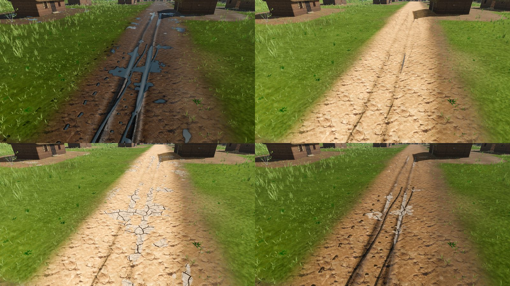
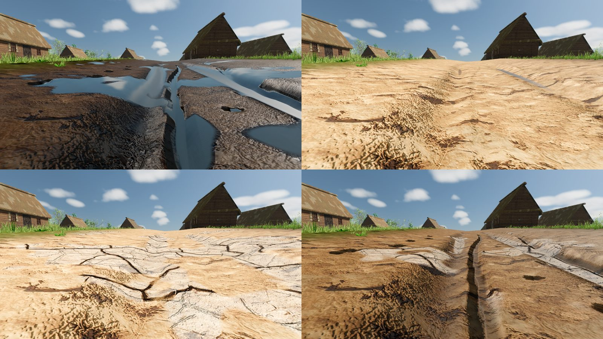
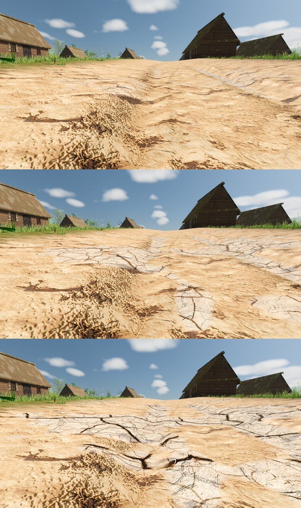
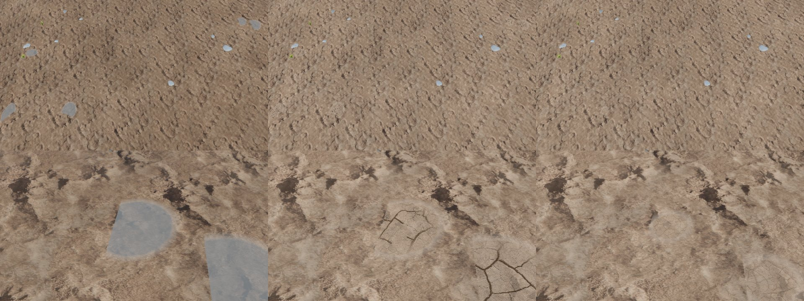
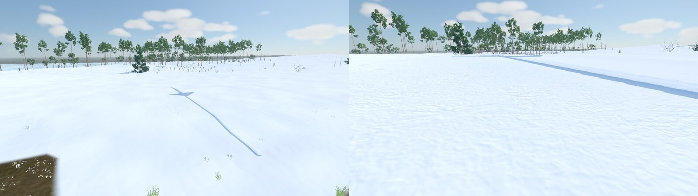
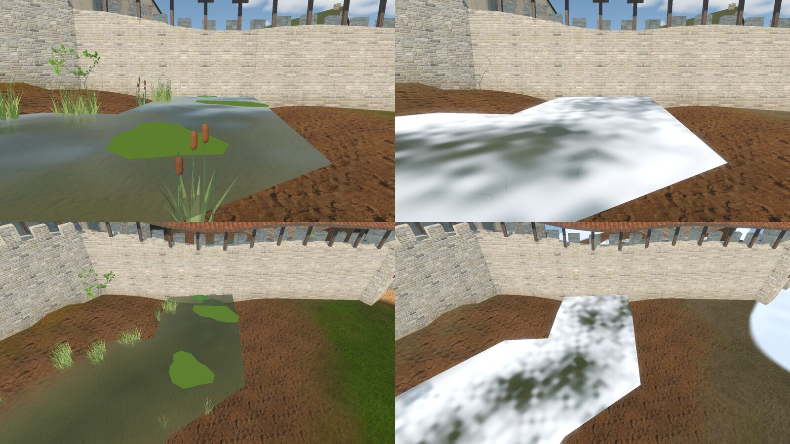

# Weather on the ground: puddles, drought and cracked earth

Status: implemented (task **R-1516**). Scope: the seamless Reval city ground (`city_ground.gdshader`) and the district-map puddle decals (`MapView3D`, `map_view_puddle.gdshader`). Rain fills puddles in the hollows, ruts and prints of bare soil; long sunny spells can turn into a drought that bakes those same basins into cracked clay; rain soaks the cracks back to loose earth before puddles form again. Out of scope: vegetation wilting and gameplay effects of drought (crops, wells, NPC talk). Winter ground (snow, cold soil, ice) is summarised under **Snow and ice** below; its owning page is [`SEASONS.md`](SEASONS.md) ([ADR 0045](../adr/0045-seasons.md)).

## What the player sees

| Ground state | When | Look |
|---|---|---|
| Puddles | During and after rain | Water stands in the deepest hollows, ruts and prints first and widens as rain goes on; dries at `PUDDLE_DRY_PER_SECOND` after the rain stops. |
| After rain on cobbles (R-1748) | While `puddle_wetness` holds | Cobbled streets and squares stay dark-wet and glossy (polished stone crowns low roughness, sand joints duller), water stands in sunken patches of the paving with ragged edges, and the joints round each pool brim with a mirror film. Pools reflect the sky. |
| Dusty | Sunny weather after the puddles are gone | Bare soil turns paler and more matte (`ground_dryness` up to `DRYNESS_FAIR_CAP` = 0.4). No cracks. |
| Cracked | Only in a drought | The basins that hold puddles bake into polygonal cracked clay, deepest basins first, spreading as dryness climbs past ~0.45. Cracks grade with age: a fine hairline net (4-10 cm cells) first, then deep furrows between 15-35 cm polygons open from the basin centre outwards as dryness nears 1. A pale silt rim lies just outside the crust. |
| Soaking | First rain on dry ground | The rain is absorbed first: dryness falls, the crust darkens and shrinks back into loose earth. No puddle and no water film in the ruts until the ground is soaked (dryness 0). |
| Puddles again | Rain continues on soaked ground | Normal puddle fill resumes. |

Cracks appear only on bare soil (splat earth and mud, cart roads, ploughed fields). Turf, sand, rock and paving never crack. Cracks outlast the drought that made them: only rain closes them.

Review plates (cart road; top-left rain, top-right dry, bottom-left drought, bottom-right first rain on cracks):

Crack gradation, low camera, dryness 0.55 / 0.75 / 1.0:

## Simulation (`scripts/map/view3d/sky_weather_3d.gd`)

All rates are per weather second, so `time_scale` speeds or pauses them consistently.

- `ground_dryness()` (0..1). Rises only when it is not raining and `puddle_wetness()` is 0, by `DRYNESS_GAIN_PER_SECOND` times sun height times `1 - 0.85 * cloud_coverage()`. Outside a drought it stops at `DRYNESS_FAIR_CAP`; in a drought the gain is `DRYNESS_DROUGHT_GAIN` times faster and the cap is 1. Nothing but rain lowers it.
- Rain soaks first: each second rain removes up to `rain_intensity * DRYNESS_SOAK_PER_SECOND` of dryness, and only the share the soil could not absorb fills puddles (`_advance_ground_water`). So the order is always cracks, loose earth, puddles.
- Drought spell: `drought_active()`, `drought_seconds_left()`. When the sky changes to `clear` or `cloudless` (a real change, never a "stay" re-pick) over ground with dryness at least `DROUGHT_ONSET_DRYNESS`, a roll on the separate drought RNG starts a drought with `DROUGHT_START_CHANCE`, lasting `DROUGHT_SECONDS`. During a drought `_pick_drought_weather` only moves between clear, cloudless and cloudy, so no rain can form. Any rain (including a forced debug shower) ends the drought.
- Debug and tests: `start_drought(seconds)` opens (or with 0 ends) a drought now.
- The drought RNG is a separate stream (seed `WEATHER_SEED + 211`), so drought rolls never change the normal weather sequence.

## Rendering (`scripts/city/city_ground.gdshader`)

- Uniform `ground_dryness`, pushed each frame by `CityWorld3D.apply_time` from `WeatherPresentation.ground_dryness`.
- The crust uses the same basin mask as puddles (`hollow * soft`, deep ruts, on flat ground) with a level that rises with dryness, mirroring how the water level rises with `puddles`.
- Texture: `cracked_albedo` = `assets/materials/pbr/cracked_earth/cracked_earth_albedo.png` (1024 px, seamless, `crack_scale` 0.35 repeats per world unit). Only an albedo ships: the shader is near the GL Compatibility sampler limit, so crack relief is derived from the plate's luminance by finite differences. The plate's mean tone is divided out so the crust keeps the local soil colour, then pulled towards pale silt.
- Crack gradation: the shader samples the same plate twice, coarse (`crack_scale`) and fine (`crack_scale * 3.5`). `crack_age` = `smoothstep(0.3, 0.95, crack_amount)` times how deep the point lies inside the crust, so the basin centre matures first. Fine cracks carry weak relief and fade to half as `crack_age` grows; the coarse plate's contrast exponent rises from 0 to 1.6 with age, so furrow shoulders darken in turn and the gaps widen rather than fade in. Plate: `low_crack_gradation.jpg` (dryness 0.55 / 0.75 / 1.0).
- Source plate: OpenAI `gpt-image-1` (Leonardo had no tokens), processed by `tools/process_leonardo_terrain_textures.py --only cracked_earth` (family `cracked_earth`, `albedo_only`). Prompt and provenance: `assets/materials/pbr/cracked_earth/prompt.json`, `assets/SOURCES.csv`.

### Cobbled paving (R-1748)

Before R-1748 the water level was multiplied by `1 - paving`, so a wet town square stayed dry. Now `water_depth` mixes the soft-ground basin with a paving basin by `paving`:

- `cobble_sink`: three octaves of value noise (0.13, 0.47 and 1.9 per world unit) mark shallow sunken patches a few metres across with a ragged rim. `cobble_pool` adds 15% in the sand joints (`FieldStone.stone`, kept as `paving_stone`). The waterline sits higher than on earth (`1.3 - puddles * 0.72`): stone drains through its joints, so only the deepest patches fill.
- `joint_film`: once `puddles` passes ~0.3, the joints within reach of a pool hold a film (75% of the puddle look).
- Wet paving: `wet` gains `puddles * paving * 0.6`, so stone stays dark while puddles stand; `wet_paving` lowers roughness to 0.24 on stone crowns and 0.5 in joints and lifts specular to 0.5.
- Reflections come from the sky radiance (Mobile has no screen-space reflections), so pools mirror the sky but not the houses.

Plate: [after rain before/after](../reports/images/city_lighting/after_rain_before_after.jpg) (`tools/godot_render.sh --resolution 1600x900 res://tools/capture_city_lighting.tscn -- --states=after_rain`).

## District maps (`MapView3D`, `scripts/map/view3d/map_view_puddle.gdshader`)

District maps have no basin mask in their terrain shader; their puddles are prebuilt decals (the `Puddles` MultiMesh in each scatter chunk). The same decals now carry both ground states:

- Visibility: `MapView3D._sync_puddle_visibility()` shows the `Puddles` nodes while `puddle_wetness() > 0.001` (water) or `ground_dryness() > PUDDLE_CRUST_DRYNESS` (0.45, crust); `MapView3D.puddle_layer_visible(wetness, dryness)` is the rule. A fair spell (dryness up to 0.4) shows no basins.
- Uniforms: the same sync pushes `puddle_wetness` and `ground_dryness` into the shared puddle material through `MapViewWaterMaterials.apply_ground_water()` (only when a value changed). The water film fades in with `puddle_wetness`.
- Crust: `crack_amount = smoothstep(0.45, 1.0, ground_dryness)`. The crust grows from the basin centre outwards (35% of the waterline radius at the onset, the full basin at dryness 1), with a faint silt rim just outside. Crack maturity follows the city shader: a fine hairline net first, coarse furrows from the centre as dryness nears 1. As rain soaks the ground, dryness falls, the crust shrinks and fades out at 0.45, and water appears only once dryness is 0.
- Texture: the same `cracked_earth_albedo.png`, sampled in world space (`crack_scale` 1.1 per world unit, denser than the city's 0.35 because district puddles are only ~0.3-0.7 wu across), so neighbouring basins share one crack field. Relief comes from the plate's luminance by finite differences. It is the shader's only sampler, well under the GL Compatibility limit of 16.
- Local soil tint: the decal is alpha-blended and cannot read the ground beneath it, so the scatter builder writes the soil tone into each puddle's instance colour (`MapViewMeshBuilderConfig.PUDDLE_CRUST_SOIL`: mud, dirt, farm soil; alpha 1 = may crack). Plates draw at low alpha so the real ground shows through; gaps darken the soil tone. Puddles on cobblestone and castle paving have alpha 0: a dry puddle on stone simply vanishes.

Review plate (top: gameplay camera, bottom: close camera; left to right: rain, drought at dryness 1, early drought at 0.62):

## Snow and ice

Status: partial (ADR 0045). Snow on the ground and ice on the moat, stream and lakes are implemented; ice on puddles and the sea is planned (SEASONS task 6). Full detail lives in [`SEASONS.md`](SEASONS.md); this section records how winter meets the ground water above.

| Ground state | When | Look | Status |
|---|---|---|---|
| Cold soil | Mean temperature below 9 C (`SkyWeather3D.ground_warmth()`, smoothstep 1..9 C) | Sun-baking scales with warmth; near freezing (warmth under `COLD_DAMP_WARMTH`, about 3 C) soil re-dampens at up to `COLD_DAMP_PER_SECOND`, so cool spring sun still dusts bare soil; below about 5 C no drought starts, at 1 C or below the sun no longer dries soil at all, so winter never shows cracked crust. Puddles evaporate at down to 15% speed (`COLD_PUDDLE_DRY_SHARE`) and linger. | implemented |
| Snowfall | Rain weather while the date's `snow_share` is 0.5 or more (about November to early April) | Snow emitter replaces rain streaks. Only the liquid share wets soil or fills puddles (`_advance_ground_water`), so snowfall leaves dryness and puddles alone. | implemented |
| Settled snow | Date's snow cover (`SeasonState.snapshot`), not the live snowfall | `city_ground.gdshader` lifts the ground by the baked `CitySnow` depth: drifts, bare paving and roofs, deeper in woods. Snow is thinned over puddle basins (`1 - 0.9 * puddle`) and rock. Walking leaves trenches and prints, footsteps crunch. | implemented |
| Ice on moat, stream, lakes | `SeasonState.ice_cover_target(ICE_FRESH)` | Shallows freeze first, then open water; running water later; waves die out; snow and cracks on the ice. | implemented |
| Ice on puddles | `SeasonState.ice_puddle` (freezes at -0.5 C, no lag) | Not rendered yet: a winter puddle in the city or a district decal still draws as open water. | planned |
| Sea ice | `SeasonState.ice_sea` | Not rendered yet. | planned |

Settled snow in January (left: trench walked through a drift, right: low camera along the trench):

Moat through the year (left: 15 July, right: 15 January; top: bank camera, bottom: high camera). In January the water is frozen with snow on the ice, and reeds and lilies are gone:

Plates: `tools/godot_render.sh --script tools/capture_snow_prints.gd -- --date=1343-01-15` and `tools/godot_render.sh --script tools/capture_city_season.gd -- --date=1343-01-15` (also `1343-07-15`). Output in `build/season/`. Snowfall looks: `tools/capture_snowfall.gd` (see SEASONS).

## Save and load

`SkyWeatherState` saves `ground_dryness`, `drought_seconds_left` and `drought_rng_state` (contract: [`SKY_WEATHER_STATE_CONTRACT.md`](../SKY_WEATHER_STATE_CONTRACT.md)). Saves from before R-1516 load with dryness 0 and no drought.

## Verify

- `godot --headless --path . --script tools/run_godot_tests.gd -- --filter=test_ground_drought` (fair spell never cracks, puddles block baking, drought cracks and they outlast it, rain soaks before puddles, drought sky never rains, drought onset rules, save round trip, old saves).
- `--filter=test_sky_weather_state` (payload field list).
- `--filter=test_puddle_drought_crust` (district-map `Puddles` node visible in a drought with the crust uniforms and crack plate set; hidden on dry or fair-dusted ground).
- District plates: `tools/godot_render.sh --script tools/capture_puddle_drought.gd` (all-mud test district, rain / dry / drought / early drought, gameplay, low and close cameras; `-- --base=dirt` for dirt). Output in `build/puddle_drought/`.
- Plates: `tools/godot_render.sh --script tools/capture_city_mud.gd -- --tag=drought --wet=0 --puddles=0 --dryness=1` (also `--tag=soak --wet=0.6 --puddles=0 --dryness=0.6`). Output in `build/mud/`.

## Limits

- Cobble puddles (R-1748) reflect only the sky, not buildings or people, and the paving basins are noise, not real street drainage (gutters, kennels).

- Weather "stay" outcomes in `_pick_next_weather` do not reset the state timer (pre-existing), so a stay re-rolls every frame until the sky changes. The drought roll is tied to real weather changes to stay independent of that.
- Drought odds follow the calendar only through cold soil (`ground_warmth`): no drought below about 5 C mean, otherwise the same odds in every warm month. `tests/godot/test_ground_drought.gd` covers spring dusting and frozen-ground re-damping; the drought tests run in midsummer because the default campaign date (21 April) is too cool for a drought.
- Puddles do not freeze and there is no sea ice (see **Snow and ice**). Settled snow follows the date's cover curve, not the snow that actually fell, so a snowfall does not deepen it.
- District-map crust exists only where a puddle decal was scattered (`PUDDLE_CHANCE`); there is no dusty-soil tint on district terrain below the crack threshold.
