[Landmark sites index](../CITY_LANDMARK_SITES.md) · [All systems](../README.md)

# St Catherine's Dominican friary (task R-1718)

Status: implemented (task **R-1718**, with **R-1727** and **R-1124 / LM-02** folded in; maintainer decision 2026-10-13). Stable ID: `site.st_catherine`, landmark `landmark.st_catherine`. [Manifest](../../../content/world/reval_city/sites/st_catherine.json) · [Model builder](../../../scripts/city/sites/st_catherine_builder.gd). Scope: the friary as a walled close of the seamless city with an enterable church, a walkable cloister, west forecourt and service yard, enterable ground-floor rooms in the ranges, and the census friary household living there on a horarium (maintainer request 2026-10-13: "doors from the garth cannot be entered", "grass grows on the flags", "no monks"). Out of scope: the dormitory upstairs, the sanctuary mechanic at the gate, the church services of ADR 0046 for the laity, the friars' own dialogue, 15th-century enlargements.

| Aerial from the south-west | Cloister garth |
|---|---|
| 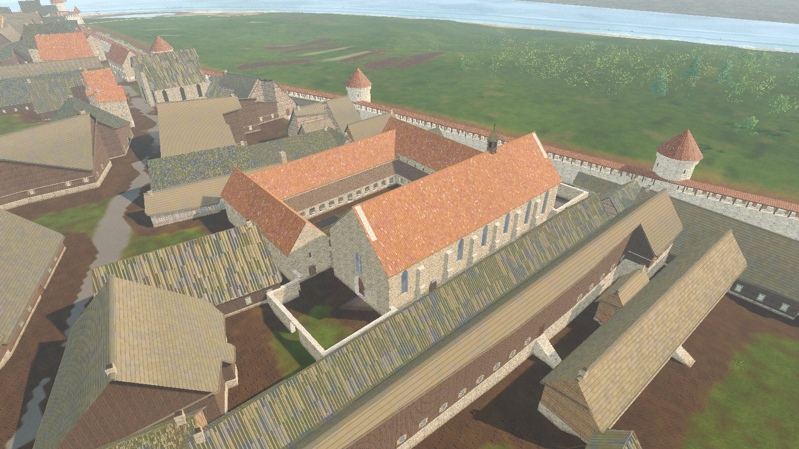 | 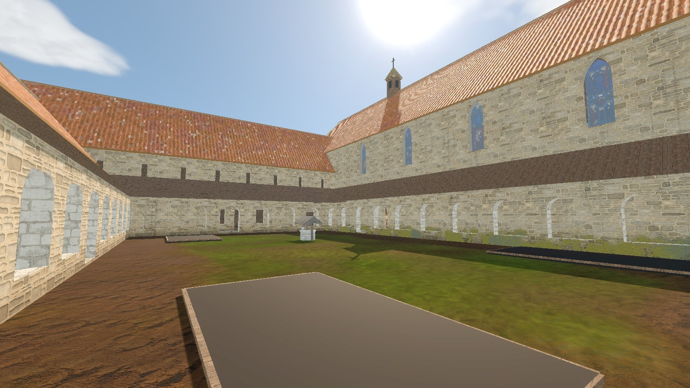 |

**Function in 1343:** a friary of the Order of Preachers (re-founded 1246 by Prior Daniel of Visby with eleven friars): preaching to townsfolk, confession, a school, a brewery and fish trade through the port. Not a parish. The precinct is a church-law seam where the town Vogt treads carefully (sanctuary, composite).

**Plan as built** (site-local metres, +x east along Katariina käik, +z south; anchor (159.5, -44.3), rotation 5°; Kühnert's plan reduced to the c. 1300 phase, `plausible composite` unless marked):

- **Close (`close.polygon`):** 72-77 × 52 m between Katariina käik (south and west), the Munga houses (north) and Müürivahe (east), with a notch at the north-west for the Vene corner house. The dossier's 58 × 95 m target does not fit the plan's streets. Limestone rubble wall 3.6 m with an ashlar coping; an open **west gate** (gate W1 of the dossier, off the lane to Vene) and an open **yard gate** onto Katariina käik. The plan compiler drops the 13 strip houses inside or overlapping the close through `replaces`; trees and shrubs stay out of `close.polygon`.
- **Church** (`attested` stone church c. 1300; plan composite): a 50 × 17 m single-span preaching hall, 11 m walls, one tile roof at 45° with an open tie-beam roof inside, no tower (a small louvred timber bell turret on the ridge, as mendicant statutes allowed). Buttresses on the lane and the east end, tall lancets with stained glass, a three-light east window, a two-light west window over the **profiled west portal** (`door.st_catherine.west`, three orders, [City doors](../CITY_DOORS.md#landmark-portals-r-1693)). Inside: nave for the laity with flags and ledger slabs, a pulpit on the south wall, two side altars before a **stone rood screen** with the rood above, the **friars' choir** three steps up with stalls and desks along both walls and the high altar. Doors: west portal, south door onto the lane (laity, the terrace level door), cloister door from the south walk.
- **Cloister:** a garth (31 × 18.5 m) with the friary **well** at `poi.well.dominican` and three plank-edged herb beds, ringed by a limestone arcade on a dwarf wall (entry arches mid-side and opposite the cloister door) under lean-to tile roofs.
- **Ranges**, ground floors enterable after Kühnert's plan (medievalheritage.eu summary; `plausible composite` where marked). Each room has a studded, braced or ledged leaf (`CityDoors`), lime-washed walls and a boarded ceiling under the upper floor; upstairs windows stay shuttered.
  - **East range** (`attested` as the first range, finished c. 1300), from the church northwards: **sacristy** (door from the choir, vestment press and plate chest), **chapter house** (square, four rib-vaulted bays on one octagonal pillar, stone bench round the walls, the prior's seat and a lectern; door from the east walk between two unglazed openings), the narrow room (later the library) holding the **day stair to the dormitory**, and the **old refectory** in the north-east corner (two long boards with benches, the prior's high table, trenchers, jugs and bread). The dormitory upstairs is not walkable.
  - **North range** (`plausible composite`; Kühnert's north-wing refectory is c. 1500): **kitchen** under the smoking stack (hearth, work table, fuel, water, crocks) and **stores** (herring barrels, malt, grain, salt, the cellarer's cupboard).
  - **West range:** the **granary** at the church corner, entered from the passage off the forecourt (sacks of rye and malt), and the **lay brothers' hall** (a long board with benches, the stair to their dormitory).
- **Service yard** (`reserve`, packed earth and paving): shingled brewhouse, keg stack, malt sacks, cooper's staves, firewood, a cart, herring casks, grain, a fish-splitting table, a tub and baskets. All existing props (`CitySiteProps`, `MapViewMeshBuilderDistrictLifeProps`, `obj.basket_wicker`); no new models.

**Rooms and HUD:** `room.nave` "St Catherine's (nave)", `room.choir` "St Catherine's (friars' choir)" (both lift `Church/Upper` and `Church/Roof`), the four cloister walks `room.cloister_{south,north,west,east}` "St Catherine's (cloister walk)" (lift `Cloister/Roof`), and the range rooms `room.sacristy`, `room.chapter_house`, `room.dorter_stair`, `room.refectory`, `room.kitchen`, `room.stores`, `room.granary`, `room.lay_hall` ("St Catherine's friary (...)"; they lift `Ranges/Upper`, `Ranges/Ceilings` and the range roofs). Anchors: `anchor.st_catherine.high_altar`, `.west_gate`, `.garth_well`, `.yard`, `.chapter_house`, `.refectory`, `.dorter_stair`, `.kitchen`, `.lay_hall`. Review spawns (`--city-spawn=`): `st_catherine_choir`, `st_catherine_chapter`, `st_catherine_refectory`, `st_catherine_cloister`.

**Ground cover:** no grass grows on a site floor or through a solid (`CitySite.covers`, so the flagged walks and rooms stay bare), and inside the walled close the turf is kept short like a scythed garth (`CitySite.in_close` makes `CityGrass.wildness_at` 0). The same applies to St Michael's close.

## Community: the friars' day

The census household `hh.inst_st_catherine_friary` (24 friars, 8 lay brothers, 5 servants and a cook; [Citizens](../CITIZENS.md)) lives in the close instead of at the old church door. The manifest's `community` block lists the walkways inside the close and the seats; `tools/city/build_citizen_runtime.py` (`apply_communities`) gives each member a home, exact seats and a horarium, and `CitizenRoster` plays it like any timetable. One bell calls the house: times shift by a few minutes per person, not by the town's half hour.

| Hour (about) | Friars | Lay brothers | Servants and cook |
|---|---|---|---|
| 02:00-03:10 | night office (matins) in the choir stalls | asleep | asleep |
| 05:00 | lauds and prime in the choir | 04:40 prime in the nave behind the screen, then work | water at the garth well (05:20), kitchen |
| 06:10 | chapter in the chapter house (the prior at the east seat) | brewhouse, garth beds, granary, stores, the gate | kitchen; food from the market (08:40) |
| 06:50 | study in the cloister walks | | |
| 08:50 | terce and the conventual mass in the choir | | |
| 10:00 | between the hours: study, preaching at the market cross, questing for alms (forum, fish landing, Viru road), or hearing confessions in the nave (by seniority) | | |
| 11:25 | dinner in the old refectory, a brother reading | 11:55 dinner at the lay table | 12:35 dinner; the cook keeps the kitchen |
| 12:20 | study | work | fish from the landing (13:10), then the brewhouse or the stores (14:35) |
| 14:25 / 15:00 | none in the choir, then the afternoon's work as at 10:00 | | |
| 16:50 | vespers | | kitchen (17:35) |
| 17:50 | supper (collation) in the refectory | supper | |
| 18:35-19:20 | compline, then up the day stair to the dormitory (the great silence) | compline in the nave, then up their stair | home at 19:00 |

Dress: friars wear the white wool habit with the black hood and shoulder cape (`DOMINICAN_WHITE` in the runtime builder, the monastic hood of [Citizen wardrobe](../CITIZEN_WARDROBE.md)); the black cappa needs its own garment (the knights' order mantle carries a cross). The information card reads "Singing the hours in the choir", "At chapter in the chapter house", "Begging alms for the friary" and so on.

Walkways join the street graph only at the west gate W1 and the yard gate (`Graph.add_interior`): street places never snap onto them, so townsfolk never route through the cloister, and the yard is a dead end reached from Katariina käik.

Sources for the day: the Order's constitutions and Humbert of Romans on study for preaching (hours at about 3-hour intervals; terce, sext and none short); Kühnert's room functions; [Liturgical calendar, spring 1343](../../../history/dossiers/religion/liturgical-calendar-spring-1343.md); [Dominican brewery and fish yard](../../../history/dossiers/religion/dominican-brewery-fish-yard-1343.md). Clock hours for April Reval, the split of friars between study, preaching, questing and confession, and the lay brothers' jobs are `plausible composite`.

| Terce in the choir (09:20) | Chapter (06:30) |
|---|---|
| 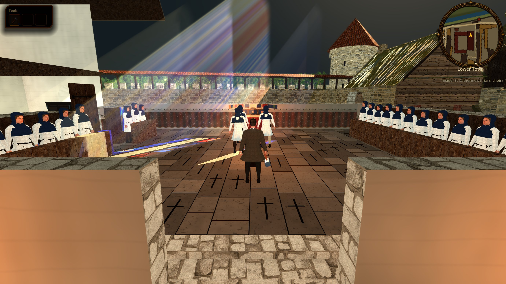 | 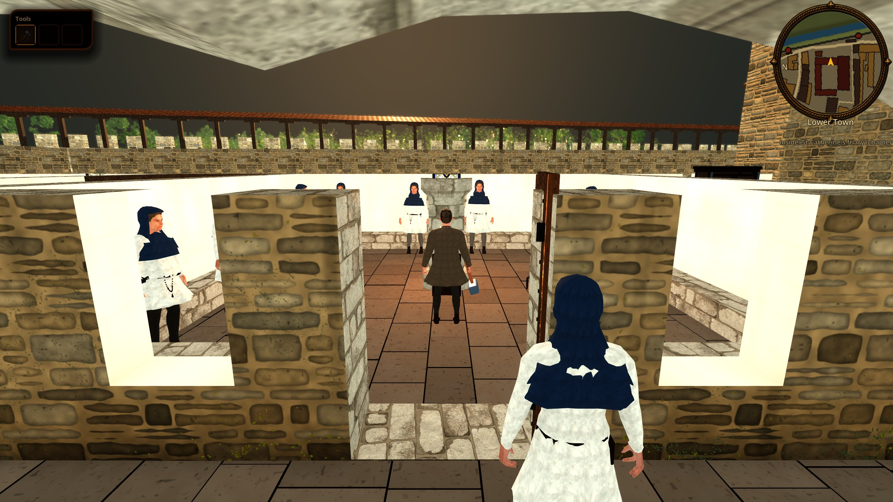 |

| Dinner in the refectory (11:40) | Study in the cloister, lay brothers in the garth (07:30) |
|---|---|
| 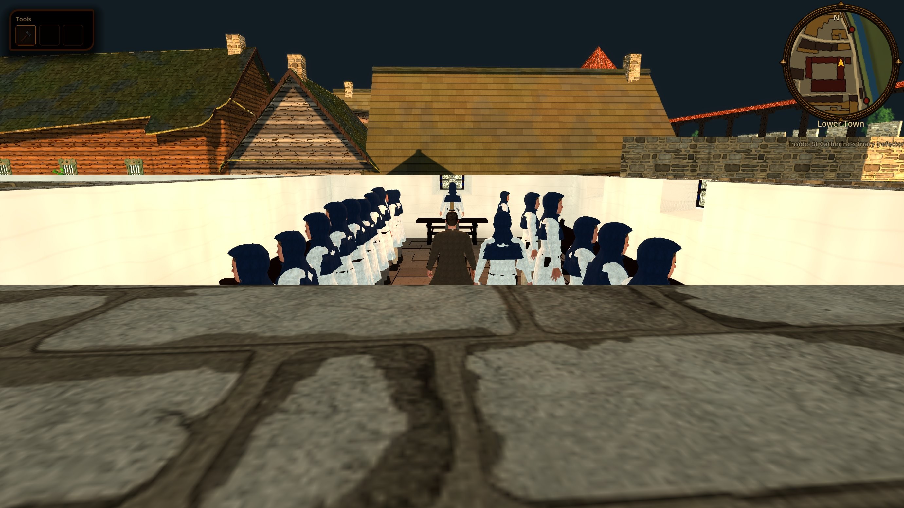 | 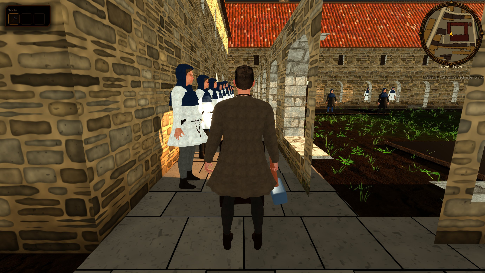 |

**Left out (later):** the eight-bay hall (67.7 m) and its vaults, the crypt as a council cannon store, the new refectory in the north wing (c. 1500), the rebuilt two-storey cloister, Black Heads patronage (15th-16th c.), the 1520s works, the Behind-the-Monks tower, the carved vine and oak-leaf capital friezes of the west portal.

**Historical research:**

- Project: [Churches and religious houses](../../../history/dossiers/religion/churches-and-religious-houses.md); [Ecclesiastical precinct boundaries](../../../history/dossiers/religion/ecclesiastical-precinct-boundaries-1343.md) (Dominican polygon); [Dominican brewery and fish yard](../../../history/dossiers/religion/dominican-brewery-fish-yard-1343.md); [Back lanes east of Pikk](../../../history/dossiers/topography/back-lanes-east-of-pikk.md).
- External: Medieval Heritage, ["Tallinn - Dominican Friary"](https://medievalheritage.eu/en/main-page/heritage/estonia/tallinn-monastery-of-st-catherine-puha-katariina-klooster/) (Kühnert plans, sections and room functions); E. Kühnert, *Das Dominikanerkloster zu Reval*, Reval 1926; MNLL, ["De ordine predicatorum de Tolosa in Dacia"](https://medieval.wiki.uib.no/De_ordine_predicatorum_de_Tolosa_in_Dacia) (1229 and 1246 foundations); Mauritanum, [St Catherine's Convent](https://1246.eu) (surviving east-wing rooms).

**Review plates:** `docs/reports/images/city/st_catherine_aerial.jpg`, [garth](../../reports/images/city/st_catherine_garth.jpg), [west gate from the lane](../../reports/images/city/st_catherine_street_gate.jpg), [Katariina käik along the south wall](../../reports/images/city/st_catherine_street_south.jpg), [west portal](../../reports/images/city/st_catherine_west_portal.jpg), [nave](../../reports/images/city/st_catherine_nave.jpg), [service yard](../../reports/images/city/st_catherine_yard.jpg).

**Verify:** `godot --headless --path . --script tools/validate_city_sites.gd`; `godot --headless --path . --script tools/run_godot_tests.gd -- --filter=test_st_catherine_site` (rooms, doors, and the friars in the choir at terce, in the dormitory at night, in the refectory at dinner); `python3 tools/city/build_citizen_runtime.py --check`; `python3 -m unittest tests.python.test_citizen_wardrobe` (white habit); `tools/godot_render.sh --resolution 1600x900 res://tools/capture_city_citizens.tscn -- --city-spawn=st_catherine_choir --city-hour=9.3`; `tools/godot_render.sh --script tools/capture_reval_city.gd -- --only=st_catherine_aerial,st_catherine_garth,st_catherine_street_gate,st_catherine_street_south,st_catherine_west_portal,st_catherine_nave,st_catherine_yard`; `tools/godot_render.sh --resolution 1600x900 res://tools/capture_reval_city_walk.tscn -- --only-sites` (all three doors walked in, roofs lift, leaves open).

**Limits:** the dormitory upstairs is not walkable and friars vanish on the day stair; citizens stand (no sitting pose) and have no collision, so a walker can brush a table edge on the way to a seat; the gate is not yet a sanctuary seam in gameplay; the 13 removed houses' census households are settled (R-1934, [displaced households](../../CITIZENS/CENSUS.md#households-displaced-by-landmark-sites)): 6 (32 people, 13 with cards: the potter Marten Tõlli poeg's family, the barber Jüri Tanieli poeg's, the potter Andres Laurentsi poeg's and three more) rent free booths in Katariina käik, Müürivahe, Meistrite hoov, Vene and Viru and walk the city again, 5 larger ones (36 people) are retired with reserved IDs, 2 plots were empty; their cards still tell of their old homes by the friary as their past; `bldg.osm.w221512373` was a merged OSM polygon across the lane, so the plot south of Katariina käik east of the church is empty; if the water-supply work (WS-4) starts drawing a well at every `poi.well.*`, it must skip `poi.well.dominican`, which this site already models.

## More views

Model captures, not photos of modern Tallinn or concept art. Ongoing fixes may postdate them. Walk-test frames are first-person or top-down shots taken by the automated site walk (2026-10-13).

| Aerial view from the south-west | Cloister garth |
|---|---|
|  |  |

| West gate from the lane | Katariina käik along the south wall |
|---|---|
| 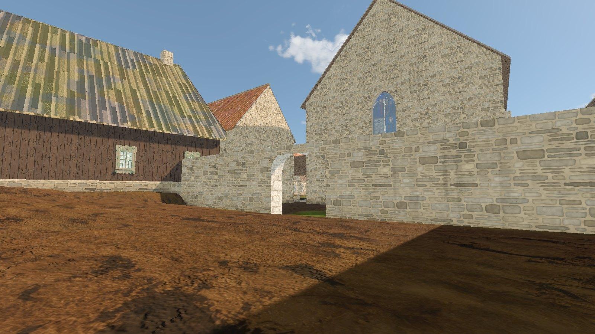 | 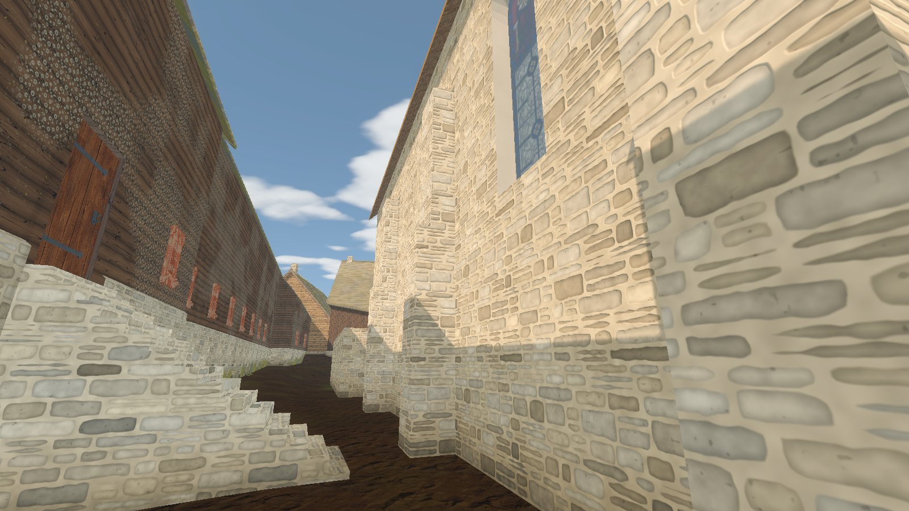 |

| West portal | Nave |
|---|---|
| 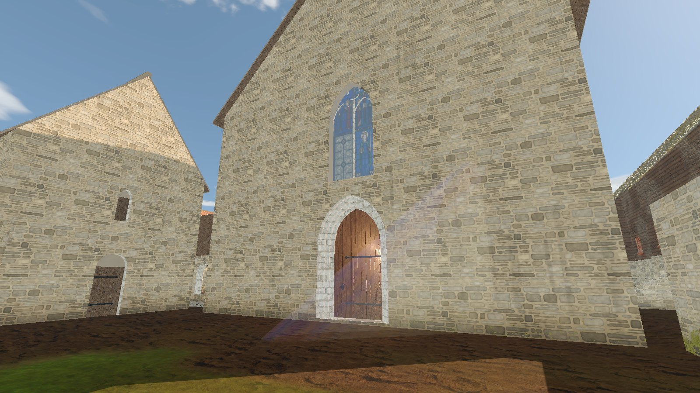 | 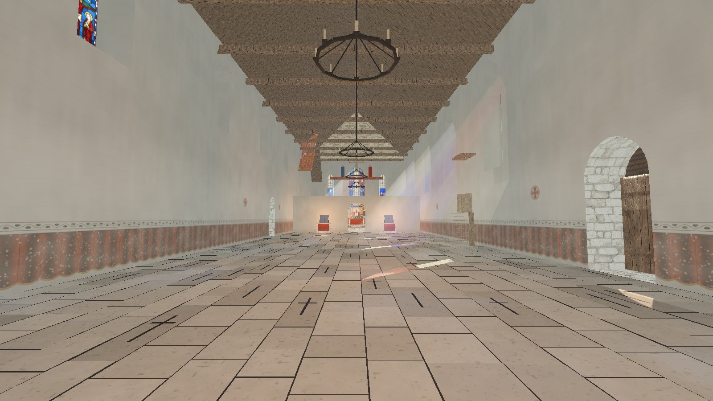 |

| Service yard | Walk test: just inside the door |
|---|---|
| 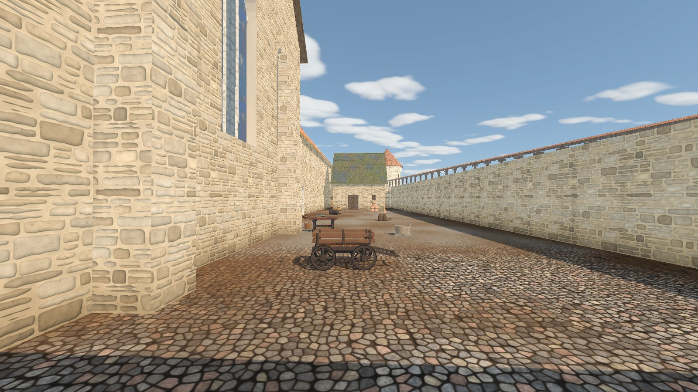 | 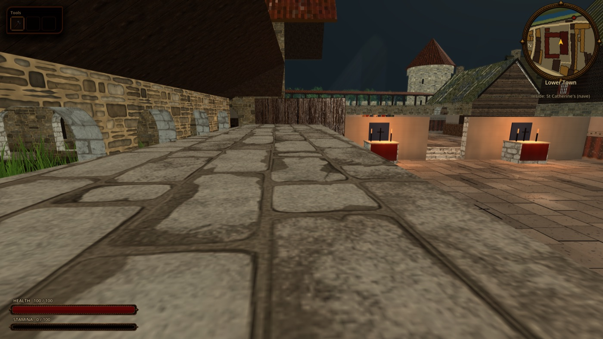 |

| Walk test: top-down camera inside | Walk test: view of the garth |
|---|---|
| 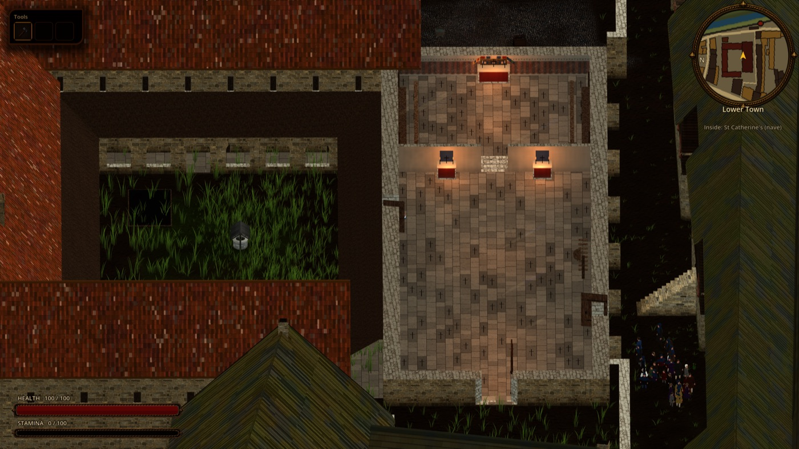 | 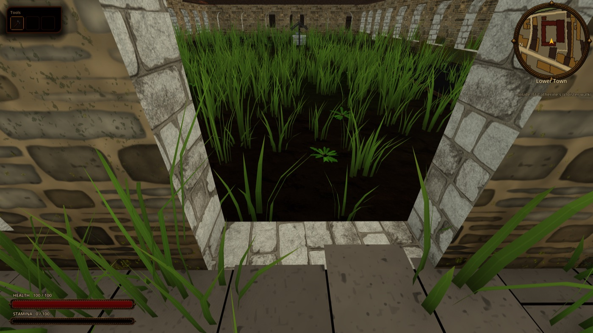 |

| Walk test: first-person view of the nave |  |
|---|---|
| 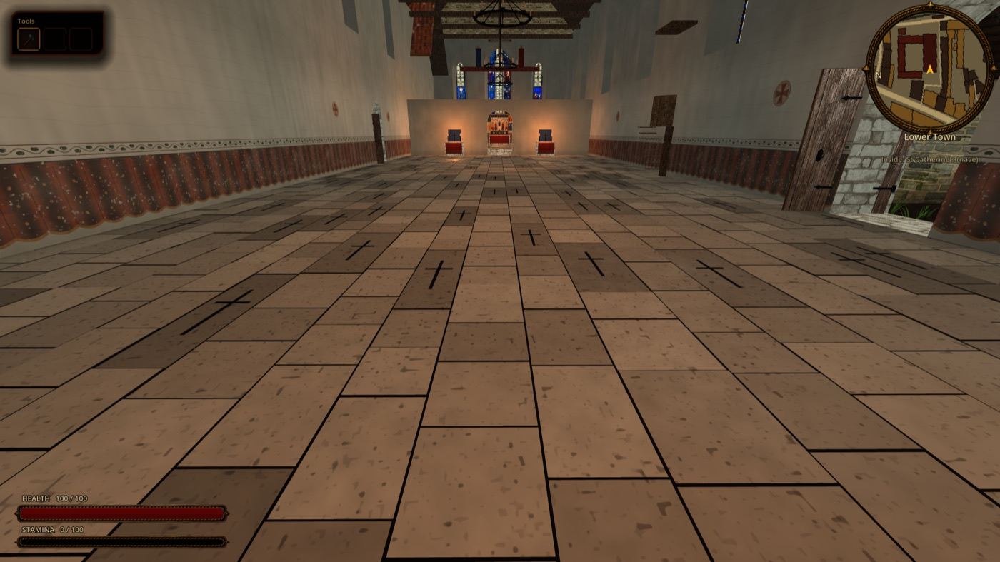 |   |
