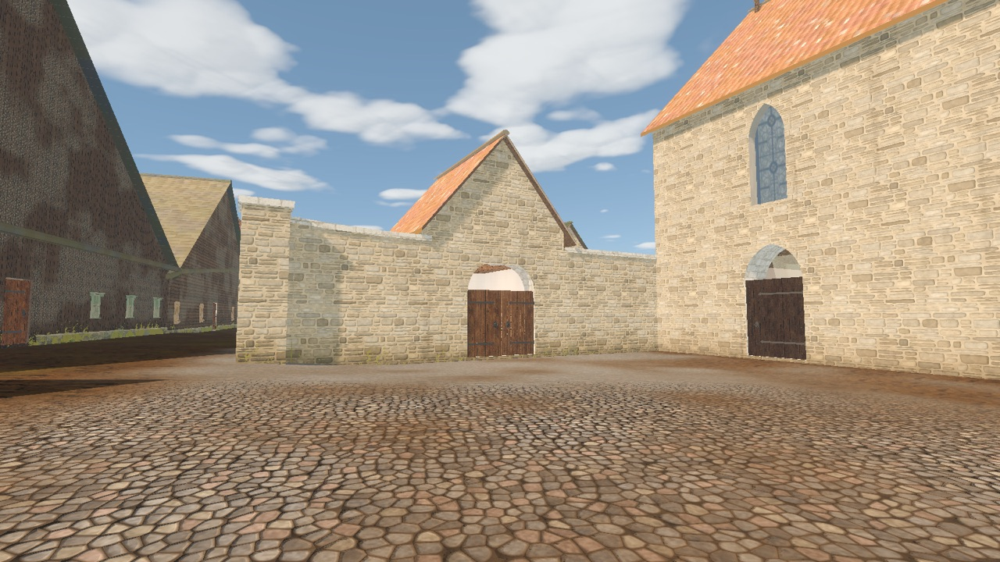
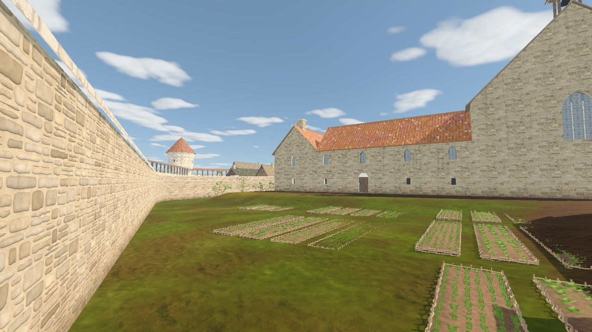
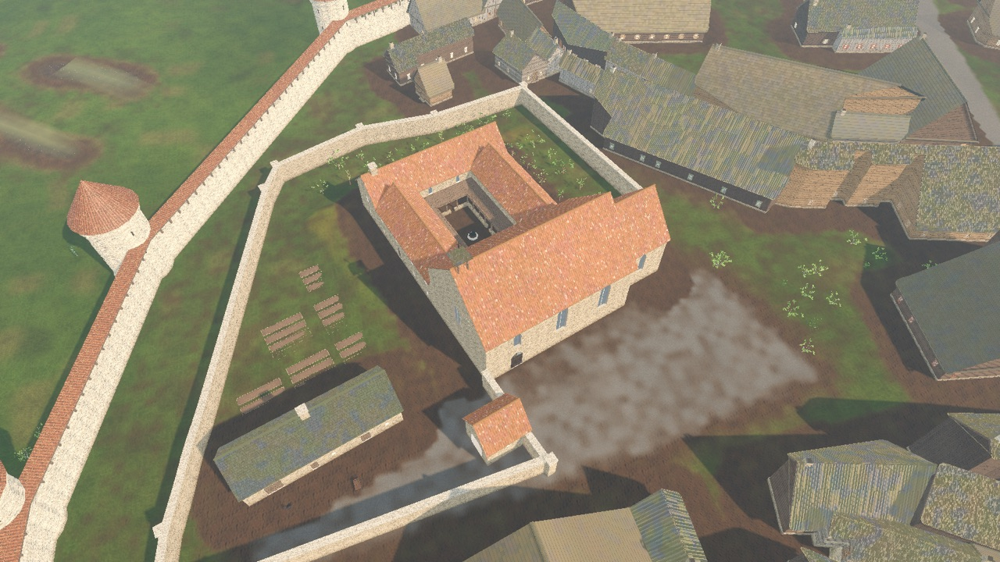
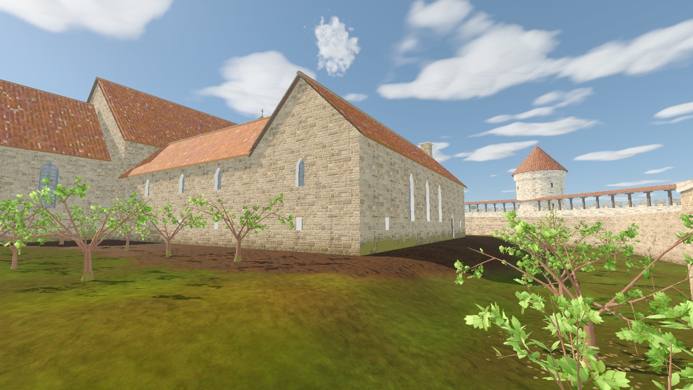
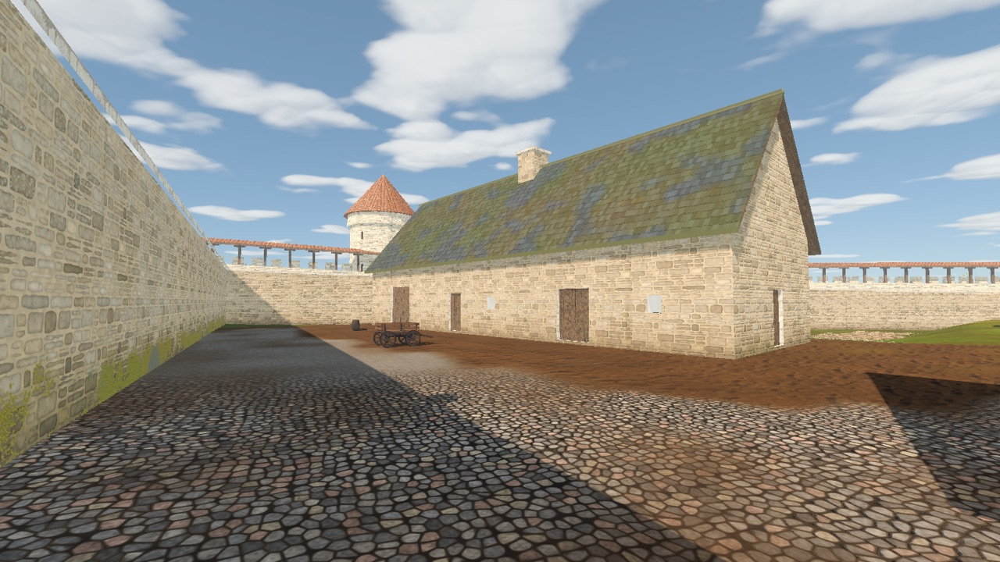
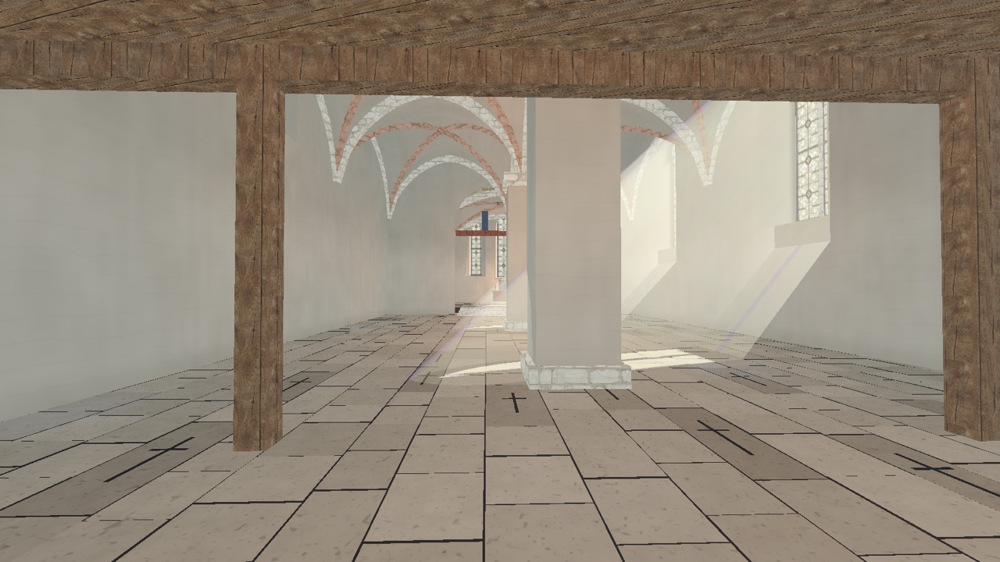
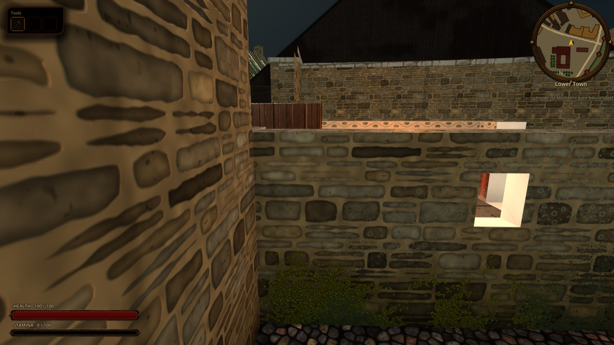
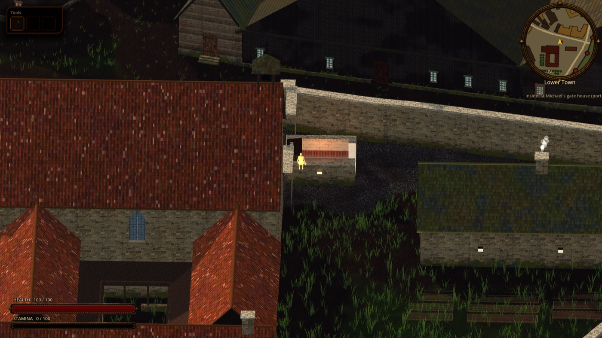
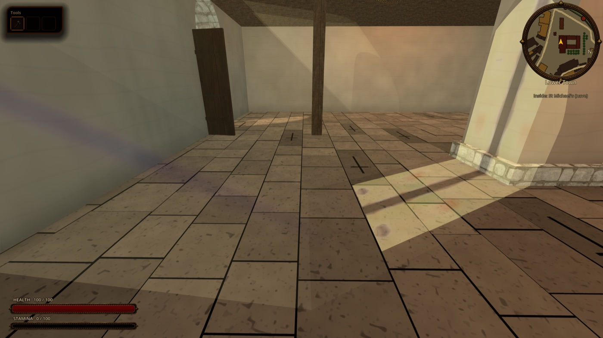
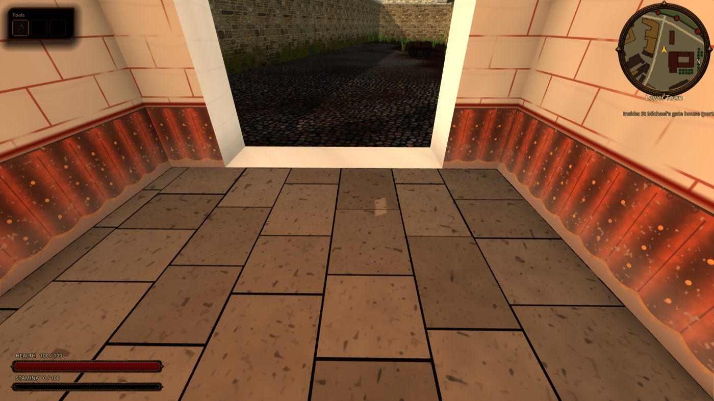

[Landmark sites index](../CITY_LANDMARK_SITES.md) · [All systems](../README.md)

# St Michael's Cistercian nunnery

**Status:** implemented (task **R-1719**, approved by the maintainer 2026-10-13; supersedes the district-map task R-1130 / LM-05), interim GDScript builder. Stable ID: `site.st_michael`. [Manifest](../../../content/world/reval_city/sites/st_michael.json) · [Model builder](../../../scripts/city/sites/st_michael_builder.gd). Scope: the walled close of the nunnery as one site of the seamless city: church, claustral ranges, gate house, service wing, kitchen garden and orchard. Out of scope: the 1340s tie-in of the nunnery wall into the town curtain (**R-1720**), claustral homes and enclosure rules for the census nuns (**R-1721**), walkable claustral interiors, Blender GLB shells.

| From the church square | Inside the close |
|---|---|
|  |  |
|  |  |
|  |  |

**Function in 1343:** an enclosed convent of Cistercian nuns from vassal and upper-town families (founded 1249, attested); patron of St Olaf's church since 1267 (attested); landlord of manors and urban mills. In April 1343 its walls are being tied into the new town curtain (Johannes Kanne's 1340s programme, attested; not modelled here, see R-1720).

**Plan** (plausible composite; the close area in 1343 is **unknown**). The model fills the lane-bounded block between Suur-Kloostri, Gümnaasiumi, Kooli and Aida, keeping the street-front house rows: about 0.5 ha inside the close wall, church included. The precinct dossier's zone shares are kept (built core about a fifth, garden and orchard about half).

- **Church** on the footprint of the surviving nunnery church (dossier I1 ~40-50 × 18-22 m; here 38 × 17.5 m): a two-aisled hall of three bays on two square piers under brick-ribbed rib vaults, a short, narrower chancel with a flat east end and three stepped lancets, plain gables and a ridge bell-cote instead of a tower. Lay people enter by the **south portal** (`door.st_michael.south`) from the open church square; the nuns hear the office on a **west gallery** (Nonnenempore) behind a parapet and lattice, reached from the dormitory range (a blind doorway high in the north wall). Rooms: `room.nave` "St Michael's (nave)", `room.choir` "St Michael's (sanctuary)" up three steps.
- **Claustral ranges** north of the church round a small garth with a lavabo well and timber lean-to walks on a low sill wall: west range (lay sisters, cellarer), north range (refectory, the attested 9.25 × 8.1 m north-wing room; kitchen with its stack at the west end), east range (chapter house below, dormitory above). The enclosure is closed to the player: the ranges and garth are one solid block, their doors are blind niches with plank leaves.
- **Gate house (porta)** on the close wall facing the church square, the only way into the close (`gate.st_michael.porta`, door `door.st_michael.porta`, room `room.porta` "St Michael's gate house (porta)"), with the portress's turn window. Behind it the **lay sisters' yard** (cobbled reserve) with a cart and estate grain, and the **service wing** (granary, brewhouse with a smoking stack, stable).
- **Garden and orchard:** six patches of wattle-edged kitchen-garden beds (April seedlings) west of the ranges; orchard rows of apple, cherry, pear and plum behind the north and east ranges (`orchard.st_michael.north`, `orchard.st_michael.east`).
- **Close wall:** limestone rubble, 4.4 m above the ground with an ashlar coping and corner piers, following the ground (the close falls about 3 m to the north-west).

**Decoration:** Cistercian restraint: lime-washed walls inside, colourless grisaille glass only (glazing programme 4 in `city_stained_glass.gdshaderinc`, after the order's statutes), no murals, statues or retable; a plain altar and the rood. Composite.

**Left out (later):** the "Nuns' Gate" name (1355), the 1433 fire repairs, the post-Reformation school, the Swedish-era fabric and the Orthodox cathedral fittings of the surviving church.

**Replaced plan buildings:** the generic church shell `bldg.osm.w26889132`, two houses and a shed on the church square (`bldg.osm.w26900735`, `bldg.osm.w201040694`) and two houses inside the close (`bldg.osm.w46961813`, `bldg.osm.w46961814`).

**Historical research:** [Churches and religious houses](../../../history/dossiers/religion/churches-and-religious-houses.md); [Ecclesiastical precinct boundaries](../../../history/dossiers/religion/ecclesiastical-precinct-boundaries-1343.md) (St Michael segments and zone shares); [Monastery building-set contract](../../tasks/architecture/AR-07_monastery_district_set.md) (legacy); Wikipedia (et), ["Tallinna Püha Miikaeli klooster"](https://et.wikipedia.org/wiki/Tallinna_P%C3%BCha_Miikaeli_klooster); I. Graužiniene, [lecture on the convent](https://gag.ee/wp-content/uploads/2018/12/Klooster_ettekanne-Gustav-Adolfi-p%C3%A4eval_06.11.2015_Inna.pdf), Gustav Adolf Gymnasium 2015 (founding legend vs the 1249 date).

**Verify:** `godot --headless --path . --script tools/validate_city_sites.gd`; `godot --headless --path . --script tools/run_godot_tests.gd -- --filter=test_st_michael_site` (registered, no plan house inside the close, the gate house is the only way in, south portal into the nave, orchard and garden); `tools/godot_render.sh --script tools/capture_reval_city.gd -- --only=st_michael_aerial,st_michael_gate,st_michael_close,st_michael_orchard,st_michael_yard,st_michael_interior`.

**Limits:** the census still binds the nunnery household (`hh.inst_st_michael_nunnery`, 40 residents) to the church-door place, now on the church square in front of the south portal, and lets choir nuns run town errands (R-1721). Three census households (`hh.lt.osm_w26900735`, `hh.lt.osm_w46961813`, `hh.lt.osm_w46961814`) belong to replaced plots and need rehoming; since R-1718's runtime pass they are not compiled into `citizens.json` (they no longer stand at doors inside the close). The curtain by the close is shown finished (R-1720). The claustral ranges, cloister walks and gallery cannot be entered.

## More views

Model captures, not photos of modern Tallinn or concept art. Ongoing fixes may postdate them. Walk-test frames are first-person or top-down shots taken by the automated site walk (2026-10-13).

| Gate house and south portal from the church square | Inside the close |
|---|---|
|  |  |

| Aerial view from the south-west | Orchard rows |
|---|---|
|  |  |

| Lay sisters' yard and service wing | Lay nave under the nuns' west gallery |
|---|---|
|  |  |

| Walk test: just inside the door | Walk test: top-down camera inside |
|---|---|
|  |  |

| Walk test: first-person view of the nave | Walk test: view of the gate house |
|---|---|
|  |  |
