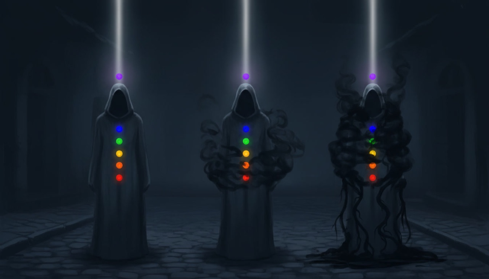
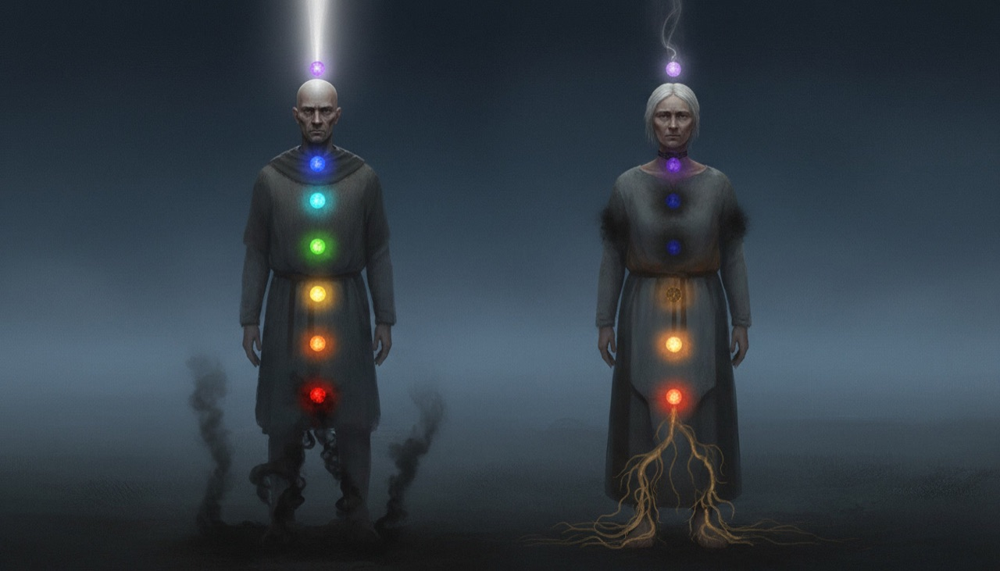
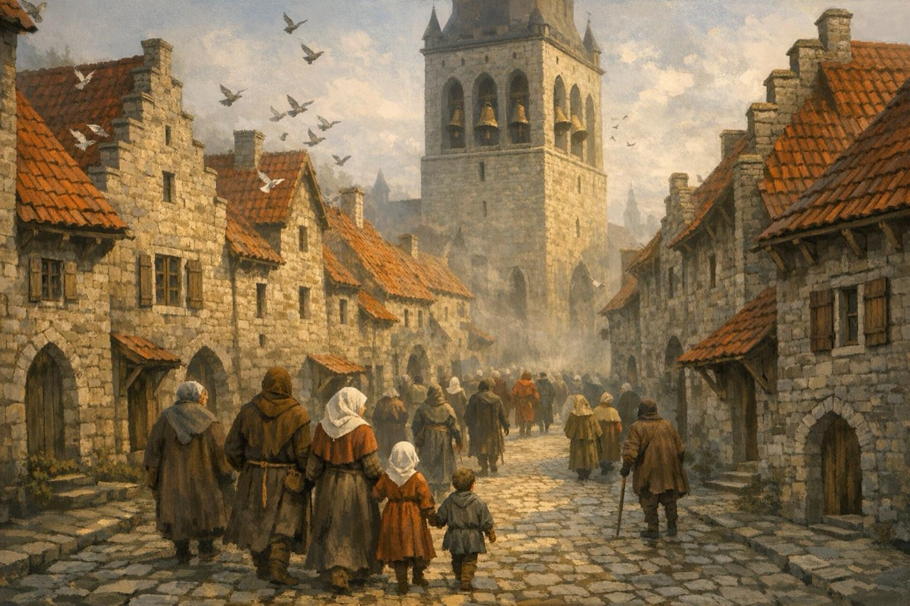
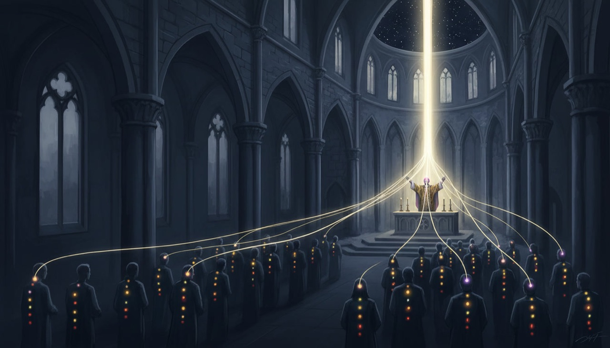
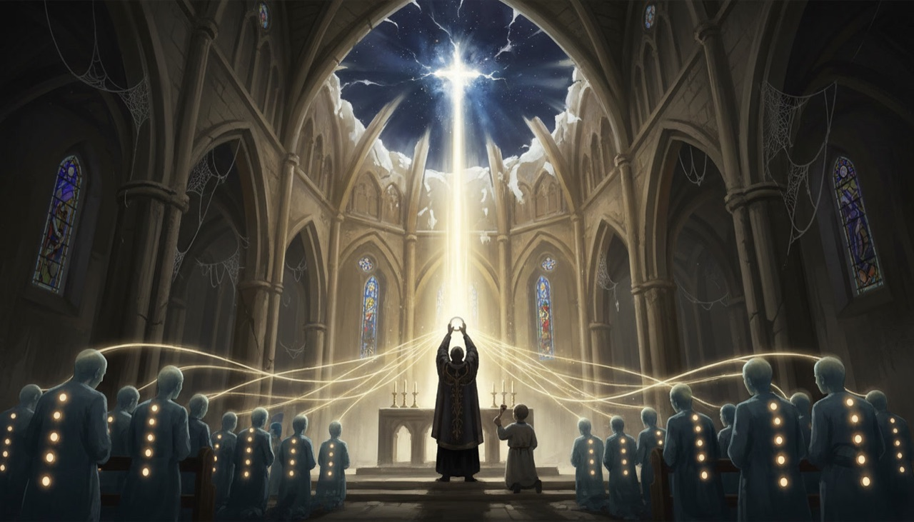
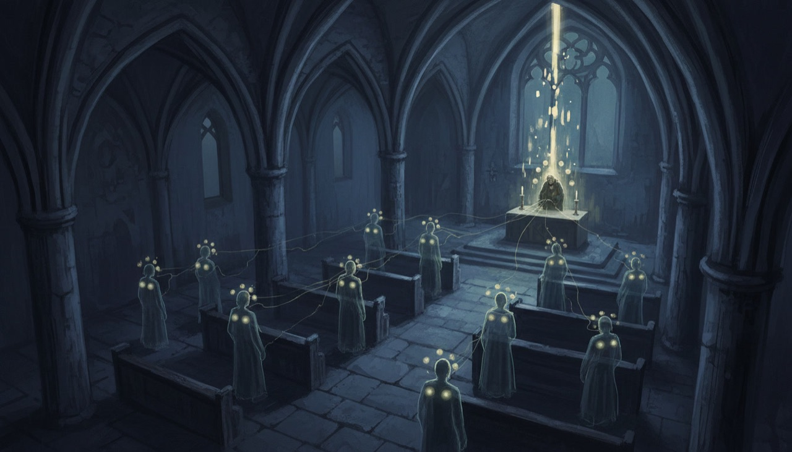
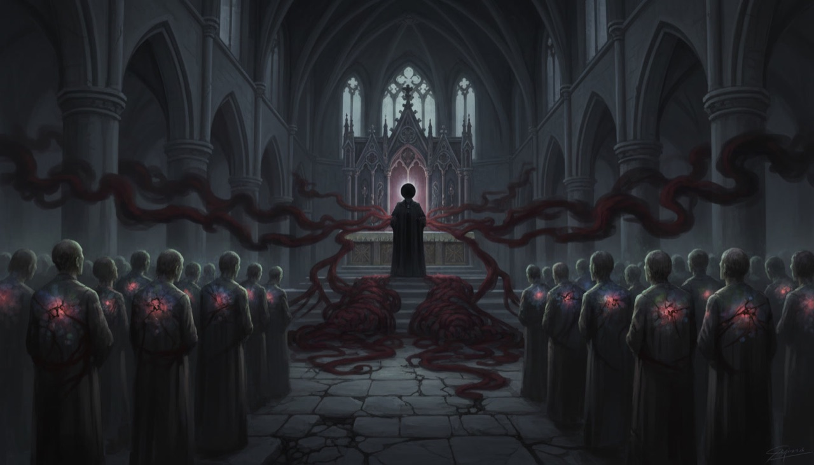
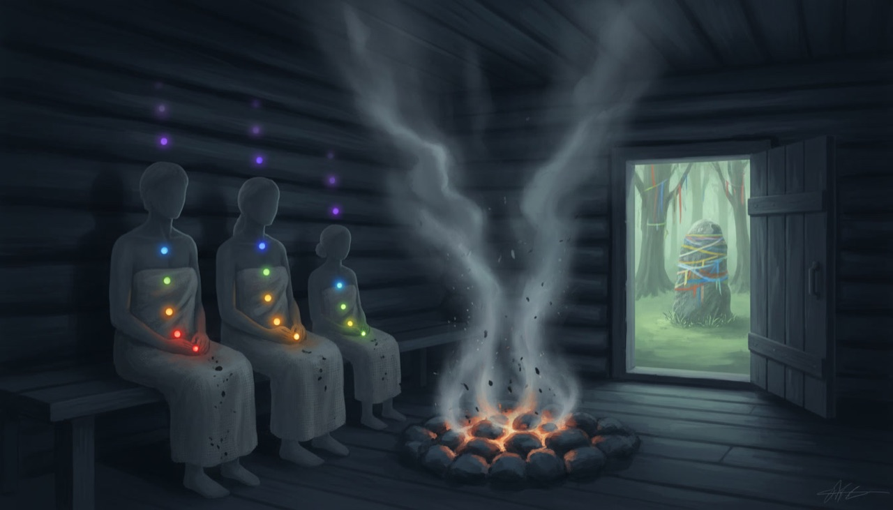
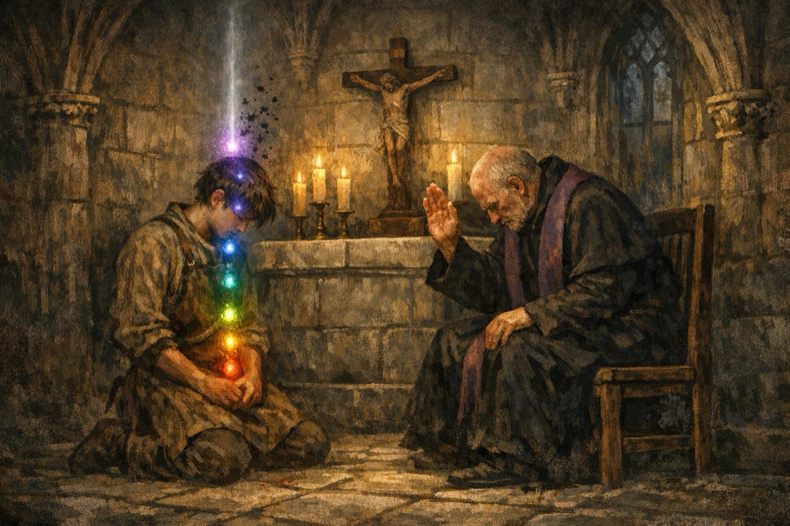

# ADR 0046: Church services, soul-light soot and collective spirit channeling

- **Status:** Proposed (drafted 2026-10-11 from a maintainer brainstorm). **No code until the maintainer approves this ADR.** Tasks are on the board as epic **R-1735** (CS-0) with children **R-1736..R-1743**, all `idea` + `needs-approval` until then.
- **Builds on:** [ADR 0041](0041-spirit-sight-auras-and-soul-lights.md) (soul lights, clarity, sky beam, earth tethers, 12-aura budget), [ADR 0033](0033-teen-protagonist-and-spirit-dialogue-combat.md) (per-school guilt), [ADR 0044](0044-named-npc-presentation-tier.md) (named NPC tier), [`CITIZENS.md`](../SYSTEMS/CITIZENS.md) (census and timetables), [`LIVING_CITY.md`](../SYSTEMS/LIVING_CITY.md) (Hope / Fear).
- **Amends:** ADR 0041 in two narrow points: the hero's clarity (today `1 - max guilt tier / 3`) is multiplied by a soot factor, and the sky beam and earth tethers read soot-effective float levels instead of integer levels. Everything else stays: light levels remain NATURAL-driven and soot is a second, dynamic layer on top.
- **Does not supersede:** ADR 0003 (offline authored dialogue), the ban on a universal good/evil morality score, the asset freeze (P0-040).

## Situations at a glance (concept art)

Nine concept images to scan the design before reading the rules. They are AI-generated mood boards (Leonardo: Nano Banana and GPT Image 1.5, 2026-10-11), not runtime assets and not the target render: the game draws the lights, threads and column with the procedural ADR 0041 aura shaders. Rainbow orbs bottom to top are the seven `aspect.*` lights (nature red at the pelvis ... light violet above the head); black smoke is soot.

**1. Soot scale (section 1).** Same soul, clean, half sooty, near the cap. Soot veils the lights, thins the sky beam and grows earth tethers; the levels underneath do not change.

**2. Church only vs folk rites only (section 5).** The church cleans the upper lights, folk rites the root. Someone who keeps only one is bright on one half and dark on the other.

**3. The bell call (sections 2-3).** Sunday 08:45, physical view: bells in the belfry, the whole parish walks to its nearest church. No spirit effects in the physical layer.

**4. A good mass: the priest conducts (section 4).** Every crown beam bends into a thread toward the priest; his beam becomes a column through the vault. Thread width follows each person's own beam.

**5. Elevation peak (section 4).** At the three-stroke elevation bell the column swells for about 4 s and the pulses beat in step. Reduced flashing: a slow brighten instead.

**6. Weak conductor at vespers (sections 2, 4-5).** A few devout, a tired priest with low clarity: faint broken threads and a thin, stuttering column. Small cleansing.

**7. Corrupt conductor drains (section 5).** Closed faith light or clarity below 0.25: the pulse runs backward along the threads, the congregation's upper lights cloud, tether knots coil under the altar, no column rises.

**8. Folk counter-rite: the sauna (section 5).** Steam lifts soot off the root lights; the upper lights stay as they were. The hiis and the offering stone (through `faction.cult_metsik`) do the same for the hero and also lower `guilt.folk`.

**9. The hero's annual confession (section 6).** Authored dialogue with a parish priest, open confession without a booth. Up to 4 levels of `guilt.church` and upper-light soot fall away; no NATURAL points.

## Context

The maintainer wants churches to be a place of regular gathering: clergy in them, services on a schedule, and a reason for the hero and the NPCs to come. A service should use the spirit layer: the priest is the conductor of a collective channeling, and in spirit sight the congregation's energy rises as a column of light to God. What a service does to each participant, and to the hero, must be worked out, together with the question it raises: if church cleans souls, how do they get dirty, and why is not everybody clean all the time?

What exists today:

- About three in four residents already "go to church" in their timetable (mornings for the old, vespers for most; clergy work at the church door), but there are no services as events and no priest at the altar ([`CITIZENS.md`](../SYSTEMS/CITIZENS.md)).
- Every person carries seven soul lights (the seven NATURAL aspects) with an integer level 0..5 and one clarity 0..1. A crown beam rises to the sky; closed lights drag earth tethers ([`SPIRIT_SIGHT.md`](../SYSTEMS/SPIRIT_SIGHT.md)). NPC light levels and clarity are static content or a stable hash; the hero's clarity comes from guilt.
- Guilt is per school (`guilt.church`, `guilt.folk`, `guilt.civic`), 0..10, lowered only by `GuiltLedger.absolve(school, amount, rite_id)`, once per rite id. No rite content exists yet (SW-4, **R-1351**).

So the column of light is almost there visually, but there is no damage and no healing.

### Open questions and the maintainer's answers (brainstorm 2026-10-11)

| Question | Answer applied here |
|---|---|
| Is damage a drop in light level? | No. Levels are strength and grow only through NATURAL. Damage is a separate dynamic **soot** (*tahm*). |
| Where does soot come from? | Daily trade and season wear, Living City Fear, lost spirit duels (on the guarded light), bestiary night creatures, guilt and sin. |
| Why is not everyone clean? | The church cleans mainly the upper lights and only Christian guilt; root lights and folk blood-debt need folk rites. The effect scales with the priest, the participant's faith and regularity, and is partial. A corrupt priest may drain. |
| How often are services? | Sunday and feast high mass for the whole parish, daily vespers for a few. The bell calls. |
| What does the hero get? | Passive attendance clears part of Christian guilt; spirit sight shows the truth of the service; an annual confession is a deeper cleanse in dialogue. **No NATURAL points.** |
| What is saved? | Crowd soot is derived, never saved. Only the hero and named NPCs persist soot. |

## Decision

### 1. Soot: a dynamic layer on the soul lights

- Every being with an aura carries **soot** per light, keyed by the seven `aspect.*` ids, each 0..1 with a cap of 0.9 (tuning): soot never fully closes a light, only the level can.
- Effects, all through existing aura inputs: the light shows an **effective float level** = level x (1 - dim x soot); the aura's clarity is multiplied by (1 - clarity_loss x mean soot); the existing earth-tether rule reads the effective float level, so a sooty light drags a tether toward the earth without a second tether rule. The sky beam formula (ADR 0041) also reads effective levels, so soot thins it.
- Soot does **not** change integer light levels, NATURAL ranks or duel multipliers in this ADR (balance stays where ADR 0041 put it; revisit after play).
- Like the rest of the aura, soot shows burden and strength, not virtue. A saint after a famine winter is sooty; a calm extortionist who keeps the rites is clean.

**Sources** (all deterministic, numbers are data in `content/spirit/soot_tuning.json`):

| Source | Lights hit | Who |
|---|---|---|
| Daily wear by trade and calendar month (winter hunger on nature, debt on affection, guard duty on tenacity, ...) | trade-specific | everyone |
| Living City Fear above its default 8 (fire, execution, raid, plague) | nature, affection, tenacity | everyone; Hope above 8 slows wear |
| Losing a spirit duel | the light that guards the element of the finishing word (ADR 0041 table) | duel loser |
| Bestiary night visitors (card fields `soot_light`, `soot_amount`; the luupainaja sits on the chest = `aspect.unity`) | per card | the visited sleeper |
| Guilt events (`GuiltLedger.record_act`) | church -> upper lights, folk -> nature, civic -> tenacity, by weight | hero; named NPCs through quest events |

Without any rite a soul climbs toward the cap; a person who keeps neither church nor folk rites visibly darkens in about two weeks.

### 2. Services on a schedule

| Service | When | Who goes | Strength |
|---|---|---|---|
| **High mass** | Sundays (`GameCalendar.weekday_index`) and listed feasts, about 09:00-10:00 | the whole parish: every household member aged 7+, except infants, the sick and the watch on duty | full |
| **Vespers** | daily, about 17:00-17:30 | the devout few (`devout` residents) and all clergy | small |

- A feast calendar (`content/world/church_calendar.json`) lists Julian dates for 1343-1346; Easter 1343 is 13 April, so the game opens a week after it.
- Parishes: St Olaf's, St Nicholas' and the Holy Spirit church; a household belongs to the nearest one. The precinct churches (St Mary's on Toompea, St Catherine's, St Michael's) stay out of this ADR.
- The citizen timetable's existing `church` slot is **replaced** by this schedule, not doubled.

### 3. The bell call and the gathering

- The bells ring 15 game minutes before each service from the church's real bell position (St Olaf's provisional belfry, St Nicholas' tower, Holy Spirit's gable turret). The parish walks in and stands in the nave from the east; the priest stands at the altar.
- The bell is one in-house synthesised sound (tier B under [`AUDIO.md`](../SYSTEMS/AUDIO.md)), not a recording or a new art asset. A short three-stroke **elevation bell** marks the peak of the mass and is the cue the spirit layer listens to.
- No Latin text, chant or communion action is built.

### 4. Collective channeling in spirit sight

- **Conductor:** one priest per service, a clergy resident or a named NPC with an authored aura.
- **Threads:** each congregant's crown beam bends into a thread toward the priest's crown. Thread width follows that person's own beam strength on soot-effective levels, so a closed crown sends nothing.
- **Column:** the priest's beam becomes a column through the vault (the interior cut-away is unchanged), its width the sum of the incoming threads times the conductor factor (section 5).
- **Synchronisation:** during the service each participant's breathing pulse eases into step with the priest's, and its displayed clarity is pulled toward his. This is presentation; the stored soot changes once, at the dismissal.
- **Peak:** at the elevation bell the column swells for about 4 s. Reduced flashing replaces the swell with a slow brighten.
- **Drain:** a draining conductor (section 5) reverses the pulse direction along the threads and grows earth-tether knots under the altar; a weak one gives a thin, stuttering column.

### 5. What a service cleans, and its limits

Removal per light at the dismissal = base (mass 0.35, vespers 0.12) x **light weight** x **conductor factor** x **openness** x **regularity** (all tuning data):

- **Light weight:** light, awareness, resonance, unity 1.0; tenacity 0.5; affection 0.1; nature 0. The church cleans the upper soul; the root is not its business.
- **Conductor factor** = (priest faith level / 5) x priest clarity.
- **Openness** from the participant's faith light (`aspect.light`): 0 -> 0, 1 -> 0.4, 2 -> 0.7, 3+ -> 1. A closed crown leaves as it came.
- **Regularity:** 1 + 0.1 per consecutive week attended, at most 1.5.
- **Partial:** one service never clears everything.
- **Corrupt priest:** a conductor whose faith light is closed, or whose clarity is below 0.25, drains instead: participants gain a little soot on their upper lights. Which priests are corrupt is narrative content, not a rule about the Church.
- **Guilt:** a service touches only `guilt.church`, and only for the hero (section 6). `guilt.folk` (blood-debt) and `guilt.civic` are never reduced by the church.
- **Folk counter-rites:** the root lights and folk blood-debt are cleaned by the weekly sauna (households that go), and by a hiis offering or an offering stone reached through `faction.cult_metsik` (hero). Their light weights mirror the church's. This puts the 1343 tension between parish and village, on the eve of St George's Night, into the picture without a verdict: someone who keeps only the church is bright above and dark below.

### 6. The hero

- **Passive attendance:** if the apprentice stays in the nave from the bell call to the dismissal, a mass absolves one level of `guilt.church` through a per-occurrence rite id (`rite.mass.<yyyy-mm-dd>.<church>`) and cleans his soot by the section 5 rule with his own faith light as openness. Vespers clean soot only. Leaving early forfeits. He may simply wait; no forced cutscene, spirit sight stays available.
- **Spirit sight shows the truth:** the threads, the column, a weak or draining priest. Awareness level 4+ (ADR 0041 reading depth) names a draining conductor in the reading.
- **Annual confession:** once per liturgical year (Easter to Easter, `rite.confession.<year>`), an authored dialogue with a parish priest clears up to 4 levels of `guilt.church` and more upper-light soot; honest answers clear more than evasive ones. A corrupt confessor still absolves on paper but adds soot.
- **No NATURAL points or ranks** from any church act. The church cleans; it does not make a soul stronger.

### 7. Data, determinism and saves

- **Crowd soot is derived, never saved:** a pure function of the citizen id (stable hash), the day index, the service schedule and the resident's attendance pattern, the trade wear table and the current Fear. Same inputs, same aura in any process. The current Fear stands in for recent Fear (no per-day Fear history is kept), so a Fear spike darkens the crowd at once and fades as Fear falls; the hero and named NPCs, whose soot is stored, accumulate it day by day instead.
- **Recurring rites:** `GuiltLedger.absolve` fires once per rite id, so every service occurrence gets its own id (date + church) and the confession one per liturgical year. The ledger's rules do not change.
- **Sacrament neutrality:** a corrupt confessor still absolves `guilt.church` (the sacrament is not shown failing); the soot he adds is the spirit-layer cost, in line with the `invented` label in `CANON.md`.
- **Persisted:** the hero's soot (`soul.soot`, seven values quantised to 1/100), attended rite ids and the consecutive-weeks counter; named NPC soot (`npc_soot.<char id>`) only when non-zero. Older saves load with zero soot and no error.
- Priest conductor data (faith level, clarity, corrupt or not) is authored aura content on the clergy or named NPC record, validated like any `aura` block.

### 8. Performance

The ADR 0041 budget stays: 12 full auras, nearest first. Inside a church during a service every further participant gets a **congregation tier**: a soft glow plus its thread, drawn from one shared instanced mesh, capped at 120 threads; beyond that the threads bundle into 8 strands. No per-frame mesh rebuild, GL Compatibility only, procedural shaders only.

## Equivalent scope accounting

Removed or folded to pay for this:

1. **SW-4 (R-1351) shrinks:** its confession and cleansing rites move into CS-6 (church) and CS-7 (folk); SW-4 keeps only apology content. No separate hub-only confession is built.
2. **The citizen `church` timetable slot is replaced** by the service schedule; there is no second, parallel church outing.
3. **No blessing, buff or healing system:** a service only lowers soot and `guilt.church`. No faith currency, no stat boosts, no NATURAL points.
4. **No liturgy content:** no Latin text, chant, sermon dialogue or communion action; the mass is bell, gathering, stillness and the elevation cue.
5. **No precinct churches, no new map sites:** St Mary's, St Catherine's and St Michael's services, and dedicated hiis or offering-stone sites, wait for their own map tasks.
6. **Soot does not touch duel balance** in this ADR, so no duel retuning pass is owed.

No new art assets (all looks procedural, P0-040); one in-house synthesised bell sound.

## Alternatives considered

- **Lower the light level as damage.** Simple, but mixes strength with burden and turns church into a levelling machine. Rejected for a separate soot layer.
- **Church fully heals.** Everyone would be clean all the time and the picture would say nothing. Rejected for partial, upper-only, priest-dependent cleansing.
- **Save soot for every citizen.** Thousands of floats per save and a drift risk. Rejected for a deterministic derived crowd.
- **Grant NATURAL points for piety.** Makes attendance a grind and a hidden morality reward. Rejected by the maintainer.
- **A single "sin" meter cleaned by the church.** Forbidden (no universal morality score); guilt stays per school and soot per light.
- **Show the column always, not only in spirit sight.** Breaks the physical layer's realism and the period look. Rejected; the physical view shows people standing in a nave.

## Consequences

- [`SPIRIT_SIGHT.md`](../SYSTEMS/SPIRIT_SIGHT.md) gains "Soot and church services" (`Status: planned` until CS-1..CS-7 land); [`CITIZENS.md`](../SYSTEMS/CITIZENS.md) gains "Church services" (planned). [`STATE_AND_SAVES.md`](../SYSTEMS/STATE_AND_SAVES.md) gets the `soul.soot` and `npc_soot` rows when CS-1 lands.
- [`CANON.md`](../CANON.md) carries the labels: canonical hours and vespers, Sunday and feast mass obligation, annual confession and Easter communion (Fourth Lateran Council, 1215), the elevation of the Host and the elevation bell are **`attested`**; Reval parish assignment by nearest church and the service times are **`plausible composite`**; sauna, hiis and offering stones are **`folklore`**; soot and collective channeling are **`invented`**.
- Saves: new optional `soul.soot`, `npc_soot`, attended service rite ids and the weeks counter; old saves load.
- Tests: soot model and sources, schedule and attendance, cleansing rules (upper vs root, conductor, openness, regularity, drain), hero attendance and confession, folk rites, congregation LOD and plates.
- Risks: readability of a full nave of threads (mitigated by LOD and bundling); the Church read as villain or saint (mitigated by priest-dependent results and by folk rites having the same limits in mirror); soot tuning that makes the city uniformly dark or clean (all numbers are data, CS-8 reviews a game week).
- Gamepad and keyboard: attendance needs no input; confession uses the existing dialogue controls.
