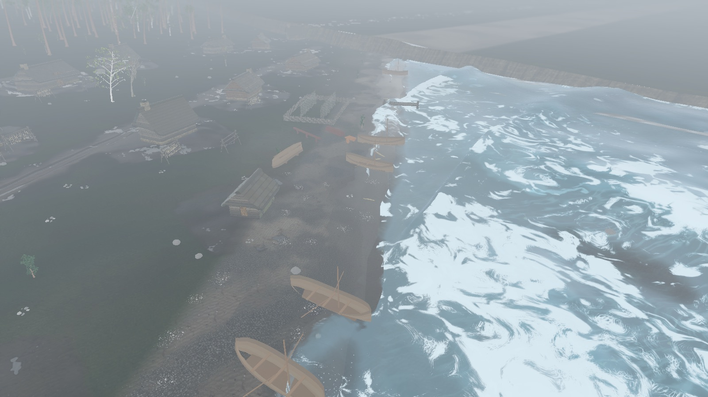
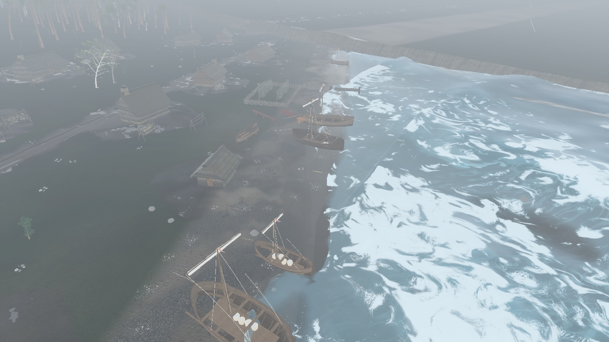
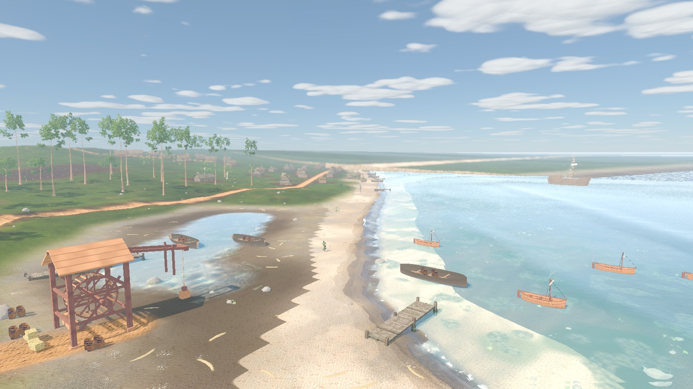
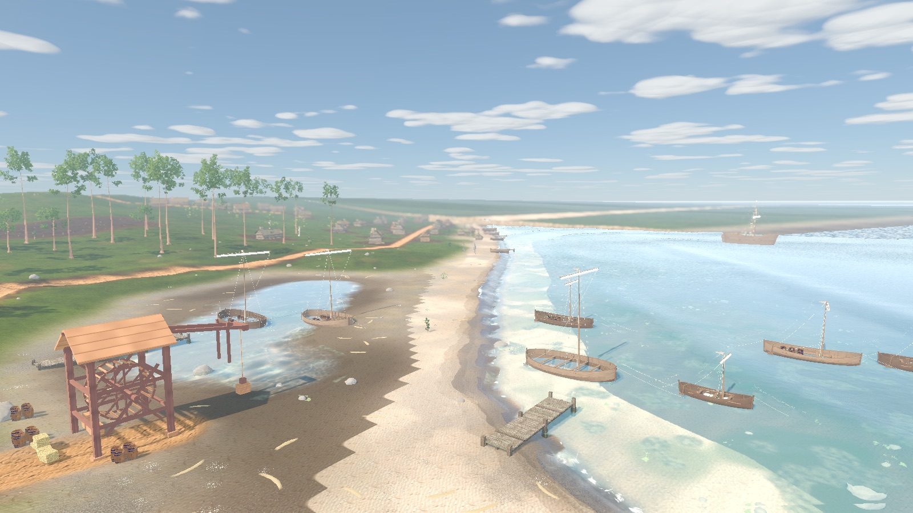
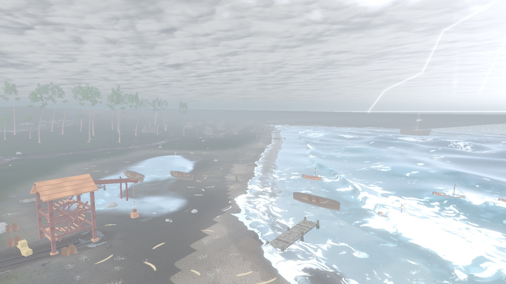
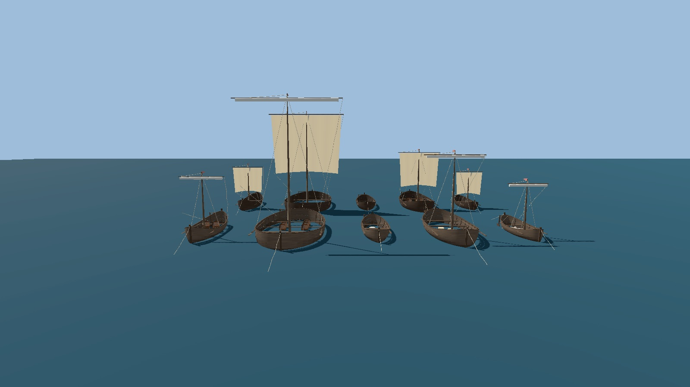
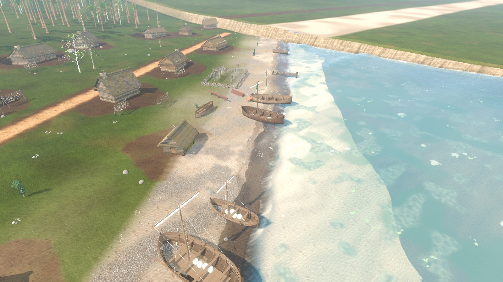
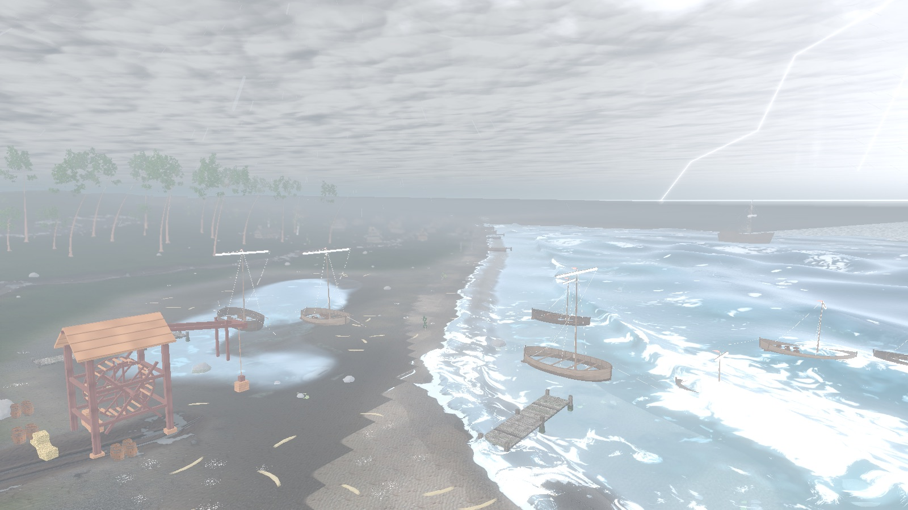
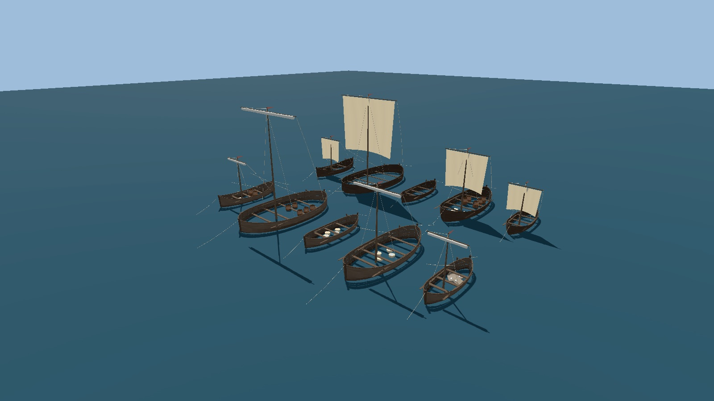

# CO-06 working-craft fleet (R-953)

Status: implemented 2026-10-13 (task **R-953**). Feature page: [`docs/SYSTEMS/SHIPS.md`](../SYSTEMS/SHIPS.md#working-craft-r-953).
Contract: [`docs/tasks/coast/CO-06_vessel_asset_fleet.md`](../tasks/coast/CO-06_vessel_asset_fleet.md). Evidence: [`baltic_vessels_1343.md`](./baltic_vessels_1343.md) (CO-05 cards plus the R-953 comparanda addendum).

## What changed

- `scripts/city/vessel_fleet.gd` (`VesselFleet`): five lofted clinker designs in metres (V2 small fishing boat, V3 larger *mündrik* boat, V4 open rowing boat, V5 *lodi* lighter, V6 Saaremaa strait craft), three wear variants, up to four load dressings, named rig sub-nodes for CO-07 and a 10 x 8 sail cloth on the cog sail shader.
- `CityShips` builds every non-cog hull from `VesselFleet`, keyed by its stable id (plan `boat.kalamaja.*`, `lighter.coastal.*`; generated `boat.landing.<n>`); beached hulls keep their keel on the sand and never bob; afloat hulls sit at their design draught.
- `CogModel.build(..., wear)` adds a freshly tarred hull variant; roadstead cogs pick one per `cog.roads.<n>`.
- Map view: `fishing_boat` / `merchant_boat` props now build `VesselFleet` / `CogModel` hulls scaled into map units, and both `BoatFloat3D` and the 2D capsule read the built hull's extents (`MapViewMeshBuilderPropModels.boat_half_extents`).
- Deleted: `map_view_fishing_boat_builder.gd`, `map_view_merchant_boat_builder.gd`, `scripts/city/city_boats.gd` and the two tests that only covered the deleted builders (`test_map_view_fishing_boat.gd`, `test_merchant_boat_model.gd`).

## Decisions

1. **Procedural in GDScript, not GLB (2026-10-13).** The contract (written 2026-10-07) targeted rrmap harbour props and a Blender GLB fleet. The rrmap harbour maps were retired since, and the live fleet is the seamless city's `CityShips`, whose cog (`CogModel`) is already a procedural true-metre hull with a walkable interior. The user was asked and did not answer within the session; the recommended option was taken: build the working craft the same way as the cog (lofted clinker meshes, shared hewn-timber texture, rope and sail shaders), keep boarding (`deck_height_at`) and wind response, and delete both primitive builders. No new binary asset ships, so `assets/SOURCES.csv`, `ASSET_INVENTORY.md` and `ART_BIBLE.md` are unchanged.
2. **The cog stays `CogModel`.** It already matches Peeter scale; CO-06 adds only the second wear variant. An LOD for distant cogs is not added: the roadstead cog is about ten draw calls and was already budgeted.
3. **Unknown card fields come from named comparanda**, recorded in the R-953 addendum of the dossier (Bill 1998 small boat ratios, Gedesby, *Slavia* rig and draught, the *lodi* handbook). Nothing is averaged from typology.
4. **Pose follows placement, not the hash.** The contract asked for moored-vs-hauled from `(map_seed, prop_id)`; a hash can haul a boat onto open water, so the pose comes from the plan (`lift` > 0 = beached) and only design, wear and load are hashed.
5. **Stable hash.** `String.hash()` is not documented as stable across engine versions, so selection uses djb2 plus an avalanche finaliser; a test pins one value. Plain djb2 gave ids that differ in the last digit the same high bits, so every Kalamaja boat got the same load until the finaliser was added.
6. **Allowed-file deviations.** Re-targeting to the seamless city touched files outside the contract list: `scripts/city/city_ships.gd`, `scripts/city/cog_model.gd`, `scripts/city/city_boats.gd` (deleted), `scripts/map/map_scene_bootstrap.gd` (capsule extents), `tests/godot/test_city_shore.gd`, `tests/godot/test_boat_collision.gd`, the two deleted builder tests, `docs/SYSTEMS/SHIPS.md`, `docs/SYSTEMS/CITY_SEA.md`, `docs/SYSTEMS/OBJECT_CATALOG.md`, `docs/SYSTEMS/README.md` and the CO-05 dossier addendum.

## Verification

```bash
godot --headless --path . --script tools/run_godot_tests.gd -- --filter=test_vessel_fleet,test_boat_float_3d,test_boat_collision,test_city_shore,test_cog_model
tools/godot_render.sh --script tools/capture_co06_vessel_fleet.gd -- --tag=after
tools/godot_render.sh --rendering-method mobile --rendering-driver metal --script tools/capture_co06_vessel_fleet.gd -- --tag=after_metal
```

`test_vessel_fleet` covers: every design builds with its named sub-nodes and oar count; hull length and beam match the card; sails are a >= 8 x 6 grid on the wind shader and furled when moored; selection is deterministic (pinned hash); the six Kalamaja clinker boats show at least three different looks (six today); beached hulls never move and afloat hulls sit at their draught; cogs have two wear materials; map boat props use the fleet; no script references the deleted builders. `test_boat_float_3d` adds: each map design floats on the extents of its own hull, and a short and a long hull pitch differently on the same wave.

Pre-existing, unrelated: `test_boat_float_3d::test_world_wind_drives_vegetation_and_cloth_uniforms` fails on origin because `map_view_canopy.gdshader` reads wind through `tree_wind.gdshaderinc`, not `wind_field.gdshaderinc` directly; origin `0a14d2ba` also shipped a syntax break in `map_view_wind_materials.gd` (lines inside `apply_grass_interaction`'s signature) that another session is fixing. Tests here ran with that fix applied locally and not committed.

## Plates

Kalamaja beach, clear noon. Before: identical flat vertex-coloured hulls.


After: small and large boats, tarred, weathered and patched hulls, nets, baskets and cargo, masts with furled sails, bow lines to stakes.


Storm, before and after:





Roadstead and the fish landing (lighters, afloat fishing boats, anchored cogs further out), clear and storm:








Fleet line-up (front row furled, back row sails set to a following wind):




Metal (mobile renderer):







## Limits and follow-ups

- No rig or oar animation (CO-07, **R-954**). Set sails only appear on the line-up plate.
- The Saaremaa strait craft is not placed (the ferry landing is the `world.saaremaa` map).
- Plank surfaces reuse the hewn-timber texture with vertex tones; a dedicated clinker hull plate (albedo/normal/roughness per wear) would sharpen close views.
- The roadstead plate frames the cogs from the shore at a distance; a closer anchored-cog wear pair is not plated.
