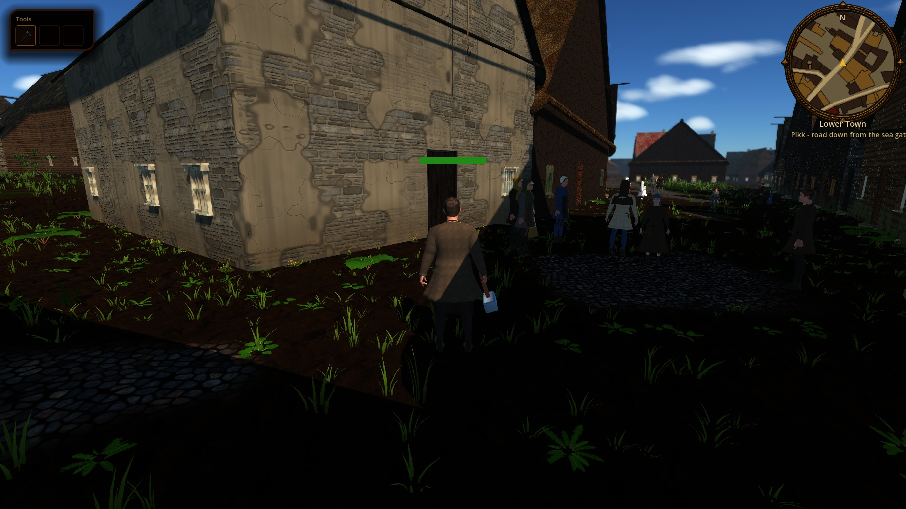
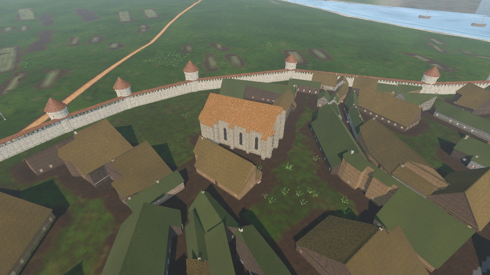
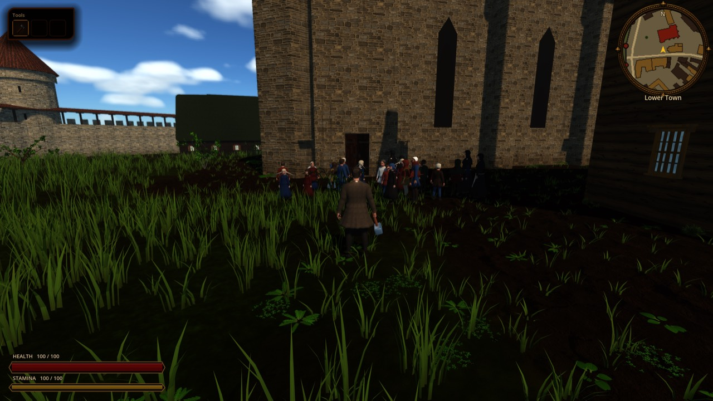

# Historical walk coverage ledger

Status: living ledger, updated by each historical-plausibility playtest walk.

One row per location of the ADR 0031 seamless Reval city (`content/world/reval_city/plan.json` districts and ADR 0032 landmark sites) and its hinterland. Each walk picks the least recently visited or lowest rated rows first so that no area is richly detailed while another stays empty. Findings go to the task board (`tasks` tool, tag `#historical-walk`), never into this file as a backlog.

Ratings are 1-5 against the best-developed location (the bar): **A** architecture, **P** props, **V** vegetation and terrain, **L** people and life, **S** audio and ambience. "-" means not yet rated; from 2026-10-09 on, **S** stays "-" until someone actually listens in the running game (screenshots cannot rate sound), and **Avg** is over the rated columns only.

Captures: `docs/reports/images/historical_walk/`, produced with two scratch scripts. Static views extend `tools/capture_reval_city.gd` and override `_shots()` (`tools/godot_render.sh --script ... -- --out=res://build/<dir>`, day progress 0.42). That tool does not stream fauna, fences, forbs or citizens around the camera, so every walk also takes gameplay-camera shots from the live scene (`scenes/world/reval_city/reval_city.tscn` in a host `.tscn`, teleport `city.player`, wait about 6 s for streaming, then save the viewport), as `tools/capture_reval_city_walk.gd` does. Do not rate life or props from static views alone.

## Ledger

| Location | Plan id | Last visited | A | P | V | L | S | Avg | Open tasks |
|----------|---------|--------------|---|---|---|---|---|-----|------------|
| Toompea plateau and Danish castle | `district.toompea` | 2026-10-09 | 2 | 1 | 2 | 1 | 2 | 1.6 | R-1462, R-1463, R-1464, R-1465, R-1466, R-1470, R-1471; legacy-targeted R-1128, R-967, R-293 |
| Kalarand fishing shore | `district.kalarand` | 2026-10-09 | 2 | 2 | 2 | 1 | 2 | 1.8 | R-1467, R-1468, R-1469, R-1470; R-1347 (LIFE-4 fishers) |
| Lower Town streets: Pikk/Lai (bar, provisional) | `district.lower_town` | 2026-10-11 (captured; visual review pending) | 4* | 2* | 3* | 3* | - | 3.0* | R-1465, R-1657 |
| Town Hall square and market | `site.raekoja_plats`, `poi.forum` | 2026-10-10 | 3 | 2 | 2 | 2 | - | 2.3 | R-1610, R-1611, R-1612, R-1616, R-1465, R-1323 |
| Holy Spirit church and almshouse | `site.holy_spirit` | 2026-10-10 | 3 | 1 | 2 | 1 | - | 1.8 | R-1613, R-1614, R-1615, R-1434; legacy-targeted R-1126 |
| St Olaf's | `site.st_olaf` | 2026-10-11 | 3 | 1 | 2 | 1 | - | 1.8 | R-1650, R-1653, R-1655, R-1656, R-1657, R-1613, R-1614, R-1470 |
| St Nicholas' | `site.st_nicholas` | 2026-10-11 | 3 | 2 | 1 | 1 | - | 1.8 | R-1651, R-1652, R-1654, R-1657, R-1613, R-1614, R-1470; legacy R-1119 (retarget note) |
| St Mary's (Dome church building site) | `site.st_mary` | 2026-10-11 (captured; visual review pending) | 4* | 3* | - | 2* | - | 3.0* | R-1678, R-1679; shared checks R-1613, R-1614 |
| St Catherine's Dominican friary | `landmark.st_catherine` | 2026-10-11 | 2 | 1 | 1 | 1 | - | 1.3 | R-1718, R-1721, R-1722, R-1723; legacy-targeted R-1124 (retarget note) |
| St Michael's Cistercian nunnery | `landmark.st_michael` | 2026-10-11 | 2 | 1 | 1 | 1 | - | 1.3 | R-1719, R-1720, R-1721, R-1722, R-1323; legacy-targeted R-1130 (retarget note) |
| Harbour and Coastal Gate | `harbour`, `gate.coastal` | 2026-10-10 | 3 | 2 | 1 | 2 | - | 2.0 | R-1542, R-1543, R-1465, R-1470; legacy-targeted R-206, R-208, R-298 |
| Viru road suburb | `district.viru` | 2026-10-09 | 2 | 1 | 2 | 2 | - | 1.8 | R-1504, R-1545, R-1434, R-1470 |
| Cattle-road farmsteads | `district.karja` | 2026-10-10 | 2 | 1 | 2 | 2 | - | 1.8 | R-1544, R-1545, R-1546, R-1465, R-1434, R-1323 |
| Harju-road houses | `district.harju` | 2026-10-10 | 2 | 1 | 2 | 2 | - | 1.8 | R-1594, R-1592, R-1465, R-1434, R-1545, R-1323 |
| Vassal yards below the castle | `district.toompea_foot` | 2026-10-09 | 2 | 2 | 1 | 2 | - | 1.8 | R-1503, R-1545, R-1434, R-1470 |
| Hinterland fields, pastures and woods | `fields`, `pastures`, `woods` | 2026-10-10 | - | 2 | 2 | 2 | - | 2.0 | R-1591, R-1592, R-1593, R-1595, R-1596, R-1544 |

*Walk 7 starred ratings are provisional data/detail-coverage estimates, not visual acceptance. Pikk/Lai A/P/V retain the earlier bar estimates; L uses scheduler/live-actor evidence. St Mary A/P reflect authored construction detail; L reflects misbound institutional schedules. Terrain and audio cannot be newly rated without image/listening access. Starred averages must not be used to claim visual parity. Earlier unstarred ratings remain historical observations, not revalidated here.*

## Walk log

### 2026-10-09 - Toompea and Kalarand

Captures: `toompea_castle_aerial`, `toompea_castle_forecourt`, `toompea_kohtu_street`, `toompea_toom_ruutli`, `toompea_overview_n`, `toompea_short_hill_gate`, `kalarand_aerial`, `kalarand_beach`, `kalarand_village`, `kalarand_boatwright`, `kalarand_from_sea` (all `.jpg` in `images/historical_walk/`).

**Toompea.** Dense stone vassal houses and the Dome church building site with scaffolding fit the dossier (`history/dossiers/architecture/toompea-castle-and-upper-town.md`). Biggest breaks: the Danish castle bailey is empty grass (R-1462); every Toompea wall segment is a 5 m crenellated stone curtain although the masonry barrier toward the Lower Town is attested only for 1454-1455 (R-1463); the wall-walk roof floats on slopes (R-1464); shingle roofs read as green camouflage (R-1465, city-wide); streets carry no props, yard walls or people (R-1466). Audio is the music theme only (R-1470). Idea: the Lower Town watch shuts the wooden hill gates at night (R-1471). Older castle and curiae tasks (R-1128, R-967, R-293) point at the retired `toompea_quarter.rrmap`; R-1128 now carries a retarget note.

**Kalarand.** Net yards, clinker boats and the beach fit `history/dossiers/topography/kalamaja-fishing-shore-1343.md`. Biggest breaks: the sea ends about 52 m offshore, so the bay reads as a canal with a green plain beyond (R-1468); 24 identical huts on a lawn instead of a few huts with smoke and salt sheds, splitting tables and fish racks (R-1467); the boatwright yard is untextured primitives (R-1469).

**Consistency gap.** The Lower Town and its five landmark sites have bespoke builders, interiors and citizens. Toompea, the second political pole of the story, has generic house shells, an empty castle and no street life, and the outer districts (Kalarand, Viru, Karja, Harju) are uniform log-and-thatch huts on lawn. Next walks: Viru road suburb and Vassal yards below the castle (not yet visited), then the Harbour.

### 2026-10-09 - Viru road suburb and Vassal yards below the castle (backfilled 2026-10-10)

Captures: `hw2_viru_overview`, `hw2_viru_road`, `hw2_viru_yard`, `hw2_viru_runtime`, `hw2_foot_overview`, `hw2_foot_road`, `hw2_foot_yard`, `hw2_foot_runtime`, `hw2_lower_town_bar`, `hw2_bar_runtime`. This walk filed its tasks but did not update the ledger or commit the captures; the 2026-10-10 walk added both.

**Viru.** 21 houses on a road through lawn and scattered trees, no service outbuildings (Toompea foot has 38). Census has carpenter, carter and gardener households, and the runtime loads about 30 citizens, so the gap is readable work yards, not population (R-1504). Window rhythm on smoke dwellings was sent to the window review (R-1434).

**Toompea foot.** Dense log yards with outbuildings below the cliff. All 12 households are classified poor, including a knight of the Danish crown and crown clerks with labourer status (R-1503). Ground is bare lawn with brown yard pads.

### 2026-10-10 - Harbour and Coastal Gate, Cattle-road farmsteads

Captures: `hw3_harbour_aerial`, `hw3_harbour_strand`, `hw3_harbour_to_gate`, `hw3_harbour_to_sea`, `hw3_harbour_from_roads`, `hw3_harbour_runtime`, `hw3_karja_aerial`, `hw3_karja_road`, `hw3_karja_gate_mill`, `hw3_karja_farmyard`, `hw3_karja_farm_above`, `hw3_karja_runtime`, `hw3_karja_road_runtime`.

**Harbour.** What fits `history/dossiers/topography/harbour-and-shoreline.md`: open roadstead with cogs at anchor, two short timber jetties, one treadwheel crane, no stone quay, a low Coastal Gate, a broken sandy shore. Biggest breaks: the strand is painted with a fieldstone paving lattice and carries dandelions and meadow grass down to the jetties (R-1542). The landing has no cargo work: no lighters at the jetties, carts, plank stacks or rope, and about 20 citizens stand idle in one clump by a shed (R-1543). Correctly absent: a customs house or toll booth (no 1343 harbour tariff is attested, `history/dossiers/economy/reval-harbour-customs-1340s.md`).

**Karja.** The 13 farmsteads have the right building types (barn-dwelling, byre, granary, pigsty, sheep shed, henhouse), and hens and sheep spawn at runtime. Biggest breaks: no fields, gardens, orchards or yard fences inside the district (0 of 99 fields), so it reads as barns on a lawn (R-1544). Yard pads end in stair-stepped grid edges (R-1545, also Viru and Toompea foot). Pale round blotches on the thatch (R-1465 widened from shingle to thatch). A lattice window on a barn-dwelling (R-1434 addendum). Knee-high summer grass and flowering dandelions in April (R-1323 note). Correctly absent: a mill or barbican at the Cattle Gate (`history/dossiers/topography/karja-gate-leaf-state-1343.md` excludes both). New idea: St George's Day cattle drive-out on 23 April, research first because the custom is attested only in later folklore (R-1546).

**Consistency gap.** The Lower Town (average 2.6) is still the only place with dressed streets and work. All five extramural areas now rated (Toompea, Kalarand, Viru, Toompea foot, Karja) sit at 1.6-1.8, and the main commercial entrance (the harbour, 2.0) has the buildings but none of the activity that justifies them. The shared causes are city-wide, not per district: blotched roof materials, splat-grid yard edges, a summer sward in April, and citizens that stand instead of working. Fixing those four once (R-1465, R-1545, R-1323, R-1543 activities) lifts every outer district together. Next walks: Harju-road houses and the hinterland fields, then the Lower Town on foot (it has only been rated from older captures) and the landmark sites.

### 2026-10-10 - Harju-road houses and the hinterland west of them

Captures: `hw4_harju_aerial`, `hw4_harju_gate_out`, `hw4_harju_road`, `hw4_harju_yard`, `hw4_harju_to_fields`, `hw4_fields_aerial`, `hw4_fields_eye`, `hw4_wood_edge`, `hw4_east_country` (static), `hw4_rt_harju_road`, `hw4_rt_harju_yard`, `hw4_rt_fields`, `hw4_rt_pasture` (gameplay camera; the runtime clock reached dusk by the pasture shot, so the wood edge was rated from the static view only), and `hw4_farm_field_rye_game`, `hw4_farm_pasture`, `hw4_farm_yard_barn_dwelling` from `tools/capture_city_farmland.gd --tag=hw4` (21 April). Hinterland **A** is "-": its only buildings are the farmsteads rated under Karja and Harju.

**Harju.** 18 farmsteads (69 buildings) in a loose cluster on both sides of the road from the Smiths' Gate, with the right rural types (smoke cottages, barn-dwellings, byres, sheep sheds) and no chimneys, which fits `history/dossiers/architecture/rural-smoke-dwelling-and-farmstead-1343.md`. Garden beds with seedlings line the road and cattle stand at the gate, so at gameplay height it reads better than from above. Biggest breaks: yards are bare mud pads with no well, cart, woodpile or manure heap (R-1594); painted red doors and two framed windows per gable on peasant cottages (R-1434 addendum); blotched thatch (R-1465 addendum). The gate itself fits `walls-gates-towers.md` (plain gate tower, no foregate); the red shutters with white cross match Reval's lesser arms (CANON line on the Dannebrog), so not filed.

**Hinterland.** Crops follow the date, crofts have wattle, pole and stone fences, hay ricks and stock, orchards stand beside the farms. Biggest breaks: every winter-grain strip renders as a pale white-grey slab, which reads as snow from any distance (R-1591, visual bug); `road.toompea_south` crosses four sown strips (R-1592); fields are about 10 ha in small islands on a uniform mown lawn, where the dossiers describe open strips and hay meadows dominating (R-1593); woods are spaced trees on lawn with no understorey or forest floor (R-1595). New idea: an April ploughing team as ambient life, which lifts a FARMLAND non-goal and needs approved art (R-1596).

**Consistency gap.** Every extramural area now has a row; all sit at 1.6-2.0 against the Lower Town's provisional 2.6. The farm suburbs (Karja, Harju, Toompea foot) share one generator and the same four faults: bare yards, blotched roofs, stair-step pads and a summer lawn instead of April ground. One pass on the farmstead generator (R-1594, R-1545) and the ground (R-1591, R-1593, R-1323) lifts all three districts and the country together. Next walks: the Lower Town on foot (still rated only from older captures), then the landmark sites (Town Hall square, Holy Spirit, St Olaf's, St Nicholas'), which have no rows rated yet.

### 2026-10-10 - Town Hall square (market) and Holy Spirit church

Captures: `hw5_forum_aerial`, `hw5_forum_to_hall`, `hw5_forum_from_hall`, `hw5_forum_west`, `hw5_forum_stalls`, `hw5_holy_aerial`, `hw5_holy_almshouse`, `hw5_holy_south`, `hw5_holy_north_windows` (static), `hw5_rt_forum`, `hw5_rt_forum_west`, `hw5_rt_hall_door`, `hw5_rt_forum_noon`, `hw5_rt_holy_south`, `hw5_rt_holy_nw` (gameplay camera). The runtime clock ran to dusk again by the church, so the second run sets `city.runtime.cycle_progress = 0.45` before each shot (scratch script `build/hw5/hw5_runtime.gd`). Pin the clock in every future runtime walk.

**Town Hall square.** The council hall fits `history/dossiers/topography/raekoja-plats-extents-1343.md`: one-storey limestone hall, tile roof, stepped gables with blind lancets, no arcade or tower, shuttered windows, town banners, pillory on the open ground, no well (R-1207). It is the best single building walked so far. Biggest breaks: the forum renders as wall-to-wall cobbles at street level because the plan builder blends paving uniformly over the polygon instead of laying patches (R-1610); all 18 houses round the market are one-storey log or plank barns under thatch or shingle with their eaves to the square, and none is stone or tiled (R-1611); at late morning about six citizens stand on the market, a horse stands inside a stall, and the stalls carry few goods (R-1612). Knee-high summer grass along the house fronts is the April sward issue (R-1323). Idea: council notices read from the hall doorway on market days (R-1616).

**Holy Spirit.** Massing fits `history/dossiers/religion/churches-and-religious-houses.md`: two-aisle hall, lower choir, almshouse wing, crow-stepped gables, timber bell turret, no 1360 tower or vaults; the site touches Pühavaimu and Saiakang as it should. Biggest breaks: the church stands on an earthen berm about 1 m high (R-1613, visual bug); the lime render is flat, untextured white that blooms in daylight (R-1614); the precinct is generic lawn with a vegetable bed and a plank shed against the south wall, and there is no churchyard or almshouse yard (R-1615, research first: the dossier says each parish had a cemetery but maps cemetery greens only at St Nicholas and St Olaf). Interior not walked. A plastered house on Pikk nearby has large clear-glazed grid windows (R-1434 third addendum). Nobody was seen at the church at midday.

**Consistency gap.** The landmark models are now ahead of their setting. The Town Hall and Holy Spirit are bespoke and dossier-checked, but they stand in a ring of the same one-storey timber barns used in the farm suburbs, on a lawn or on blanket cobbles, with almost no people. The Lower Town core round its two civic buildings rates no better than Harju or Karja on props and life. The highest-leverage fix is the plan-builder pass on forum frontage and ground (R-1611, R-1610), followed by market-day life (R-1612), not further landmark detail. Next walks: St Olaf's and St Nicholas', then the Lower Town streets on foot (still rated only from older captures).

### 2026-10-11 - St Olaf's and St Nicholas'

Captures: `hw6_olaf_aerial`, `hw6_olaf_west`, `hw6_olaf_south`, `hw6_olaf_east`, `hw6_olaf_tower_yard`, `hw6_nic_aerial`, `hw6_nic_west`, `hw6_nic_south_chapel`, `hw6_nic_north_porch`, `hw6_nic_east` (static), `hw6_rt_olaf_west`, `hw6_rt_olaf_south`, `hw6_rt_olaf_east`, `hw6_rt_olaf_north`, `hw6_rt_nic_south`, `hw6_rt_nic_north`, `hw6_rt_nic_west`, `hw6_rt_nic_east` (gameplay camera, clock pinned at 0.45). A static north view landed inside a house and was dropped; `hw6_rt_olaf_west` and `hw6_rt_olaf_north` are against house walls west and north of the church. Interiors not walked.

**St Olaf's.** Massing fits the site's period notes and `history/dossiers/religion/churches-and-religious-houses.md`: short tiled hall nave with crow-stepped gables, lower chancel, massive unfinished west tower with putlog scaffold, hoist jib and a provisional belfry, no 1364+ upper tower or spire. Biggest breaks: no churchyard at all although every parish had one (R-1650); the vaulted nave has no buttresses, unlike St Nicholas' and the retired map-view model (R-1653); long dark lines cross the sky between roofs and read as power cables (R-1655, visual bug, source not yet identified); the building site has a cart and two stone stacks and nobody working (R-1656). The east chancel stands on a grassy mound (R-1613 widened). The "grey limestone rubble" renders warm beige with brick-like coursing (R-1614 addendum).

**St Nicholas'.** The best-argued 1343 phase so far: buttressed hall with chancel and sacristy, low whitewashed west tower with blind arcading, the 1342 St Barbara chapel inside a cemetery of 26 graves. Biggest breaks: the church sits on a 2 m terrace with a turf cliff, caused by `terrace.level.outside_m: 2.0` in both site JSONs (R-1613 addendum); the cemetery has no wall, gate or paths and the crosses stand in knee-high meadow (R-1651); the attested north porch reads as a floating dark slab over a flush portal (R-1654); the wealthiest parish stands alone in about 100 m of inner-town lawn towards the Harju Gate (R-1652, research first). The white tower blooms like the Holy Spirit render (R-1614 addendum). R-1119 (St Nicholas "completely missing", retired rrmaps) got a retarget note.

**Both.** Nobody at either church at midday (R-1657, church-door routines for all three parishes). Parish bells and the masons' yard added as test points to the ambience item (R-1470).

**Consistency gap.** All four Lower Town landmark sites are now rated, and the pattern from the Town Hall and Holy Spirit repeats: bespoke, dossier-checked church shells (A 3) on a raised turf pad in lawn or meadow, with no precinct (churchyard, paths, enclosure) and no people (V 1-2, L 1). The landmarks are ahead of their ground and their life. The highest-leverage fixes are shared, not per church: the site terrace rule (R-1613), one shared churchyard routine used by St Olaf's, St Nicholas' and, after research, Holy Spirit (R-1650, R-1651, R-1615), and church-door routines (R-1657). Next walks: the Lower Town streets on foot (still rated only from older captures, so the bar itself is unverified), then St Mary's (Dome church building site) at street level, and the Dominican and Cistercian precincts, which have no rows yet.

### 2026-10-11 - Walk 7: Pikk/Lai and St Mary's, capture + data review (partial)

**Selection:** the Lower Town bar had never been walked and St Mary had only been seen from afar. Both were selected before revisiting recently rated churches. No runtime, content, asset or generator implementation was changed.

**Evidence and limits:** 13 fresh JPEGs under `images/historical_walk/`, prefixed `hw7_`; [capture manifest](images/historical_walk/hw7_manifest.json) includes dimensions, hashes, scratch capture script bodies and renderer/counter caveats. Base HEAD `aa048fba`, with concurrent uncommitted runtime edits: these are working-build observations, not clean-main acceptance. Static capture extends `tools/capture_reval_city.gd`; live capture instantiates `reval_city.tscn`, teleports to named street points/three cathedral approaches, waits seven seconds and resets daylight to 0.45, with citizen time pinned to 10:00. This is a sampled player-camera visit, **not a continuous collision/pathfinding walk**. Both captures exit 0; runtime has texture UID fallback and shutdown resource-leak warnings. No assertion-suite pass is claimed.

**Visual-review blocker:** browser screenshot returned a filesystem path, not inspectable image pixels; text-read of JPEG cannot inspect it. The independent `dev-code-reviewer` also reported no pixel access. No new screenshot-based anachronism, terrain defect, clothing judgment or visual approval is claimed. Audio was not listened to. Captures are supplied for human inspection, and both rows remain pending visual review. Existing shared roof, church-render and terrace tasks were not duplicated or declared reproduced. The review checked evidence/scope only; a later parent data audit confirmed the institution-routing defect below.

**Lower Town data assessment:** Pikk has 39 street-associated buildings: 7 limestone, 6 plaster, 14 plank, 12 log; roofs 7 tile, 19 shingle, 13 thatch. Lai has 45: 11 limestone, 1 plaster, 12 plank, 21 log; roofs 11 tile, 14 shingle, 20 thatch. These are associations in the plan, not measured street frontage percentages. [Pikk/Lai frontage dossier](../../history/dossiers/topography/pikk-lai-frontage-materials-1340s.md) attests the coexistence of timber and stone, but cannot assign exact 1343 facades: every plot-level arrangement remains **plausible composite**. Do not turn later architectural remains into a mandate for all-stone streets. Nearby streamed citizen counts were 32, 33 and 34 at Pikk, Lai and north Pikk; these are not visible population counts. Street life is implemented, so no new 'empty streets' task is justified from these captures alone.

**St Mary data assessment:** the authored construction phase includes completed choir/vestry, a partly completed nave, timber centering/scaffold, treadwheel crane, four stone stacks, cart, masons' lodge with banker/templates, lime pit and detached belfry. Thus this precinct's props are ahead of St Olaf's two-stack/cart yard in walk 6. The rebuilding programme and cathedral chapter/school are **attested**; precise April 1343 construction progress and yard arrangement are **plausible composite**. Later tower/helm (1779), pulpit (1686), monuments and box pews are explicitly excluded in site notes. Unknown details use simplified later forms only where no later date rules them out. Sources: [church dossier](../../history/dossiers/religion/churches-and-religious-houses.md) and [Toompea dossier](../../history/dossiers/architecture/toompea-castle-and-upper-town.md). Neither interior nor liturgical sound was inspected.

**Concrete finding, R-1678 (P1):** all 37 `hh.inst_st_mary_chapter` residents inherit a missing old building anchor: census `building=bldg.osm.w26902813`, `door=null`, `xy=[0,0]`; runtime home becomes `[2.5,0.0]`. Canon `cit.tp.inst_st_mary_chapter.001` works/prays at `[178.37,-37.32]`, by St Catherine's in the Lower Town. The generator sees only three old building church candidates, omitting new landmark sites. This misrepresents separate episcopal/cathedral and Lower Town institutions. Their exact homes are composite, but relocation to the generic origin is a demonstrable data fallback, not historical uncertainty. Repair source bindings, not population quantity. Nearby actors at cathedral viewpoints numbered 8/21/21, not zero.

**Existing finding updated, R-1657:** parish-door routine task now records the shared site-resolution omission; repair routing before adding more people. Do not add a second posted-NPC system or duplicate existing school/cleric schedules.

**New bounded idea, R-1679 (P3):** after R-1678, assign a small approved subset of existing residents to a cathedral-school doorway routine. School by 1319 is **attested**; chosen pupils, hours and route are **plausible composite**. Currently 236 school-pattern residents have no school target within 80 units of the cathedral; this does not mean all should study there. Reuse walk/idle and wardrobe, no school minigame. Catalog query found no usable writing tablet, so no uncatalogued tablet/book should be placed; any art requires exact-file P0-040 approval. Scope expansion would require an ADR, not permission implied by this idea.

**Consistency gap:** the richest authored landmark construction kit can coexist with fundamentally wrong social destinations. St Mary's has more construction dressing than St Olaf's, yet its entire chapter is anchored to the wrong district; Pikk/Lai has the mixed merchant fabric missing from the market-frontage sample. Priority should be consistent institution/site bindings and ground/life integration, not another pass of landmark ornament. This is a data-supported comparison, not a new visual ranking. Next: human review of these 13 images and an audible ambience pass; then add/visit the still-unrated Dominican and Cistercian precincts.

Representative evidence (awaiting pixel-level review):

### 2026-10-11 - Walk 8: St Catherine's Dominican friary and St Michael's Cistercian nunnery

Captures: `hw8_cath_aerial`, `hw8_cath_east`, `hw8_mich_aerial`, `hw8_mich_south_door`, `hw8_mich_west`, `hw8_mich_east` (static, `tools/capture_reval_city.gd` override), `hw8_rt_mich_south`, `hw8_rt_mich_west` (gameplay camera, clock pinned at 0.45 and citizen hour 10:00). Scratch scripts in `build/hw8/` follow the walk 7 manifest pattern. Five more views (St Catherine north door, south and west; St Michael north; St Catherine runtime) landed inside or against houses that stand hard against both churches, which is itself the main finding; they were dropped. Images were reviewed at pixel level this time. Audio not listened to. Interiors not walked.

**St Catherine's.** Neither precinct is an ADR 0032 site: the friary is the generic plan church shell (`bldg.osm.w26885940`, about 33 x 25 m, no tower) with 36 ordinary log and plank houses within 70 m, some touching its walls, and the only friary data is `poi.well.dominican`. There is no cloister, claustral range, precinct wall or service yard. `history/dossiers/religion/ecclesiastical-precinct-boundaries-1343.md` asks for an enclosed close between Vene and the curtain with the church south, a cloister garth north, and no strip housing inside; `dominican-brewery-fish-yard-1343.md` adds the brewery, stable and fish-transfer yard (R-1718). The church exterior itself (buttressed limestone hall, lancets, tile) is a fair simplified form.

**St Michael's.** The same shell (`bldg.osm.w26889132`) stands in meadow grass among 17 ordinary houses, with no close wall, gate, nuns' range, service wing, garden or orchard, where the dossier's art line is "garden, wall, service wings" (R-1719). All 35 curtain segments are finished stone; the 1340s nunnery-wall tie-in should be an active building site in April 1343 (R-1720, research first to name the segments). Knee-high grass round the church is the April sward issue (R-1323).

**Both, people.** All 38 friary and 40 nunnery residents have the church door as `home` (`citizens.json` places 586 and 587), so at 10:00 about 25 people stand in one clump at St Michael's door (`hw8_rt_mich_south`). Of the nunnery, 25 have well errands, 20 market errands and 23 stroll, choir nuns included, which breaks enclosure (R-1721, same institution-binding family as R-1678). Friars and nuns wear the generic dark brown cleric cloth, with no white habit, black cappa or veil to set them apart (R-1722, `clothing-and-status-markers.md`). New idea: Dominican preaching and alms-questing in the eastern lanes with the existing scheduler (R-1723). R-1124 and R-1130 still target retired rrmaps and got retarget notes.

**Consistency gap.** The four parish churches and St Mary's are bespoke ADR 0032 sites with builders, terraces, scaffolds and dossier notes. The two religious houses, which together hold about 80 residents and two of the largest precincts of the 1343 town, are untouched generic shells in strip housing (average 1.3, lowest in the ledger). The landmark-site programme stopped at the parishes. Adding both precincts as sites (R-1718, R-1719) is the prerequisite for everything else here, and for R-1678's institution binding. Next walks: revisit Toompea and Kalarand (oldest rows, 2026-10-09), then the Viru and Toompea-foot rows.

