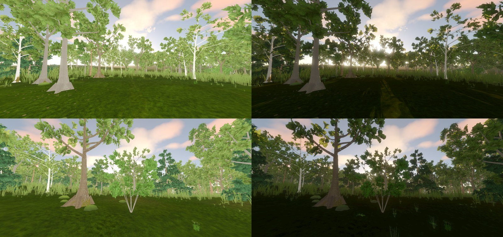
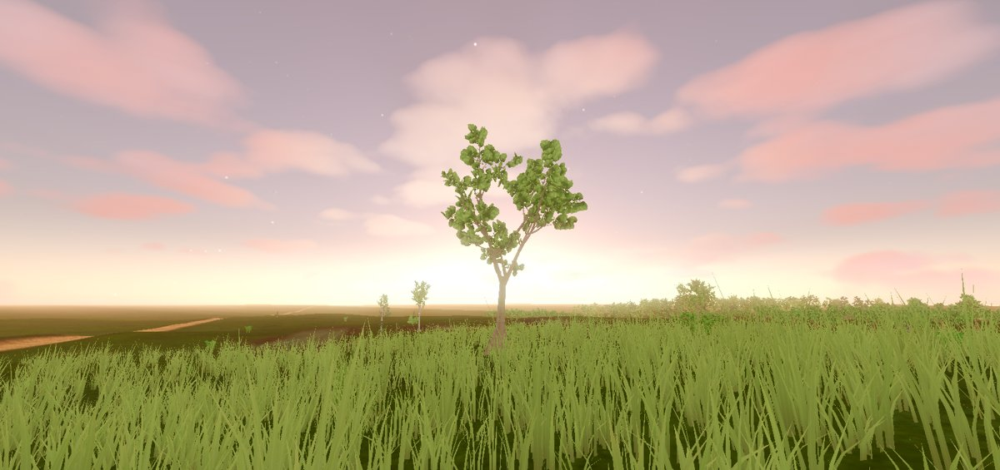

# Witcher-style backlit forest: gap analysis (2026-10-11)

Question: can the current tree and lighting systems reproduce a Witcher 3 golden-hour shot (a broad veteran oak and a wood silhouetted against a low sun, light glowing through leaf gaps, near-black foreground, warm pale sky, dirt path through flowering grass)? If not, what must improve?

**Answer: not yet.** Lighting alone gets the mood about halfway; tree form, crown density and light scattering through foliage are missing.

The reference screenshot is not stored in the repository (third-party copyright).

## Method

`tools/capture_backlit_forest.gd` frames the largest oak and the densest stand of the seamless city (`CityWorld3D`, 15 July 1343, clear sky, 18.6 h, sun 8 degrees up) against the sun, twice:

- **stock**: the shipped grade (R-1537, R-1748);
- **tuned**: hypothesis probe only, not shipped. Sky ambient x0.18, exposure x0.75, sun energy x1.6, glow 0.6 with bloom 0.15.

The probe mounts only `CityWorld3D`; the `CityMapView` AO, god-ray and haze passes are not in these plates.

*Left stock (mean luma 134 / 124), right tuned (81 / 72). The reference reads around 40-50.*

*Earlier probe pass: the most open oak against a setting sun, stock grade.*

## What already works

- Low sun colour, sky gradient and clouds; long shadows appear once ambient drops (tuned plates).
- The sun is visible through trunk gaps, and AgX plus glow give a usable glare when glow is raised.
- The canopy shader already has a chlorophyll-shifted `BACKLIGHT` term; it shows as yellow-lit leaf edges in the tuned plates.

## Gaps, by impact

### Lighting

1. **Backlit scenes are flat-lit.** `OUTDOOR_DAY_EXPOSURE_GAIN` (1.9) and `AMBIENT_DAY_ENERGY` (2.1) from R-1748 tune frontlit streets. Against the sun they fill every shadow: the stock foreground is a bright lawn instead of a silhouette. Needs view-dependent exposure (simple eye adaptation or a sun-facing exposure term) and ambient that falls with sun elevation.
2. **No canopy occlusion of sky light.** The ground and lower crowns under a wood get the full sky ambient. AO is screen-space, city-only and short-range (2.4 m). Needs a coarse canopy-density map (the moss `CityShadeMask` canopy channel is a start) that darkens ambient on ground, grass, trunks and inner crowns.
3. **God rays ignore trees.** `god_ray_pass.gd` marches a raster of building and landmark heights only, so no shafts form through foliage. Either add crown volumes to the raster or add a screen-space radial scattering pass masked by sky visibility.
4. **Weak glare through leaves.** Glow threshold 1.05 and day intensity 0.2 (`GLOW_INTENSITY_DAY`; `POST_PROCESS.md` still says 0.14) leave no bloom where the sun shines through leaf gaps. The tuned plates show that more glow helps; it needs to scale with how much of the sun disk is on screen, not globally.
5. **Minor:** stars are faintly visible with the sun 1.6 degrees up (`star_visibility = pow(1 - day_blend, 3)`).

### Trees

1. **No veteran oak form.** The largest city oak is 12.3 m with a slim straight bole, closer to a birch. The reference oak is wider than tall, with a massive short trunk and long, twisting, near-horizontal limbs. Needs a veteran or ancient growth form in the Weber-Penn presets (low splits, high limb count, gravity-bent limbs, girth from age), not a scaled-up young oak. The sacred-grove ancient oak GLB is an authored prop outside the tree systems.
2. **Crowns read as blobs of large cards.** Clusters are big and few; crown silhouettes show card planes and no small sky holes. The reference crown is thousands of small leaves with fine gaps and bare twig tips at the edge. Needs smaller, more numerous clusters at the crown edge, a twig level beyond the leaves, and alpha-to-coverage so thin gaps survive mips.
3. **Leaf maps are built but not bound.** `leaf_card_normal.png` and `leaf_card_surface.png` (roughness, translucency, occlusion) from R-1329 are unused; translucency is one uniform per species. Binding them gives per-leaf glow variation in backlight.
4. **Bark and trunk.** Oak trunks in the grove read pale grey-white; the R-1329 oak bark textures are not bound. Root flares are faceted cones.
5. **Understory.** The reference wood floor is dense shrubs, saplings, tall grass and flowers; ours is a lawn texture with sparse grass tufts. Ecology computes shrubs and litter but draws almost none (`shrubs` layer 320 triangles at baseline).
6. **Budget blocker.** Denser crowns are not affordable before the LOD chain: `trees_lod0` is already 14.6x over budget (R-1320). V7 (R-1326) must land first or together.

### Renderer limits (accepted)

The Mobile renderer (ADR 0043) has no volumetric fog, SDFGI or SSIL. All items above are achievable with custom passes as the project already does for AO, haze and god rays; none needs a renderer change.

## Suggested order

1. Backlight exposure and sun-elevation ambient (cheap, biggest mood gain).
2. Canopy ambient occlusion map.
3. Foliage-aware god rays and sun-occlusion glare.
4. Veteran oak growth form.
5. Tree LOD chain (R-1326), then finer crowns, twig level and bound leaf maps.
6. Understory density.

Re-run `tools/godot_render.sh --script tools/capture_backlit_forest.gd` after each step and compare against these plates.
