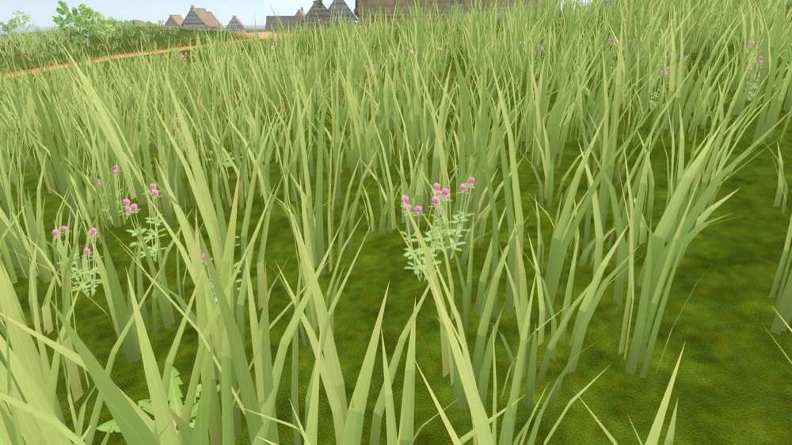
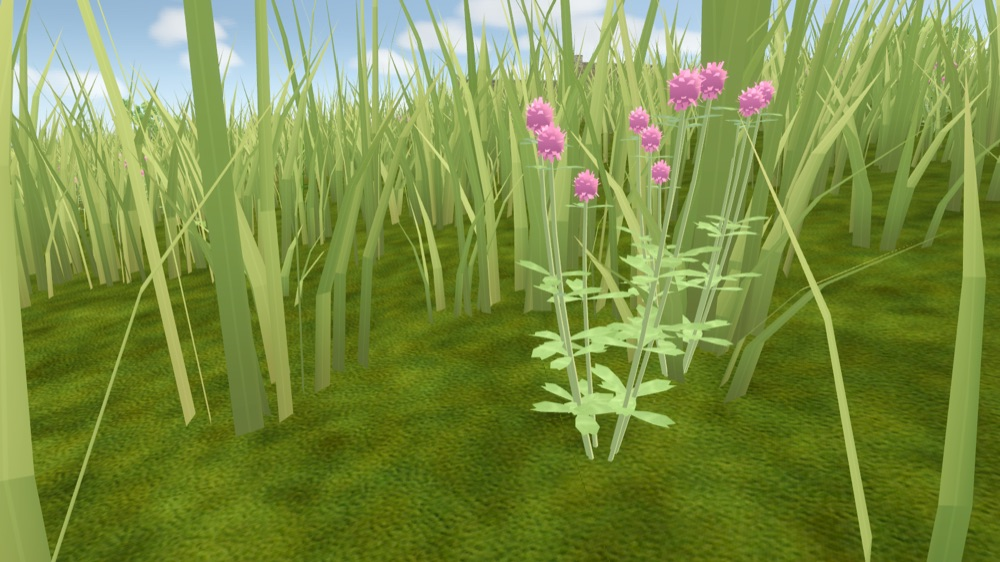

# Witcher-style flower meadow: gap analysis (2026-10-11)

Question: can the current grass and wild-plant systems reproduce a Witcher 3 summer meadow (a drift of oxeye daisies running from the camera to the wood edge, scattered red poppies, tall blue-violet flower spikes, fine dense grass, oaks behind)? If not, what must change in flowers and grass?

**Answer: no.** The streaming, placement and wind pipeline can carry it, but the species, the density model, the grass blades and the far representation cannot. Every gap below is content or tuning inside the existing systems; none needs a new renderer or framework.

The reference screenshot is not stored in the repository (third-party copyright).

## Method

`tools/capture_city_forbs.gd` (summer, 20 July 1343) frames the highest-scoring open meadow spot of the seamless city at eye and knee height. Stock grade, no tuning.

*Our best meadow: a few red clover plants in waist-high, wide, flat-shaded blades over a visible ground texture.*

## What already works

- Chunk streaming with near/mid/far grass tiers, deterministic per chunk (`CityGrass`).
- Habitat-driven forb placement with patch noise (`CityForbs.suitability`), seasonal model swap (`VegetationPhenology.forb_phase`).
- One MultiMesh per model and LOD: adding species costs draw calls, not per-plant nodes.
- Shared wind field, `BACKLIGHT` from vertex alpha in `city_forb.gdshader` (petals can glow in back light once their alpha is set).

## Gaps, by impact

### Flowers

1. **Missing species.** The city grows dandelion, plantain, white and red clover, burdock and sparse yarrow. The reference needs:
   - **Oxeye daisy** (*Leucanthemum vulgare*, native, flowers June-July). Not in the city. `chamomile` exists only as the generic `ARCHETYPE_FLOWER` profile of blueprint maps (`map_view_plant_species.gd`), not as a detailed `CityForbMeshes` model.
   - **Common poppy** (*Papaver rhoeas*). Arable weed that came with cereal farming; plausible on field edges and fallow near Reval in 1343 (medium confidence, needs a `docs/CANON.md` label). Grows at field margins, not in old hay meadow.
   - **Tall blue-violet spikes.** The reference plants are garden lupines (*Lupinus polyphyllus*), introduced to Europe from North America in the 19th century: excluded by the period rule. Period-correct look-alikes: forking larkspur (*Consolida regalis*, rye-field weed), cornflower (*Centaurea cyanus*, rye fields), spiked speedwell / long-leaved speedwell (*Veronica spicata*, *V. longifolia*), tufted vetch (*Vicia cracca*), meadow bellflowers (*Campanula*). Pick 1-2 with the researcher before modelling.
2. **Density model is "individual finds".** `MAX_DENSITY` is 0.12-0.45 candidates per m2 per species, gated by patch noise. The reference drift is tens of flower heads per m2 over tens of metres. Needs a **drift mode**: a species-level patch with high fill, drawn as cluster instances (one instance = a plant with 5-15 heads), so 30-80 heads/m2 cost a few thousand instances, not tens of thousands.
3. **No far representation.** Forbs shrink out at 24-32 m (`SMALL_FADE`) and are gone from the far tier. In the reference the daisy drift reads to the wood edge as a white speckle. Needs a far substitute that follows the same patch field: a flower-colour tint on the mid/far grass clumps or a flower speckle mask in the ground shader (`city_grass_ground.gdshaderinc`), cross-faded with the near meshes.
4. **Head shape and shading.** Daisy heads must be flat, camera-readable discs (ray florets plus a raised yellow disc), facing up-ish with tilt variation. Petal alpha should be high so `BACKLIGHT` lifts them against the sun. The current models stop at small rounded heads (red clover reads as a pink ball).
5. **Phenology and habitat.** Add `FORB_WINDOWS` for every new species (daisy June-July, poppy June-August, larkspur July-August) and a **hay-meadow habitat**: open, unmown until the July hay cut, away from roads. Today wildness depends only on road and house distance, so "meadow" and "neglected verge" are the same field. A poppy/larkspur/cornflower **field-margin** habitat needs the farmland mask (`city_farmland.gd`).

### Grass

1. **Blades are too wide, few and uniform.** Wide flat strips, one yellow-green tone, no seed heads; the ground texture shows between clumps. The reference has fine, dense, darker blades with tone variation, grass flowering stems (timothy, cocksfoot, fescue panicles) and no visible soil. Needs narrower blades with more per clump, per-blade hue and value variation, a seed-head variant, and a darker ground under grass so gaps read as shadow.
2. **Height is wrong for a flower meadow.** Open ground grows to `TALL_SCALE_MAX` 2.7 (waist height). In a flowering hay meadow the grass sits around knee height and the flowers stand at or above it; at waist height the grass hides every daisy (see the plates). Needs a per-habitat height cap: meadow knee-high, neglected ground waist-high.
3. **Grass shading is flat.** No visible self-shadowing or depth darkening inside the sward; the reference sward is dark at the base and bright at the tips. A base-to-tip value ramp in the grass shader would give most of this cheaply.

### Lighting and trees

Covered by [witcher_backlit_forest_gap_2026-10-11.md](witcher_backlit_forest_gap_2026-10-11.md): veteran oak form, crown density, canopy ambient, exposure. The reference here is front-lit midday, so lighting matters less than flowers and grass.

### Budget

Drift mode and denser blades must be measured with `tools/capture_vegetation_benchmark.gd` against `docs/reports/vegetation_benchmark_baseline.md`. Cluster instancing and the far speckle are the levers that keep it affordable.

## Suggested order

1. Researcher: confirm period species for daisy, poppy and the blue spike substitute; add canon labels.
2. Grass: habitat height cap (meadow knee-high), blade width/count, tone variation, base darkening.
3. Oxeye daisy as a detailed `CityForbMeshes` model with phenology, in drift mode with cluster instances.
4. Far daisy speckle tied to the same patch field.
5. Poppy and the blue spike species with the field-margin habitat.
6. Grass seed-head variant.

Re-run `tools/godot_render.sh --script tools/capture_city_forbs.gd -- --season=summer` after each step and compare against these plates.
