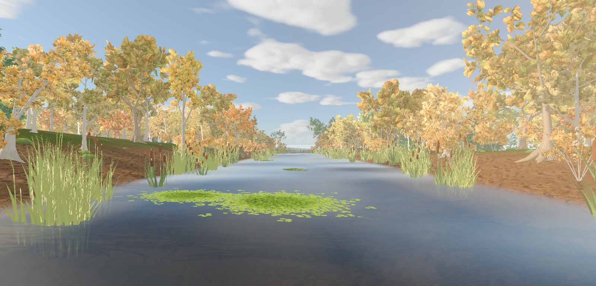
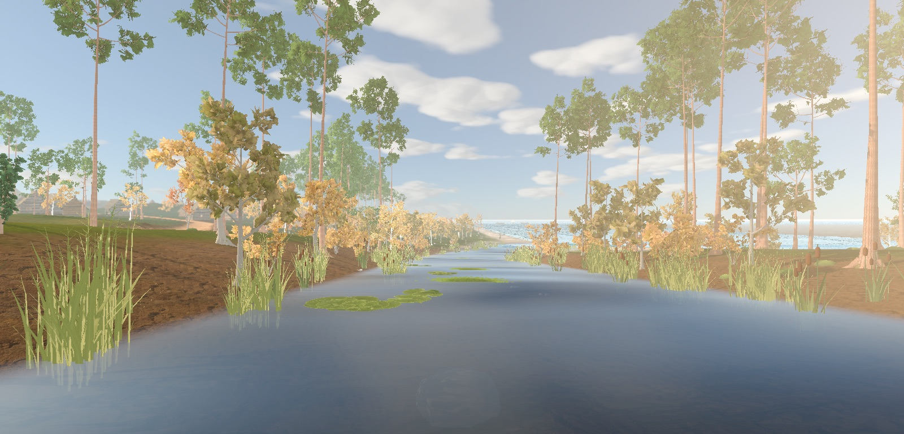
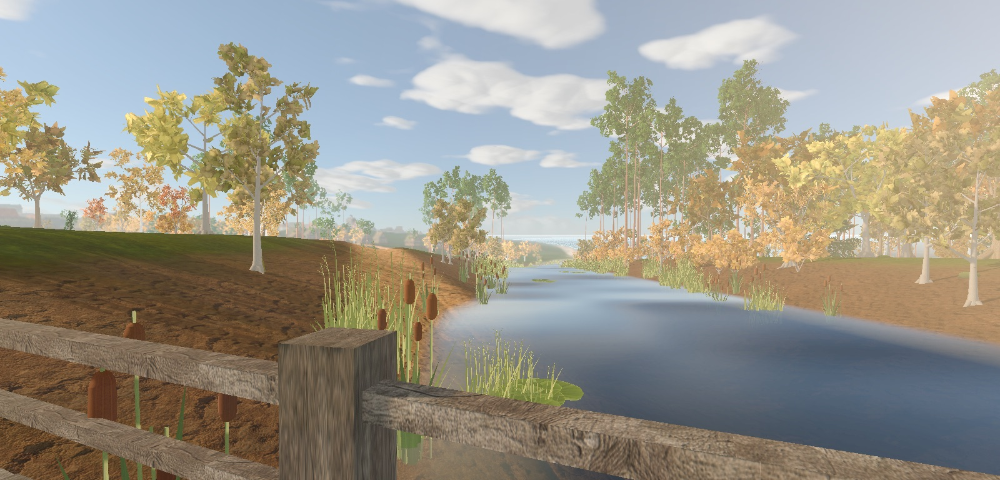
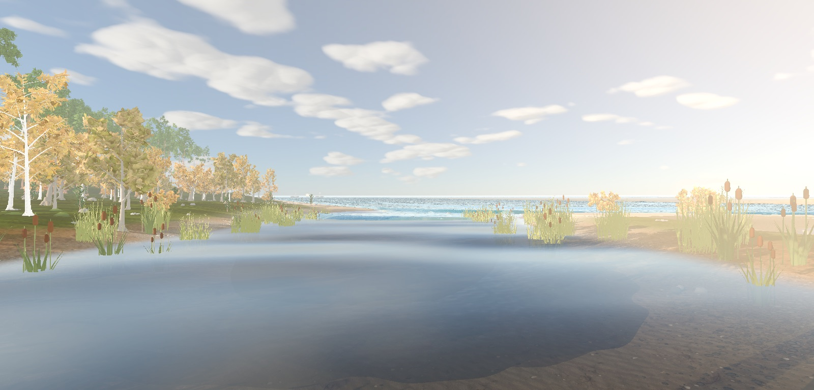

# Witcher-style autumn river village: gap analysis (2026-10-12)

Question: what is missing to reproduce a Witcher 3 autumn river shot (a still river mirroring a red-gold wood and the sky, a log house with a heavy weathered roof on a sandy point, a stone arch bridge, a fisherman in a rowing boat, a mill wheel, reeds and a plank jetty in the foreground, wispy high cloud)? Which models, mechanics and detail, and in what order?

**Answer: the biggest gap is the water, not the trees.** Our stream mirrors nothing, so the half of the frame that carries the reference is empty. The second gap is the grade (milky, low contrast). Then come the bank, the village models and the life on the water. Nothing below needs a new renderer; all of it fits the Mobile renderer with custom passes, as the project already does for AO, haze and god rays.

The reference screenshot is not stored in the repository (third-party copyright; it is probably a modded or graded capture, so its contrast is an upper bound).

## Method

`tools/capture_witcher_river_probe.gd` frames the Hareapea stream in the seamless city (`CityMapView`, full pass stack) on 5 October 1343, day progress 0.68, at 1.6-2.5 m over the water looking downstream. Stock grade, no tuning.

```bash
tools/godot_render.sh --script tools/capture_witcher_river_probe.gd [-- --progress=0.68]
```



*Upper reach: autumn crowns line both banks, but the water shows only a pale sky tint, no trees.*







## What already works

- Seasonal tree colour with a per-species autumn palette (`VegetationPhenology.AUTUMN_COLORS`, two hues per crown).
- The stream ribbon meets the bank at the waterline, with humic colour by depth, downstream ripples, wakes and swimmable pools (`CITY_SEA.md`, *Stream, moat and wake*).
- Reed and cattail belts, lily pads and duckweed (`CityMoatPlants`, R-1749).
- Cumulus and a cirrus layer in the sky shader (`sky_weather_3d.gdshader`).
- A clinker fishing boat (`map_view_fishing_boat_builder.gd`), chimney and smoke-room plumes, log dwellings at Harju, a watermill at Padise.

## Gaps, by impact

### 1. Water: no reflections (largest single gap)

`scripts/city/city_moat_water.gdshader` (stream and moat) has no scene reflection: it shades a murky body and gets only the sky radiance through Godot's standard GGX specular (roughness 0.22, `SPECULAR` 0.35), which blurs the sky into a pale sheen. In the reference the river is a dark mirror: trees, house, bridge and sky are reflected with ripple distortion, and the bank line doubles every silhouette. The Mobile renderer has no SSR.

- **Planar reflection for calm inland water.** The stream and moat are near-flat at known heights, so one reflection camera mirrored about the local surface height, rendering a reduced layer set (terrain, trees LOD1+, buildings, sky) at half resolution into a texture, gives exact mirroring. Distort the lookup by the existing ripple normals. Cost: one extra low-res scene pass, only when inland water is on screen.
- **Alternative: screen-space reflection pass** like the custom SSAO (R-1748). Cheaper, but loses anything off screen (the sky above the frame, the far bank behind the camera) and shows edge artefacts at low camera angles, exactly the reference angle. Prefer planar for the stream.
- **Fresnel and darker body.** At grazing angles the water must be almost all reflection; looking down, the brown bed and depth show. Today it reads milky blue-grey at every angle.
- **Floaters on the mirror.** Duckweed patches read as flat green decals with hard edges; they need broken edges and a few loose fronds.

### 2. Grade and light: milky, flat, noon-like

At 0.68 day progress the plates still look like midday under haze: low contrast, no deep shadows, desaturated distance, a white horizon. The reference has saturated warm light, blue shadows and dark tree bases.

- Same root cause as [the backlit-forest report](witcher_backlit_forest_gap_2026-10-11.md): high outdoor exposure gain and ambient energy (R-1748) fill every shadow. Ambient should fall with sun elevation, and the aerial haze should be thinner on a clear autumn afternoon.
- The per-species autumn colours are there but are washed to one pale yellow. A clear-weather grade with more saturation in mid tones and a slightly cooler shadow tint would let red, orange and yellow crowns separate.
- Canopy occlusion of sky light (dark trunks and understory under crowns) is missing, see the backlit-forest report.

### 3. Banks and shoreline

Our banks are smooth carved slopes with a bare brown mud texture; the reference shore is a sandy point with grass tufts, low shrubs, exposed roots, wet dark mud at the waterline and stones.

- **Wet band at the waterline**: a darker, glossier strip 0.3-1 m above the surface (the terrain shader already knows the water level).
- **Bank cover**: grass and shrubs down to the wet band instead of bare mud; sedge and rush between reeds; occasional stones, driftwood, roots.
- **Shape**: varied bank profiles (low sandy points, undercut banks, a beach where cattle drink) instead of one carved section.
- **Reeds**: flat-shaded uniform pale green blades. Need hue variation, darker bases, seed plumes on common reed (*Phragmites*), and autumn straw tones.

### 4. Village models

The reference house is a large, aged log building with a deep, mossy, sagging roof, lean-tos, a market awning and clutter. Ours: Harju log dwellings are low boxes with clean roofs and empty yards (`REGIONAL_SITES.md` limits); the city suburbs use the shared log/thatch kit.

- **Weathering**: moss and lichen on the north roof side, sagging ridge, rot at the sill logs, grey sun-bleached boards, patched roof sections. Bake into material masks per building, not per instance texture.
- **Silhouette richness**: lean-tos, eaves overhangs, firewood stacks, drying racks for nets, fences, a boat pulled onto the bank.
- **Period caution**: the high thatched silhouette is not cleared for 1343 (R-1632); current canon uses low board-and-bark roofs. Detail must come from weathering and clutter, not a taller roof.

### 5. Water-side structures

- **Plank jetty / landing stage** for the stream and sea shore: a prefab with uneven, weathered, gapped boards on driven piles.
- **Watermill with an undershot wheel and a turning animation**: the Karja gate mill over the moat is uncertain for 1343, Padise has a mill; a stream mill needs a canon check first.
- **Stone arch bridge**: a multi-arch masonry bridge over a rural stream is unlikely for 1343 Reval (period rule: exclude unless attested). Use a timber trestle bridge with weathered piles; the current crossings are thin plank decks with rails.

### 6. Life on the water

- A rowing boat on the stream with an animated fisherman (rod or net), and moored boats at a landing. The clinker boat exists for the sea; it needs a stream-sized variant and a citizen activity (`fish_from_boat`).
- Birds over water, insects at dusk, ripples from rising fish (the fish models of R-1761 exist).

### 7. Trees and sky (covered elsewhere)

- Crown form, leaf density, veteran oak, pale bark: [backlit-forest report](witcher_backlit_forest_gap_2026-10-11.md).
- Mixed wood edge: the reference wood mixes dark conifers with red, orange and yellow broadleaf crowns in a continuous wall. Our banks are a single row of similar birch-like trees and some bare-trunked pines; needs species mix and an understory layer between them.
- Sky: the cirrus layer exists but is faint (`* 0.11` coverage term); a clear autumn preset with stronger, wind-combed cirrus would match the reference.

## Suggested order

1. Planar reflection for stream and moat, with Fresnel and a darker body. Biggest visual gain per effort.
2. Clear-weather grade: lower ambient with sun elevation, thinner haze, mid-tone saturation (shared with the backlit-forest step 1).
3. Wet waterline band and bank cover on the terrain shader; reed hue variation.
4. Jetty prefab, timber trestle bridge, stream boat with a fisherman activity.
5. Building weathering masks and yard clutter for log dwellings.
6. Mixed wood edge and understory; stronger cirrus preset.

Re-run the probe after each step and compare against these plates.
